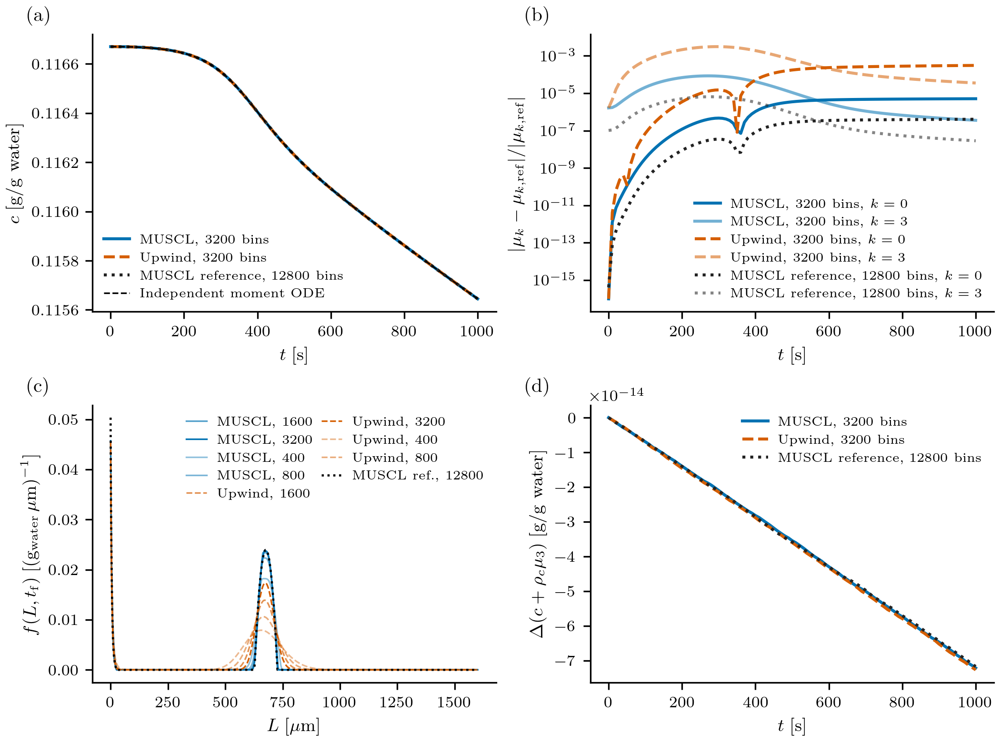

# PopulationBalanceModels.jl

[](https://github.com/pavaninguva/PopulationBalanceModels.jl/actions/workflows/CI.yml)
[](https://pavaninguva.github.io/PopulationBalanceModels.jl/dev/)
[](Project.toml)
[](LICENSE)

PopulationBalanceModels.jl models the evolution and steady states of **particle
and cell distributions**. Define physical mechanisms independently of their
numerical treatment, couple populations to bulk balances, and compare predictions
with observations. The same forward models support parameter estimation and
uncertainty propagation.

Compose [growth, nucleation, aggregation, breakage, removal and growth-rate dispersion](https://pavaninguva.github.io/PopulationBalanceModels.jl/dev/defining_models/)
through `PBMModel`, then choose their numerical treatment separately.

[Documentation](https://pavaninguva.github.io/PopulationBalanceModels.jl/dev/) ·
[Getting started](https://pavaninguva.github.io/PopulationBalanceModels.jl/dev/getting_started/) ·
[Case studies](https://pavaninguva.github.io/PopulationBalanceModels.jl/dev/case_studies/) ·
[Examples](examples/README.md)

## Install from source

Use Julia **1.10 or newer**. For the development version, clone the repository
and activate its environment:

```sh
git clone https://github.com/pavaninguva/PopulationBalanceModels.jl.git
cd PopulationBalanceModels.jl
julia --project=. -e 'using Pkg; Pkg.instantiate()'
```

## Build and solve a population balance

A Gaussian population grows while new particles enter at zero size and existing
particles are removed. Here length is in µm, time in min, and number concentration
in particles/mL. Run this complete example in Julia started with `julia --project=.`:

```julia
using PopulationBalanceModels
using Distributions: Normal

p = (G=0.3, J=0.05, k=0.02)
model = PBMModel(
    growth = Growth(rate=(L,p,t,ctx) -> p.G),
    primary = Nucleation(rate=(p,t,ctx) -> p.J, size=0.0),
    removal = Death(rate=(L,p,t,ctx) -> p.k),
)

grid = Grid1D(range(0.0, 10.0; length=101); coordinate=:length)
methods = TermMethods(
    growth = MUSCL(),
    by_term = (primary=BoundaryInjection(:left),),
)
operator = compile(model, grid; methods, bc=SizeBC(NoFlux(), NoFlux()))

# Total before domain truncation is 1 particle/mL; omitted tails are not redistributed.
initial = InitialDistribution(Normal(2.0, 0.4); total=1.0)
problem = PBMProblem(operator, initial, (0.0, 1.0); p)
solution = simulate(problem; method=SSPRK33(), dt=0.01, saveat=0.0:0.25:1.0)

final_density = density(grid, solution.u[end])
final_number = only(moment(grid, solution.u[end], 0))
```

The state stores **integrated bin populations**; `density` converts them to
bin-average densities. The boundary source supplies the inward number flux `J`
once; `NoFlux` closes the transport faces. Physical rates, spatial reconstruction
(`MUSCL`) and time integration (`SSPRK33`) are separate choices.
The [first-model tutorial](https://pavaninguva.github.io/PopulationBalanceModels.jl/dev/getting_started/)
explains the equations, units and number-balance check.

## Choose the formulation and analysis

| Task | Package approach |
|:--|:--|
| **Resolve a distribution** | [Direct discretization](https://pavaninguva.github.io/PopulationBalanceModels.jl/dev/numerical_methods/) on `Grid1D` or `Grid2D`, with uniform or nonuniform rectangular meshes and methods selected per physical term. |
| **Evolve moments** | [Moment formulations](https://pavaninguva.github.io/PopulationBalanceModels.jl/dev/moment_methods/) reuse the physical model; select a basis and family with `moment_method`, with automatic analytical evaluation and closure where needed. |
| **Add process balances** | [Couple populations and bulk states](https://pavaninguva.github.io/PopulationBalanceModels.jl/dev/coupled_systems/) through `PBMSystem`, or add prescribed [axial advection and dispersion](https://pavaninguva.github.io/PopulationBalanceModels.jl/dev/axial_reactors/) in physical reactor position. |
| **Solve transients or steady states** | Use `PBMProblem` → `simulate`, or [StationaryPBMProblem → solve_stationary](https://pavaninguva.github.io/PopulationBalanceModels.jl/dev/steady_state/), including parameter continuation. |
| **Estimate parameters** | [Observations and Bayesian estimation](https://pavaninguva.github.io/PopulationBalanceModels.jl/dev/inference/) connect forward models to data for MAP fitting, local Gauss–Newton/Laplace uncertainty and MCMC. |
| **Propagate input uncertainty** | [Forward UQ](https://pavaninguva.github.io/PopulationBalanceModels.jl/dev/uncertainty_quantification/) provides Monte Carlo and non-intrusive PCE, including independent validation and refinement, without requiring an estimation problem. |
| **Plot results** | The optional [PythonPlot interface](https://pavaninguva.github.io/PopulationBalanceModels.jl/dev/plotting/) plots solutions, observations, prepared fits, parameter results and UQ summaries without CSV pipelines or new forward solves. |

Compilation checks compatibility; the guides describe supported term,
representation, boundary and solver combinations. Stationary root finding,
fitting and MCMC use optional Julia integrations documented in those guides.
The [architecture overview](https://pavaninguva.github.io/PopulationBalanceModels.jl/dev/development/)
shows how these components fit together.

## From a model to a scientific calculation



**Batch cooling crystallization.** The population and solute balance evolve
together: crystal growth and nucleation consume dissolved material. This retained
benchmark compares transport methods, checks moments independently and monitors
the discrete material balance. It uses an explicitly chosen nonnegative initial
population and a refined numerical distribution reference; see the
[case study](https://pavaninguva.github.io/PopulationBalanceModels.jl/dev/case_studies/crystallization/)
for the model, assumptions and verification.

Explore the worked applications:

- [Cooling crystallization](https://pavaninguva.github.io/PopulationBalanceModels.jl/dev/case_studies/crystallization/): shared concentration, prescribed cooling, nucleation and growth.
- [Tubular precipitation](https://pavaninguva.github.io/PopulationBalanceModels.jl/dev/case_studies/continuous_precipitation/): coupled axial transport, startup and outlet distributions, with numerical refinement and literature comparisons.
- [Stem-cell dynamics](https://pavaninguva.github.io/PopulationBalanceModels.jl/dev/case_studies/stem_cells/): a synthetic model of marker production, division and differentiation.
- [Milling uncertainty](https://pavaninguva.github.io/PopulationBalanceModels.jl/dev/case_studies/milling_uncertainty/): breakage and classification, followed by MC/PCE propagation of uncertain inputs, with explicit literature-reconstruction qualifications.

Each case develops its equations, numerical choices and interpretation, and ends
with a complete downloadable tutorial script. The [example catalogue](examples/README.md)
also includes short capability demonstrations and full reproduction drivers.

## Development and reproducibility

Small tutorials run without retained production exports. For the manual or
plot-only reproduction, fetch the original checksum-verified payloads explicitly:

```sh
python tools/retained_data.py fetch --profile docs
# Use --profile paper for publication cases, or --profile all for every retained check.
```

See the [retained-data instructions](tools/README.md). Fetching performs no
simulations or inference and preserves original producer records.

See [contributing](CONTRIBUTING.md) for development and documentation builds,
[test instructions](test/README.md) for core and optional checks, and the separate
[paper workflow](paper/README.md) for manuscript figures. Release history is in
the [changelog](CHANGELOG.md); existing users can consult the
[migration guide](docs/src/migration.md). The package is distributed under the [MIT license](LICENSE).
