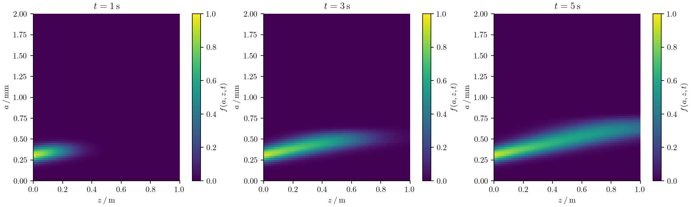

# Axially dispersed reactors

Populations in a tubular reactor change both their position and their intrinsic
properties. A crystal may grow while travelling downstream; axial mixing also
spreads the time spent in the reactor. Treating position as another particle
size would confuse these two processes and their boundary conditions.

`AxialDispersion` adds a physical axial mesh to a sectional population with one
or two intrinsic coordinates. The velocity and dispersion coefficient are
prescribed constants. This is an axial-dispersion reactor model; it does not
solve fluid momentum or calculate a flow field.

## Particle balance and units

For one intrinsic coordinate ``a`` and axial position ``z``, the balance is

```math
\frac{\partial f(a,z,t)}{\partial t}
+\frac{\partial[G(a,z,t)f(a,z,t)]}{\partial a}
+u\frac{\partial f(a,z,t)}{\partial z}
=D_z\frac{\partial^2 f(a,z,t)}{\partial z^2}
+B(a,z,t)-S(a,z,t).
```

For two intrinsic coordinates, replace the growth contribution by

```math
\frac{\partial[G_1(a_1,a_2,z,t)f(a_1,a_2,z,t)]}{\partial a_1}
+\frac{\partial[G_2(a_1,a_2,z,t)f(a_1,a_2,z,t)]}{\partial a_2}.
```

``u\ge0`` has units axial length/time; ``D_z\ge0`` has units axial length²/time.
``f`` is a number density per fluid volume and intrinsic-coordinate measure.
The state ``N_{i,c}`` integrates over intrinsic bin ``i`` and averages over axial
cell ``c``. It is **not** multiplied by axial cell width. With constant reactor
cross-sectional area ``A``, the total particle inventory is
``A\sum_c\Delta z_c\sum_iN_{i,c}``.

## Choose inlet and outlet conditions

Write the downstream axial flux as

```math
J_z(a,z,t)=u f(a,z,t)-D_z\frac{\partial f(a,z,t)}{\partial z}.
```

The default Danckwerts inlet prescribes total flux from the upstream feed:

```math
u f(a,0,t)-D_z\frac{\partial f(a,0,t)}{\partial z}=u f_{\mathrm{in}}(a,t),
\qquad
\frac{\partial f(a,L_z,t)}{\partial z}=0.
```

The inlet concentration inside the reactor need not equal the upstream feed.
This flux formulation is the
[Danckwerts inflow condition](https://doc.comsol.com/6.3/doc/com.comsol.help.cfd/cfd_ug_chemsptrans.11.139.html).
At the outlet, particles leave by advection and the dispersive flux is zero.
For zero velocity this boundary choice gives zero total flux at both ends.
`boundary=:closed` explicitly requests that situation and requires zero velocity.
`boundary=:periodic` is also available for transport verification; it has no feed.

Intrinsic size boundaries remain separate: `SizeBC` or `SizeBC2D` controls growth
through particle-size faces. Neither sets the reactor inlet.

## Build and solve a reactor

Here a continuous feed enters a previously empty tube. Sizes are in mm, axial
positions in m, and time in seconds.

```@example axial
using PopulationBalanceModels
using Distributions: Normal, pdf
sizes = Grid1D(range(0.0,2.0;length=41);coordinate=:length)
zgrid = AxialGrid(range(0.0,1.0;length=31))
p = (seed_concentration=1.0, seed_mean=0.3, seed_std=0.08, growth_rate=0.08)
inlet = DensityInlet((L,p,t) -> p.seed_concentration *
    pdf(Normal(p.seed_mean,p.seed_std),L); quadrature=GaussLegendre(4))
reactor = AxialDispersion(zgrid;
    velocity=0.2, dispersion=0.005,
    inlet=inlet,
)
model = PBMModel(growth=Growth((L,p,t,ctx)->p.growth_rate))
operator = compile(model,sizes;
    domain=reactor, axial_scheme=MUSCL(),
    methods=TermMethods(growth=Upwind()),
    bc=SizeBC(OpenBoundary(),OpenBoundary()),
)
N0 = zeros(length(sizes),length(zgrid))
problem = PBMProblem(operator,N0,(0.0,5.0);p)
dt = suggest_dt(operator,N0,p,0.0;cfl=0.25)
solution = simulate(problem;method=SSPRK33(),dt,saveat=[0.0,1.0,3.0,5.0])
final_at_outlet = axial_population(operator,solution.u[end],length(zgrid))
number_concentration(sizes,final_at_outlet)
```

Here `seed_concentration` is particles/m³ of feed fluid, `seed_mean` and
`seed_std` are in mm, and `growth_rate` is mm/s. The inlet density has units
particles/(m³ mm). Its bin concentrations are

```math
N_{i,\mathrm{in}}(p,t)=\int_{a_i}^{a_{i+1}} f_{\mathrm{in}}(a,p,t)\,da.
```

`DensityInlet` is an explicit continuous-density declaration. Compilation
prepares Gauss–Legendre nodes/weights in each intrinsic bin; density values use
the **current** parameters and time at every RHS stage. It also works without a
Growth term. Negative/nonfinite evaluated densities are rejected. Increase the
quadrature order independently when a narrow or complicated profile is unresolved.

There is no automatic renormalization: the Gaussian tail outside the represented
domain is omitted. If the feed instead conditions on that domain, explicitly
use `pdf(truncated(Normal(...),lower,upper),L)` and import `truncated` from
Distributions. That changes the physical feed assumption.

A bare `inlet=(p,t)->bin_concentrations` retains its original meaning: return
already integrated bin concentrations as a vector (or supported tensor array),
not density samples or particle rates. `inlet=nothing` gives zero feed. In both
forms, the Danckwerts influx is **velocity times bin concentration**, exactly
once; dispersion does not add a second independently prescribed inlet flux.

`methods` chooses intrinsic mechanisms; `axial_scheme` independently chooses
physical axial advection, defaulting to Upwind. No PBMSystem is needed here.
Native stage checks remain enabled. The chosen step is conservative for this
example; refine it rather than treating an Upwind-based recommendation as a
positivity guarantee for higher-order reconstruction.

The short [complete example](assets/source/examples/axially_dispersed_growth.jl)
solves without writing files by default:

```sh
julia --project=. examples/axially_dispersed_growth.jl
# Optional fresh CSV output; retained documentation assets are not overwritten.
julia --project=. -e 'include("examples/axially_dispersed_growth.jl"); AxiallyDispersedGrowth.run(output="/tmp/axial-density-inlet")'
```



Particles travel downstream and grow toward larger sizes. Dispersion spreads
the startup front. This retained illustration comes from the original Upwind,
bin-vector feed example; it has not been regenerated for the density-inlet/MUSCL
example above. Numerical smearing and physical dispersion must be assessed
separately by refinement.

## Two intrinsic coordinates and local physics

Use the same domain with a tensor grid:

```@example axial_tensor
using PopulationBalanceModels
sizes = Grid2D(0.0:0.1:1.0,0.0:0.2:2.0)
zgrid = AxialGrid(0.0:0.1:1.0)
reactor = AxialDispersion(zgrid;velocity=0.2,dispersion=0.01)
model = PBMModel(growth=Growth2D((0.03,0.02)))
operator = compile(model,sizes;domain=reactor,axial_scheme=MUSCL(),bc=SizeBC2D())
N0 = zeros(length(sizes),length(zgrid))
problem = PBMProblem(operator,N0,(0.0,1.0))
size(axial_population(operator,problem.u0,1))
```

Each state column flattens the tensor bins in Julia's column-major order.
`axial_population` restores the ``(n_1,n_2)`` view without copying it. A tensor
feed may return that matrix shape or a flattened vector. For a continuous feed,
use the coordinate-tuple convention, for example
`DensityInlet((xy,p,t)->p.amplitude*(1+xy[1])*(1+xy[2]))` with an explicit
`p=(amplitude=1.0,)` supplied to PBMProblem. Quadrature is tensor-product, with
`GaussLegendre(q)` using q points **per axis**. The result integrates over both
intrinsic widths, with no extra axial-width factor.

Intrinsic mechanisms use their existing sectional interfaces: growth, local
sources and removal, and, for 1D intrinsic grids, supported nucleation and
fixed-pivot collisions. Their residual is evaluated independently in every
axial cell. `ctx.fields.z` gives that cell's center. The compile keyword
`fields=(cell,t)->(...)` can add prescribed axial operating conditions. The
context's `N` is the local intrinsic population; it is not the whole reactor.

## Transport shared solute and multiple populations

`axial_problem(local_problem,reactor;axial_scheme=MUSCL())` lifts an existing
local `PBMSystem` into every reactor cell. All scalar bulk states receive the
same axial advection and dispersion as the populations. Local interactions and
material exchanges keep their original callbacks; `ctx.bulk.c` is the current
cell's solute concentration and `ctx.fields.z` is its axial centre.

```julia
reactor = AxialDispersion(zgrid;velocity=u,dispersion=D,
    inlet=(p,t)->(populations=(crystals=zeros(nbins),),bulk=(c=p.cfeed,)))
problem = axial_problem(local_problem,reactor;axial_scheme=MUSCL())
crystal_numbers = population(problem,problem.u0,:crystals) # bins × axial cells
solute = bulk(problem,problem.u0,:c)                      # one value per cell
local_state = axial_stateview(problem,problem.u0,1)
```

DensityInlet currently targets standalone Grid1D/Grid2D populations and is
rejected for the coupled route, including raw moments and named population
feeds. The inlet must provide every local population and bulk value, either as those
named tuples or as the complete packed vector. Initial values repeat the local
problem unless an explicit `initial` matrix is given. Named population and bulk
accessors return views; every column is a complete local coupled state.
See [Continuous precipitation](case_studies/continuous_precipitation.md) for a
working material-conserving model.

The coupled adapter supports one-/two-coordinate sectional populations and raw
moments with residual-based local methods. It rejects DQMOM states: linearly
advecting weights and weighted abscissas does not implement the spatial direct
moment equations. `axial_stateview(problem,u,cell).populations.name` restores
each tensor's intrinsic matrix; the axial solver still stores flattened local
states in columns. Both axial adapters reject intrinsic
[`SizeDiffusion`](methods/dispersion.md), including tensor diffusion; axial
dispersion is a separate physical mechanism. Direct evolution methods,
negative flow, state-dependent dispersion and a solved flow field are outside
both adapters. Limited reconstruction of individual raw moments can still lose
joint realizability; check moment stage validity and refine rather than
repairing moments silently.

## Conservative discretization and time step

For adjacent axial cells, the face flux is

```math
J_{i,c+1/2}=uN^{\mathrm{face}}_{i,c+1/2}
-D_z\frac{N_{i,c+1}-N_{i,c}}{z_{c+1}-z_c},\qquad
\frac{dN_{i,c}}{dt}=R_{i,c}
+\frac{J_{i,c-1/2}-J_{i,c+1/2}}{\Delta z_c}.
```

Both adapters use the same reconstruction preparation and face-flux routine.
Select `axial_scheme` in `compile(...;domain=reactor,axial_scheme=...)` for a
standalone grid, or in `axial_problem(...;axial_scheme=...)` for a system.
Upwind gives ``N^{\mathrm{face}}_{i,c+1/2}=N_{i,c}`` for positive velocity.
Upwind is the default; Upwind, MUSCL, VanLeer,
WENO3 and WENO5 support fixed nonuniform axial meshes; Centered and LinearUpwind
require uniform spacing. WENO5 prepares the same cell-average reconstruction as
[intrinsic growth](methods/growth.md), with at least six axial cells.
Dispersion uses a two-point centered flux,
including nonuniform axial meshes. On a uniform mesh the dispersive term is
second order. Interior fluxes cancel after multiplication by ``\Delta z_c``.
Higher-order advection does not increase the order of this dispersive flux or
the Danckwerts/zero-gradient boundary closure. Independent WENO reconstruction
of raw moments still has no joint-realizability guarantee; the native
`MeasureEuler` axial guarantee continues to require Upwind.
Consequently, the reactor inventory changes by local creation/removal and
inlet minus outlet flux, even on a nonuniform axial mesh. `axial_fluxes`
returns those face fluxes for balance diagnostics.

Explicit time stepping must resolve both intrinsic mechanisms and axial
transport. On a uniform axial mesh, the axial contribution to the forward-Euler
outgoing rate is ``u/\Delta z+2D_z/\Delta z^2`` in interior cells.
For the single-population adapter, `suggest_dt` combines it with local intrinsic transport/source bounds; it is
still only a local recommendation. It neither adapts `simulate` nor bounds
future coefficients, and is not a positivity guarantee for higher-order axial or
intrinsic reconstruction. WENO has no positivity limiter.
All residual-based native time methods and the optional SciML residual adapter
can advance this system. Stiff diffusion on fine axial meshes may make an
external implicit solver more practical.

Tests check inlet/outlet inventory balance on nonuniform meshes, constant-feed
stationarity, positivity under a compatible explicit step, periodic Fourier
advection–diffusion, second-order pure-dispersion refinement, and conservative
intrinsic growth with both one and two particle coordinates.

## Preserve joint realizability of transported moments

For supported raw-moment systems, select `axial_scheme=Upwind()` with
`simulate(...;method=MeasureEuler())`. The native policy checks a nonuniform-mesh
advection/dispersion CFL bound and transports each entire moment vector with the
same nonnegative coefficients. Independent high-order moment reconstructions
are outside that guarantee and are rejected by this policy.
`diagnostics(solution).reactor_flux_integrals` records the actual accepted
inlet/outlet flux integrals. Cumulative internal-size histories have zero axial
flux; they are not transported reservoirs. Extinction/size escape combined with
axial MeasureEuler is explicitly unsupported. Read the
[complete restrictions](methods/realizable_evolution.md) and run
`examples/realizable_axial_transport.jl` for a nonuniform-grid inventory check.
