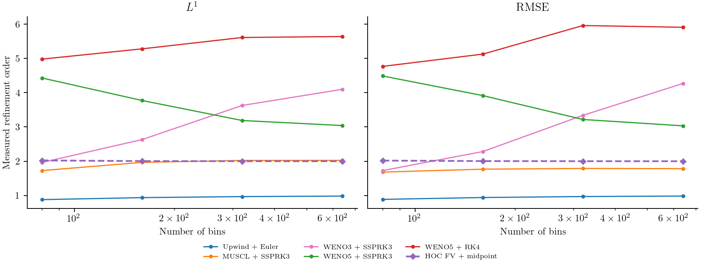

# Comparing growth and time methods

If every particle grows at the same rate, the size distribution should move
without broadening. This makes constant growth a useful test: the exact answer
is known, and numerical diffusion, oscillations and computational cost can be
compared without uncertainty about the physical kinetics.

We use Case 1 of [Inguva, Schickel and Braatz (2022)](https://web.mit.edu/braatzgroup/Inguva_ComputChemEng_2022.pdf),
then repeat the comparison with a smooth periodic distribution to measure
convergence. The two inputs serve different purposes. A sharp front tests
resolution and positivity; a smooth input tests the accuracy of the schemes.

## Model, initial condition and boundaries

For ``0\le a\le1``,

```math
\frac{\partial f(a,t)}{\partial t}
+0.1\frac{\partial f(a,t)}{\partial a}=0,
\qquad f(a,0)=100\exp(-a/0.01).
```

The incoming number flux is zero. The far boundary lets particles leave; the
initial tail that can reach it by ``t=4`` is negligible. The analytical density is

```math
f(a,t)=\begin{cases}
100\exp[-(a-0.1t)/0.01],&a\ge0.1t,\\
0,&a<0.1t.
\end{cases}
```

All numerical states are bin integrals, initialized and assessed against exact
bin integrals of this function. Sampling the steep exponential only at bin
centres would add a separate initialization error.

```@example growth_comparison
using PopulationBalanceModels
include(joinpath(pkgdir(PopulationBalanceModels),"examples","constant_growth_methods.jl"))
import .ConstantGrowthMethods
model = PBMModel(growth=Growth(AffineGrowth(0.1,0.0)))
grid = Grid1D(range(0.,1.;length=201);coordinate=:length)
bc = SizeBC(OpenBoundary(),OpenBoundary())
initial = ConstantGrowthMethods.exact_counts(grid,0.)
operator = compile(model,grid;methods=TermMethods(growth=MUSCL()),bc)
problem = PBMProblem(operator,initial,(0.,4.))
solution = simulate(problem;method=SSPRK33(),dt=0.5*first(grid.widths)/0.1)
nothing # hide
```

## A representative set of methods

The comparison uses seven pairings. This keeps the plots readable while showing
first-order transport, limited reconstruction, high-order reconstruction,
temporal error and a characteristic shift.

| Growth treatment | Time method | Courant number in the smooth/timing comparison |
|:--|:--|:--|
| Upwind | Forward Euler | 0.5 |
| MUSCL | SSPRK33 | 0.5 |
| WENO3 | SSPRK33 | 0.5 |
| WENO5 | SSPRK33 | 0.5 |
| WENO5 | RK4 | 0.5 |
| HOC finite-volume compact reconstruction | Native midpoint | 0.5 |
| Inguva2022 characteristic update | Matched shift | 1 |

The Courant number is ``C=G\Delta t/\Delta a``. Inguva2022 requires a grid
uniform in travel time and a step that moves one whole cell. For constant
``G=0.1``, an ordinary uniform mesh meets that requirement:

```@example growth_comparison
shift_operator = compile(model,grid;evolution=Inguva2022(),bc)
shift_problem = PBMProblem(shift_operator,initial,(0.,4.))
shift_solution = simulate(shift_problem;dt=first(grid.widths)/0.1)
maximum(abs.(last(shift_solution.u).-ConstantGrowthMethods.exact_counts(grid,4.)))
```

That ``C=1`` is labelled in every comparison. It is not a valid ``C=0.5`` run
of the characteristic method. Its lower cost includes taking fewer steps and
using a direct copy rather than reconstructing face fluxes. Other available
schemes remain documented in [Growth](../methods/growth.md) and
[Time integration](../methods/time.md); they have not been removed from the package.

HOC is selected through the same model and bin-integrated initial state:

```julia
compact_operator = compile(model,grid;evolution=HOCFiniteVolume(),bc)
compact_solution = simulate(PBMProblem(compact_operator,initial,(0.,4.));
    dt=0.5*first(grid.widths)/0.1,check_nonnegative=false)
```

This is the conservative compact finite-volume method, with fourth-order
interior space reconstruction and second-order midpoint time integration.
It is not the legacy two-dimensional `HOCADI` update. At fixed Courant number,
second-order time error eventually dominates.
The [compact verification](../methods/compact_verification.md) separates spatial
and temporal refinements. The sharp-front run retains its dispersive negative
lobes; this scheme has no positivity guarantee.

## Resolve the moving front


The purple dashed curve is HOC + midpoint. The methods resolve the front
with different amounts of spreading and signed error; the analytical bin
averages distinguish discretization error from plotting a continuous density
through bin centres. Negative values remain in this diagnostic calculation.
For a physical solve that requires nonnegative populations, select an
appropriate positivity-preserving method and retain the state checks.

## Compare both error norms

For analytical bin averages ``\bar f_i^{\mathrm{exact}}``, we report

```math
E_{L^1}=\sum_i\Delta a_i\left|\bar f_i-\bar f_i^{\mathrm{exact}}\right|,
\qquad
E_{\mathrm{RMS}}=\left[
\frac{\sum_i\Delta a_i(\bar f_i-\bar f_i^{\mathrm{exact}})^2}
{a_{\max}-a_{\min}}\right]^{1/2}.
```


The front is discontinuous, so these curves do not establish formal
smooth-solution order. The companion calculation uses periodic boundaries and

```math
f(a,0)=1+0.2\sin(2\pi a)+0.1\cos(4\pi a),
\qquad f(a,t)=f(a-0.1t,0)
```

with periodic continuation. Both initialization and comparison again use exact
bin integrals.


Rather than placing arbitrarily anchored ``h^2`` and ``h^5`` lines on these
plots, we calculate the observed order from each pair of grids:

```math
p_{\mathrm{obs}}=
\frac{\log[E(N)/E(2N)]}{\log2}.
```



The purple dashed HOC + midpoint curves have measured RMSE orders 2.019, 2.005, 2.001 and 2.000
on the 40–640-bin grids. At the shared ``C=0.5``, temporal error limits this
complete method to second order; this plot does not isolate its fourth-order
spatial reconstruction.

WENO3 + SSPRK33 has measured RMSE orders 1.73, 2.28, 3.34, 4.27
on the successive 40–640-bin refinements. Third-order face reconstruction does
not ensure an immediate third-order curve: nonlinear weights near extrema and
the third-order time update both contribute at these resolutions. The fixed
WENO weight parameter also changes its importance as the mesh is refined.
The final slope above three is finite-range behaviour, not evidence for a
higher formal order.

Upwind approaches first order. MUSCL approaches
second order in ``L^1`` but about 1.8 in RMSE here, because limiting near smooth
extrema affects the norms differently. WENO5 with SSPRK33 approaches third
order as time error dominates. RK4 gives much smaller errors on this mesh range;
its observed slopes above five are finite-range behaviour, not proof of a new
order or of fifth-order space–time accuracy. At sufficiently fine resolution,
fourth-order temporal error can dominate that pairing too. The characteristic
shift is at roundoff, where an inferred convergence order is meaningless.

## Measure computation time once


Each configuration has **one measured integration**. Small, separate warmups
pass the selected time method explicitly, matching the measured call; the benchmark-sized problem is not run
three times. Timings include stepping, residual evaluation and allocations,
and exclude compilation, file output and plotting. A full garbage collection
before each timer prevents earlier configurations' garbage being charged to the
next method; allocation bytes and in-solve GC time are exported too. They have no averaging or
repeatability bands and will vary between runs and machines. The retained timings
were measured together before this presentation update; [inputs.txt](../assets/constant_growth/inputs.txt)
records the Julia version, CPU and thread counts.

Raw results are in [errors.csv](../assets/constant_growth/errors.csv) and
[smooth_errors.csv](../assets/constant_growth/smooth_errors.csv). They also retain
negative number, total-number drift and actual step counts.

```sh
julia --project=. examples/constant_growth_methods.jl
python docs/benchmarks/plot_transport_comparisons.py constant --usetex
julia --project=docs docs/make.jl
```

## Minimal run and full reproduction

Run this block from the repository root. It constructs and solves one problem;
including a driver does not run its CSV exports.

```julia
using PopulationBalanceModels
include("examples/constant_growth_methods.jl")
grid = Grid1D(range(0.0, 1.0; length=201))
initial = ConstantGrowthMethods.exact_counts(grid, 0.0)
bc = SizeBC(OpenBoundary(), OpenBoundary())
problem = ConstantGrowthMethods.make_problem(grid, initial, WENO3(), SSPRK33(), 4.0, bc)
solution = simulate(problem; method=SSPRK33(), dt=0.025, check_nonnegative=false)
```

The figure-generation drivers and supporting sources are available below. Keep
the repository's relative paths; the [benchmark guide](../assets/source/plotting/README.txt)
lists plotting commands and optional environments.


- [Complete comparison driver](../assets/source/examples/constant_growth_methods.jl).
- [Benchmark/export helpers](../assets/source/examples/support/constant_growth_benchmark.jl).
