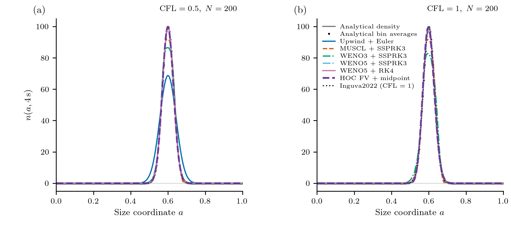
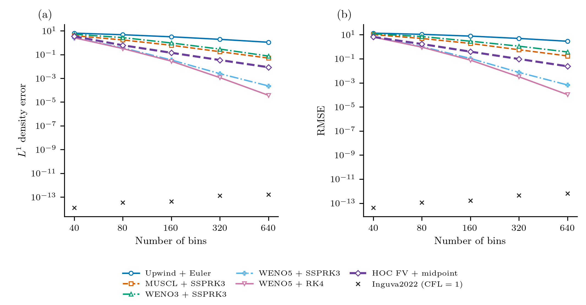
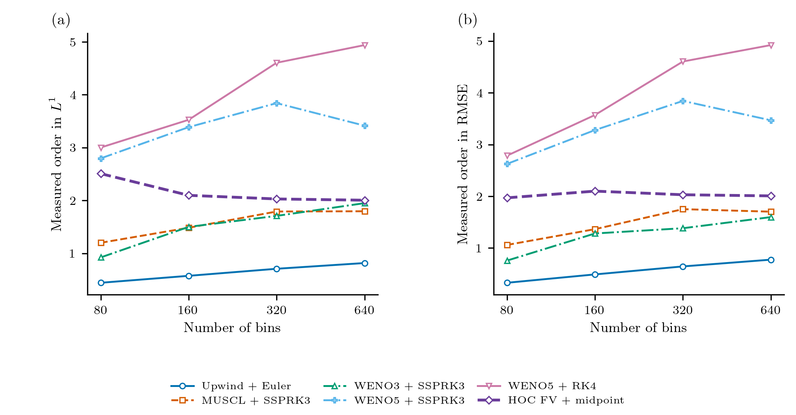
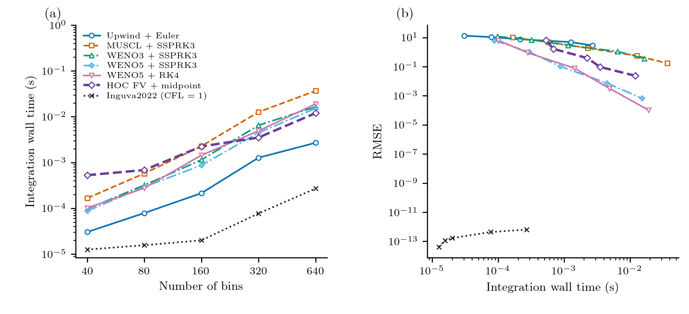

# Comparing growth and time methods

If every particle grows at the same rate, the size distribution should move
without broadening. This makes constant growth a useful test: the exact answer
is known, and numerical diffusion, oscillations and computational cost can be
compared without uncertainty about the physical kinetics.

We use the constant-growth equation from Case 1 of
[Inguva, Schickel and Braatz (2022)](https://web.mit.edu/braatzgroup/Inguva_ComputChemEng_2022.pdf),
replacing its exponential initial condition with a localized Gaussian.
**Every profile, error, refinement order and timing below uses this same
Gaussian problem**, with the same growth rate, domain, final time and physical
boundaries. Only the numerical resolution, selected growth/time pairing and
stated CFL change. The Gaussian makes numerical spreading and distortion easy
to see.

## Model, initial condition and boundaries

For ``0\le a\le1``,

```math
\frac{\partial n(a,t)}{\partial t}
+0.1\frac{\partial n(a,t)}{\partial a}=0,
\qquad n(a,0)=100\exp\!\left[-\frac{(a-0.2)^2}{2(0.03)^2}\right].
```

The incoming number flux is zero. The far boundary lets particles leave; the
initial tail that can reach it by ``t=4`` is negligible. The Gaussian's standard
deviation is 0.03, independent of bin width, and its centre moves from 0.2 to 0.6.
The analytical density is

```math
n(a,t)=\begin{cases}
100\exp\!\left[-\frac{(a-0.1t-0.2)^2}{2(0.03)^2}\right],&0\le a-0.1t\le1,\\
0,&\text{otherwise}.
\end{cases}
```

All numerical states are bin integrals, initialized and assessed against exact
bin integrals of this function. Sampling the Gaussian only at bin centres
would add a separate initialization error. Its finite initial support leaves
only about ``1.3\times10^{-11}`` of the untruncated number below zero.

```@example growth_comparison
using PopulationBalanceModels
p = (speed=0.1,height=100.0,center=0.2,width=0.03)
growth(a,p,t,ctx) = p.speed
initial_density(a,p,t) = p.height*exp(-0.5*((a-p.center)/p.width)^2)
model = PBMModel(growth=Growth(growth))
grid = Grid1D(range(0.0,1.0;length=201);coordinate=:length)
bc = SizeBC(OpenBoundary(),OpenBoundary())
operator = compile(model,grid;methods=TermMethods(growth=MUSCL()),bc)
initial = InitialDensity(initial_density;support=(0.0,1.0))
problem = PBMProblem(operator,initial,(0.0,4.0);p)
solution = simulate(problem;method=SSPRK33(),dt=0.5*minimum(grid.widths)/p.speed,
    saveat=[0.0,2.0,4.0])
nothing # hide
```

## A representative set of methods

The comparison uses seven pairings. This keeps the plots readable while showing
first-order transport, limited reconstruction, high-order reconstruction,
temporal error and a characteristic shift.

| Growth treatment | Time method | CFL in the Gaussian refinement/timing comparison |
|:--|:--|:--|
| Upwind | Forward Euler | 0.5 |
| MUSCL | SSPRK33 | 0.5 |
| WENO3 | SSPRK33 | 0.5 |
| WENO5 | SSPRK33 | 0.5 |
| WENO5 | RK4 | 0.5 |
| HOC finite-volume compact reconstruction | Native midpoint | 0.5 |
| Inguva2022 characteristic update | Matched shift | 1 |

The Courant number is ``C=G\Delta t/\Delta a``. Inguva2022 requires a grid
uniform in travel time and a step that moves one whole cell. For constant
``G=0.1``, an ordinary uniform mesh meets that requirement:

```@example growth_comparison
# The analytical comparison belongs to verification, after the first solve.
include(joinpath(pkgdir(PopulationBalanceModels),"examples","constant_growth_methods.jl"))
import .ConstantGrowthMethods
# The complete update needs a declared affine law, not an inferred callback form.
shift_model = PBMModel(growth=Growth(AffineGrowth(p.speed,0.0)))
shift_operator = compile(shift_model,grid;evolution=Inguva2022(),bc)
shift_problem = PBMProblem(shift_operator,initial,(0.,4.);p)
shift_solution = simulate(shift_problem;dt=first(grid.widths)/0.1)
maximum(abs.(last(shift_solution.u).-ConstantGrowthMethods.gaussian_counts(grid,4.)))
```

That ``C=1`` is labelled in every comparison. It is not a valid ``C=0.5`` run
of the characteristic method. Its lower cost includes taking fewer steps and
using a direct copy rather than reconstructing face fluxes. Other available
schemes remain documented in [Growth](../methods/growth.md) and
[Time integration](../methods/time.md); they have not been removed from the package.

HOC is selected through the same model and bin-integrated initial state:

```julia
compact_operator = compile(shift_model,grid;evolution=HOCFiniteVolume(),bc)
compact_solution = simulate(PBMProblem(compact_operator,initial,(0.,4.);p);
    dt=0.5*first(grid.widths)/0.1,check_nonnegative=false)
```

This is the conservative compact finite-volume method, with fourth-order
interior space reconstruction and second-order midpoint time integration.
It is not the legacy two-dimensional `HOCADI` update. At fixed Courant number,
second-order time error eventually dominates.
The [compact guide](../methods/compact.md) explains the complete update;
its [verification notes](../methods/compact_verification.md) separate spatial
and temporal refinements. Signed undershoots, if present, are retained;
this scheme has no positivity guarantee even for a smooth input.

## Resolve the translating Gaussian



The purple dashed curve is HOC + midpoint. The methods resolve the Gaussian
with different amounts of spreading and signed error; the analytical bin
averages distinguish discretization error from plotting a continuous density
through bin centres. Negative values remain in this diagnostic calculation.
For a physical solve that requires nonnegative populations, select an
appropriate positivity-preserving method and retain the state checks.

## Compare both error norms

For analytical bin averages ``\bar n_i^{\mathrm{exact}}``, we report

```math
E_{L^1}=\sum_i\Delta a_i\left|\bar n_i-\bar n_i^{\mathrm{exact}}\right|,
\qquad
E_{\mathrm{RMS}}=\left[
\frac{\sum_i\Delta a_i(\bar n_i-\bar n_i^{\mathrm{exact}})^2}
{a_{\max}-a_{\min}}\right]^{1/2}.
```



Every curve uses the same Gaussian at ``t=4``. The common refinement sequence
is **40, 80, 160, 320 and 640 bins** in both the manual and paper figures.
The Gaussian standard deviation remains 0.03 on every mesh; it spans only 1.2
bin widths on the coarsest grid and 19.2 on the finest. The 200-bin profiles
above are a representative resolution, not a different initial condition.
Errors use the stored signed solution and exact bin averages, without clipping,
smoothing or changing the incoming truncation in the analytical reference.

We calculate the observed order from successive Gaussian refinements:

```math
p_{\mathrm{obs}}=
\frac{\log[E(N)/E(2N)]}{\log2}.
```



The table gives the final 320-to-640-bin slopes. These are measured slopes
for this finite mesh range, not independent estimates of formal spatial order.

| Growth/time pairing | Last ``L^1`` slope | Last RMSE slope |
|:--|--:|--:|
| Upwind + Euler | 0.82 | 0.78 |
| MUSCL + SSPRK33 | 1.80 | 1.70 |
| WENO3 + SSPRK33 | 1.95 | 1.60 |
| WENO5 + SSPRK33 | 3.42 | 3.47 |
| WENO5 + RK4 | 4.94 | 4.92 |
| HOC + midpoint | 2.01 | 2.01 |

Upwind still visibly broadens this narrow peak, and has not reached its
asymptotic first-order slope on these grids. Limited/nonlinear reconstructions
and the resolution of the Gaussian extremum affect the MUSCL and WENO3 curves.
The data do not establish third-order whole-solve convergence for WENO3 on
this mesh range. WENO5 with SSPRK33 approaches the time-method-limited regime;
WENO5 with RK4 has much smaller errors and slopes near five here, without
establishing fifth-order space-time accuracy.

HOC + midpoint has RMSE slopes 1.97, 2.10, 2.03 and 2.01. Its second-order
time update dominates at fixed CFL; this comparison does not isolate its
fourth-order spatial reconstruction. Spatial and temporal error remain
combined for every pairing.

The matched characteristic shift reproduces the bin translation to floating-point
accuracy. Its actual reported errors remain visible as isolated markers in the
error plot; no convergence slope is assigned. The analysis screen is
``1000\epsilon H`` for RMSE and ``1000\epsilon H(a_{\max}-a_{\min})`` for
``L^1``, with Gaussian height ``H=100``. This scales with density/coordinate
units and only suppresses unresolved order estimates. It does not change the
errors, solver tolerances or numerical states.

## Measure computation time once



Each configuration has **one measured integration**. Small, separate warmups
pass the selected time method explicitly, matching the measured call; the benchmark-sized problem is not run
three times. Timings include stepping, residual evaluation and allocations,
and exclude compilation, file output and plotting. A full garbage collection
before each timer prevents earlier configurations' garbage being charged to the
next method; allocation bytes and in-solve GC time are exported too. They have no averaging or
repeatability bands and will vary between runs and machines. The retained timings
were measured together for the Gaussian runs using Julia 1.10.12, an
Intel Core i9-13900H, the `goldmont` CPU target, one Julia thread and one BLAS
thread. They retain the original producing environment; redrawing them does
not measure current-source performance.

The compact [Gaussian metrics](../assets/constant_growth/gaussian_metrics.csv)
contain the 35 refinement measurements and 13 profile configurations.
[Gaussian profile bin integrals](../assets/constant_growth/gaussian_profiles.csv),
[derived orders](../assets/constant_growth/gaussian_orders.csv) and the
[selection/provenance record](../assets/constant_growth/gaussian_selection.json)
are downloadable. The selection records the original numerical-file hashes,
producer records, configuration and measured timings. The earlier periodic
experiment remains an independent verification example; it supplies none of
this case study's figures or quoted slopes.

## Minimal run and full reproduction

The small Gaussian figure selection ships with the source, so redrawing this
case does not require fetching the production-data directories:

```sh
python -m pip install -r paper/requirements.txt
python docs/benchmarks/plot_transport_comparisons.py constant --usetex
python paper/growth/plot.py
```

Both plotters select the same measured Gaussian runs. The manual keeps
alphabetic panel labels; the paper uses lowercase Roman labels. Neither command
solves the PBM or rewrites numerical tables.

The first calculation above is a complete minimal run. A deliberate new full
comparison uses the [standard environment](../verification.md) and a separate
output directory, preserving retained producers:

```sh
julia --project=. -e 'include("examples/constant_growth_methods.jl"); ConstantGrowthMethods.run(output="/tmp/gaussian-growth")'
python docs/benchmarks/plot_transport_comparisons.py constant --input /tmp/gaussian-growth --output /tmp/gaussian-growth-doc-figures --usetex
python paper/growth/plot.py --input /tmp/gaussian-growth --output /tmp/gaussian-growth-paper-figures
```

The driver records Gaussian runs only, on the same refinement grids and
boundaries as the retained comparison. Its default output is under `.cache/`;
new calculations have their own source/configuration hashes and timings.
An explicitly requested new figure-selection export is available through
`python paper/_support/growth_results.py --input CALCULATION --output NEW_SELECTION`.
This derives plotting tables and orders without modifying the calculation.

- [Complete comparison driver](../assets/source/examples/constant_growth_methods.jl).
- [Benchmark/export helpers](../assets/source/examples/support/constant_growth_benchmark.jl).

### Complete script

The authored walkthrough declares the physical Gaussian number density directly,
compiles MUSCL on 200 bins with open size boundaries, and advances it with
SSPRK33 at CFL 0.5. There is no probability/total conversion, reference factory,
error calculation or export loop. The initial bin integrals agree with the
original Gaussian input. Exact translation, scheme sweeps, grid errors and
measurements of cost belong to the verification/reproduction workflow above.

[Download the authored script](../assets/source/tutorials/constant_growth.jl).
The displayed code below is read verbatim from `examples/tutorials/constant_growth.jl`;
the download is a byte-for-byte copy. Run from the checkout root:

```sh
julia --project=. examples/tutorials/constant_growth.jl
```

For downloaded files, preserve the relative directory layout described in the
[tutorial source guide](../assets/source/examples/tutorials/README.txt).

```@eval
using Markdown
Markdown.MD([Markdown.Code("julia", Main.CaseStudyScripts.script(:constant_growth))])
```

Optional plotting calls at the end use existing results after explicitly loading
`PythonPlot`; they perform no simulation, fitting or propagation. See the
[plotting guide](../plotting.md) for the optional environment and saving figures.
