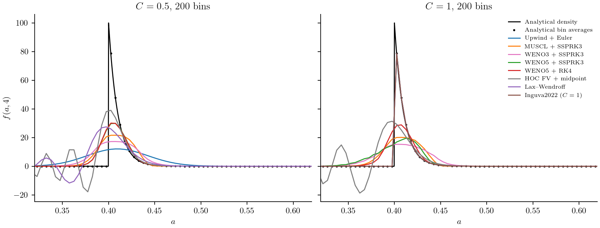
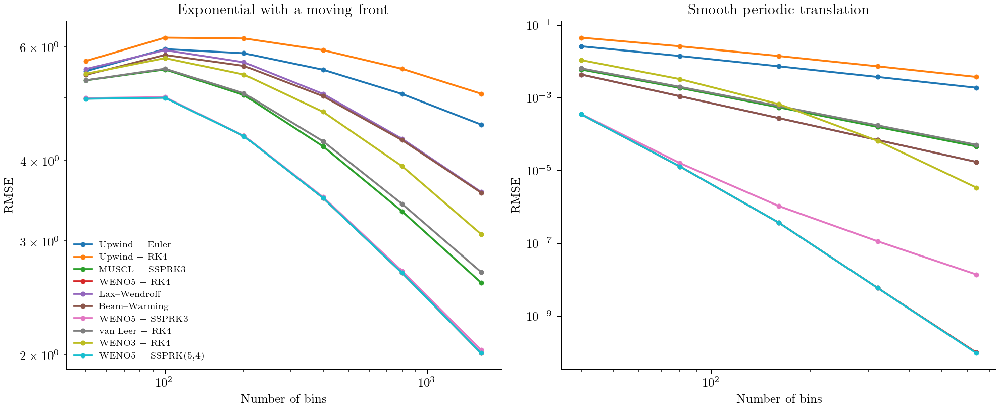
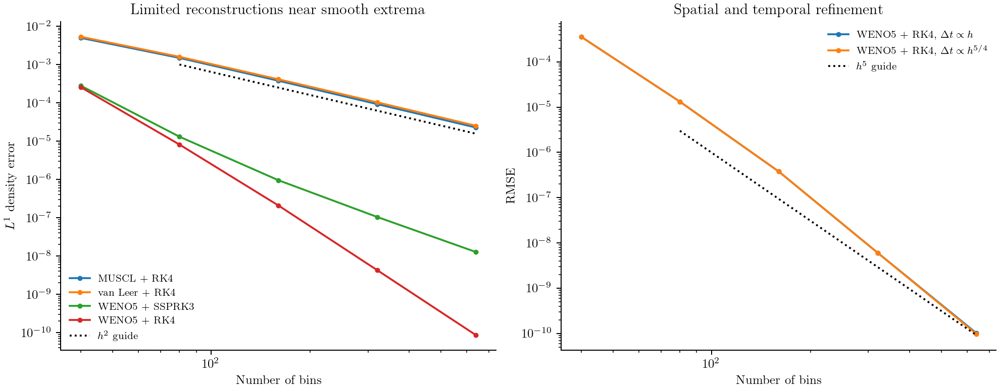
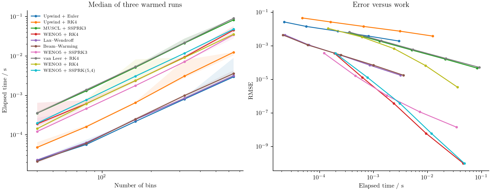

# Comparing growth and time methods

A population can broaden for two different reasons: its particles may have
different growth rates, or its numerical approximation may smear the size
distribution. A constant-growth calculation separates these effects. Every
particle moves at the same rate, so the true distribution translates without
changing shape. Any broadening, oscillation, or loss of number comes from the
calculation or its boundaries.

This model follows Case 1 of
[Inguva, Schickel, and Braatz (2022)](https://web.mit.edu/braatzgroup/Inguva_ComputChemEng_2022.pdf).
It also demonstrates a special result from that study: at a Courant number of
one, some simple schemes reduce to an exact cell shift. A more accurate ODE
integrator does not necessarily preserve that cancellation.

## Model and analytical solution

For intrinsic coordinate ``a\ge0``, solve

```math
\frac{\partial f(a,t)}{\partial t}
+0.1\frac{\partial f(a,t)}{\partial a}=0,
\qquad f(a,0)=100\exp(-a/0.01).
```

There are no births, deaths, or collisions. The left boundary supplies no new
particles. The analytical solution before the upper boundary matters is

```math
f(a,t)=
\begin{cases}
100\exp[-(a-0.1t)/0.01],&a\ge0.1t,\\
0,&a<0.1t.
\end{cases}
```

The runner uses ``0\le a\le1`` and stops at ``t=4``. It applies a zero-flux
upper boundary as in the source comparison. The initial tail near that boundary
is exponentially small; the dominant feature travels to ``a=0.4``. The sharp
leading edge is a difficult test for unlimited high-order schemes.

## Specify the law, grid, and boundaries

```@example growth_comparison
using PopulationBalanceModels
include(joinpath(pkgdir(PopulationBalanceModels),"examples","constant_growth_methods.jl"))
import .ConstantGrowthMethods
const comparison = ConstantGrowthMethods

model = PBMModel(growth=Growth(AffineGrowth(0.1,0.0)))
grid = Grid1D(range(0.0,1.0;length=201);coordinate=:length)
bc = SizeBC(OpenBoundary(),NoFlux())
N0 = comparison.exact_counts(grid,0.0)
nothing # hide
```

`AffineGrowth(0.1,0.0)` declares a constant velocity in coordinate units per
time. `N0` contains bin integrals of the initial density. Sampling the steep
initial exponential only at bin centers would introduce an avoidable initial
quadrature error.

## Pair a face reconstruction with an integrator

```@example growth_comparison
operator = compile(model,grid;methods=TermMethods(growth=MUSCL()),bc)
problem = PBMProblem(operator,N0,(0.0,4.0))
dt = 0.5*first(grid.widths)/0.1
solution = simulate(problem;method=SSPRK33(),dt)
nothing # hide
```

Changing `MUSCL()` to `Upwind()`, `VanLeer()`, `WENO3()`, `WENO5()`, `Centered()`, or `LinearUpwind()`
changes the growth face flux. Changing `SSPRK33()` to `ForwardEuler()`,
`SSPRK22()`, `SSPRK54()`, or `RK4()` changes how the assembled residual advances in time.
The runner compares selected combinations, rather than assuming every pairing
is stable at the same step size. The
[growth](../methods/growth.md) and [time](../methods/time.md) pages describe
their stencils, boundaries, and restrictions.

Lax–Wendroff and Beam–Warming include their own time updates:

```@example growth_comparison
lw = compile(model,grid;evolution=LaxWendroff(),bc)
lw_problem = PBMProblem(lw,N0,(0.0,4.0))
lw_solution = simulate(lw_problem;dt,check_nonnegative=false)
minimum(lw_solution.u[end])
```

`evolution=BeamWarming()` selects the other complete update. These compiled
operators reject variable growth and additional mechanisms. They do not supply
an ODE residual for a second integrator. Negative values are deliberately
retained in this benchmark and exported; the normal default state checks
would reject a run with a substantial undershoot.

## Compare the solutions



At ``C=0.5``, upwind broadens the peak. Increasing its time order does not remove
the spatial diffusion. MUSCL and WENO reduce that broadening, while the unlimited
schemes can create appreciable negative lobes. Their negative number and minimum
density are reported in `errors.csv`.

At ``C=1``, Upwind with ForwardEuler, Lax–Wendroff, and Beam–Warming shift the
bin numbers one cell per step, within floating-point error. Upwind with RK4
still solves the semi-discrete upwind equations and remains diffusive. The
exact cancellation is a property of the complete update, not of the upwind
spatial stencil alone. The existing `Inguva2022()` method provides a direct
shift on a matched travel-time grid; its variable-growth extension is explained
in [Transport along growth trajectories](../methods/characteristics.md).

LinearUpwind needs a smaller step: the runner omits its ``C=1`` pairing,
which is outside RK4's stability region. A transport CFL of one is not a general
stability bound for higher-order stencils.

Lax–Wendroff at ``C=0.5`` is stable for periodic constant advection but is not
monotone. For a Fourier wave of angle ``\theta``, its squared amplification is

```math
|A(\theta)|^2=1-4C^2(1-C^2)\sin^4(\theta/2)\le1,\qquad |C|\le1.
```

The tests compare a signed-velocity step against the expanded difference
formula and check the discrete squared norm over a full domain transit.
The front's negative lobes are dispersive oscillations; calling them instability
would obscure the distinction between bounded error and positivity.

## Measure error and work

For each run, compare numerical bin averages with **analytical bin averages**:

```math
\bar f_i^{\mathrm{exact}}(t)=\frac{1}{\Delta a_i}
\int_{a_{i-1/2}}^{a_{i+1/2}}f(a,t)\,da,
```

```math
E_{\mathrm{RMS}}=
\left[\frac{1}{a_{\max}-a_{\min}}
\sum_i\Delta a_i(\bar f_i-\bar f_i^{\mathrm{exact}})^2\right]^{1/2}.
```

The runner records absolute errors, total-number drift, negative number,
step count, and elapsed time. It first warms each calculation, then reports the
median and range of three runs. Timings include stepping, residual assembly,
and allocations on the generating machine.



The paper's exponential and the zero-inflow front are nonsmooth. Their RMSE
curves measure how well a scheme resolves that front; they cannot establish
smooth-solution order. A second test uses periodic boundaries and the smooth,
positive initial density

```math
f(a,0)=1+0.2\sin(2\pi a)+0.1\cos(4\pi a),\qquad 0\le a\le1.
```

Its analytical solution is ``f(a,t)=f(a-0.1t,0)`` with periodic continuation.
Both initialization and comparison use exact bin integrals. At fixed
``C=0.5``, Lax–Wendroff and Beam–Warming approach second-order RMSE convergence.
WENO5 with SSPRK3 approaches third order because time error eventually dominates.
WENO5 with RK4 reaches much smaller errors. A companion run reduces its time
step as ``\Delta t\propto h^{5/4}``, so fourth-order time error cannot mask
fifth-order spatial convergence. Error cancellation and nonlinear weights can
produce slopes above the formal order over a finite refinement range; those
slopes do not establish a new order of accuracy.



The MUSCL and van Leer slope limiters reduce the reconstruction near extrema,
even for smooth profiles. Here their integrated absolute errors approach second
order, while their RMSE slopes remain near 1.8. The norm matters: a local loss
of accuracy near extrema is more prominent in RMSE than in an integrated
absolute error. WENO3's fixed smoothing parameter also affects its approach to
the asymptotic regime. The CSV files retain every measured error rather than
replacing the curves with fitted formal-order lines.



The timing plot compares the same smooth problem at fixed CFL; bands show the
three-run range. It separates cost per grid from accuracy per unit work. These
results concern this implementation and machine. They are not solver rankings
for other models or hardware.

Raw front results are in [errors.csv](../assets/constant_growth/errors.csv);
the smooth results and their measured refinement slopes are in
[smooth_errors.csv](../assets/constant_growth/smooth_errors.csv).

Regenerate the data and figures from the repository root:

```sh
julia --project=. examples/constant_growth_methods.jl
python docs/benchmarks/plot_transport_comparisons.py constant --usetex
julia --project=docs docs/make.jl
```
