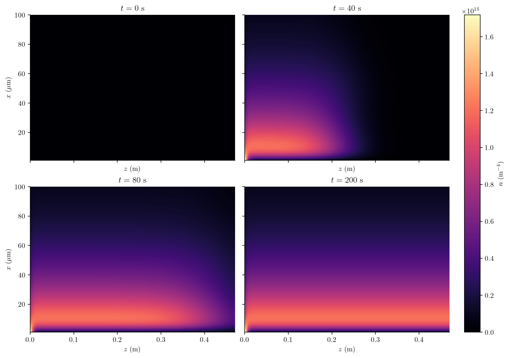
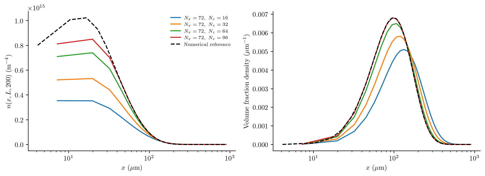
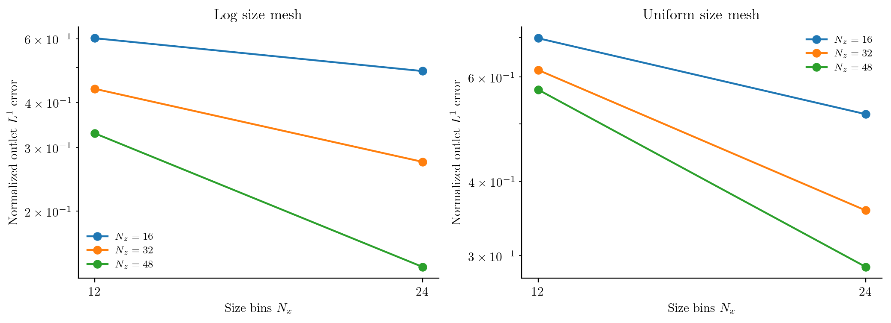
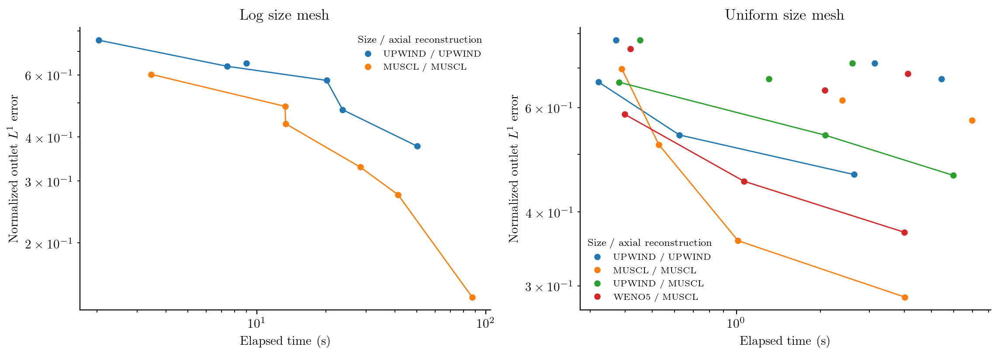

# Precipitation in a continuous tubular reactor

A supersaturated feed enters a tube that initially contains no solute or
particles. Nuclei form as the feed advances, crystals grow, and precipitation
reduces the dissolved concentration. Axial dispersion spreads the residence-time
distribution. The outlet PSD therefore depends on both reaction kinetics and
mixing along the tube; a well-mixed batch model cannot describe its startup.

This calculation uses Case 7A of [Zhang et al. (2024)](https://doi.org/10.1016/j.compchemeng.2024.108612).
It targets the transient fields and outlet distributions in Figure 9(a,c) and
the error-versus-runtime comparison in Figure 10(a,b). It compares this package's Upwind, MUSCL and uniform-size WENO5
reconstructions. These are not CADET's WENO23/WENO35 algorithms, boundary
closures or timings. Case 7B is not included: the printed
lognormal centre needs an unambiguous conversion to SI units before it can be
used as a reproduction input.

## Model and boundaries

Let ``n(x,z,t)`` be number density per reactor-fluid volume per particle length,
``c(z,t)`` dissolved concentration, ``x`` particle length and ``z`` axial position.
The particles obey

```math
\frac{\partial n(x,z,t)}{\partial t}
+v_{\mathrm{ax}}\frac{\partial n(x,z,t)}{\partial z}
+\frac{\partial[G(z,t)n(x,z,t)]}{\partial x}
=D_{\mathrm{ax}}\frac{\partial^2n(x,z,t)}{\partial z^2}.
```

Nucleation supplies the size-boundary flux

```math
G(z,t)n(x_c,z,t)=B_0(z,t),\qquad
B_0=k_p s^{u}+k_b s^{b}M,\qquad
G=k_gs,
```

where

```math
s(z,t)=\max\!\left(\frac{c(z,t)-c_{\mathrm{eq}}}{c_{\mathrm{eq}}},0\right),
\qquad
M(z,t)=\rho k_v\int_{x_c}^{\infty}x^3n(x,z,t)\,dx.
```

Primary nucleation starts the population. Secondary nucleation is proportional
to the crystal mass concentration ``M``. There is no aggregation, breakage or
growth-rate dispersion in this case. Below saturation, both rates stop; this
precipitation-only model does not redissolve existing particles. The solute balance is

```math
\frac{\partial c(z,t)}{\partial t}
+v_{\mathrm{ax}}\frac{\partial c(z,t)}{\partial z}
=D_{\mathrm{ax}}\frac{\partial^2c(z,t)}{\partial z^2}
-\rho k_v\left[B_0(z,t)x_c^3+
3\int_{x_c}^{\infty}G(z,t)x^2n(x,z,t)\,dx\right].
```

Both balances use Danckwerts inflow and a zero-gradient outlet:

```math
v_{\mathrm{ax}}n(x,0,t)-D_{\mathrm{ax}}\frac{\partial n(x,0,t)}{\partial z}=0,
\qquad \frac{\partial n(x,L,t)}{\partial z}=0,
```

```math
v_{\mathrm{ax}}c(0,t)-D_{\mathrm{ax}}\frac{\partial c(0,t)}{\partial z}
=v_{\mathrm{ax}}c_{\mathrm{feed}},
\qquad \frac{\partial c(L,t)}{\partial z}=0.
```

Initially ``n(x,z,0)=0`` and ``c(z,0)=0``. Concentrations refer to local fluid volume, with no extra porosity factor
in the exchange. The axial velocity is ``Q/(A\varepsilon)``, not ``Q/A``;
porosity changes the residence time substantially.

| Input | Value and units |
|:--|:--|
| ``c_{\mathrm{feed}}``, ``c_{\mathrm{eq}}`` | 9, 0.4 kg m⁻³ |
| ``\rho``, ``k_v`` | 1200 kg m⁻³, 0.524 |
| ``k_p``, ``u`` | 5 m⁻³ s⁻¹, 10 |
| ``k_b``, ``b`` | 4×10⁸ kg⁻¹ s⁻¹, 2 |
| ``k_g`` | 7×10⁻⁶ m s⁻¹ |
| ``x_c``, ``x_{\max}`` | 1, 900 µm |
| ``Q``, ``A``, ``\varepsilon`` | 1.67×10⁻⁷ m³ s⁻¹, 1.46×10⁻⁴ m², 0.21 |
| ``L``, ``D_{\mathrm{ax}}`` | 0.47 m, 4.2×10⁻⁵ m² s⁻¹ |

These are [supporting-information Table S8](https://ars.els-cdn.com/content/image/1-s2.0-S0098135424000309-mmc1.pdf) inputs. The authors' public
[verification script](https://github.com/cadet/CADET-Verification/blob/090606762fc657510a9e31c547890bf9a17ffb59/src/benchmark_models/settings_crystallization.py)
confirms the empty initial state and porosity convention. Its flow uses exactly
10 mL/min; this script retains the SI table's rounded ``Q``. The coefficients
have the units above because ``s`` is dimensionless.

## Assemble local precipitation, then add axial transport

The kinetic callbacks read the local dissolved concentration. They do not need
to know how the reactor is divided into cells:

```julia
supersaturation(p,ctx) = max(ctx.bulk.c/p.ceq-1,zero(ctx.bulk.c))
growth(x,p,t,ctx) = p.kg*supersaturation(p,ctx)
function nucleation(p,t,ctx)
    s = supersaturation(p,ctx)
    M = 1e12*p.rho*p.kv*moment(ctx.grid,ctx.N,3)
    (p.kp*s^p.u + p.kb*s^p.b*M)/1e12
end
model = PBMModel(
    growth=Growth(rate=growth),
    primary_secondary=Nucleation(rate=nucleation,size=first(grid.edges)),
)
operator = compile(model,grid;methods=TermMethods(
    growth=MUSCL(),by_term=(primary_secondary=BoundaryInjection(:left),)))
system = PBMSystem((crystals=operator,);nonnegative_bulk=(:c,),
    exchanges=(ConservativeExchange(:crystals,:c,
        (x,p,t,ctx)->1e12*p.rho*p.kv*x^3),))
local_problem = PBMProblem(system,(crystals=zeros(length(grid)),),(0.,200.);
    bulk0=(c=0.,),p)
reactor = AxialDispersion(AxialGrid(range(0.,p.L;length=nz+1));
    velocity=p.Q/(p.area*p.porosity),dispersion=p.Dax,
    inlet=(p,t)->(populations=(crystals=zeros(length(grid)),),
                  bulk=(c=p.cfeed,)))
problem = axial_problem(local_problem,reactor;axial_scheme=MUSCL())
```

For numerical scaling the internal particle counts are divided by ``10^{12}``.
The rate divides by that scale, the mass callback multiplies by it, and exported
densities restore physical units. This changes no physical coefficient.

`ConservativeExchange` subtracts the **resolved discrete** crystal-mass increase
from solute. This balances material exactly cell by cell before axial fluxes are
added. At finite resolution it differs from separately quadraturing the continuum
sink above, including the mass assigned to the first bin. On coarse uniform size meshes,
a 1-µm nucleus is represented at a much larger first pivot; a higher-order
growth reconstruction alone cannot eliminate that source/material error.
That difference must
shrink under size refinement; it is not evidence of a different physical source.
The upper size boundary is closed. Check its occupancy before treating the
finite-domain calculation as an approximation on an infinite size domain.

## Startup and the outlet distribution



The fields use 1,152 uniform size bins and 128 axial cells, with a shared
colour scale. The empty initial condition is shown explicitly. At 40 s the
feed has raised supersaturation near the inlet; nucleation creates small
particles and growth moves them to larger sizes. Solute depletion and axial
mixing reshape the distribution downstream. The 80-s field still describes
startup; 200 s is the outlet comparison time, not an analytical steady solution.
Colours are number density per size and fluid volume in m⁻⁴.
The field view uses a **linear** 1–100 µm axis to show the number-density peak.
A [logarithmic view](../assets/continuous_precipitation/fields_log.png) shows
the same cell averages up to 300 µm. The simulation, outlet curves and all
inventory calculations retain the full 1–900 µm size domain.

The previous 144-bin field had only three size bins below 20 µm, close to the
number-density peak. Its first bin spanned 1–7.24 µm. Displaying those bin
averages on a logarithmic axis made the missing resolution conspicuous.
The new spacing is 0.780 µm, with 24 bin centres below 20 µm. These are finer
simulations, plotted with their actual cell edges; no spline or image smoothing
is used. The log view still enlarges the first few uniform cells; those visible
bands are cell averages. Zhang's Figure 9 uses **logarithmic** size meshes (100 bins for the
field and 200 for Case 7A's outlet), which concentrate cells near this peak.
Our uniform mesh is required by the current WENO5 implementation and needs many
more bins across the 1–900 µm domain to give comparable local resolution.



These curves hold 128 axial cells fixed and vary only the **size** mesh.
Lines join bin centres without interpolating new values. The left panel shows
absolute number density; the right weights bin numbers by centre ``x^3`` and
normalizes by resolved volume. Its integral over size in µm is one.
Large particles carry more volume, so the number and volume peaks differ.
The number peak is near 10–15 µm, while the volume peak is near 100 µm.
A 6.24-µm bin is large relative to the former and small relative to the latter;
this explains why the old volume curve looked smoother than the number curve.
A logarithmic display axis does not change either density's linear-size units.
Volume normalization removes absolute number information; inspect both panels.
The dashed curve is the finest numerical reference. The closed upper boundary
and fixed axial mesh still leave domain and axial-resolution uncertainty.

```@eval
using Markdown, PopulationBalanceModels
folder=joinpath(pkgdir(PopulationBalanceModels),"docs","src","assets","continuous_precipitation")
rows=split.(readlines(joinpath(folder,"size_resolution.csv"))[2:end],',')
body=["| Size bins | Δx (µm) | Outlet L¹ difference from 1,152 bins | Number (m⁻³) |", "|--:|--:|--:|--:|"]
for r in rows
    error = r[1]=="1152" ? "reference" : string(round(100 * parse(Float64,r[7]);sigdigits=3))*"%"
    push!(body,"| $(r[1]) | $(round(parse(Float64,r[3]);sigdigits=3)) | $error | $(round(parse(Float64,r[8]);sigdigits=4)) |")
end
Markdown.parse(join(body,"\n"))
```

This norm includes the difference between piecewise-constant representations;
a visible peak change can exceed the change in total number. From 576 to 1,152
bins, total number changes by only 0.066%, while the distribution difference is
1.96%. The third moment is almost unchanged. Agreement of these integral
quantities therefore does not certify that the number-density peak is resolved.
The last row is
not an exact solution or a zero-error estimate. See the downloadable
[size-resolution results](../assets/continuous_precipitation/size_resolution.csv)
and [bin densities](../assets/continuous_precipitation/size_resolution_outlets.csv).

## Refine size and axial resolution separately

Case 7 has **no analytical coupled PSD solution**. The SI's analytical DPFR
solution belongs to Case 6, a first-order reaction problem. Following Eq. 49,
the normalized distribution difference is

```math
E_{L^1}=
\frac{\sum_i\Delta x_i\left|n_i-n_i^{\mathrm{ref}}\right|}
     {\sum_i\Delta x_i n_i^{\mathrm{ref}}}.
```

An error of 0.1 means 10%. To compare different meshes, we integrate their
piecewise-constant densities on the union of their edges. This preserves bin
numbers; it differs from the paper's spline interpolation. Every comparison,
including the supplementary logarithmic-size runs, now uses **one common
uniform-size numerical reference**, rather than a different target for each
size-mesh family. Even exact bin integrals on two different meshes define
different piecewise-constant densities. This norm includes that representation
difference as well as evolution error; it is not a test of fifth-order face
reconstruction in isolation.

The reference uses **WENO5 in size, MUSCL axially and RK4 in time** on 1,152 × 128
cells. WENO5 requires uniform size spacing. On the checked startup meshes, WENO5 in *both* directions fails
the negative-bulk check during empty-reactor startup, including after a tenfold
step reduction; those [failed checks](../assets/continuous_precipitation/failures.csv)
remain visible. We therefore do not call this a WENO5/WENO5 reference or infer
high accuracy from the scheme name alone. The size and axial checks below
quantify its remaining resolution dependence.

The earlier comparison trajectories are retained, with their errors recomputed
against the finer reference. Their timings are unchanged. All use RK4 and axial MUSCL, varying only size reconstruction
among Upwind, MUSCL and WENO5. The primary study has two four-point paths:

- Size refinement: ``N_x=12,24,48,72``, with ``N_z=96`` fixed.
- Axial refinement: ``N_z=16,32,64,96``, with ``N_x=72`` fixed.

The shared endpoint is solved once. Four logarithmic-size MUSCL runs at
``N_x=12,24,36,48`` and ``N_z=64`` remain in the downloadable results as a
mesh-family sensitivity check. WENO5 is not applied to that nonuniform mesh.



Smaller ``\Delta x`` or ``\Delta z`` lies to the right. Each line changes one
resolution only. The black dashed size-refinement curve adds the finer WENO5
study at **128 axial cells**; the coloured curves use 96. These paths are not
joined across different axial meshes. The 1,152-bin reference's comparison with
itself is omitted from the log plots. Flattening or nonmonotonic errors can occur when the other
coordinate, finite first-bin source deposition, or reference error is limiting;
these are not isolated smooth-advection order tests. Refining only axial transport cannot remove coarse size-space source/material
error. These paths diagnose where each coordinate limits the solution; they do
not establish asymptotic order for this coupled problem. A high-order growth
stencil cannot recover a peak represented by only a few bins. The dedicated finer size study above addresses that gap.



Numbers beside markers give the refined cell count. Lines connect increasing
resolution along each path; they are **not Pareto fronts** or a claim that
runtime must be monotone. A work plot that combines a Cartesian
product of size and axial meshes can hide this: an expensive, axially fine but size-coarse
run can be less accurate than a cheaper run with a better size mesh. Separating
those paths makes that distinction inspectable. Step counts also change with the coupled solution: along the Upwind size
path they are 8,936, 8,915, 6,705 and 8,717, rather than a fixed count per mesh.
The state-dependent step bounds therefore contribute to nonmonotone costs.
Single-run timing noise also matters for small differences.

## Check the numerical reference and cost

The driver uses a step bound of 0.3 divided by the sum of size-advection,
axial-advection and axial-diffusion rates, an additional local solute-depletion
bound, and a 0.25-s cap. RK4 stages keep the existing ``10^{-8}`` state-check
tolerance; values are never clipped. This is a state-dependent benchmark step
controller, not an adaptive-error solver or a positivity guarantee.

The retained half-step and axial checks were executed on the **previous
144 × 128 baseline**. Their reference dimensions are explicit below; they do
not establish temporal or axial convergence of the new 1,152 × 128 field.
The finer study changes size resolution alone and reports its differences
above. All differences are diagnostics, not upper error bounds.

```@eval
using Markdown, PopulationBalanceModels
folder=joinpath(pkgdir(PopulationBalanceModels),"docs","src","assets","continuous_precipitation")
rows=split.(readlines(joinpath(folder,"reference_checks.csv"))[2:end],',')
body=["| Check | Compared mesh | Baseline mesh | Normalized difference |", "|:--|--:|--:|--:|"]
for r in rows
    push!(body,"| $(replace(r[2],"_"=>" ")) | $(r[3]) × $(r[4]) | $(r[8]) × $(r[9]) | $(round(parse(Float64,r[5]);sigdigits=3)) |")
end
Markdown.parse(join(body,"\n"))
```

The [transient temporal checks](../assets/continuous_precipitation/temporal_checks.csv)
compare the same 144 × 128 mesh at 40, 80 and 200 s. The whole-field number difference
uses ``\sum_{ij}\Delta z_j|N_{ij}^{\mathrm{half}}-N_{ij}|`` divided by
``\sum_{ij}\Delta z_jN_{ij}``; the bin numbers already include size widths.
The largest field difference is ``2.6\times10^{-8}``, the largest outlet
difference ``5.0\times10^{-7}``, and the largest bulk-concentration difference
``1.3\times10^{-8}`` kg m⁻³. Startup differences exceed those at 200 s, which
is why the late outlet check alone is insufficient. These checks support small
time error at that mesh. The older separate spatial changes were about 6%;
this motivated the additional size refinement rather than smoothing the plots.

Each timing is **one measured solve after a separate small compilation warmup**.
It includes stepping, step selection, checks and saved states, excluding problem
assembly, export and plotting. The reference saves 0, 40, 80 and 200 s;
comparison runs save 200 s only. These are package timings, not CADET timings.
The new size-study measurements and the earlier uniform comparison timings
were each collected without other substantial compute jobs. The 144-bin size-study
row reuses the earlier baseline; the 288-, 576- and 1,152-bin solves are new.
The complete `--size-resolution` command also reruns the 144-bin case.
Logarithmic-mesh sensitivity runtimes overlapped later checks and
inference; they are recorded in the CSV but excluded from the work plots and
representative timing table.

```@eval
using Markdown, PopulationBalanceModels
folder=joinpath(pkgdir(PopulationBalanceModels),"docs","src","assets","continuous_precipitation")
rows=split.(readlines(joinpath(folder,"runtimes.csv"))[2:end],',')
rows=filter(r->r[1] in ("reference","size_resolution") || (r[1]=="comparison" && r[2]=="uniform" && r[5]=="72" && r[6]=="96"),rows)
body=["| Role | Size / axial scheme | Size × axial | Steps | Seconds |", "|:--|:--|--:|--:|--:|"]
for r in rows
    push!(body,"| $(r[1]) | $(r[3]) / $(r[4]) | $(r[5]) × $(r[6]) | $(r[8]) | $(round(parse(Float64,r[7]);sigdigits=3)) |")
end
machine=only(filter(line->startswith(line,"Julia "),readlines(joinpath(folder,"verification.txt"))))
Markdown.parse(machine*"\n\n"*join(body,"\n"))
```

[Verification settings](../assets/continuous_precipitation/verification.txt),
[all errors and timings](../assets/continuous_precipitation/performance.csv), and
[reference outlet bin densities](../assets/continuous_precipitation/reference_outlets.csv)
are retained. These finite references leave spatial and size-domain uncertainty;
no full-horizon coupled analytical accuracy claim is made.

```sh
# Optional: rerun comparison solves and reference checks first (more expensive):
# julia --project=. -e 'include("examples/continuous_precipitation.jl"); ContinuousPrecipitation.run_benchmark()'
# Regenerate fine fields/outlets and rebase errors from retained comparison outlets:
julia --project=. examples/continuous_precipitation.jl --size-resolution
python docs/benchmarks/plot_population_studies.py precipitation --usetex
# Larger study; separate output, not executed for these figures:
julia --project=. -e 'include("examples/continuous_precipitation.jl"); ContinuousPrecipitation.run_benchmark(full=true, output="/tmp/precipitation-full")'
```

The larger option uses the SI reference arrangement ``(250,750)`` and all 25
pairs of ``N_x=(12,25,50,100,200)`` with ``N_z=(37,75,150,300,600)`` per eligible
size scheme/grid family. Axial MUSCL and RK4 remain fixed, unlike the paper's
same-scheme-in-both-directions CADET study. It is an arrangement for further
package refinement, not a reproduction of CADET's WENO23/WENO35 or boundary
closures. Fine logarithmic meshes can make explicit integration expensive.
The no-argument script runs the coarse comparison/check stage followed by the
fine size study. `--size-resolution` runs only the latter, using retained
comparison outlets. Neither command implies that the old 144-bin time/axial
checks have been repeated on 1,152 bins.

## Minimal run and full reproduction

Run this block from the repository root. It constructs and solves one problem;
including a driver does not run its CSV exports.

```julia
using PopulationBalanceModels
include("examples/continuous_precipitation.jl")
problem = ContinuousPrecipitation.build(; nx=24, nz=32, mesh=:log,
    scheme=MUSCL(), axial_scheme=MUSCL())
solution = ContinuousPrecipitation.advance(problem, [0.0, 40.0, 80.0, 200.0]; method=RK4())
outlet = population(problem, last(solution.u), :crystals)[:, end]
concentration = bulk(problem, last(solution.u), :c)
```

The figure-generation drivers and supporting sources are available below. Keep
the repository's relative paths; the [benchmark guide](../assets/source/plotting/README.txt)
lists plotting commands and optional environments.

- [continuous_precipitation.jl](../assets/source/examples/continuous_precipitation.jl)

- [Benchmark/export helpers](../assets/source/examples/support/precipitation_benchmark.jl).
