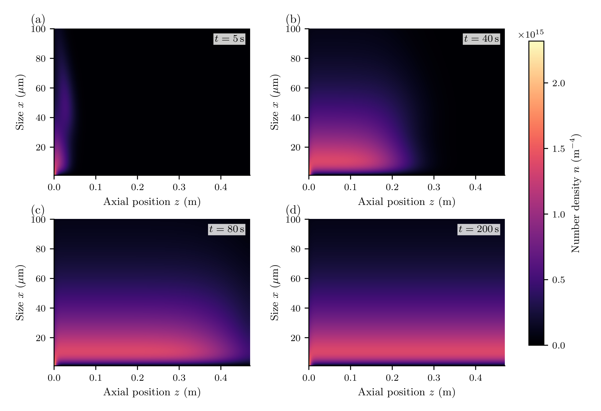
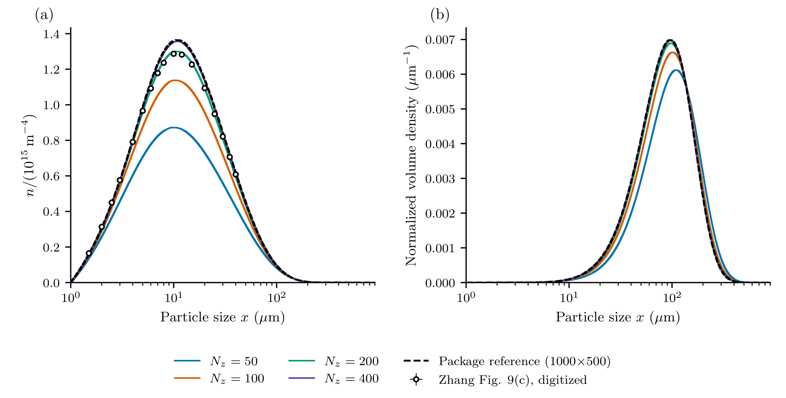
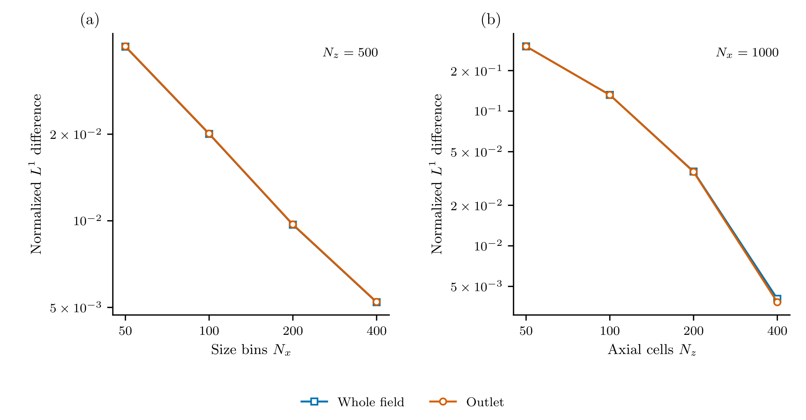
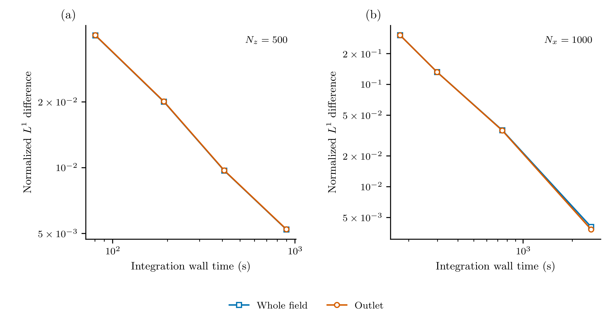

# Precipitation in a continuous tubular reactor

A supersaturated feed enters a tube that initially contains no solute or
particles. Nuclei form as the feed advances, crystals grow, and precipitation
reduces the dissolved concentration. Axial dispersion spreads the residence-time
distribution. The outlet PSD therefore depends on both reaction kinetics and
mixing along the tube; a well-mixed batch model cannot describe its startup.

This calculation uses Case 7A of [Zhang et al. (2024)](https://doi.org/10.1016/j.compchemeng.2024.108612).
It targets the transient fields and outlet distributions in Figure 9(a,c) and
the resolution dependence discussed with Figures 10–12. Here we use
geometry-aware WENO5 on logarithmic particle-size bins and MUSCL on uniform
axial cells, refining the two coordinates separately. MUSCL reconstructs axial
advection; axial dispersion uses the native conservative centred face gradient.
These are not CADET's WENO23/WENO35 algorithms, boundary
closures or timings. Case 7B is not included: the printed
lognormal centre needs an unambiguous conversion to SI units before it can be
used as a reproduction input.

## Model and boundaries

Let ``n(x,z,t)`` be number density per reactor-fluid volume per particle length,
``c(z,t)`` dissolved concentration, ``x`` particle length and ``z`` axial position.
The particles obey

```math
\frac{\partial n(x,z,t)}{\partial t}
+v_{\mathrm{ax}}\frac{\partial n(x,z,t)}{\partial z}
+\frac{\partial[G(z,t)n(x,z,t)]}{\partial x}
=D_{\mathrm{ax}}\frac{\partial^2n(x,z,t)}{\partial z^2}.
```

Nucleation supplies the size-boundary flux

```math
G(z,t)n(x_c,z,t)=B_0(z,t),\qquad
B_0=k_p s^{u}+k_b s^{b}M,\qquad
G=k_gs,
```

where

```math
s(z,t)=\max\!\left(\frac{c(z,t)-c_{\mathrm{eq}}}{c_{\mathrm{eq}}},0\right),
\qquad
M(z,t)=\rho k_v\int_{x_c}^{\infty}x^3n(x,z,t)\,dx.
```

Primary nucleation starts the population. Secondary nucleation is proportional
to the crystal mass concentration ``M``. There is no aggregation, breakage or
growth-rate dispersion in this case. Below saturation, both rates stop; this
precipitation-only model does not redissolve existing particles. The solute balance is

```math
\frac{\partial c(z,t)}{\partial t}
+v_{\mathrm{ax}}\frac{\partial c(z,t)}{\partial z}
=D_{\mathrm{ax}}\frac{\partial^2c(z,t)}{\partial z^2}
-\rho k_v\left[B_0(z,t)x_c^3+
3\int_{x_c}^{\infty}G(z,t)x^2n(x,z,t)\,dx\right].
```

Both balances use Danckwerts inflow and a zero-gradient outlet:

```math
v_{\mathrm{ax}}n(x,0,t)-D_{\mathrm{ax}}\frac{\partial n(x,0,t)}{\partial z}=0,
\qquad \frac{\partial n(x,L,t)}{\partial z}=0,
```

```math
v_{\mathrm{ax}}c(0,t)-D_{\mathrm{ax}}\frac{\partial c(0,t)}{\partial z}
=v_{\mathrm{ax}}c_{\mathrm{feed}},
\qquad \frac{\partial c(L,t)}{\partial z}=0.
```

Initially ``n(x,z,0)=0`` and ``c(z,0)=0``. Concentrations refer to local fluid volume, with no extra porosity factor
in the exchange. The axial velocity is ``Q/(A\varepsilon)``, not ``Q/A``;
porosity changes the residence time substantially.

| Input | Value and units |
|:--|:--|
| ``c_{\mathrm{feed}}``, ``c_{\mathrm{eq}}`` | 9, 0.4 kg m⁻³ |
| ``\rho``, ``k_v`` | 1200 kg m⁻³, 0.524 |
| ``k_p``, ``u`` | 5 m⁻³ s⁻¹, 10 |
| ``k_b``, ``b`` | 4×10⁸ kg⁻¹ s⁻¹, 2 |
| ``k_g`` | 7×10⁻⁶ m s⁻¹ |
| ``x_c``, ``x_{\max}`` | 1, 900 µm |
| ``Q``, ``A``, ``\varepsilon`` | 1.67×10⁻⁷ m³ s⁻¹, 1.46×10⁻⁴ m², 0.21 |
| ``L``, ``D_{\mathrm{ax}}`` | 0.47 m, 4.2×10⁻⁵ m² s⁻¹ |

These are [supporting-information Table S8](https://ars.els-cdn.com/content/image/1-s2.0-S0098135424000309-mmc1.pdf) inputs. The authors' public
[verification script](https://github.com/cadet/CADET-Verification/blob/090606762fc657510a9e31c547890bf9a17ffb59/src/benchmark_models/settings_crystallization.py)
confirms the empty initial state and porosity convention. Its flow uses exactly
10 mL/min; this script retains the SI table's rounded ``Q``. The coefficients
have the units above because ``s`` is dimensionless.

## Assemble local precipitation, then add axial transport

The logarithmic edges put more cells near the small-particle peak without
changing the full 1–900 µm domain. Each local population state is a bin integral,
``N_i(z,t)=\int_{x_i^-}^{x_i^+}n(x,z,t)\,dx``; the axial adapter stores its
cell average in ``z``. Density plots divide by the actual size-bin widths.
The kinetic callbacks read the local dissolved concentration; they do not
need to know the axial mesh:

```julia
p = ContinuousPrecipitation.parameters()
nx, nz = 100, 100
grid = Grid1D(exp.(range(log(p.xc),log(p.xmax);length=nx+1));coordinate=:length)
supersaturation(p,ctx) = max(ctx.bulk.c/p.ceq-1,zero(ctx.bulk.c))
growth(x,p,t,ctx) = p.kg*supersaturation(p,ctx)
function nucleation(p,t,ctx)
    s = supersaturation(p,ctx)
    M = 1e12*p.rho*p.kv*moment(ctx.grid,ctx.N,3)
    (p.kp*s^p.u + p.kb*s^p.b*M)/1e12
end
model = PBMModel(
    growth=Growth(rate=growth),
    primary_secondary=Nucleation(rate=nucleation,size=first(grid.edges)),
)
operator = compile(model,grid;methods=TermMethods(
    growth=WENO5(),by_term=(primary_secondary=BoundaryInjection(:left),)))
cubes = grid.centers.^3
bulk_balance(ctx,p,t) = (c=-sum((1e12*p.rho*p.kv*cubes[i]) *
    ctx.derivatives.crystals[i] for i in eachindex(cubes)),)
system = PBMSystem((crystals=operator,);bulk_rhs=bulk_balance,
    nonnegative_bulk=(:c,))
local_problem = PBMProblem(system,(crystals=zeros(length(grid)),),(0.,200.);
    bulk0=(c=0.,),p)
reactor = AxialDispersion(AxialGrid(range(0.,p.L;length=nz+1));
    velocity=p.Q/(p.area*p.porosity),dispersion=p.Dax,
    inlet=(p,t)->(populations=(crystals=zeros(length(grid)),),
                  bulk=(c=p.cfeed,)))
problem = axial_problem(local_problem,reactor;axial_scheme=MUSCL())
```

For numerical scaling the internal particle counts are divided by ``10^{12}``.
The rate divides by that scale, the mass callback multiplies by it, and exported
densities restore physical units. This changes no physical coefficient.

The bulk balance subtracts the **current-stage resolved discrete** crystal-mass
increase from solute. For this closed growth/nucleation model it is equivalent to
`ConservativeExchange(:crystals,:c,(x,p,t,ctx)->1e12*p.rho*p.kv*x^3)`, without
reevaluating the growth residual. The reproduction tests compare these two
normal `PBMSystem` routes. Use one of them, not both. A total-derivative balance
would need revisiting if particle escape or other removal mechanisms were added.
This balances material cell by cell before axial fluxes are
added. At finite resolution it differs from separately quadraturing the continuum
sink above, including the mass assigned to the first bin. On coarse uniform size meshes,
a 1-µm nucleus is represented at a much larger first pivot; a higher-order
growth reconstruction alone cannot eliminate that source/material error.
That difference must
shrink under size refinement; it is not evidence of a different physical source.
The upper size boundary is closed. Check its occupancy before treating the
finite-domain calculation as an approximation on an infinite size domain.

## Startup and the outlet distribution



These are physical cell-average number densities on the **1000 logarithmic-size
bins × 500 uniform axial cells** reference mesh. The size axis is linear and
zooms to **1–100 µm**, as in the earlier field figure. The simulation retains
the full **1–900 µm** domain for outlet distributions, errors and inventories.
The actual bin edges are used without image interpolation or smoothing.
The four panels share one linear density colour scale and the earlier figure's
`magma` palette, from zero to the largest density across the four full fields.
Zero and tiny negative tails use the darkest colour, rather than a white mask.
The numerical solution is not clipped or smoothed for display.
At the four saved reference snapshots, the total negative-number fraction is
below ``10^{-23}``; signed values remain in the diagnostics.

Nucleation first populates small sizes near the inlet. Growth moves number to
larger sizes while depletion reduces supersaturation. Axial dispersion spreads
the residence times, so the downstream distribution includes particles with
different growth histories. The 200-s outlet is the comparison time used in
the paper; it is a transient calculation, not an analytical steady solution.



The curves hold **1000 size bins fixed** and use 50, 100, 200 and 400 axial cells.
The dashed curve has 500 axial cells. The left panel is absolute number density
in m⁻⁴. The reported outlet is the last axial cell's average, without extrapolating
a boundary value; its resolution error includes that approximation. The right
panel weights each bin number by its centre cubed and normalizes:

```math
q_{3,i}=\frac{x_i^3N_i}{\Delta x_i\sum_jx_j^3N_j}.
```

The plotted volume density is per micrometre and integrates to one. Larger
particles carry more volume, so its peak need not coincide with the number peak.
A logarithmic size axis changes neither density's linear-size units. Lines are
steps of the computed bin averages; a smooth-looking peak comes from resolution,
not a spline.

The open circles are **17 graph-digitized number-density points** from Zhang's
Figure 9(c), for their 200 × 200 WENO35 calculation at 200 s. The bars represent
±2-pixel extraction uncertainty, not experimental noise. Only the unambiguous
1.5–40 µm portion was extracted. A partial number-density curve cannot define a
normalized volume distribution, so no literature points are invented in the
right panel. The package uses WENO5/MUSCL and the rounded SI flow rate; it is
not the paper's WENO35/WENO35 calculation. At the 17 sampled sizes, the
reference density differs from the digitized ordinate by −3.6% to +5.9%, with
a mean absolute relative difference of 3.2%. This is a pointwise comparison
over the extracted window, not an error integral over the full distribution.

The digitized ordinates are retained unchanged and interpreted on the SI
``\mathrm{m}^{-4}`` density scale used by the model and CADET output. Figure 9's
printed per-micrometre ordinate label is ambiguous: taking it literally would
give about ``3.2\times10^5`` kg m⁻³ of solids in just the digitized size window,
versus 9 kg m⁻³ in the feed. On the SI scale that partial-window estimate is
0.32 kg m⁻³. The literature comparison is conditional on this stated unit
interpretation; no readings were multiplied to improve agreement.

The [extracted points](../assets/continuous_precipitation_log/zhang_figure9c_digitized.csv),
[source and pixel calibration](../assets/continuous_precipitation_log/provenance.json),
and [point-by-point comparison](../assets/continuous_precipitation_log/digitized_point_comparison.csv)
retain the distinction between literature data and the package reference.

## [Refine each coordinate against one reference](@id Refine-size-and-axial-resolution-separately)

Case 7 has **no analytical coupled PSD solution**. The analytical DPFR expression
in the SI belongs to Case 6, a first-order reaction test. Our numerical reference
uses 1000 logarithmic size bins and 500 uniform axial cells, with the same
physical model, WENO5 size reconstruction and MUSCL axial reconstruction as
all comparison runs.

| Path | Varied resolution | Fixed resolution |
|:--|:--|:--|
| Size | ``N_x=50,100,200,400`` | ``N_z=500`` |
| Axial | ``N_z=50,100,200,400`` | ``N_x=1000`` |

These are two paths, not a Cartesian mesh study. Every error uses the **same**
reference. Following the normalization in Eq. 49, the outlet difference is

```math
E_{L^1}=\frac{\int|n(x,L,t)-n^{\mathrm{ref}}(x,L,t)|\,dx}
                  {\int n^{\mathrm{ref}}(x,L,t)\,dx}.
```

An error of 0.1 means 10%. The whole-field version integrates over both size
and axial position. On nonmatching grids, both piecewise-constant densities are
integrated on the common partition of their edges. This preserves bin numbers;
it differs from the paper's spline interpolation. Even exact bin integrals on
two grids have a nonzero piecewise-constant representation difference. These
curves therefore do not establish fifth-order convergence of the full nonlinear
startup problem.
The 1000 × 500 reference is still finite: differences to it are not rigorous
error bounds or evidence of convergence beyond the finest tested mesh.



Panel (a) changes only size resolution; panel (b) changes only axial resolution.
Each shows whole-field and outlet differences at 200 s. The outlet difference
falls from 4.04% to 0.522% along the 50–400-bin size path, and from 30.3% to
0.382% along the 50–400-cell axial path. Coarse axial resolution causes the
larger outlet discrepancy over these tested ranges.
The whole-field and outlet norms are close at this time; the hollow square and
circle markers distinguish the two curves where they overlap.

The first bin also
changes when the size mesh changes: boundary births are deposited in that bin,
and the discrete solute exchange uses its centre-cubed material weight.
The existing Upwind fallbacks near physical size boundaries are retained; the
interior WENO5 stencil is not a fifth-order boundary-source treatment.
Early-time outlet errors are flagged as uninterpretable when the
reference outlet signal is below its nominal summed absolute-tolerance scale;
whole-field comparisons remain available.

[Refinement results](../assets/continuous_precipitation_log/refinement.csv) retain
all four transient times, bulk differences and the outlet-resolution flag.
[Additional observables](../assets/continuous_precipitation_log/refinement_observables.csv)
separate number, material, solute, upper-boundary occupancy and signed minima.

## [Check time resolution, balance and cost](@id Check-the-numerical-reference-and-cost)

The logarithmic first cell makes explicit integration expensive. The production
workflow uses the checked external [SUNDIALS CVODE-BDF](https://sundials.readthedocs.io/en/latest/cvode/Mathematics_link.html)/GMRES adapter through `odeproblem`.
CVODE supplies the time integrator; the paper helper supplies state checks and
a problem-specific linear-solve preconditioner.
CVODE selects its order up to five, with stability-limit detection enabled and
no prescribed restart. This is an adaptive-order solver, not a claim of
fifth-order convergence for the complete problem. Relative tolerance is ``10^{-7}``; absolute
tolerances are ``10^{-14}`` for the ``10^{12}``-scaled bin populations and
``10^{-11}`` kg m⁻³ for solute, with a 0.5-s maximum step. A separate check on
the **same 1000 × 500 mesh** tightens all tolerances tenfold and halves the step
cap. The adapter is compared against native RK4 on a small problem first.
It checks every accepted state at the existing ``10^{-8}`` threshold; for
populations this applies to scaled bin counts. Signed minima and small negative
population contributions are exported without clipping. This external method
has no positivity guarantee.
The linear-solve preconditioner differentiates the native growth stencil with
six-color AD, solves its banded local Jacobian with a rank-one conservative
nucleation/solute correction, and applies a low-order axial factor. Dense
Jacobians independently check the local algebra and cache updates. This changes
the Krylov solve, not the WENO5/MUSCL residual; Sundials controls Jacobian lagging.

Earlier explicit uniform-grid attempts with axial WENO5 failed the
[negative-bulk checks](../assets/continuous_precipitation/failures.csv). Those
historical failures are retained; they were not rerun as logarithmic-grid
production calculations. The present axial reconstruction is MUSCL throughout.

```@eval
using Markdown, PopulationBalanceModels
folder=joinpath(pkgdir(PopulationBalanceModels),"docs","src","assets","continuous_precipitation_log")
rows=split.(readlines(joinpath(folder,"refinement.csv"))[2:end],',')
rows=filter(r->r[1]=="time_refinement",rows)
body=["| Time (s) | Whole-field L¹ | Outlet L¹ | Maximum bulk difference (kg m⁻³) |", "|--:|--:|--:|--:|"]
for r in rows
    outlet = r[12]=="true" ? string(round(parse(Float64,r[9]);sigdigits=3)) : "unresolved outlet signal"
    push!(body,"| $(r[3]) | $(round(parse(Float64,r[8]);sigdigits=3)) | $outlet | $(round(parse(Float64,r[end]);sigdigits=3)) |")
end
Markdown.parse(join(body,"\n"))
```

The whole-field time-refinement difference is below ``5\times10^{-7}`` at
all four snapshots. The largest resolved outlet difference is
``4.6\times10^{-5}`` at 40 s; at 200 s it is ``4.6\times10^{-10}``.
These changes are much smaller than the tested spatial differences. At 5 s
the outlet signal is effectively zero, so a relative outlet error has no
useful accuracy interpretation. This check resolves temporal uncertainty at
the tested settings; it does not remove the finite reference mesh's spatial
uncertainty.

The [reference accounting](../assets/continuous_precipitation_log/reference_accounting.csv)
uses the actual discrete population derivative and axial face fluxes. Solute
uptake and resolved crystal mass cancel locally; reactor inventory changes
through the inlet and outlet. Number is created by nucleation. The closed upper
size boundary is not an escape reservoir; inspect its occupancy before assuming
the finite domain is inactive. The [reference settings and producer record](../assets/continuous_precipitation_log/reference_provenance.toml)
include the first-bin deposition/material ratio and the actual solver diagnostics.
The reference's saved material-rate balance defect is below
``1.4\times10^{-17}`` kg m⁻² s⁻¹. At 200 s the uppermost size bin contains
``3.0\times10^{-9}`` of its resolved solid material: little boundary pileup,
although this occupancy check is not a separate domain-refinement test.



There is one measured integration after a separate small compilation warmup.
Timing includes stepping, state checks and saved states, but excludes assembly,
explicit garbage collection, export and plotting. Lines follow increasing
resolution within a path, not a Pareto front. Single measurements have no
repeatability error bars.

```@eval
using Markdown, PopulationBalanceModels
folder=joinpath(pkgdir(PopulationBalanceModels),"docs","src","assets","continuous_precipitation_log")
rows=split.(readlines(joinpath(folder,"runtimes.csv"))[2:end],',')
body=["| Configuration | Size × axial | Steps | Seconds |", "|:--|--:|--:|--:|"]
for r in rows
    push!(body,"| $(replace(r[1],"_"=>" ")) | $(r[2]) × $(r[3]) | $(r[6]) | $(round(parse(Float64,r[4]);sigdigits=3)) |")
end
Markdown.parse(join(body,"\n"))
```

Full numerical exports, timings and source/dependency identities are retained
under `paper/precipitation/data/`. The earlier uniform-size documentation outputs
and the previous partial 400 × 400 paper study are historical calculations;
they are not used for these errors or figures.

## Minimal run and full reproduction

From a checkout with the [standard environment](../verification.md), this small
native calculation demonstrates the same model assembly without running a
production refinement study:

```julia
using PopulationBalanceModels
include("examples/continuous_precipitation.jl")
problem = ContinuousPrecipitation.build(nx=50,nz=50,mesh=:log,
    scheme=WENO5(),axial_scheme=MUSCL(),tf=5.)
solution = ContinuousPrecipitation.advance(problem,[5.];method=RK4())
```

This small builder uses the equivalent generic `ConservativeExchange` route;
the production wrapper reuses its physical terms and numerical preparation with
the stage-derivative bulk balance shown above.

For the complete study, including the numerical reference and its time check:

```sh
julia --project=paper -e 'using Pkg; Pkg.develop(path=pwd()); Pkg.instantiate()'
julia --project=paper paper/precipitation/run.jl
python paper/precipitation/plot.py
python test/paper_data.py --case 3
julia --project=docs docs/make.jl
```

Focused model, source, exchange and preconditioner checks use
`julia --project=paper test/paper_precipitation.jl`. The nonuniform WENO tests
are in `test/nonuniform_weno.jl`, with the usual package test environment.

The production run is expensive and resumes matching completed configurations.
`--smoke` writes a separate small study under `.cache/paper/`; it does not replace
production data. Plotting reads validated results and saves only 300-dpi PNGs,
shared by the paper and this page. It never reruns a simulation. The full driver
is `paper/precipitation/run.jl`; the physical builder is
[examples/continuous_precipitation.jl](../assets/source/examples/continuous_precipitation.jl).
