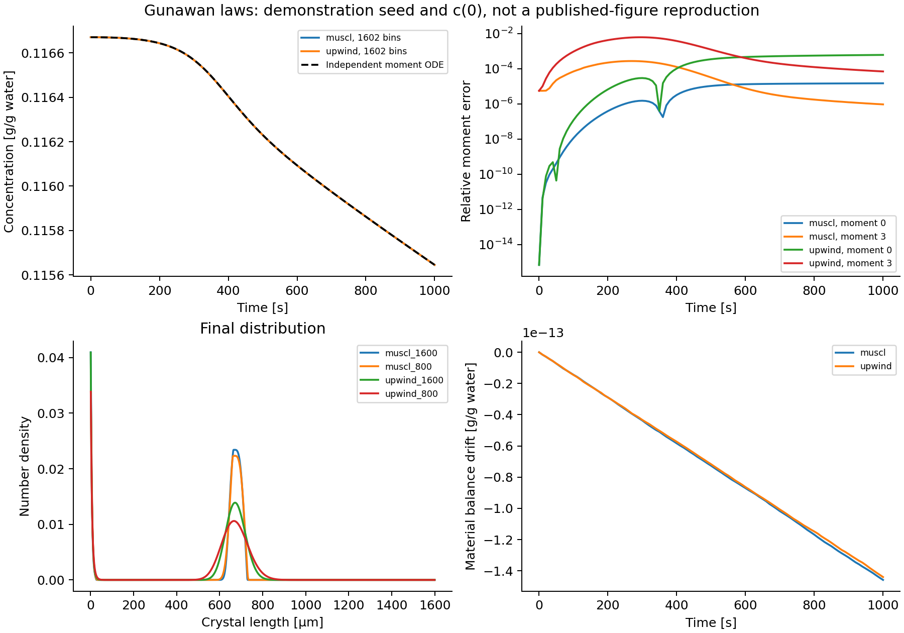

# Gunawan: cooling crystallization

## Coupled equations

Example 2 in [Gunawan, Fusman, and Braatz (2004)](https://web.mit.edu/braatzgroup/80_High_resolution_algorithms_for_multidimensional_population_balance_equations.pdf)
models nucleation and size-dependent growth driven by a changing dissolved
concentration and a prescribed cooling trajectory:

```math
\frac{\partial n(L,t)}{\partial t}
+\frac{\partial [G(L,c(t),T(t))n(L,t)]}{\partial L}
=B_0(c(t),T(t))\delta(L),
```

```math
G(L,c,T)=k_g\left[\frac{c-c_{\mathrm{sat}}(T)}{c_{\mathrm{sat}}(T)}\right]^g(1+0.1L),
\qquad
B_0=k_b\left[\int_0^\infty L^3 n(L,t)\,dL\right]
\left[\frac{c-c_{\mathrm{sat}}(T)}{c_{\mathrm{sat}}(T)}\right]^b,
```

```math
\frac{dc(t)}{dt}=-3\rho_c\int_0^\infty G(L,c(t),T(t))L^2n(L,t)\,dL.
```

Lengths are micrometers, time is seconds, and concentration is grams of solute
per gram of water. The crystal density is ``2.11\times10^{-12}`` g/µm³ and the
paper's shape convention is ``V=\int L^3n\,dL``; no extra spherical factor is added.
The kinetics use ``k_b=4.64\times10^{-7}``, ``b=1.78``, ``k_g=116``, and ``g=1.32``.
The recipe sets growth and nucleation to zero outside supersaturation; these
fractional-power laws do not specify a dissolution branch.

```math
T(t)=32-4(1-e^{-t/18600}),\qquad
c_{\mathrm{sat}}(T)=1.721\times10^{-4}T^2-5.88\times10^{-3}T+0.1286.
```

## Initial data and the reproduction limit

Equation 34 prints the seed polynomial

```math
n(L,0)=-3.48\times10^{-4}L^2+0.136L-13.3,
\qquad 180.5\le L\le210.5.
```

At that precision its maximum is approximately -0.01264368, so it cannot be
used as a nonnegative population. Clipping produces an empty seed and changes
secondary nucleation. The published case description also does not specify an
unambiguous initial dissolved concentration. The builder therefore requires
`initial_density` and `c0`; it does not silently repair the polynomial.

The executable comparison uses the explicitly chosen seed
``0.08[1-((L-195.5)/15)^2]`` on that support, and ``c(0)=c_{\mathrm{sat}}(32)``.
It now runs to the paper's 1000-second horizon. These inputs support a numerical
coupling/refinement study, not reproduction of the published CSD or error table.
The paper's comparison also used HR1 and Lax–Wendroff, which are not provided
by the current package.

## Code deployment and term treatment

`examples/papers/gunawan2004_case2.jl` contains the reusable builder. It declares
nucleation explicitly as a named term, separately from growth:

```julia
model = PBMModel(
    growth=Growth(rate=G),
    nucleation=Nucleation(rate=J,size=0.0),
)
methods = TermMethods(growth=MUSCL(),
    by_term=(nucleation=BoundaryInjection(:left),))
operator = compile(model,grid;methods,bc=SizeBC(NoFlux(),NoFlux()))
system = PBMSystem((crystals=operator,);
    fields=(p,t)->(T=temperature(t),),
    nonnegative_bulk=(:c,),
    exchanges=(ConservativeExchange(:crystals,:c,
        (L,p,t,ctx)->p.rho*L^3; mechanisms=(:growth,:nucleation)),))
```

`G(L,p,t,ctx)` reads the current `ctx.bulk.c`; `J(p,t,ctx)` reads that
concentration and `moment(ctx.system,:crystals,3)`. Temperature is a prescribed
field, while concentration is a state advanced with the distribution at every
SSPRK stage. The grid must start at zero for the boundary source.

The number influx ``G(0,t)n(0,t)=B_0(t)`` is deposited without dividing by growth.
The exchange uses the selected discrete growth and nucleation residuals with
weight ``\rho_cL^3``. Therefore it preserves the discrete dissolved-plus-particle
quantity. The continuum zero-size source has zero mass; its finite first pivot
has a small positive discrete mass, also included in that exchange.

## Independent moment comparison

Writing ``\mu_k(t)=\int L^k n(L,t)\,dL`` and ``h(t)=k_gs(t)^g`` gives

```math
\frac{d\mu_0}{dt}=k_b\mu_3s^b,\qquad
\frac{d\mu_k}{dt}=k\,h(t)[\mu_{k-1}+0.1\mu_k],\quad k=1,2,3,
\qquad
\frac{dc}{dt}=-\rho_c\frac{d\mu_3}{dt}.
```

The benchmark integrates these separately coded continuum equations with RK4
and checks reference step halving from 0.01 to 0.005 s. It initializes continuum
moments by exact three-point quadrature of the demonstration polynomial, rather
than fitting them to the sectional pivots. Seed-support edges are inserted into
the sectional grid so cell quadrature does not straddle the discontinuity.

```sh
julia --project=. examples/cooling_crystallization_benchmark.jl
python docs/benchmarks/plot_case_studies.py cooling
```



The 802/1602-cell runs compare upwind and MUSCL at a 0.05 s time step. Final
relative third-moment errors against the continuum ODE were about
``1.40\times10^{-4}`` / ``6.99\times10^{-5}`` for upwind and
``1.47\times10^{-6}`` / ``9.36\times10^{-7}`` for MUSCL. The reference step-halving
difference was below ``1.3\times10^{-12}``. The grid study does not isolate
spatial order: time and boundary-source discretization errors remain.

[Moment histories](../assets/cooling_benchmark/moments.csv),
[continuum reference](../assets/cooling_benchmark/reference.csv), and
[input metadata](../assets/cooling_benchmark/inputs.txt) record this calculation.
The concentration and material-balance panels check different properties:
discrete conservation can be excellent while continuum moment error is finite.

For a paper reproduction, replace the demonstration seed and `c0` with confirmed
values, then compare the CSD at 1000 s and moments under the same size/time
intervals as the publication. The builder also provides `build_moments` for the
native exact-closure API; the optional integration tests compare it with the
independent moment equations.
