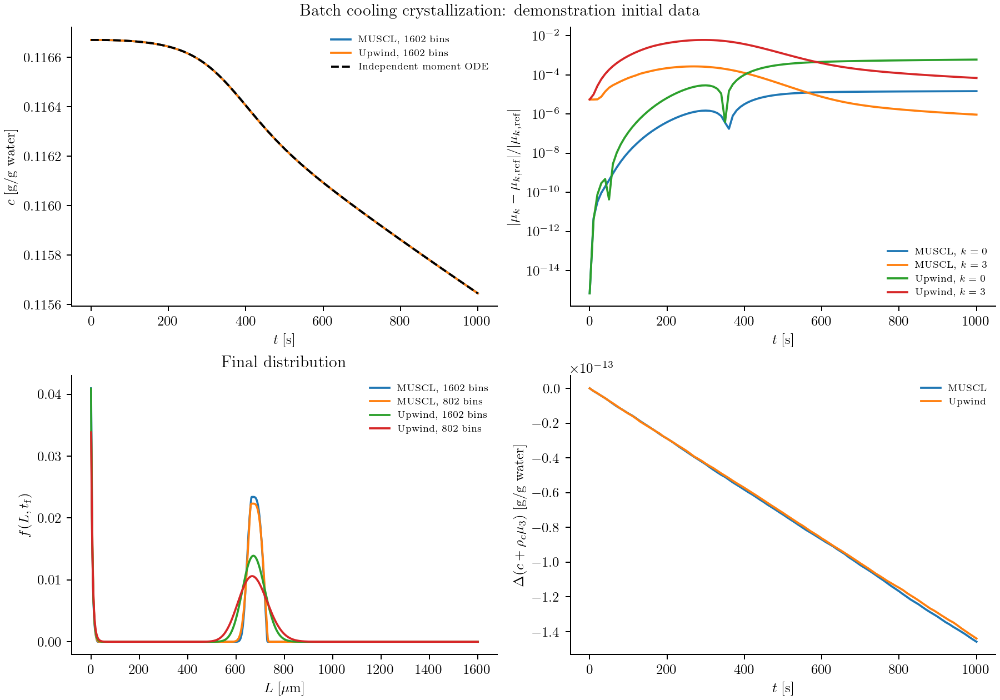

# Batch cooling crystallization

Cooling a saturated solution makes crystallization possible, but it does not
determine the final crystal sizes. Existing seeds grow, new crystals nucleate,
and both processes reduce the supersaturation that drives them. To predict the
size distribution, we need to solve a population balance and a solute balance
together.

Here we consider a seeded batch of potassium nitrate with size-dependent growth
and secondary nucleation. The kinetics and cooling trajectory come from
[Gunawan, Fusman, and Braatz (2004), Example 2](https://web.mit.edu/braatzgroup/80_High_resolution_algorithms_for_multidimensional_population_balance_equations.pdf).
This calculation illustrates how a rate law reads a shared concentration, how
nucleation enters through a boundary, and how the discrete solute balance is
constructed from the particle calculation.

## Write the two balances

Let ``f(L,t)`` denote the number density at crystal length ``L``. For ``L>0``,
growth transports crystals through size space:

```math
\frac{\partial f(L,t)}{\partial t}
+\frac{\partial\!\left[G(L,c(t),T(t))f(L,t)\right]}{\partial L}=0.
```

Nuclei enter at zero length through the boundary condition

```math
G(0,c(t),T(t))f(0,t)=B_0(c(t),T(t)).
```

Write the relative supersaturation as
``s(t)=\max[c(t)/c_{\mathrm{sat}}(T(t))-1,0]``. The kinetic laws are

```math
G(L,c,T)=k_gs^g(1+\alpha L),\qquad
B_0(c,T)=k_b s^b\int_0^\infty L^3f(L,t)\,dL.
```

The concentration decreases as crystal volume increases:

```math
\frac{dc(t)}{dt}=-3\rho_c\int_0^\infty
L^2G(L,c(t),T(t))f(L,t)\,dL.
```

Length is in µm, time in seconds, and ``c`` in grams of solute per gram of
water. The volume convention is ``\int L^3f\,dL``; no spherical shape factor is
inserted. At zero length a nucleus has zero continuum volume. The model sets
growth and nucleation to zero below saturation: it does not describe dissolution.

## Supply parameters and the cooling trajectory

The reusable recipe is in `examples/papers/gunawan2004_case2.jl`. Load it from
the installed source directory:

```@example cooling
using PopulationBalanceModels
include(joinpath(pkgdir(PopulationBalanceModels),"examples","papers","gunawan2004_case2.jl"))
import .Gunawan2004Case2
const recipe = Gunawan2004Case2
p = recipe.parameters()
```

The fields are ``k_b=4.64\times10^{-7}``, ``b=1.78``, ``k_g=116``, ``g=1.32``,
``\rho_c=2.11\times10^{-12}`` g/µm³, and ``\alpha=0.1`` µm⁻¹. They can be
changed explicitly, for example with `recipe.parameters(kg=120.0)`.

Temperature is a prescribed operating history:

```math
T(t)=32-4(1-e^{-t/18600}),\qquad
c_{\mathrm{sat}}(T)=1.721\times10^{-4}T^2-5.88\times10^{-3}T+0.1286.
```

The recipe implements these as `temperature(t)` and `solubility(T)`. Unlike
temperature, concentration belongs in the state vector because the model must
solve for it.

## Define growth and nucleation

The following are the callbacks used by the recipe:

```@example cooling
supersaturation(ctx) = max(ctx.bulk.c / recipe.solubility(ctx.fields.T) - 1, 0.0)

function growth_rate(L,p,t,ctx)
    p.kg * supersaturation(ctx)^p.g * (1 + p.size_factor * L)
end

function nucleation_rate(p,t,ctx)
    p.kb * moment(ctx,3) * supersaturation(ctx)^p.b
end

model = PBMModel(
    growth = Growth(rate=growth_rate),
    nucleation = Nucleation(rate=nucleation_rate,size=0.0),
)
nothing # hide
```

`growth_rate` returns a length velocity in µm/s. `nucleation_rate` returns a total
number creation rate, so it receives no length argument. `moment(ctx,3)` reads
the third moment of this population at the current integration stage. The same
callback works with bin numbers or the exactly closed moment representation.

## Put nucleation at the boundary

We use a finite length range, 0–1600 µm. The seed support is split at its endpoints
so a cell does not straddle the jump in the initial density:

```@example cooling
edges = sort!(unique(vcat(collect(0.0:0.5:1600.0),180.5,210.5)))
grid = Grid1D(edges;coordinate=:length)
methods = TermMethods(
    growth = MUSCL(),
    by_term = (nucleation=BoundaryInjection(:left),),
)
operator = compile(model,grid;methods,bc=SizeBC(NoFlux(),NoFlux()))
nothing # hide
```

MUSCL reconstructs the density used in the growth face flux. BoundaryInjection
adds ``B_0`` to the first bin as an inward number flux; it does not evaluate
``f(0,t)=B_0/G(0,t)``. The boundary nucleation term supplies the influx even
though the transport boundary itself is NoFlux. Adding an InflowFlux for the
same nuclei would count them twice.

The upper edge is closed. Its last bins should remain negligible; otherwise
enlarge the domain before interpreting the result.

## Couple the solute concentration

Each crystal carries the solute weight ``\rho_cL^3``. Use that same weight to
calculate how much solute the resolved population gains:

```@example cooling
system = PBMSystem((crystals=operator,);
    fields = (p,t)->(T=recipe.temperature(t),),
    nonnegative_bulk = (:c,),
    exchanges = (ConservativeExchange(:crystals,:c,
        (L,p,t,ctx)->p.rho*L^3;
        mechanisms=(:growth,:nucleation)),),
)
nothing # hide
```

ConservativeExchange subtracts the selected discrete particle-material rate
from the concentration derivative. Consequently,
``c+\rho_c\sum_iL_i^3N_i`` is conserved for this closed system. A boundary
nucleus is represented at the first positive pivot and therefore has a small
discrete volume. Including nucleation in the exchange accounts for it. That
finite-grid contribution approaches the zero-volume continuum source as the
first bin is refined.

Both concentration and distribution are evaluated at every Runge–Kutta stage.
There is no separate concentration update after the population solve.

## Initialize and solve

The reported seed is

```math
f(L,0)=
\begin{cases}
-3.48\times10^{-4}L^2+0.136L-13.3,&180.5\le L\le210.5,\\
0,&\text{otherwise}.
\end{cases}
```

There is a numerical discrepancy in these printed coefficients:

```@example cooling
recipe.reported_seed_density(195.5)
```

The polynomial is negative even at its maximum within the stated support.
The runner retains it literally and rejects it as an initial population. A
resolved nonnegative seed is needed to complete the published comparison; no
replacement is used as the benchmark default. A separate numerical illustration
with explicitly stated seed data is shown below.

Once the initial data are resolved, an input file can return
`(initial_density=f0,c0=c0,provenance="Source of these initial data")`. A saturated
start has ``c(0)=c_{\mathrm{sat}}(32)=0.1166704``. State this choice explicitly.
The remaining construction is:

```julia
inputs = include("/path/to/cooling_inputs.jl")
N0 = recipe.initial_counts(grid,inputs.initial_density)
problem = PBMProblem(system,(crystals=N0,),(0.0,1000.0);
    bulk0=(c=inputs.c0,),p)
solution = simulate(problem;method=SSPRK33(),dt=0.01,saveat=0.0:10.0:1000.0)

crystals = population(problem,solution.u[end],:crystals)
final_density = density(grid,crystals)
final_concentration = bulk(problem,solution.u[end],:c)
```

## Check the distribution against its moments

For this growth law the first four moment equations close exactly:

```math
\frac{d\mu_0(t)}{dt}=k_b\mu_3(t)s(t)^b,
\qquad \mu_k(t)=\int_0^\infty L^kf(L,t)\,dL,
```

```math
\frac{d\mu_k(t)}{dt}=k k_gs(t)^g[\mu_{k-1}(t)+\alpha\mu_k(t)],
\quad k=1,2,3,\qquad
\frac{dc(t)}{dt}=-\rho_c\frac{d\mu_3(t)}{dt}.
```

These ODEs provide an independent check of the sectional calculation. Material
balance alone is insufficient: the discrete exchange can conserve material
while the distribution still has substantial discretization error.

The runner compares upwind and MUSCL with an independent RK4 moment solution,
checked by halving its time step. It exports concentration, moments, final
distributions, and material drift:

```sh
julia --project=. examples/cooling_crystallization_benchmark.jl /path/to/cooling_inputs.jl
python docs/benchmarks/plot_case_studies.py cooling
```

The default is 3200 bins with a 0.01 s time step. Include 32000 bins to approach
the 0.05 µm reference spacing in the source study. This compares solutions of
the model; the published HR1 and Lax–Wendroff algorithms are not implemented.

## Numerical illustration with stated seed data

The panels below retain a separate calculation with
``f(L,0)=0.08[1-((L-195.5)/15)^2]`` on 180.5–210.5 µm and
``c(0)=c_{\mathrm{sat}}(32)``. This seed is a demonstration choice, not a correction
to the printed polynomial. The calculation uses upwind and MUSCL, an independent
moment reference, and material-balance diagnostics. It does not establish a
reproduction of the published figures.



The input provenance and raw data remain in
`docs/benchmarks/diagnostics/cooling_benchmark/`. Re-render this retained evidence with
`python docs/benchmarks/plot_case_studies.py illustrations --usetex`.
