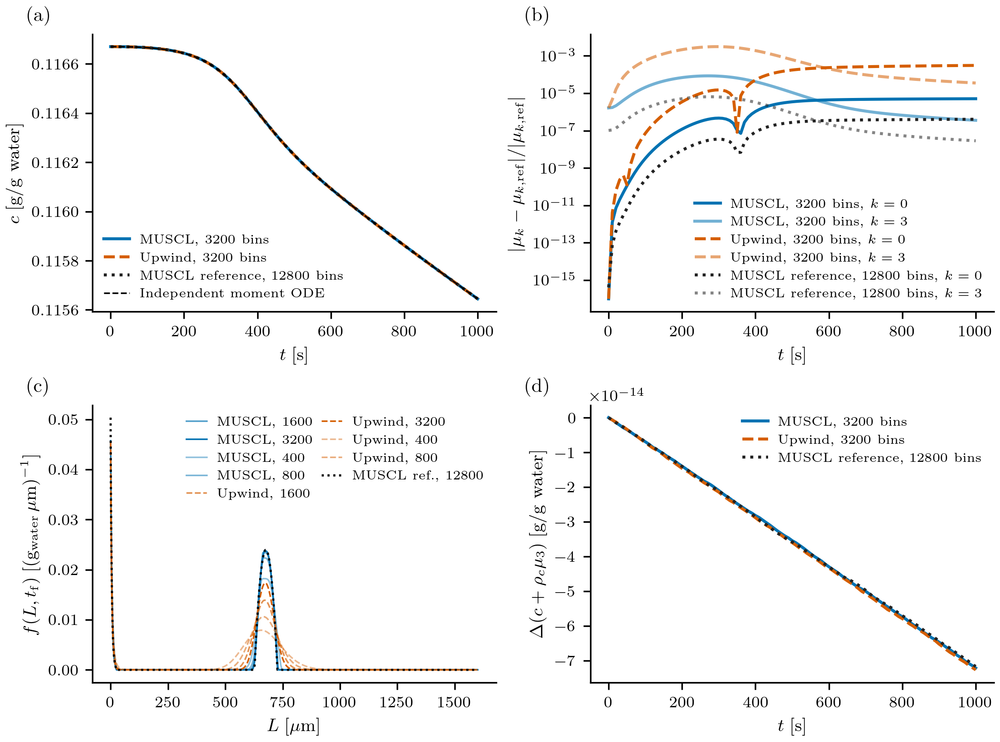
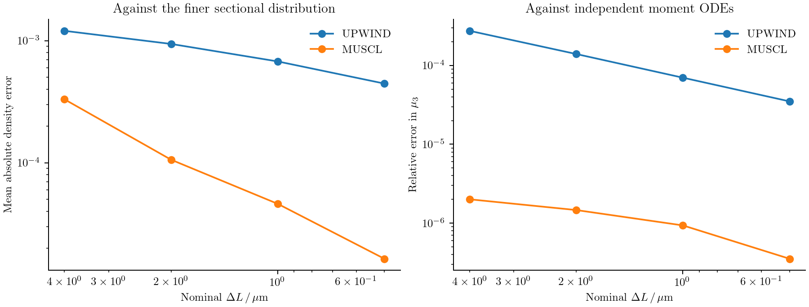

# Batch cooling crystallization

Cooling a saturated solution makes crystallization possible, but it does not
determine the final crystal sizes. Existing seeds grow, new crystals nucleate,
and both processes reduce the supersaturation that drives them. To predict the
size distribution, we need to solve a population balance and a solute balance
together.

Here we consider a seeded batch of potassium nitrate with size-dependent growth
and secondary nucleation. The kinetics and cooling trajectory come from
[Gunawan, Fusman, and Braatz (2004), Example 2](https://web.mit.edu/braatzgroup/80_High_resolution_algorithms_for_multidimensional_population_balance_equations.pdf).
This calculation illustrates how a rate law reads a shared concentration, how
nucleation enters through a boundary, and how the discrete solute balance is
constructed from the particle calculation.

## Write the two balances

Let ``f(L,t)`` denote the number density at crystal length ``L``. For ``L>0``,
growth transports crystals through size space:

```math
\frac{\partial f(L,t)}{\partial t}
+\frac{\partial\!\left[G(L,c(t),T(t))f(L,t)\right]}{\partial L}=0.
```

Nuclei enter at zero length through the boundary condition

```math
G(0,c(t),T(t))f(0,t)=B_0(c(t),T(t)).
```

Write the relative supersaturation as
``s(t)=\max[c(t)/c_{\mathrm{sat}}(T(t))-1,0]``. The kinetic laws are

```math
G(L,c,T)=k_gs^g(1+\alpha L),\qquad
B_0(c,T)=k_b s^b\int_0^\infty L^3f(L,t)\,dL.
```

The concentration decreases as crystal volume increases:

```math
\frac{dc(t)}{dt}=-3\rho_c\int_0^\infty
L^2G(L,c(t),T(t))f(L,t)\,dL.
```

Length is in µm, time in seconds, and ``c`` in grams of solute per gram of
water. The volume convention is ``\int L^3f\,dL``; no spherical shape factor is
inserted. At zero length a nucleus has zero continuum volume. The model sets
growth and nucleation to zero below saturation: it does not describe dissolution.

## Supply parameters and the cooling trajectory

The reusable recipe is in `examples/papers/gunawan2004_case2.jl`. Load it from
the installed source directory:

```@example cooling
using PopulationBalanceModels
include(joinpath(pkgdir(PopulationBalanceModels),"examples","papers","gunawan2004_case2.jl"))
import .Gunawan2004Case2
const recipe = Gunawan2004Case2
p = recipe.parameters()
```

The fields are ``k_b=4.64\times10^{-7}``, ``b=1.78``, ``k_g=116``, ``g=1.32``,
``\rho_c=2.11\times10^{-12}`` g/µm³, and ``\alpha=0.1`` µm⁻¹. They can be
changed explicitly, for example with `recipe.parameters(kg=120.0)`.

Temperature is a prescribed operating history:

```math
T(t)=32-4(1-e^{-t/18600}),\qquad
c_{\mathrm{sat}}(T)=1.721\times10^{-4}T^2-5.88\times10^{-3}T+0.1286.
```

The recipe implements these as `temperature(t)` and `solubility(T)`. Unlike
temperature, concentration belongs in the state vector because the model must
solve for it.

## Define growth and nucleation

The following are the callbacks used by the recipe:

```@example cooling
supersaturation(ctx) = max(ctx.bulk.c / recipe.solubility(ctx.fields.T) - 1, 0.0)

function growth_rate(L,p,t,ctx)
    p.kg * supersaturation(ctx)^p.g * (1 + p.size_factor * L)
end

function nucleation_rate(p,t,ctx)
    p.kb * moment(ctx,3) * supersaturation(ctx)^p.b
end

model = PBMModel(
    growth = Growth(rate=growth_rate),
    nucleation = Nucleation(rate=nucleation_rate,size=0.0),
)
nothing # hide
```

`growth_rate` returns a length velocity in µm/s. `nucleation_rate` returns a total
number creation rate, so it receives no length argument. `moment(ctx,3)` reads
the third moment of this population at the current integration stage. The same
callback works with bin numbers or the exactly closed moment representation.

## Put nucleation at the boundary

We use a finite length range, 0–1600 µm. The initial distribution is split at its support endpoints
so a cell does not straddle the jump in the initial density:

```@example cooling
edges = sort!(unique(vcat(collect(0.0:0.5:1600.0),180.5,210.5)))
grid = Grid1D(edges;coordinate=:length)
methods = TermMethods(
    growth = MUSCL(),
    by_term = (nucleation=BoundaryInjection(:left),),
)
operator = compile(model,grid;methods,bc=SizeBC(NoFlux(),NoFlux()))
nothing # hide
```

MUSCL reconstructs the density used in the growth face flux. BoundaryInjection
adds ``B_0`` to the first bin as an inward number flux; it does not evaluate
``f(0,t)=B_0/G(0,t)``. The boundary nucleation term supplies the influx even
though the transport boundary itself is NoFlux. Adding an InflowFlux for the
same nuclei would count them twice.

The upper edge is closed. Its last bins should remain negligible; otherwise
enlarge the domain before interpreting the result.

## Couple the solute concentration

Each crystal carries the solute weight ``\rho_cL^3``. Use that same weight to
calculate how much solute the resolved population gains:

```@example cooling
system = PBMSystem((crystals=operator,);
    fields = (p,t)->(T=recipe.temperature(t),),
    nonnegative_bulk = (:c,),
    exchanges = (ConservativeExchange(:crystals,:c,
        (L,p,t,ctx)->p.rho*L^3;
        mechanisms=(:growth,:nucleation)),),
)
nothing # hide
```

ConservativeExchange subtracts the selected discrete particle-material rate
from the concentration derivative. Consequently,
``c+\rho_c\sum_iL_i^3N_i`` is conserved for this closed system. A boundary
nucleus is represented at the first positive pivot and therefore has a small
discrete volume. Including nucleation in the exchange accounts for it. That
finite-grid contribution approaches the zero-volume continuum source as the
first bin is refined.

Both concentration and distribution are evaluated at every Runge–Kutta stage.
There is no separate concentration update after the population solve.

## Choose the initial conditions

The printed initial condition is a quadratic on 180.5–210.5 µm:

```math
f(L,0)=
\begin{cases}
-3.48\times10^{-4}L^2+0.136L-13.3,&180.5\le L\le210.5,\\
0,&\text{otherwise}.
\end{cases}
```

At the displayed precision this polynomial is negative throughout its support;
its maximum is approximately −0.01264. The recipe retains it literally as
`reported_initial_density`. This is an initial-condition discrepancy, not a
missing measured dataset. We do not clip the function or infer new coefficients.

For **our numerical benchmark**, choose a nonnegative parabolic initial
population on the same size interval:

```math
f(L,0)=
\begin{cases}
0.08\left[1-\left(\dfrac{L-195.5}{15}\right)^2\right],
&180.5\le L\le210.5,\\
0,&\text{otherwise}.
\end{cases}
\qquad c(0)=c_{\mathrm{sat}}(32)=0.1166704.
```

This gives a smooth peak with compact support and known moments. The saturated
start makes growth and nucleation initially zero; cooling then creates the
driving force. These are stated choices for this calculation, not corrected
paper coefficients or a claim to reproduce its original distribution curves.
The kinetics, cooling trajectory, and coupled balances are retained.

```@example cooling
f0 = recipe.benchmark_initial_density
c0 = recipe.solubility(recipe.temperature(0.0))
N0 = recipe.initial_counts(grid,f0)
problem = PBMProblem(system,(crystals=N0,),(0.0,10.0);
    bulk0=(c=c0,),p)
solution = simulate(problem;method=SSPRK33(),dt=0.05,saveat=[0.0,10.0])
crystals = population(problem,solution.u[end],:crystals)
final_concentration = bulk(problem,solution.u[end],:c)
nothing # hide
```

`initial_counts` integrates the initial density over every size bin. For this
piecewise polynomial, aligning the support endpoints makes its three-point
Gauss rule exact for the initial bin numbers. The full runner continues to
1000 s and compares several grids.

## Construct a numerical reference

There is no analytical distribution solution for this concentration-dependent
problem. We follow the reference-solution strategy of the source study: run a
finer sectional calculation, then check its moments independently. Here the
reference is MUSCL with 12800 bins over 0–1600 µm and SSPRK33 at 0.1 s. A second
calculation uses 6400 bins at the same time step. Their final relative L1
distribution difference is about **0.42%**. A time-step check at 6400 bins,
0.1 versus 0.05 s, changes the distribution by about **0.0013%**.

These differences are refinement diagnostics, not certified error bounds; the
fine solution is not labelled exact. The paper used its HR1 method at 32000 bins
and 0.01 s. We use the package's MUSCL implementation and a smaller documented
budget. The runner exposes `reference_bins`, `check_bins`, and `dt` for a more
expensive comparison.

The first four continuum moment equations close exactly for the affine growth
law:

```math
\mu_k(t)=\int_0^\infty L^kf(L,t)\,dL,\qquad
\frac{d\mu_0(t)}{dt}=k_b\mu_3(t)s(t)^b,
```

```math
\frac{d\mu_k(t)}{dt}=k k_gs(t)^g
[\mu_{k-1}(t)+\alpha\mu_k(t)],\quad k=1,2,3,
\qquad
\frac{dc(t)}{dt}=-\rho_c\frac{d\mu_3(t)}{dt}.
```

An independently coded RK4 calculation integrates these five ODEs and halves
its own time step. The final fine-grid third moment differs from the continuum
moment result by about ``2.8\times10^{-8}`` in relative terms. Agreement of a
few moments does not establish pointwise accuracy of the size distribution,
which is why the sectional refinement check is also needed.

## Compare distributions and bulk concentration



The concentration follows the independent moment calculation closely.
Nucleation creates a small-size population, while the initial population shifts
toward larger lengths. Upwind broadens these features; MUSCL resolves them
more sharply. The panels use the same stated initial conditions and the same
rate callbacks on every grid.

The final relative L1 distribution errors against the 12800-bin reference are:

| Nominal bins | Upwind | MUSCL |
|--:|--:|--:|
| 400 | 104% | 28.7% |
| 800 | 81.5% | 9.17% |
| 1600 | 58.6% | 3.99% |
| 3200 | 38.5% | 1.41% |

These distribution errors are much larger than the corresponding third-moment
errors. A few accurately predicted moments can hide substantial peak broadening.

ConservativeExchange checks a different property: the resolved material balance
``c+\rho_c\sum_iL_i^3N_i``. A nearly constant balance cannot by itself establish
an accurate distribution, because the exchange conserves the discrete material
even when growth is numerically diffusive.

## Measure grid error

The runner integrates the piecewise-constant fine-grid density over each coarse
bin. This conservative projection avoids comparing a coarse bin number with a
fine-grid point sample. If ``\bar f_i^{\mathrm{ref}}`` denotes the projected
reference, the mean absolute density error is

```math
E_{\mathrm{mean}}=
\frac{1}{L_{\max}-L_{\min}}
\sum_i\Delta L_i\left|\frac{N_i}{\Delta L_i}-\bar f_i^{\mathrm{ref}}\right|.
```

It also reports relative L1 error, RMS and maximum density errors, concentration
error, moment error, and maximum material-balance drift. Coarse grids have
400, 800, 1600, and 3200 nominal bins; extra edges split the initial support
when needed. The reference's own spatial error should be considered when
interpreting the smallest coarse-grid errors.



Regenerate the complete comparison without an external input file:

```sh
julia --project=. examples/cooling_crystallization_benchmark.jl
python docs/benchmarks/plot_transport_comparisons.py cooling --usetex
julia --project=docs docs/make.jl
```

An optional Julia input file may override `initial_density`, `c0`, `provenance`,
`grids`, `reference_bins`, `check_bins`, `dt`, and `tf`. Keep the provenance
accurate when changing initial conditions. Raw results, reference checks, and
run settings are stored in `docs/src/assets/gunawan_example2/`. These figures
replace the earlier separate demonstration panels with one runnable,
consistently specified numerical benchmark.

## Complete runnable script

The code below is read from the example source during the documentation build.
Run it from the repository root using the environment described above.

### `examples/cooling_crystallization_benchmark.jl`

```@eval
using Markdown, PopulationBalanceModels
Markdown.MD([Markdown.Code("julia",read(joinpath(pkgdir(PopulationBalanceModels),"examples","cooling_crystallization_benchmark.jl"),String))])
```

### `examples/papers/gunawan2004_case2.jl`

```@eval
using Markdown, PopulationBalanceModels
Markdown.MD([Markdown.Code("julia",read(joinpath(pkgdir(PopulationBalanceModels),"examples","papers/gunawan2004_case2.jl"),String))])
```
