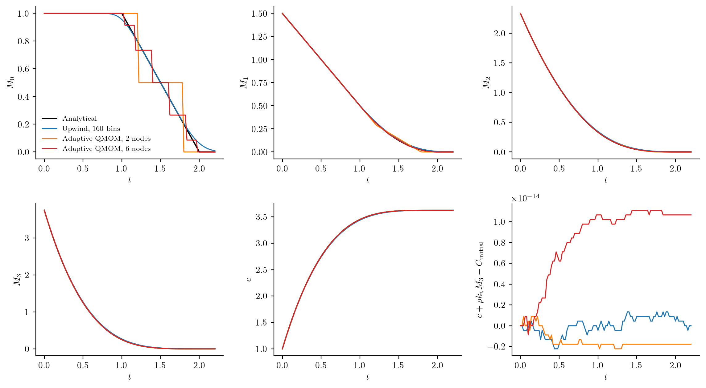

# Dissolving a finite population

How does a closed slurry return all its solid material to solution while its
particles disappear? A material balance alone cannot answer this: it must be
paired with a population balance that removes particles reaching zero size.
This example has an analytical solution, so it also separates errors in the
disappearance approximation from errors in material exchange.

## A shrinking distribution and a shared solute

Take a uniform initial number density between lengths `a=1` and `b=2`, with
`N0=1` particle per process volume. Each particle shrinks at `G=-g=-1`. There is
no nucleation, aggregation, breakage or material feed. Using dimensionless size
and time, the equations and initial conditions are

```math
\frac{\partial n(L,t)}{\partial t}
+\frac{\partial[-g n(L,t)]}{\partial L}=0,\qquad L>0,
```

```math
n(L,0)=\begin{cases}N_0/(b-a),&a\leq L\leq b,\\0,&\text{otherwise},\end{cases}
\qquad
\frac{dc(t)}{dt}=-\rho k_v\frac{dM_3(t)}{dt},\qquad c(0)=1,
\quad \rho k_v=0.7.
```

Particles reaching `L=0` disappear. No incoming boundary data are imposed there,
because the characteristics leave the nonnegative size domain. Number starts
to decline at `t=a/g=1`; the continuum is empty at `t=b/g=2`.
The exact moments and solute concentration are

```math
M_k(t)=\frac{N_0}{(b-a)(k+1)}
 \left[(b-gt)_+^{k+1}-(a-gt)_+^{k+1}\right],\qquad
c(t)=c(0)+\rho k_v[M_3(0)-M_3(t)].
```

At zero a particle has no remaining `L³` material. Removal therefore changes
number without returning its initial mass a second time.

## Specify the two numerical representations

The moment calculation declares its boundary approximation explicitly:

```julia
model = PBMModel(shrinkage=Growth((L,p,t,ctx)->-1.0))
basis = MomentSet(0:11; coordinate=:length)
op = compile(model, basis; closure=RankAdaptiveQMOM(6;rtol=1e-10),
             boundary=MomentBoundary(left=:absorb))
initial = [dissolution_reference(k,0.0) for k in basis.orders]
exchange = MomentExchange(:crystals,:solute,3;factor=0.7)
```

The sectional calculation instead selects an upwind zero-boundary trace:

```julia
grid = Grid1D(range(0.0,3.0;length=161);coordinate=:length)
op = compile(model, grid; growth_scheme=Upwind(),
             bc=SizeBC(AbsorbingZero(),NoFlux()))
initial = [max(0.0,min(r,2.0)-max(l,1.0))
           for (l,r) in zip(grid.edges[1:end-1],grid.edges[2:end])]
exchange = ConservativeExchange(:crystals,:solute,(L,p,t,ctx)->0.7*L^3)
```

For either representation, pack the population, bulk state and historical
removal ledger into one system:

```julia
system = PBMSystem((crystals=op,); exchanges=(exchange,),
    nonnegative_bulk=(:solute,),
    accounting=(CumulativeAccounting(:crystals;properties=(volume=3,)),))
problem = PBMProblem(system,(crystals=initial,),(0.0,2.2);bulk0=(solute=1.0,))
solution = simulate(problem;dt=0.005,saveat=0.0:0.02:2.2,method=MeasureEuler())
number_removed = cumulative(problem,solution.u[end],:crystals,:extinction)
```

These fragments show the representation choices; the complete script below
contains the analytical helper, refinement runs and CSV export.

## Results and their interpretation



The moment number curve is a sequence of atomic removals. Increasing the maximum
rank from two to six reduces its maximum number error from about `0.28` to
`0.114` on this output schedule. Decreasing the timestep alone does not remove
this continuous-to-atomic approximation error. For a truly atomic initial
population with resolved rank, the constant-velocity hitting events are exact
within reconstruction/event tolerances; that is tested separately.

The sectional calculation has numerical spreading and a small tail after the
continuum extinction time. Increasing from 80 to 160 bins reduces maximum
number error from about `0.092` to `0.063`. The method retains that positive tail
instead of deleting it with an arbitrary threshold. Its initial material uses
the discrete center-weighted third moment, which approaches the continuum
initial value under grid refinement.

The plotted material error uses each calculation's **own discrete initial
inventory**. Its maximum magnitude is below `2e-14` in these runs. This small
balance error does not establish accuracy of the number distribution: the
moment staircase and sectional tail are visible despite conserved material.
The selected moments and solute curve provide independent physical comparisons.
Full extinction is an exactly zero raw-moment state with active rank zero;
absolute moments remain zero. A normalized size distribution or mean size is
undefined there, so normalized observations raise an explicit error rather than
producing NaNs or fabricating a distribution.

The method, restrictions, numerical tolerances and reservoir conventions are
explained in [Realizable evolution and particle removal](../methods/realizable_evolution.md).
In particular, these are batch extinction calculations; the supported axial
verification does not include extinction events.

## Run and regenerate

From the repository root:

```sh
julia --project=. examples/realizable_dissolution.jl
python docs/benchmarks/plot_dissolution.py --usetex
julia --project=. examples/realizable_startup.jl
julia --project=. examples/realizable_axial_transport.jl
```

The first command writes [the numerical data](../assets/dissolution/dissolution.csv).
The plotting command needs NumPy, Matplotlib and a LaTeX installation; omit
`--usetex` to use Matplotlib's built-in mathematical typography. It draws no grid
lines. The other two scripts verify exact-zero startup, coupled growth with
nucleation and aggregation, and nonuniform axial moment/bulk transport.

## Complete dissolution script

```@eval
using Markdown, PopulationBalanceModels
Markdown.MD([Markdown.Code("julia", read(joinpath(pkgdir(PopulationBalanceModels), "examples", "realizable_dissolution.jl"), String))])
```
