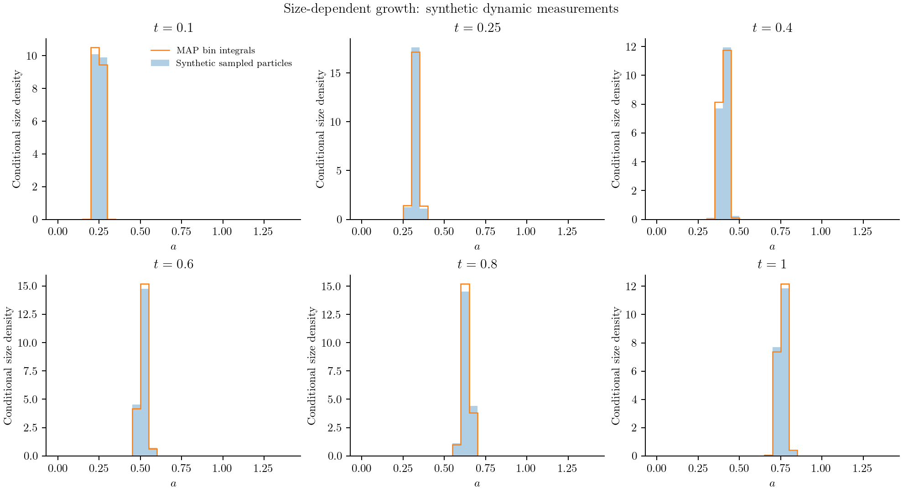
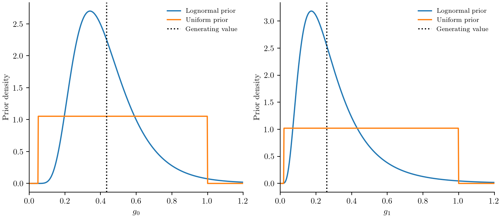
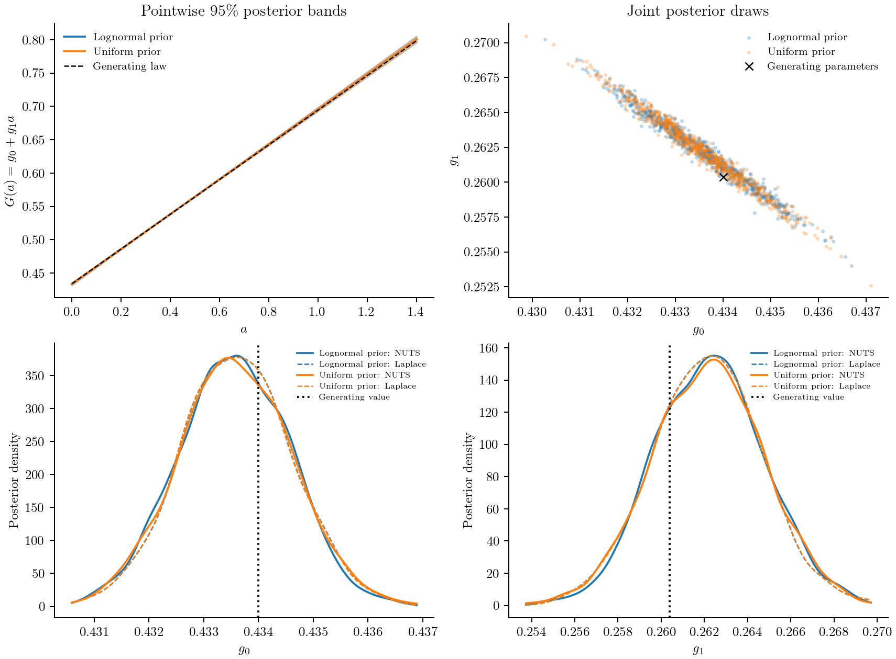
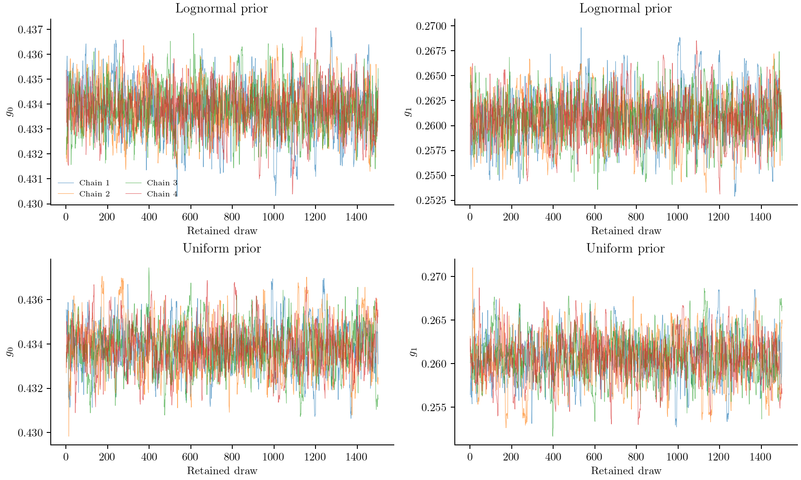
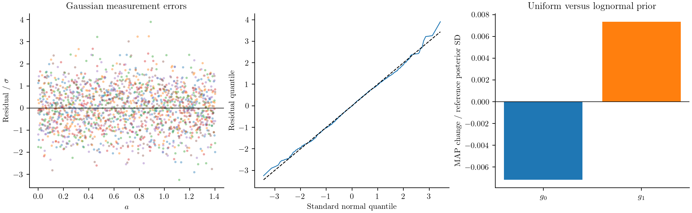
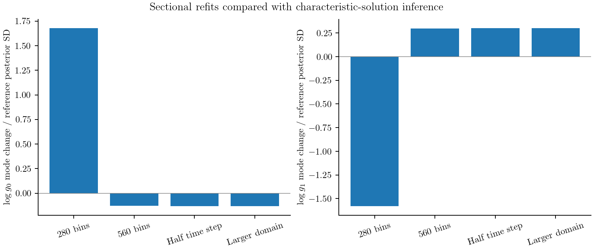

# Estimating size-dependent growth

**Retained-result convention.** The figures and fitted tables on this page keep
their producer's internal-coordinate MAP and local Gaussian approximations.
They have not been recomputed as physical-density MAP/physical covariance under
`physical_map_v1`. The MCMC probability law is preserved by the new Jacobian
handling when the model, likelihood and priors are unchanged; original source
compatibility guards and producer records still apply. The runnable scripts
now use the [physical-MAP interface](../inference.md#Migration-and-retained-results)
and write new results separately.


Suppose a particle population is measured several times while it grows. Can we
recover how growth depends on particle size? This example answers that question
with synthetic data: evaluate a known analytical solution, add nonnegative noisy measurements,
and fit the two growth coefficients.

The growth equation and initial density come from
[Inguva, Schickel and Braatz (2022), Case 2](https://web.mit.edu/braatzgroup/Inguva_ComputChemEng_2022.pdf).
The noisy measurements and prior choices below are our estimation exercise;
they are not experimental data from the paper.

## Model and measurements

The number density f follows

```math
\frac{\partial f(a,t)}{\partial t}
+\frac{\partial[(g_0+g_1a)f(a,t)]}{\partial a}=0,
\qquad
f(a,0)=50\exp\!\left[-\frac{(a-0.2)^2}{0.0005}\right].
```

Size a is nonnegative, and no particles enter at a=0. We retain the paper's
scaled size and time units. The coefficient g₀ has size/time units, while g₁
has inverse-time units. There is no nucleation, aggregation or concentration
feedback in this model.

A particle starting at size a₀ reaches

```math
a(t)=a_0e^{g_1t}+\frac{g_0}{g_1}(e^{g_1t}-1).
```

The inverse trajectory and the resulting density are

```math
a_0(a,t)=ae^{-g_1t}+\frac{g_0}{g_1}(e^{-g_1t}-1),\qquad
f(a,t)=e^{-g_1t}f(a_0(a,t),0).
```

Set f=0 when a₀<0. The exponential factor accounts for stretching: particles
move to larger sizes and the peak becomes wider and lower.

Generate data with g₀=0.434 and g₁=0.2604. At six times between 0.1 and 1,
evaluate f at 281 sizes between 0 and 1.4. Draw each measurement independently
from a Gaussian centred on that density, conditioned to be nonnegative:

```math
y_{ij}\sim\mathcal N\!\left(f(a_i,t_j;g_0,g_1),\sigma_f^2\right)
\ \text{conditioned on }y_{ij}\ge0,\qquad \sigma_f=1.
```

The initial density and noise level are known in this exercise. Only g₀ and
g₁ are fitted. These are density measurements, not sampled particle counts;
there is no binning, clipping or normalization of the density. Far from zero
this is nearly ordinary additive Gaussian noise. Near zero the noise is
asymmetric, so its conditional mean exceeds the underlying density. The
likelihood accounts for that difference using its normalization factor
``\Phi(f/\sigma_f)``. Clipping negative Gaussian draws would instead create
an artificial point mass at zero.

```julia
value = rand(rng,truncated(Normal(density,sigma),0.0,Inf))
```

```@example growth_inference
using PopulationBalanceModels, Distributions
include(joinpath(pkgdir(PopulationBalanceModels),"examples","estimate_size_dependent_growth.jl"))
import .EstimateSizeDependentGrowth
const recipe = EstimateSizeDependentGrowth
data = recipe.synthetic_measurements(seed=2022,noise=1.0)
size(data.values)
```

All six snapshots appear on one plot. The points are noisy measurements and
the continuous curves are the MAP fit with the lognormal priors defined below.



## Specify what the model predicts

FunctionObservable evaluates the analytical density at the measured sizes:

```julia
profile = FunctionObservable((N,operator,p,t)->
    recipe.exact_density.(data.sizes,t,Ref(p)))
measurement = Measurement(data.times,data.values,profile;
    likelihood=TruncatedGaussianLikelihood(sigma=data.noise))
```

Here the analytical expression supplies the point densities directly. It does
not reconstruct them from a sectional histogram. The script's analytical
solver also returns exact cell integrals for the underlying PBM state. All
sizes and times contribute to one normalized truncated-Gaussian likelihood.

## Compare two prior choices

First retain the previous growth priors:

```julia
Prior(LogNormal(log(0.4),0.4);coordinates=:physical) # g₀
Prior(LogNormal(log(0.25),0.6);coordinates=:physical) # g₁
```

These favour rates near 0.4 and 0.25. To see whether that preference drives
the answer, compare them with uniform priors:

```julia
Prior(Uniform(0.05,1.0);coordinates=:physical) # g₀
Prior(Uniform(0.02,1.0);coordinates=:physical) # g₁
```

One way to choose these bounds is to state plausible growth times. Take one
scaled size unit as a reference and one time unit as the observation duration.
The offset-growth time 1/g₀ then lies between 1 and 20 observation durations;
the stretching time 1/g₁ lies between 1 and 50 durations. These ranges allow
much slower growth than the experiment resolves, while excluding changes
faster than those assumed in this exercise. They are physical assumptions,
not universal defaults. A uniform density in rates is not uniform in timescales
or logarithms, and is not uniquely noninformative.



Both scenarios use log coordinates so rates stay positive. Each prior is
explicitly a density in physical coordinates, so the posterior in log
coordinates includes its transformation Jacobian once. In particular, a
physical uniform prior is not flat in log sampling coordinates. Retained MAP values
are transformed log-coordinate modes; new fits maximize physical density; see [Parameter estimation](../inference.md).

## Fit and calculate local uncertainty

The builder joins the physical problem, measurements and selected priors:

```@example growth_inference
problem = recipe.estimation_problem(data;prior=:lognormal)
posterior_components(problem,initial_coordinates(problem))
```

Load Optim to fit; request Laplace explicitly:

```julia
using Optim
result = fit(problem;nstarts=3,seed=22,uncertainty=:laplace)
result.parameters.shared
result.converged
result.diagnostics.gradient_norm
```

Construct a second problem with `prior=:uniform` and make the same calls. The
likelihood, data and coordinates remain the same; only the physical priors
change. Laplace uses the Hessian of that same posterior at its mode.
ForwardDiff supplies the default MAP and NUTS gradients, and the Laplace
Hessian. Finite differences independently check those derivatives. The
[derivative guide](../inference.md#Choose-how-derivatives-are-calculated)
explains ODE forward sensitivities and adjoints for models without an
analytical solution.

The following values are read from the recorded results. Intervals are marginal
95% MCMC credible intervals for this synthetic dataset and its stated model.

```@eval
using Markdown, PopulationBalanceModels
folder=joinpath(pkgdir(PopulationBalanceModels),"docs","src","assets","bayesian_growth")
rows=split.(readlines(joinpath(folder,"credible_summary.csv"))[2:end],',')
table=["| Prior | Parameter | MAP | MCMC mean | MCMC 95% interval |",
       "|:--|:--|--:|--:|:--|"]
for row in rows
    v=round.(parse.(Float64,row[3:6]);sigdigits=6)
    push!(table,"| $(row[1]) | $(row[2]) | $(v[1]) | $(v[2]) | [$(v[3]), $(v[4])] |")
end
Markdown.parse(join(table,'\n'))
```

For these measurements, the two prior scenarios give almost the same estimates
and intervals: the data are much more concentrated than either prior. This
conclusion belongs to this noise level and sampling schedule. Fewer snapshots
or larger errors can make the choice of prior matter more.

The continuous growth-law bands show uncertainty in the fitted rates, not new
measurement noise. The joint panel shows their correlation: a larger g₀ can
partly compensate for a smaller g₁ over the observed size range. The marginal
curves compare NUTS draws with Laplace draws under both prior choices. They
are smoothed displays of parameter draws; the raw draws are also exported.



## Check the chains before using their intervals

Sampling is a separate request:

```julia
using AdvancedHMC, MCMCDiagnosticTools
samples = sample_posterior(problem;initial=result,laplace=result.uncertainty,
    warmup=1000,samples=1500,chains=4,seed=25,
    target_acceptance=0.9,start_scale=3.0,max_depth=9)
report = diagnostics(samples)
report.rhat
report.ess_bulk
report.ess_tail
report.mcse_mean
report.per_chain
report.diagnostics_passed
```

The runner uses four seeded starts dispersed along both directions of the
Laplace covariance. It runs 1000 warmup iterations and retains 1500 draws per
chain, for each prior scenario. Warmup adapts the metric and step size; those
draws are excluded from posterior summaries.

It checks rank-normalized split R-hat ≤1.01, bulk and tail ESS ≥400, per-chain
BFMI ≥0.3, no retained divergences and no maximum-depth hits. MCSE reports
simulation error in posterior mean estimates in log coordinates. BFMI checks
energy exploration; warmup divergences are recorded separately. The runner
stops before interpreting results if the screen fails. Passing these checks
supports using these draws, but cannot prove convergence or rule out an
unvisited mode.

```@eval
using Markdown, PopulationBalanceModels
file=joinpath(pkgdir(PopulationBalanceModels),"docs","src","assets","bayesian_growth","sampler_diagnostics.csv")
rows=split.(readlines(file)[2:end],',')
table=["| Prior | Parameter | R-hat | Bulk ESS | Tail ESS | Mean MCSE (log) | Min BFMI | Retained divergences | Warmup divergences |",
       "|:--|:--|--:|--:|--:|--:|--:|--:|--:|"]
for r in rows
    values=round.(parse.(Float64,r[3:6]);sigdigits=4)
    bfmi=round(parse(Float64,r[9]);sigdigits=4)
    push!(table,"| $(r[1]) | $(r[2]) | $(values[1]) | $(values[2]) | $(values[3]) | $(values[4]) | $bfmi | $(r[7]) | $(r[8]) |")
end
Markdown.parse(join(table,'\n'))
```

Inspect the traces as well as the numbers. Chain identifiers, log posterior,
energy, acceptance rates, step sizes, tree depth and leapfrog counts are retained
in `chains.csv`. `chain_diagnostics.csv` includes warmup divergences for each
chain. The package result also exposes `warmup_statistics` and retained
`statistics` through `diagnostics(samples)`.



## Check the fit and the numerical approximation

Residuals should be consistent with the noise added to the analytical solution.
The plot below transforms each measurement through its fitted truncated-Gaussian
CDF and then the inverse standard-normal CDF. These normal quantile residuals
should follow a standard Gaussian under the measurement model. Ordinary
residuals divided by sigma would be asymmetric near zero. This is a model check
for one synthetic dataset, not a
coverage validation across repeated experiments.



To generate new measurement predictions, propagate a chosen number of posterior
draws. Keep the uncertainty in the noise-free density separate from fresh
truncated-Gaussian measurement errors:

```julia
draws = parameter_draws(problem,samples;n=40,seed=25)
prediction = posterior_predictive(problem,draws;
    max_solves=40,measurement_noise=true,seed=26)
```

The budget counts one forward evaluation per draw for this single experiment.
Returned predictions contain both the noise-free values and new noisy values.

The reference fit uses the analytical solution and has no spatial or time-step
error. The runner then refits the same data using Inguva2022 on two travel-time
meshes and MUSCL on uniform meshes. The Inguva mesh and time step are refined
together to keep CFL=1. The MUSCL checks change spatial resolution, time step
and domain size separately.

Bin solvers store cell integrals. The numerical comparisons use an explicit
linear interpolation of cell-average densities to the measured positions;
that observation reconstruction has its own error. Changing solver does not
change the truncated-Gaussian likelihood or the priors. Parameter shifts are shown in
units of the analytical fit's posterior standard deviation, and prediction
errors in units of the known measurement noise. Failed fit flags remain visible.



Hatched bars mark candidates that did not pass the optimizer's convergence and
gradient checks; their shifts are not accepted mode estimates. The table records
the actual flags and shifts. A shift of several posterior standard deviations
means numerical error matters for this dataset, even if the fitted curves look
close. The right panel compares predictions at the same analytical MAP
parameters, so that check does not depend on whether a numerical refit converged.

```@eval
using Markdown, PopulationBalanceModels
file=joinpath(pkgdir(PopulationBalanceModels),"docs","src","assets","bayesian_growth","refinement.csv")
rows=split.(readlines(file)[2:end],',')
table=["| Numerical variant | Converged | g₀ shift / SD | g₁ shift / SD | Maximum density error / sigma |",
       "|:--|:--|--:|--:|--:|"]
for row in rows
    v=round.(parse.(Float64,row[3:5]);sigdigits=4)
    push!(table,"| $(row[1]) | $(row[2]) | $(v[1]) | $(v[2]) | $(v[3]) |")
end
Markdown.parse(join(table,'\n'))
```

## Use the compiled transport method

The analytical fit is inexpensive because this model has a known continuous
solution. For a supplied vector of bin integrals, the package also provides the
paper's transformed transport method directly:

```julia
p = (g0=0.434,g1=0.2604)
law = AffineGrowth(:g0,:g1)
grid = characteristic_grid(law,(0.0,1.4);dt=0.005,p)
operator = compile(PBMModel(growth=Growth(law)),grid;
    evolution=Inguva2022(),p,bc=SizeBC(OpenBoundary(),OpenBoundary()))
initial = recipe.exact_counts(grid.edges,0.0,p)
solution = simulate(PBMProblem(operator,initial,(0.0,1.0);p);
    dt=0.005,saveat=data.times)
```

Compilation checks the declared growth form, positivity, boundaries and mesh.
The time step and requested outputs must align with the travel-time cells.
During a numerical refit the builder reconstructs this mesh for each proposed
parameter vector. See [Transport along growth trajectories](../methods/characteristics.md)
for the method, conservation properties and restrictions.

## Run the study

```sh
julia --project=/path/to/working_environment examples/estimate_size_dependent_growth.jl --output=/tmp/growth-physical-map
python docs/benchmarks/plot_bayesian_growth.py --usetex
```

The working environment needs Optim, AdvancedHMC and MCMCDiagnosticTools as
well as this package. The script records all seeds, prior definitions, solver
settings and diagnostics under `docs/src/assets/bayesian_growth/`. The plotter
reads those files. It uses LaTeX labels and no grid lines, and exports PNG and
SVG figures. Rebuild Documenter after changing the figures.

## Minimal run and full reproduction

The [full driver](../assets/source/examples/estimate_size_dependent_growth.jl)
adds uncertainty calculations, sampling and numerical-refinement comparisons.
Use an environment with Optim and the checkout developed into it; see the
[shared setup guide](../verification.md).

### Complete script

Run from the repository root. This generates the declared synthetic observations
and performs a MAP fit, without sampling or writing benchmark outputs.

```julia
using PopulationBalanceModels, Optim
include("examples/estimate_size_dependent_growth.jl")
study = EstimateSizeDependentGrowth
data = study.synthetic_measurements(; seed=2022)
problem = study.estimation_problem(data; prior=:lognormal)
fitted = fit(problem; nstarts=3, seed=22, maxiters=500)
fitted.converged || error("MAP did not converge; inspect the fit diagnostics")
parameters = physical_parameters(problem, fitted.minimizer)
predicted = predictions(problem, fitted.minimizer)
@show fitted.converged parameters
```
