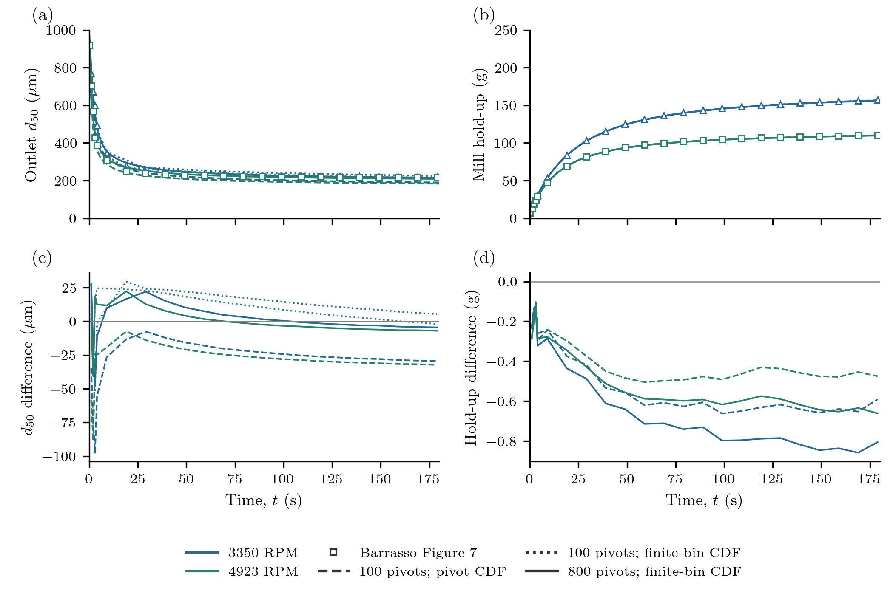
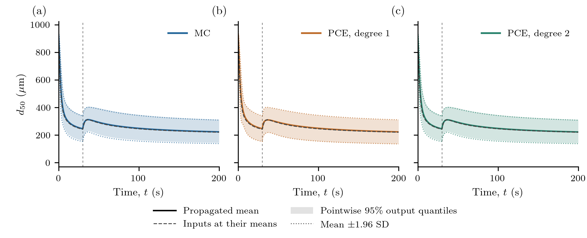

# Uncertainty in continuous milling

## The uncertainty question

A continuous cone mill breaks incoming material until fragments can pass its
screen. If the breakage and screen parameters are uncertain, how uncertain is
the size of the discharged material after a change in impeller speed? Can a
small polynomial-chaos surrogate recover the result of a much larger Monte
Carlo calculation?

We first examine the deterministic model developed by
[Barrasso et al. (2013)](https://doi.org/10.1007/s12247-013-9155-0), using their
Figure 7 startup calculation. We then propagate the four uncertain inputs
considered by [Bhonsale et al. (2018)](https://doi.org/10.3390/pr6120255) with
Monte Carlo (MC) and non-intrusive polynomial chaos expansion (PCE).
There is no parameter fitting in this example.

The forward comparison is a **partial reproduction**: mill hold-up is close,
but the full outlet-diameter trajectory is not recovered. The UQ results below
therefore describe the stated numerical reconstruction; they are not evidence
that the original published trajectories have been reproduced. Numerical
accuracy, agreement with the source, sampling error and surrogate error are
checked separately.

## The milling model

The internal coordinate is particle volume, ``v`` in m³. The density ``n(v,t)``
is a **whole-mill number inventory per particle-volume interval**, not a slurry
concentration. Barrasso's feed–breakage–screen model, also used by Bhonsale, is

```math
\frac{\partial n(v,t)}{\partial t}
=F_{\mathrm{in}}(v)-F_{\mathrm{out}}(v,t)
+\int_v^\infty b(v,y)S(y,t)n(y,t)\,\mathrm{d}y-S(v,t)n(v,t).
```

Here ``F_{\mathrm{in}}`` and ``F_{\mathrm{out}}`` are number-flow densities.
Breakage selects parents at the rate

```math
S(v,t)=\alpha\,\mathrm{RPM}(t)
\left(\frac{v}{v_{\mathrm{ref}}}\right)^\gamma,
\qquad v_{\mathrm{ref}}=2.23\times10^{-9}\;\mathrm{m^3}.
```

The daughter law is lognormal in the volume ratio ``r=v/y``, centred at
``\log r=-\log(2.68\times10^5)`` and truncated at ``r=1``. It is an
**expected daughter-count density**, normalized by its first volume moment:

```math
\int_0^y v\,b(v,y)\,\mathrm{d}v=y.
```

Normalizing it to one daughter instead would lose parent material. The
sub-first-pivot daughter number and volume are integrated analytically and
leave as fines. Their material is included once in total discharge.

The classifier acts on **net feed and breakage production**, with
``B(v,t)=\int_v^\infty b(v,y)S(y,t)n(y,t)\,\mathrm{d}y``:

```math
F_{\mathrm{out}}(v,t)
=(1-f_d(d(v)))\left(F_{\mathrm{in}}(v)+B(v,t)-S(v,t)n(v,t)\right),
```

```math
f_d(d)=\begin{cases}
0,&d\le(1-\delta)d_{\mathrm{screen}},\\
\dfrac{d-(1-\delta)d_{\mathrm{screen}}}{\delta d_{\mathrm{screen}}},
 &(1-\delta)d_{\mathrm{screen}}<d\le d_{\mathrm{screen}},\\
1,&d>d_{\mathrm{screen}},
\end{cases}
\qquad d(v)=\left(\frac{6v}{\pi}\right)^{1/3}.
```

This algebraic discharge law is not a first-order `Death` hazard. The shared
[model helper](../assets/source/examples/support/milling_model.jl) assembles
`IntegratedBirth`, `Breakage` and an explicit classifier `CustomTerm` in a
`PBMModel`. `PBMSystem` accumulates discharged material from the same fluxes.

| Fixed input | Value |
|:--|:--|
| Mass feed, ``\dot m_{\mathrm{in}}`` | 7.4 g/s |
| Particle density, ``\rho`` | 740 kg/m³ |
| Feed volume-fraction lognormal shape | median 4.81×10⁻⁵ m³; log standard deviation 0.25 |
| Screen aperture | 1575 µm |
| Daughter median volume ratio | 2.68×10⁵ |
| First representative volume | 6.54×10⁻¹⁷ m³ |

The large printed feed median corresponds to about 4.5 cm diameter; it is
retained rather than changed to improve agreement. The discrete feed
normalization and startup assumptions differ between the two calculations:

| Setting | Barrasso Figure 7 comparison | Retained Bhonsale UQ reconstruction |
|:--|:--|:--|
| Speed | separate constant 3350 and 4923 RPM runs | 4923 RPM, then 1500 RPM at 30 s |
| Initial mill | one second of feed: 7.4 g; shape assumed | empty |
| Representative volumes | published ``v_i=v_1i^6``, 100 pivots | 100 geometric pivots, ``v_1`` to 10⁻³ m³ |
| Feed deposition | normalized point weights from Barrasso Eqs. (3)–(4) | exact lognormal bin probabilities, normalized over the domain |
| Outlet median | compare pivot and finite-bin CDF reconstructions | linear diameter interpolation of the pivot-volume CDF |

Both use integrated counts divided by ``10^{12}`` as the numerical population
state. This scaling changes neither the inventory basis nor the material check:

```math
\rho\sum_i v_iN_i(t)+m_{\mathrm{discharged}}(t)
=m_{\mathrm{initial}}+\dot m_{\mathrm{in}}t.
```

## First: check the forward calculation

Barrasso's Figure 7 shows startup of the outlet volume-weighted diameter median
and the material held in the mill. The comparison uses ``\delta=0.44``,
``\alpha=8.82\times10^{-6}`` RPM⁻¹ s⁻¹, ``\gamma=0.34`` and ``\sigma=2.10``,
without refitting. These are also the input means in the later UQ calculation.
The graph starts near 7.4 g; its complete initial size distribution is
unavailable. Setting the initial population to one second of feed supplies that
mass and is an explicit reconstruction assumption.

From a checkout with the [milling environment](#Reproduction) prepared:

```julia
include("examples/verification/milling_forward.jl")
using PopulationBalanceModels

problem, _ = MillingForward.problem(bins=100, rpm=3350.0)
times = [1.0, 10.0, 30.0, 60.0, 180.0]
solution = MillingForward.MS.solve(problem, times)
N = population(problem, solution.u[end], :mill)
d50 = MillingForward.MM.outlet_median(problem.p, N, times[end])
```

Positive linear volume hats deposit daughter particles. For the same continuous
birth density and parent-pivot evaluation, these follow algebraically from
Barrasso's adjacent-volume allocation in Eqs. (14)–(17). That observation does
not identify every detail of the original gPROMS cell-average implementation.
Auxiliary bin edges are chosen to give the published arithmetic pivot centres.
Refinements to 200, 400 and 800 pivots retain the endpoint volumes.



Panels (a,b) compare the two quantities; (c,d) show signed package-minus-source
differences. The symbols are **published simulation values**, extracted from
the original vector figure, not new experiments. All 92 source markers and their
PDF coordinates are retained in the
[reference readings](../assets/source/examples/data/milling_uncertainty/barrasso_figure7.csv).
RMS differences use the 22 noninitial points for each speed and quantity.

The two 100-pivot diameter curves use the **same population trajectory**.
One interpolates its cumulative volume weights between pivot diameters; the
other integrates a piecewise-constant number density within each auxiliary
volume bin. The latter's volume CDF is quadratic in volume, not linear. The
800-pivot curve changes both resolution and, relative to the dashed curve,
the observation reconstruction. Neither change alters the kinetic parameters.
Hold-up does not depend on the median reconstruction.

```@eval
using Markdown, PopulationBalanceModels
Markdown.parse(read(joinpath(pkgdir(PopulationBalanceModels), "docs", "src", "assets",
    "milling_uncertainty", "forward", "comparison.md"), String))
```

Hold-up is close, but startup diameter differences remain as large as about
47 and 41 µm for the 800-pivot finite-bin observation. Refinement does not
uniformly improve agreement with the published curve. At the last graph times,
about 179 s, its medians are 215 and 210 µm, compared with source values 219 and
216 µm. A close late value is not a reproduction of the whole trajectory.

Tenfold tighter BDF tolerances change the 100-pivot median by less than
``5\times10^{-6}`` µm. A separately assembled affine matrix exponential, using
analytical truncated-lognormal daughter integrals, agrees within
``4\times10^{-6}`` µm at the checked times. All saved populations are nonnegative;
maximum material defects are below ``5\times10^{-11}`` kg across the refinements.
These checks support the numerical solution of the **declared reconstruction**.
They do not establish equivalence to the authors' parent reconstruction,
initial distribution, median calculation or full-precision fitted parameters.
The remaining source mismatch cannot be attributed to time integration from
this evidence, nor does it establish that the source numerics are incorrect.

## Then: propagate uncertain inputs

Bhonsale studies the response to a speed reduction at 30 s. Each realization
now starts empty and uses the separate geometric-grid configuration tabulated
above. The quantity of interest remains the **instantaneous outlet
volume-weighted diameter median**, not a median of accumulated discharged
material. At exactly 30 s the outlet uses the new speed; the inventory is
continuous. Two integrations meet there so no solver stage mixes the rates.
The 1500 RPM transient is outside the two speeds in the forward comparison.

### Input uncertainty and forward solves

| Input | Mean | Standard deviation | Units |
|:--|--:|--:|:--|
| Critical screen fraction ``\delta`` | 0.44 | 0.07 | dimensionless |
| Selection coefficient ``\alpha`` | 8.82×10⁻⁶ | 1.01×10⁻⁶ | RPM⁻¹ s⁻¹ |
| Selection exponent ``\gamma`` | 0.34 | 0.08 | dimensionless |
| Daughter log width ``\sigma`` | 2.10 | 0.12 | dimensionless |

These are Bhonsale's Gaussian marginals. Independence is assumed because a
joint dependence is not supplied. The Gaussian law has a tiny physically
inadmissible tail; invalid draws are recorded as failures, never clipped or
redrawn. A negative exponent alone is not invalid. No invalid input occurred
in the retained ensembles. Analytical PCE moments concern the polynomial's
full Gaussian extension, with the same input-law qualification.

The prepared positive fixed-pivot projection follows
[Kumar and Ramkrishna (1996)](https://doi.org/10.1016/0009-2509(96)88489-2).
Bhonsale's printed second hat in Eq. (27) has inconsistent numerator/limit
signs; the literal negative expression is not used. This does not establish
what the authors implemented. Daughter preparation is rebuilt when ``\sigma``
changes.

Both calculations use the ordinary package residual with external CVODE BDF.
An exact diagonal change to per-pivot kilograms conditions its linear algebra;
package states remain scaled counts. Relative/absolute tolerances are
``10^{-9}`` / ``10^{-14}`` kg. Invariant zero-retention classes that start at zero
are eliminated. CVODE nonnegative constraints and saved-state checks remain
active; no population is clipped. This external solve does not inherit native
SSP or realizability guarantees. The algebraic classifier also requires a
compatible startup/history; arbitrary initial states need not yield a
nonnegative net outlet flux.

### MC and PCE through the same interface

```julia
include("examples/milling_uncertainty.jl")
using PopulationBalanceModels

uq = MillingUncertainty.problem()
mc = propagate(uq, MonteCarlo(12_000; seed=2018255); max_solves=12_000)
summary = uq_summary(mc; covariance=false)
```

`UQProblem` supplies the scenario builder, checked segmented solver, common
times and a `SystemObservable` for the median. One solve supplies an entire
history. A PCE uses the same forward problem at regression inputs:

```julia
box = hcat(fill(-2.0, 4), fill(2.0, 4)) # standard-normal coordinates
training = pce_design(uq.inputs; n=12, seed=2018257, bounds=box)
validation = propagate(uq, MonteCarlo(512; seed=2018256); max_solves=512)
pce = fit_pce(uq, PolynomialChaos(1);
    design=training, validation=validation, max_solves=12)
moments = uq_summary(pce)
cheap_draws = evaluate_pce(pce, MonteCarlo(50_000; seed=2018259))
```

Degree one has five coefficients; degree two has fifteen. The first-degree
fit uses **12 LHS points**, following Bhonsale Figure 7's caption; its prose
instead describes nine sigma-design points. A separate nine-point centre/axial
design checks that choice. Degree two uses nine centre/axial points plus
23 LHS points. These declared designs are not recovered author samples.
The bounded training box covers about 83% of the four-dimensional Gaussian
probability; it does not truncate the propagated law. The 512 independent
validation inputs also test outside that box.

### Results and what the bands mean



Solid lines are **propagated means**; the grey dashed line is the nominal
solution at the input means. Shading gives pointwise 2.5/97.5 percentiles.
Dotted lines show the explicitly approximate mean ± 1.96 SD reference.
PCE percentiles use 50,000 cheap surrogate evaluations and need not be
symmetric. Negative surrogate predictions remain in the exports.

The speed reduction changes outlet production immediately, while held material
adjusts subsequently. This explains a rapid response followed by relaxation;
it need not follow a first-order residence-time law. The band describes
**uncertainty in a predicted median**. It is neither the spread of particle
sizes within one mill, a confidence interval on an estimated mean, nor
simultaneous trajectory coverage. Empty-start medians are undefined at zero;
curves begin at 0.001 s without artificial seeds or denominators.

Bhonsale's band prose refers to an F distribution while Eq. (7) uses a t
critical value. Its degrees of freedom are unavailable, so the bands above
use the explicitly defined conventions rather than invented statistical inputs.
Individual [MC](../assets/milling_uncertainty/milling_figure4.png),
[first-degree PCE](../assets/milling_uncertainty/milling_figure7.png) and
[second-degree PCE](../assets/milling_uncertainty/milling_figure8.png) figures
show startup and a speed-change zoom on common scales.

At 31 s, MC gives a mean of **275.96 µm**, SD **47.00 µm** and mean MCSE
**0.43 µm**. PCE1 and PCE2 give means **279.35** and **275.46 µm**, with independent
validation RMSEs **11.37** and **5.34 µm**. The 6,000-to-12,000 prefix mean changes
by 0.38 µm. These assess finite-ensemble and surrogate errors, not agreement
with the publication.

```@eval
using Markdown, PopulationBalanceModels
Markdown.parse(read(joinpath(pkgdir(PopulationBalanceModels), "docs", "src", "assets",
    "milling_uncertainty", "data", "accuracy.md"), String))
```

Timings are single serial ensembles after separate compilation warmup, on an
Intel Core i9-13900H with Julia 1.10.12 and one Julia/BLAS thread. “Integration”
includes BDF construction and saved-state checks, excluding scenario preparation,
observation and export. `pce1_nine` is the design sensitivity. The
[full cost record](../assets/milling_uncertainty/data/costs.csv) lists shared
512-solve validation, nominal, warmup, refinement and surrogate costs separately.
The producer counts 12,566 ensemble/nominal solves, plus 56 warmup and six
numerical-check BDF trajectories and a matrix-exponential check.

Bhonsale reports a 31-second MC mean **208.366 µm** and SD **41.7409 µm**.
The difference from this reconstruction remains substantial. PCE-design and
band ambiguities cannot explain an MC-mean discrepancy. The earlier forward
check identifies important grid, initialization and median conventions, but
does not resolve that gap or validate the retained UQ configuration against
Barrasso. No parameter or seed was selected to improve agreement.

## Numerical checks and limitations

The [forward checks](../assets/milling_uncertainty/forward/checks.json) separate
time integration and daughter quadrature from mesh/observation effects.
Their [configuration and source record](../assets/source/examples/data/milling_uncertainty/barrasso_figure7.toml)
retains the graph-extraction method and reconstruction assumptions.

The retained UQ configuration has its own
[numerical checks](../assets/milling_uncertainty/data/numerical_refinement.csv).
At 31 s, tighter time tolerances change the nominal median by
``4.2\times10^{-7}`` µm; doubling daughter quadrature changes it by
``5.4\times10^{-12}`` µm. Refining 100 to 200/400 pivots changes it by
**6.18/9.50 µm**; a fixed-spacing domain extension changes it by
``1.8\times10^{-8}`` µm. Thus the 100-pivot UQ reference is not spatially converged
to sub-micrometre precision. Its discretization effect exceeds the reported
PCE2 validation RMSE. Across production ensembles, the maximum material defect
is ``7.3\times10^{-12}`` kg, saved populations are nonnegative and upper-pivot
material is negligible. Conservation does not establish continuum accuracy.

## Reproduction

Run from a checkout, using its optional BDF/export environment:

```sh
julia --project=examples/environments/milling -e 'using Pkg; Pkg.develop(path=pwd()); Pkg.instantiate()'
# First, the separate deterministic comparison and its figure:
julia --project=examples/environments/milling examples/verification/milling_forward.jl
python test/milling_results.py --forward
python docs/benchmarks/plot_milling_uncertainty.py --forward --usetex
# Then, the retained UQ workflow (smoke does not replace production):
julia --project=examples/environments/milling examples/milling_uncertainty.jl --smoke
python test/milling_results.py --smoke
julia --project=examples/environments/milling examples/milling_uncertainty.jl --full
python test/milling_results.py
python docs/benchmarks/plot_milling_uncertainty.py --usetex
```

The full UQ command generates or reuses the matching 12,000-run dataset. Smoke
outputs stay in `.cache/`. Both plot commands only read checked exports; they
never run Julia. Final figures use real LaTeX and 300-dpi PNG plus PDF/SVG;
see the [plotting setup](../assets/source/plotting/README.txt).
Original producer manifests and numerical UQ outputs are preserved separately
from the forward comparison. No local source PDF is needed for replotting.

Download the [forward comparison](../assets/source/examples/verification/milling_forward.jl),
[UQ driver](../assets/source/examples/milling_uncertainty.jl),
[model](../assets/source/examples/support/milling_model.jl),
[BDF adapter](../assets/source/examples/support/milling_solver.jl), and
[UQ source record](../assets/source/examples/data/milling_uncertainty/reconstruction.toml).
For focused tests, use `julia --project=. test/forward_uq.jl`,
`julia --project=. test/milling_model.jl` and, in the milling environment,
`test/milling_integration.jl` and `test/milling_forward.jl`.
The [general UQ guide](../uncertainty_quantification.md) explains the reusable
interface; [verification instructions](../verification.md) describe environments.
