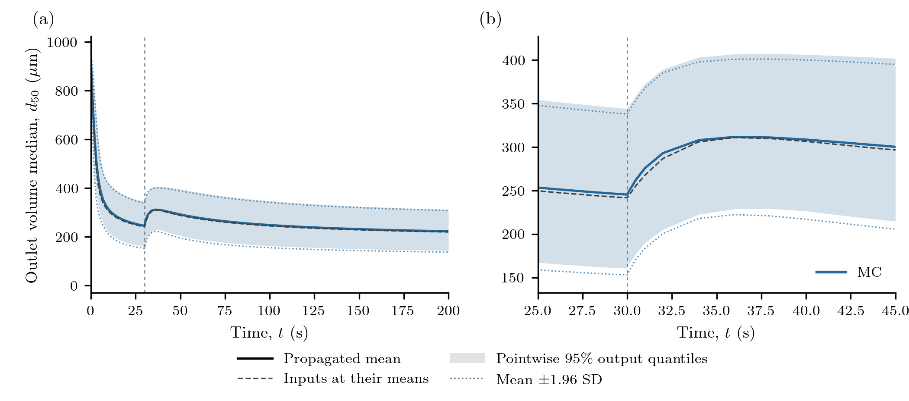
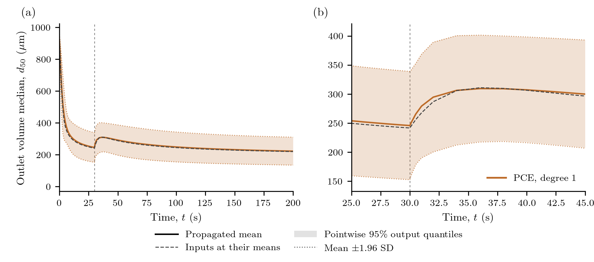
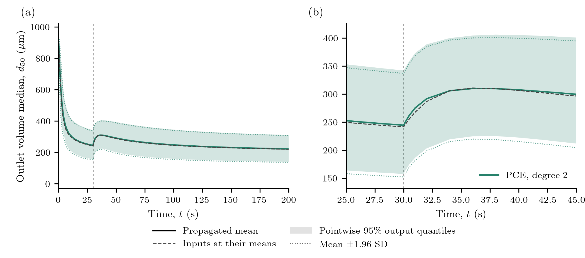

# Uncertainty in continuous milling

A cone mill breaks incoming material until fragments can pass its screen. A
change in impeller speed changes both the population held in the mill and the
size of material leaving it. How uncertain is the predicted outlet median when
the screen and breakage parameters are uncertain?

This calculation reconstructs the MC and polynomial-chaos examples in
Bhonsale, Telen, Stokbroekx and Van Impe (2018),
[DOI 10.3390/pr6120255](https://doi.org/10.3390/pr6120255), Figures 4, 7 and 8.
It is a forward-UQ calculation, without fitting or experimental observations.
The printed model, parameter table and operating change are retained. Missing
initialization/grid/statistic details and conflicting design/band descriptions
prevent an exact replication; the choices below are explicit and are not tuned
to match a curve. The package's existing protein calculations are unrelated.

## Physical model and inventory basis

The internal coordinate is particle volume, `v` in m³. Here `n(v,t)` describes
the **whole-mill number inventory per particle-volume interval**, not a slurry
concentration. The population balance is

```math
\frac{\partial n(v,t)}{\partial t}
=F_{\mathrm{in}}(v)-F_{\mathrm{out}}(v,t)
+\int_v^{\infty}b(v,y)S(y)n(y,t)\,dy-S(v)n(v,t).
```

The feed is a volume-weighted lognormal distribution, with median
`4.81×10⁻⁵ m³` and log standard deviation `0.25`, taken literally from Table 1.
The mass feed is `7.4 g/s` and particle density is `740 kg/m³`. Exact feed-bin
probabilities are converted to number flow by dividing each volume fraction
by its pivot volume. The resolved feed probabilities are explicitly normalized;
their excluded tail is reported.

The breakage selection rate is

```math
S(v,t)=\alpha\,\mathrm{RPM}(t)
       \left(\frac{v}{2.23\times10^{-9}\;\mathrm{m^3}}\right)^\gamma.
```

The daughter law is lognormal in the ratio `r=v/y`, centred at
`log(r)=-log(2.68×10⁵)` and truncated at `r=1`. It is an **expected daughter-count
density**, normalized so that

```math
\int_0^y v\,b(v,y)\,dv=y.
```

Normalizing this law as a probability density would lose the parent material.
In code the truncated relative lognormal's first moment supplies this
normalization. Positive fixed-pivot hat weights preserve number and volume in
deposition; the sub-first-pivot daughter integrals are evaluated analytically
and counted as discharged fines. The lower cutoff must lie within the freely
discharged screen range. Fines are part of total discharge, not an additional
material sink.

The screen acts on **net feed and breakage production**. With
`d(v)=(6v/π)^(1/3)` and aperture `d_screen=1575 µm`,

```math
F_{\mathrm{out}}=(1-f_d)\left(F_{\mathrm{in}}+B-Sn\right),
\quad
f_d(d)=\begin{cases}
0,&d\le(1-\delta)d_{\mathrm{screen}},\\
\dfrac{d-(1-\delta)d_{\mathrm{screen}}}{\delta d_{\mathrm{screen}}},
 &(1-\delta)d_{\mathrm{screen}}<d\le d_{\mathrm{screen}},\\
1,&d>d_{\mathrm{screen}}.
\end{cases}
```

This is the source's algebraic classifier, not a first-order `Death` hazard.
The mill starts empty in this reconstruction. Speed is `4923 RPM` for `t<30 s`
and `1500 RPM` thereafter. Separate integrations meet at 30 s, so solver stages
never mix the two rates. The inventory is continuous, while an instantaneous
outlet statistic can change at the switch. The value saved at exactly 30 s uses
the new speed. With this decreasing-speed history and empty startup, the
semi-discrete net production has a positive-measure evolution; an arbitrary
initial state or speed history does not automatically have that property.

## Uncertain inputs and numerical choices

| Input | Mean | Standard deviation | Units |
|:--|--:|--:|:--|
| Critical screen fraction `δ` | 0.44 | 0.07 | dimensionless |
| Selection coefficient `α` | 8.82×10⁻⁶ | 1.01×10⁻⁶ | RPM⁻¹ s⁻¹ |
| Selection exponent `γ` | 0.34 | 0.08 | dimensionless |
| Daughter log width `σ` | 2.10 | 0.12 | dimensionless |

These are the paper's Gaussian marginals. Independence is assumed because a
joint dependence is not supplied. The small Gaussian probability of invalid
screen/positive-rate/width parameters is reported. Such draws would be retained
as failures, not clipped or redrawn. A negative exponent alone is not invalid.
The full Gaussian law has a tiny inadmissible tail; it is an engineering input
approximation, not a globally admissible physical law. All sampled points must
pass the support check. Analytical PCE moments refer to the polynomial's full
Gaussian extension, with that same input-law qualification.

The numerical state stores integrated counts divided by `10¹²`; this scaling
does not change the inventory basis. The primary grid has 100 geometric volume
pivots from `6.54×10⁻¹⁷` to `10⁻³ m³`. The first pivot is published; the upper
domain and geometric construction are reconstruction choices. Parent material
is deposited by the positive linear hats of Kumar and Ramkrishna (1996),
[DOI 10.1016/0009-2509(96)88489-2](https://doi.org/10.1016/0009-2509(96)88489-2).
The printed second hat in Eq. (27) has inconsistent numerator/limit signs; that
literal expression would give negative weights. This does not establish what
the authors' implementation used.

The external CVODE BDF adapter evaluates the ordinary package residual and
uses its analytic affine Jacobian. Per-pivot **kilograms** are an exact diagonal
change of variables for external linear algebra; package states remain scaled
counts. Relative tolerance is `10⁻⁹`, absolute tolerance `10⁻¹⁴ kg`. Classes
with identically zero retention and initially zero inventory are eliminated as
invariant zeros. CVODE nonnegative constraints and saved-state checks remain
active; populations are never clipped. External BDF does not inherit a native
SSP or realizability guarantee.

For every run, the discrete check is

```math
\rho\sum_i v_iN_i(t)+m_{\mathrm{discharged}}(t)
=\dot m_{\mathrm{in}}t.
```

The main quantity of interest is the **instantaneous outlet volume-weighted
diameter median**. Volume contributions `v_i F_out,i` define its CDF, including
analytic unresolved fines. The median is linearly interpolated between cumulative
fixed-pivot volume values in diameter. This weighting/interpolation is a named
reconstruction choice: the 2018 paper does not fully specify it. At empty
startup the outlet median is undefined; curves begin at `0.001 s`, without seeds
or an artificial denominator.

## From the model to a UQ problem

The [model helper](../assets/source/examples/support/milling_model.jl) uses native
`IntegratedBirth`, `Breakage`, `PBMModel`, `compile` and `PBMSystem` components.
A small explicit classifier supplies the published algebraic removal. Its
prepared fixed-pivot matrix is checked against the ordinary package event loop;
there is no case-private time integrator.

```julia
include("examples/milling_uncertainty.jl")
using PopulationBalanceModels

uq = MillingUncertainty.problem()
mc = propagate(uq,MonteCarlo(12_000; seed=2018255);
               max_solves=12_000)
summary = uq_summary(mc; covariance=false)
```

`UQProblem` contains the scenario builder, checked segmented solver, common
output times and `SystemObservable` for the median. Each input realization
supplies the entire output history. Daughter preparation is rebuilt when `σ`
changes, rather than accidentally reusing the nominal kernel.

For a PCE the same forward definition is evaluated at a regression design:

```julia
box = hcat(fill(-2.,4), fill(2.,4)) # standard-normal reference coordinates
design = pce_design(uq.inputs; n=12, seed=2018257, bounds=box)
validation = propagate(uq,MonteCarlo(512; seed=2018256);
                       max_solves=512)
pce = fit_pce(uq,PolynomialChaos(1);
              design, validation, max_solves=12)
moments = uq_summary(pce)         # analytical surrogate moments
draws = evaluate_pce(pce,MonteCarlo(50_000; seed=2018259))
intervals = uq_summary(draws; covariance=false)
```

Degree one has five coefficients and degree two fifteen. The primary degree-one
fit uses **12 LHS points**, following Figure 7's caption; its prose instead says
nine sigma-design points. A separate nine-point centre/axial design checks that
choice. Degree two uses nine centre/axial points plus 23 LHS points. These are
declared reconstructions of unavailable random designs, not recovered author
samples. The bounded training box does not truncate the Gaussian input law.
Validation uses 512 disjoint, independently generated full-model inputs.
The box covers about 83% of the four-dimensional Gaussian probability, so these
checks also probe predictions outside the training region.

## Transient results and interval meanings


The solid curves are **propagated means**, distinct from the nominal solution at
the parameter means (grey dashed). Shading gives pointwise 2.5/97.5 percentiles;
dotted bounds are the explicitly approximate `mean ± 1.96 SD` reference. PCE
quantiles use 50,000 cheap surrogate evaluations and need not be symmetric.
Negative surrogate predictions remain in the exports and diagnostics.

The speed reduction changes outlet production immediately, while retained
material subsequently adjusts. The spike and relaxation therefore need not
follow a first-order residence-time law. Within-population size variability is
summarized here by each realization's median; the band describes **uncertainty
in that prediction**.

These bands are neither uncertainty in an estimated mean nor simultaneous
trajectory coverage. The source prose refers to an F distribution while Eq. (7)
uses a t critical value. Its required degrees of freedom are not recoverable;
we do not assign those missing statistical inputs. The defined quantile and
Gaussian-reference bands make the reconstruction reproducible.



The left panel retains the full startup range; the right zoom resolves the
speed change. Twelve thousand iid forward realizations supply the MC curve.
Prefix summaries separately assess finite-ensemble variability. Output SD is
not divided by `sqrt(12000)` to create an output band; only the reported mean
MCSE uses that factor.



The degree-one surrogate approximates nonlinear parameter dependence with a
linear polynomial. Agreement of a mean alone does not validate its tails or
its response near the operating change. The twelve-point and nine-point
results are retained separately.



Degree two adds interaction and quadratic terms. Its approximation error is
measured against the independent full-model validation ensemble, separately
from input uncertainty and the finite-sample MC error. A better result for one
design is not a guarantee of monotonic improvement for every small design.
At 31 s, MC gives a mean of **275.96 µm**, SD **47.00 µm** and mean MCSE
**0.43 µm**. Degree-one PCE gives **279.35 µm**, degree two **275.46 µm**;
their independent validation RMSEs are **11.37** and **5.34 µm**, respectively.
The MC prefix mean changes by **0.38 µm** between 6,000 and 12,000 samples;
that is evidence about this ensemble, not an exact-reference certificate.

```@eval
using Markdown, PopulationBalanceModels
Markdown.parse(read(joinpath(pkgdir(PopulationBalanceModels),"docs","src","assets","milling_uncertainty","data","accuracy.md"),String))
```

The table times one serial checked-forward ensemble after separate compilation
warmup. Its “Integration” column includes external BDF construction and saved
state/material checks; scenario preparation, observations and file I/O are
separate. `pce1_nine` is
the design-sensitivity calculation. The shared 512-solve validation ensemble,
nominal solve, numerical checks, warmup and surrogate costs are listed separately
in [the numerical exports](../assets/milling_uncertainty/data/costs.csv) and
[producer record](../assets/milling_uncertainty/data/provenance.json).
These measurements used Julia **1.10.12**, one Julia thread, one BLAS thread,
and an Intel Core i9-13900H. They are single-run timings without repeatability
error bars. Setup, regression, validation and surrogate costs remain separate.
The producer's `full_solves=12566` counts production ensembles and the nominal
trajectory. The workflow also executed **56 warmup** and **six numerical-check**
BDF trajectories, plus the independent matrix-exponential reference. The
512 validation solves are shared across the three PCE comparisons and should
not be counted three times.

The source reports a fitted MC mean of **208.366 µm** and SD **41.7409 µm** at
31 s. The reconstruction comparison is exported directly, without selecting
parameters or a seed to obtain agreement. The current calculation differs
materially from those published values. The printed PCE-design and band
ambiguities do **not** explain the MC-mean discrepancy. Missing initialization,
grid and statistic details limit the reconstruction, but no causal explanation
of this gap has been established. Verified conservation and UQ machinery do
not establish quantitative agreement with the source.

## Numerical checks and reproduction

Time integration is checked against a separately assembled affine
matrix exponential in material coordinates. Separate tighter-tolerance,
daughter-quadrature, 100/200/400-pivot and fixed-spacing domain-extension checks
are in [numerical_refinement.csv](../assets/milling_uncertainty/data/numerical_refinement.csv).
These distinguish solver error, projection/grid error and truncation. They do
not make a 100-pivot curve an exact continuum reference. All samples retain
material error, signed extrema, upper-pivot occupancy, fines and actual step
counts. Full population histories are not required for ensemble replotting.
At 31 s, the tighter time calculation changes the nominal median by
`4.2×10⁻⁷ µm`; doubling daughter quadrature changes it by `5.4×10⁻¹² µm`.
Size refinement changes it by **6.18 µm** at 200 pivots and **9.50 µm** at 400
relative to 100 pivots. Thus the retained 100-pivot comparison is not spatially
converged to sub-micrometre precision; this numerical effect also exceeds the
degree-two surrogate's 31-second validation RMSE. The domain-extension change
is `1.8×10⁻⁸ µm`. None of these checks closes the publication gap.
Across production ensembles, the largest material defect is `7.3×10⁻¹² kg`,
all stored populations are nonnegative, and upper-pivot material is negligible.

From a checkout, prepare the small optional BDF/export environment:

```sh
julia --project=examples/environments/milling -e 'using Pkg; Pkg.develop(path=pwd()); Pkg.instantiate()'
julia --project=examples/environments/milling examples/milling_uncertainty.jl --smoke
python test/milling_results.py --smoke
julia --project=examples/environments/milling examples/milling_uncertainty.jl --full
python test/milling_results.py
python docs/benchmarks/plot_milling_uncertainty.py --usetex
```

The full command generates the 12,000-run dataset; smoke results remain under
`.cache/` and cannot supply final figures. Matching completed results are reused;
`--force` explicitly replaces this case's outputs when required. Plot-only
regeneration checks retained-file hashes and never runs Julia. Final figures
use real LaTeX and export 300-dpi PNG plus PDF/SVG; the standard
[plotting setup](../assets/source/plotting/README.txt) lists dependencies. Local PDFs are
reference inputs and are not documentation assets.

Focused numerical commands are
`julia --project=. test/forward_uq.jl`,
`julia --project=. test/milling_model.jl`, and
`julia --project=examples/environments/milling test/milling_integration.jl`.
Stationary UQ is exercised with the ordinary optional stationary test environment.
See [verification instructions](../verification.md).

Download the [complete driver](../assets/source/examples/milling_uncertainty.jl),
[model](../assets/source/examples/support/milling_model.jl),
[BDF adapter](../assets/source/examples/support/milling_solver.jl),
[configuration/source record](../assets/source/examples/data/milling_uncertainty/reconstruction.toml),
[environment](../assets/source/examples/environments/milling/Project.toml), and
[plotter](../assets/source/plotting/plot_milling_uncertainty.py).
The [general UQ guide](../uncertainty_quantification.md) covers other problems,
including eligible two-coordinate and stationary outputs. Reproduction of the
contextual 2D UQ paper and additional propagation/surrogate families is deferred.
