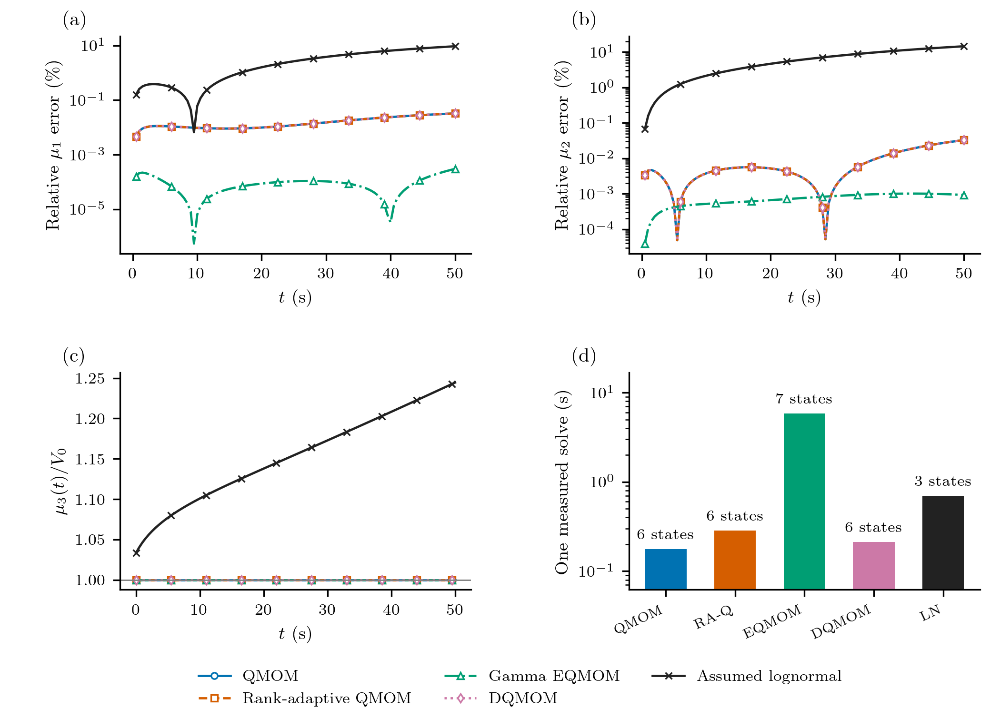
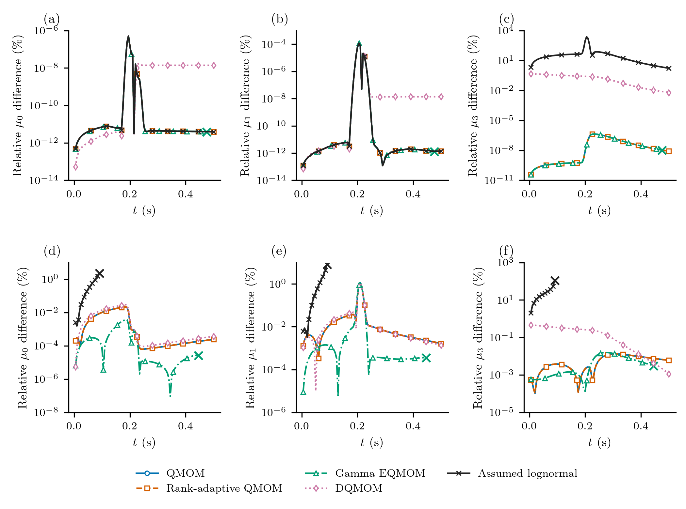

# Aggregation, fragmentation and a nucleation pulse

When particles merge, their number falls and their average size increases.
Fragmentation reverses that trend. Neither mechanism changes the total solid
volume in a closed batch. A model that follows only a few moments should retain
that balance while predicting how the number and size measures change.

A second question is harder: can those same moment equations follow a short,
intense burst of nuclei while existing particles grow and collide? These two
calculations answer different parts of that question. They use problems 4 and 5
of [Qamar et al., *A Gaussian quadrature method for solving batch crystallization models*](https://doi.org/10.1002/aic.12264),
published online in 2010 and in AIChE Journal in 2011. The first has an analytical
solution; the second has an analytical growth/source limit and a numerical
reference when collisions are included. The two references separate source integration from collision closure.

## Particle length and conserved volume

Let ``n(x,t)`` be number density per suspension volume per particle length.
Length ``x`` is in metres and time in seconds. Define

```math
\mu_k(t)=\int_0^\infty x^k n(x,t)\,dx.
```

Thus ``\mu_0`` measures number concentration and ``\mu_3`` is proportional to
solid volume concentration. Two particles of lengths ``x`` and ``y`` form one
particle of length ``(x^3+y^3)^{1/3}``. Adding lengths instead would violate the
physical balance.

For a constant aggregation kernel ``\beta_0``, the aggregation contribution is

```math
\frac{\partial n(x,t)}{\partial t}
=\frac{x^2}{2}\int_0^x
\frac{\beta_0\,n((x^3-y^3)^{1/3},t)n(y,t)}{(x^3-y^3)^{2/3}}\,dy
-\beta_0 n(x,t)\int_0^\infty n(y,t)\,dy.
```

Fragmentation contributes separately:

```math
\frac{\partial n(x,t)}{\partial t}
=\int_x^\infty a(y)b(x\mid y)n(y,t)\,dy-a(x)n(x,t).
```

The daughter count density is

```math
b(x\mid y)=\frac{6x^2}{y^3},\qquad 0<x<y.
```

It describes binary fragmentation uniform in daughter **volume**, not two
identical fragments. Its integral is two expected daughters, while its third
moment equals the parent's volume:

```math
\int_0^y b(x\mid y)\,dx=2,\qquad
\int_0^y x^k b(x\mid y)\,dx=\frac{6}{k+3}y^k.
```

`UniformVolumeDaughters()` supplies this law. Moment rules use the last integral
analytically; sectional rules use positive daughter quadrature followed by
fixed-pivot deposition. `daughter_moment` is the corresponding extension hook.

## First calculation: competing aggregation and fragmentation

Problem 4 uses ``\beta_0=1`` m³/s, ``a(x)=a_0x^3`` with
``a_0=1`` m⁻³s⁻¹, ``N_0=1`` m⁻³ and ``V_0=0.001``. In the paper's length-cubed
volume convention the initial distribution is

```math
n(x,0)=\frac{3N_0^2}{V_0}x^2
\exp\left(-\frac{N_0x^3}{V_0}\right),
\qquad
\mu_k(0)=N_0\left(\frac{V_0}{N_0}\right)^{k/3}
\Gamma\left(1+\frac{k}{3}\right).
```

``V_0=\mu_3(0)`` is the length-cubed concentration scale in this formula;
it is not a particle length or a size-grid width. The paper prints units of
m³ beside ``V_0`` while also assigning ``N_0`` units m⁻³. Here the equations
and their resulting moments fix its convention; no additional shape factor or
unit conversion is inserted into these stated benchmark values.

The complete moment equations are

```math
\frac{d\mu_k}{dt}
=\frac{\beta_0}{2}\int_0^\infty\int_0^\infty
\left[(x^3+y^3)^{k/3}-x^k-y^k\right]n(x,t)n(y,t)\,dx\,dy
+a_0\left(\frac{6}{k+3}-1\right)\mu_{k+3}.
```

In particular,

```math
\frac{d\mu_0}{dt}=-\frac{\beta_0}{2}\mu_0^2+a_0\mu_3,
\qquad \frac{d\mu_3}{dt}=0.
```

The higher equations need closure. A three-node QMOM uses moments 0 through 5
to recover a quadrature and evaluate those integrals. It does not approximate
the daughter law by an equal-volume split:

```@example qamar_case
using PopulationBalanceModels
include(joinpath(pkgdir(PopulationBalanceModels),"examples","qamar_moment_benchmarks.jl"))
import .QamarMomentBenchmarks
const benchmark = QamarMomentBenchmarks
volume = AdditiveCoordinate(x->x^3,cbrt)
model = PBMModel(
    aggregation=Aggregation(ConstantKernel(1.);coordinate_map=volume),
    breakage=Breakage((x,p,t,ctx)->x^3,UniformVolumeDaughters();
        coordinate_map=volume),
)
basis = MomentSet(0:5;coordinate=:length)
operator = compile(model,basis;method=QMOM(3))
problem = PBMProblem(operator,benchmark.exact4(0.),(0.,50.))
solution = simulate(problem;dt=0.01,saveat=[0.,10.,50.])
vec(last(solution.u))
```

The analytical solution retains the initial exponential-in-volume form. With
``N(t)=N_0\phi(t)``, all moments are

```math
\mu_k(t)=N(t)\left[\frac{V_0}{N(t)}\right]^{k/3}
\Gamma\left(1+\frac{k}{3}\right).
```

`exact4` evaluates the hyperbolic-tangent expression for ``\phi`` in the paper's
Eq. 42. The printed expression contains a ``C_0`` not defined in problem 4;
setting it to the stated aggregation coefficient ``\beta_0=1`` is independently
checked by the number equation above and by ``\mu_3=V_0``.


All relative-error panels on this page now use **percent**:

```math
E_k(t)=100\frac{|\mu_k(t)-\mu_k^{\mathrm{ref}}(t)|}{|\mu_k^{\mathrm{ref}}(t)|}\ \%.
```

Here the denominator is the analytical moment at the **same time**, not its
initial value. Panel (a) instead shows ``\mu_k(t)/\mu_k(0)``. Lines are
analytical and markers are three-node QMOM. The conserved third moment stays
at one in (a) and is omitted from the error panel. Log-error plots display
values below ``10^{-14}`` percent at that floor, including exact zeros; the
signed numerical data remain unchanged.
For QMOM with tracked third moment, the number equation is closed and material
is conserved; their small errors mainly test time integration. Higher unclosed
moments include reconstruction/closure error as well. The plotted total moment
discrepancy is not an isolated closure-error measurement. Three nodes give a
maximum relative moment error of about 0.38% over this run.
Four nodes reduce it to about 0.027%. Halving the integration step changes the
results by much less than either error: these differences mainly assess
quadrature closure, rather than time integration. The material moment remains
constant. The results correspond to the moment comparison in Figure 9; QMOM
nodes are not plotted as a reconstructed PSD.

## Compare the moment representations

The same laws can be compiled with different moment families. The builders choose
that family's required state layout and initialize it from the same distribution:

```julia
qmom = benchmark.problem4(method=QMOM(3))
adaptive = benchmark.problem4(method=RankAdaptiveQMOM(3))
extended = benchmark.problem4(method=EQMOM(3))
direct = benchmark.problem4(method=DQMOM(3))
lognormal = benchmark.problem4(method=LogNormalClosure(quadrature_order=64))
```

| Method | Evolved state | Reconstruction used for rates |
|:--|:--|:--|
| QMOM, three nodes | Six raw moments, orders 0–5 | Three positive atoms |
| Rank-adaptive QMOM, at most three nodes | The same six moments | Smallest rank reconstructing all six moments |
| Gamma EQMOM, three kernels | Seven raw moments, orders 0–6 | Three Gamma kernels, with 12 secondary quadrature points per kernel |
| DQMOM, three nodes | Three weights and three weighted abscissas | Directly evolved positive weights and distinct nodes |
| Assumed lognormal | Three raw moments, orders 0–2 | One lognormal shape, with 64 integration points |

This is a comparison at stated representation sizes, **not equal information or
equal computational work**. EQMOM uses an extra moment; lognormal uses fewer.
Increasing the lognormal integration order does not add shape parameters.
Its integration-point count is not a reconstruction rank; the CSV rank fields
are left undefined for this closure. For EQMOM those fields count primary
kernels, and for DQMOM they count distinct active atoms; neither is a count of
secondary integration points.
`ExactClosure` is not an alternative finite length-moment closure here: the
breakage equations require higher moments and the aggregation law contains
fractional powers of volume. The analytical solution remains the independent
reference for the first calculation.

DQMOM's six numbers are not six raw moments. Its initialization first obtains
quadrature from the initial moments, then packs weights and weighted sizes:

```julia
basis = MomentSet(0:5;coordinate=:length)
initial = benchmark.exact4(0.)
q = quadrature(basis,initial,QMOM(3))
state = quadrature_state(DQMOM(3),q.nodes,q.weights)
```

The runner reads its predictions through `moment_value`, rather than treating
`state[4]` as material. The lognormal third moment is explicitly reconstructed
from the first three moments:

```math
\mu_{3,\mathrm{LN}}=\frac{\mu_0\mu_2^3}{\mu_1^3}.
```

It is **not an evolved conserved state**. Even initially it differs from the
known third moment of this distribution. No missing material is assigned to a
bulk phase to conceal that difference.



The upper panels use the same analytical denominator and **percent** convention.
The lower-left panel is ``\mu_3/V_0``, not an error: departures
from one show the material prediction, including the lognormal reconstruction's
initial mismatch. On this smooth aggregation/fragmentation calculation, fixed and rank-adaptive
QMOM agree: the active rank stays three, so adaptation adds no accuracy here.
Their maximum first-/second-moment errors are about 0.0325% and 0.0327%.
Gamma EQMOM reduces these to about 0.00030% and 0.0010%,
while using seven evolved moments and substantially more quadrature and
inversion work.
That result does not establish that it is better for every population shape.

Several sharp minima are **cancellation dips**. Independent subtraction of the
saved moments and analytical values shows Gamma EQMOM's signed first-moment
error crossing zero between 9.5–10 s and 39.5–40 s; QMOM's second-moment error
crosses between 5–5.5 s and 28–28.5 s. Taking an absolute value and a log axis
makes these crossings prominent. They do not show a sudden, uniformly accurate
reconstruction or a general improvement in closure accuracy.

DQMOM approaches the same three-node weak equations as QMOM. Their small finite
step differences come from evolving different state coordinates and solving
the direct source system. The third moment is conserved algebraically in the
raw formulations; DQMOM's derived third moment has a small integration drift.
The lognormal reconstruction instead develops roughly 20% third-moment change
relative to its own reconstructed initial value, although the physical problem
conserves material. The plotted ratio starts at 1.0332 and reaches 1.2445: the roughly 20% change
is relative to its own reconstructed initial value, while the final discrepancy
from physical ``V_0`` is about 24.5%. Its number equation uses that inferred
third moment, so number and lower-moment errors also grow. Tracking fewer
moments is useful only if the shape assumption suits the evolving population.
Solve cost also depends on the quadrature: pairwise aggregation is evaluated
over all positive quadrature-point pairs, so 64 lognormal integration points
can cost more than three QMOM atoms despite the smaller state vector.

All these curves use SSPRK33 with the same maximum timestep, `0.02 s`, and a
separate `0.01 s` run. The lower-moment timestep differences in this calculation
are about `6e-8` as dimensionless fractions, much smaller than the visible
moment discrepancies. Runtime bars are
one measured solve after a short compilation warmup, including state checks;
they are not timing medians or a general performance ranking. These histories
and timings are retained from the audited runs; this revision redraws their
figures without reopening collision EQMOM evolution.

## Second calculation: a short burst of nuclei

Problem 5 adds constant growth ``G=1`` m/s and a prescribed boundary density:

```math
n(0,t)=100+10^6\exp[-10^4(t-0.215)^2].
```

`Nucleation` expects an inward **number flux**, so its rate is
``J(t)=G n(0,t)``. The large coefficient is a density amplitude, not a particle
count. The exponent sets a physical pulse duration independent of mesh spacing.
The initial condition on the stated window is

```math
n(x,0)=\begin{cases}
100,&0.4\le x\le0.6,\\
0.01,&0\le x\le2\text{ outside that interval},\\
0,&x>2.
\end{cases}
```

The background must have a finite support to define full moments. We retain
that support at initialization and include particles that subsequently grow
past ``x=2``; a reference distribution therefore needs a larger size domain.
Extending the constant background to infinity would give divergent moments.

With collisions included, the PDE is

```math
\frac{\partial n(x,t)}{\partial t}
+\frac{\partial[G n(x,t)]}{\partial x}
=\frac{x^2}{2}\int_0^x
\frac{\beta_0 n((x^3-y^3)^{1/3},t)n(y,t)}{(x^3-y^3)^{2/3}}\,dy
-\beta_0n(x,t)\int_0^\infty n(y,t)\,dy
+\int_x^\infty y^6\frac{6x^2}{y^3}n(y,t)\,dy-x^6n(x,t),
```

where ``\beta_0=1.5\times10^{-5}`` m³/s and the breakage hazard is ``a(x)=x^6``
in the paper's benchmark units. The coefficient of that hazard is one in
m⁻⁶s⁻¹. There is no solute or temperature balance in either of these tests.

```julia
boundary_density(t) = 100 + 1e6*exp(-1e4*(t-0.215)^2)
model = PBMModel(
    growth=Growth(PolynomialRate((1.,))),
    primary=Nucleation((p,t,ctx)->p.G*boundary_density(t),0.),
    aggregation=Aggregation(ConstantKernel(1.5e-5);coordinate_map=volume),
    breakage=Breakage((x,p,t,ctx)->x^6,UniformVolumeDaughters();
        coordinate_map=volume),
)
operator = compile(model,MomentSet(0:5;coordinate=:length);method=QMOM(3),
    methods=TermMethods(by_term=(growth=ExactMomentRule(),primary=ExactMomentRule())))
```

The reconstruction closes collision integrals. Growth and boundary creation use
exact moment rules: ``d\mu_0/dt`` receives ``J(t)`` and growth adds
``kG\mu_{k-1}`` to each higher equation. The source at zero adds no higher
moment directly. That separation makes the treatment of each term visible.

Without collisions, characteristics give ``n(x,t)=n(x-t,0)`` for ``x\ge t``
and ``n(x,t)=n(0,t-x)`` for ``0\le x<t``. `exact5` integrates that solution,
subdividing around the short pulse. It is an independent analytical check on
both the moment ODEs and the temporal resolution.


Lines in the left panel are analytical; lines in the right are a new sectional
reference, rather than digitized author FVS curves. Markers show three-node
QMOM. These are the two comparisons made in Figure 10. The narrow population
appears abruptly in number, then contributes to higher moments as it grows.
Aggregation and fragmentation alter the full-process histories.

## What happens when the narrow population arrives?



Every panel uses the same percent convention as the aggregation comparison:
a dimensionless difference of 0.0038 is displayed as 0.38%.
The upper row uses analytical growth/source moments; the lower row uses the
1200-bin numerical sectional reference, interpolated at the saved method times.
Each denominator is that reference moment at the same time. Values below
``10^{-14}`` percent are displayed at the stated floor, including exact zeros.
Each panel includes its complete finite trajectory and uses its own vertical
range; the exported moments are unchanged.

The upper row compares growth and nucleation with the analytical moments. All
raw-moment methods have the same closed equations for this limit. This tests
source and time integration, **not collision closure error**. Fixed and
rank-adaptive QMOM overlap because their active rank stays three. The source's
``e^{-10^4(t-0.215)^2}`` factor has a 0.01-s time scale; the maximum integration
step is ``2\times10^{-4}`` s, independently of the 0.005-s output spacing. The lognormal
first three moments also follow those equations once its reconstruction
quadrature is sufficiently resolved. Its inferred third moment can still be
wrong: agreement of evolved lower moments does not validate a reconstructed
material moment or size distribution.

The lognormal comparison uses 64 integration points; its default 16-point rule
is unresolved during this pulse. More integration points improve evaluation of
the chosen shape, not its ability to describe a bimodal population. Its inferred
third moment ``\mu_{3,\mathrm{LN}}=\mu_0\mu_2^3/\mu_1^3`` can therefore be
inaccurate while all three tracked moments are accurate.

Gamma EQMOM stops at the saved time 0.475 s in the growth/source limit: the
reference moments cease to admit the selected three-kernel family near 0.48 s.
That is distinct from physical nonrealizability. **Collision EQMOM evolution
remains unresolved and is not time converged**; its partial curve cannot support
a validated full-horizon accuracy ranking. The lognormal collision equations
instead develop broad-tail runaway near 0.09047 s, before the pulse maximum.
Its last saved point is 0.09 s. These results retain the selected closures and
state checks. Detailed failing stages, conditioning, quadrature checks and
independent diagnoses are in the [audit register](../audit.md).

Crosses mark the last saved output of an incomplete run, not the first failing
internal stage. Costs must be read alongside state count and completed horizon.

DQMOM completes both pulse calculations, but its lower-moment timestep difference
is about `1.5e-3`, compared with about `1e-6` for the raw three-node formulations.
The exported scaled source-matrix condition number helps assess this alongside
its time refinement. Matching continuous weak equations does not make two
finite-step state evolutions equally accurate. A completed run and positive
weights are insufficient accuracy checks.

The lower row uses the refined sectional solution as a **numerical comparison**,
not an exact collision solution. Its truncation, splitting and spatial errors
remain part of those differences. The reconstructed lognormal third moment is
labelled separately from tracked third moments throughout the export.

The [native positive-measure policy](../methods/realizable_evolution.md) provides
an admissible first-order option for supported raw QMOM/rank-adaptive populations.
It is not automatically applied to these SSPRK33 runs and does not supply
extinction, empty-state or rank-collision guarantees to EQMOM, lognormal or
DQMOM. Changing integration policy is a separate experiment from changing the
moment representation.

An absolute-error curve can dip when its signed difference crosses zero.
In the saved growth/source data, QMOM's first-moment difference changes sign
between 0.215 and 0.220 s, and lognormal's inferred third-moment difference
between 0.220 and 0.225 s. Those local dips indicate cancellation, not a sudden
improvement of the closure. Tiny pre-pulse differences near roundoff need no
physical interpretation.

## Separate closure and reference errors


The left verification panel plots
``100|\mu_k^{\mathrm{sectional}}-\mu_k^{\mathrm{QMOM}}|/|\mu_k^{\mathrm{QMOM}}|``
percent for 600 and 1200 bins. Its denominator is **QMOM**, whereas the family
comparison uses the sectional reference. The right panel shows percent
``\mu_4`` error against the **analytical growth/source** moments. Both use the
same ``10^{-14}``-percent log-display floor. These comparisons diagnose reference
and time/reconstruction effects separately; neither is an isolated collision
closure-error estimate.

The runner compares three and four nodes, and halves the native integration
step. A separate resolved reference uses 600 and 1200 uniform length bins on
``[0,3]``. It applies Strang splitting: fixed-pivot collision half-steps bracket
an exact ``C=1`` growth shift. Boundary births are integrated over each shift
using the Gaussian error function. The collision substeps use SSPRK33 with a conservative outgoing-rate step
estimate and checks on every Runge–Kutta stage. This is a stated reference algorithm,
not a claim to implement the paper's FVS solver.

Grid refinement also changes the split step, since its growth update requires
``\Delta t=\Delta x/G``. Their differences include spatial and splitting error.
They must not be called QMOM error alone. The initial domain and the extended
reference domain are stated separately; unresolved fixed-pivot products are
discarded explicitly. Further domain and time refinement are needed before
interpreting very small differences as validated closure accuracy. Full raw
moments do not determine a unique continuous PSD.

Results are in [aggregation_breakage.csv](../assets/qamar_moments/aggregation_breakage.csv),
[pulse.csv](../assets/qamar_moments/pulse.csv),
[sectional_reference.csv](../assets/qamar_moments/sectional_reference.csv) and
[refinement.csv](../assets/qamar_moments/refinement.csv).
The family comparison exports [histories](../assets/qamar_moments/method_comparison.csv),
[state counts, timing, conditioning and completion](../assets/qamar_moments/method_summary.csv),
and [reconstruction-quadrature checks](../assets/qamar_moments/reconstruction_checks.csv).
Final unresolved collision rates and the resolved-plus-unresolved volume balance
are recorded in [reference_checks.csv](../assets/qamar_moments/reference_checks.csv).
These endpoint rates are not cumulative escaped-volume reservoirs.

```sh
julia --project=. examples/qamar_moment_benchmarks.jl
python docs/benchmarks/plot_case_studies.py moments --usetex
python docs/benchmarks/plot_moment_comparison.py --usetex
julia --project=docs docs/make.jl
```

To regenerate only the method comparison while reusing the supplied sectional
reference, run `julia --project=. examples/qamar_moment_benchmarks.jl --methods-only`.
This retains separate timestep and reconstruction-quadrature checks.

## Minimal run and full reproduction

Run this block from the repository root. It constructs and solves one problem;
including a driver does not run its CSV exports.

```julia
using PopulationBalanceModels
include("examples/qamar_moment_benchmarks.jl")
benchmark = QamarMomentBenchmarks
problem = benchmark.problem4(; method=QMOM(3))
solution = simulate(problem; method=SSPRK33(), dt=0.02, saveat=0.0:1.0:50.0)
M1 = [moment(problem.operator.grid, vec(u), 1) for u in solution.u]
reference = [benchmark.exact4(t)[2] for t in solution.t]
```

Full sources are linked below. Follow the [shared setup and reproduction guide](../verification.md)
to retain their directory layout and plotting environment.

- [qamar_moment_benchmarks.jl](../assets/source/examples/qamar_moment_benchmarks.jl)
