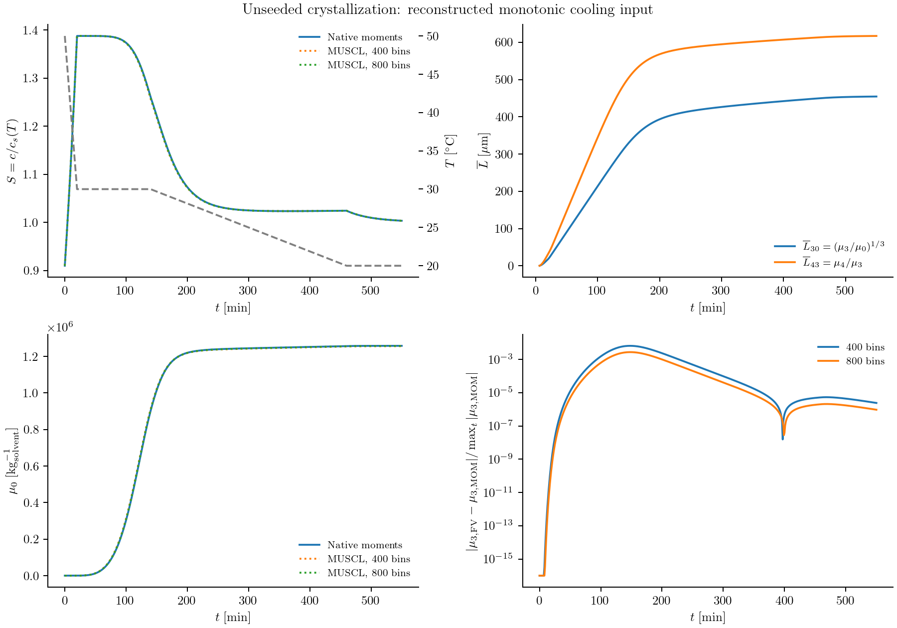

# Crystal growth under a temperature program

A cooling policy changes both how many crystals form and how much material each
crystal acquires. If the quantities we need are total number, crystal material,
and mean sizes, a few moments may be enough. Resolving every size bin is useful
when fines counts or the full product distribution are needed instead.

This calculation uses the paracetamol–ethanol kinetics of
[Kim, Kawajiri, Rousseau, and Grover (2023)](https://doi.org/10.1021/acs.iecr.2c03465).
It compares native moment equations with a sectional calculation during monotonic
cooling. The cooling history is reconstructed from the noncycling side of
Figure 13; it is an illustrative model calculation, not a verified reproduction
of that figure. The distinction matters because Figure 13 also includes
extinction of fines and distributions that a few raw moments do not determine.

## From the population balance to five ODEs

Let ``f(L,t)`` count crystals per µm and kg of solvent. With size-independent
velocity ``G(t)``, the interior equation is

```math
\frac{\partial f(L,t)}{\partial t}
+\frac{\partial[G(t)f(L,t)]}{\partial L}=0.
```

When supersaturated, primary and secondary nuclei enter at zero size with total
inward number flux ``B_1+B_2``. Define

```math
\mu_j(t)=\int_0^\infty L^jf(L,t)\,dL.
```

Provided no particles disappear through zero size and the upper boundary is
unpopulated, the moment equations are

```math
\frac{d\mu_0(t)}{dt}=B_1(t)+B_2(t),\qquad
\frac{d\mu_j(t)}{dt}=jG(t)\mu_{j-1}(t),\quad j=1,2,3,4.
```

The source at zero size adds no higher moments. Because growth is independent
of size, each equation depends only on lower tracked moments. ExactClosure
therefore assembles these equations without a distribution reconstruction.
Their numerical time integration still has error.

The free-solute balance is

```math
\frac{dc(t)}{dt}=-q\frac{d\mu_3(t)}{dt}=-3qG(t)\mu_2(t),
\qquad q=\rho_c k_v\,10^{-15}.
```

Here ``c`` is g solute/g solvent, ``\rho_c`` is in g/cm³, and ``k_v`` is the volume
shape factor. The conversion includes ``10^{-12}`` cm³/µm³ and ``10^{-3}``
kg/g: the moments are per **kg** of solvent. The invariant is ``c+q\mu_3``.

## Supply the kinetic laws

The supporting-information solubility correlation uses temperature in kelvin:

```math
c_s(T)=-8.707+0.09669T-3.610\times10^{-4}T^2+4.590\times10^{-7}T^3.
```

For ``S=c/c_s(T)>1``, the nucleation rates are

```math
B_1=k_{b1}\exp\left[-\frac{16\pi V_m^2\sigma^3}
{3(k_BT)^3(\ln S)^2}\right],\qquad
B_2=k_{b2}(S-1)^\alpha m_s^\beta,\qquad m_s=q\mu_3.
```

Both rates are zero below saturation. This implementation takes ``m_s`` in g/g,
as described beside the source paper's equation 6. Growth and dissolution are

```math
G(t)=\begin{cases}
k_g\exp[-E_{a,g}/(RT)]\,[c(t)-c_s(T)]^{\gamma_g},&c\ge c_s,\\
k_d\exp[-E_{a,d}/(RT)]\,[c_s(T)-c(t)]^{\gamma_d},&c<c_s.
\end{cases}
```

The reported ``k_d`` is negative. Time is in minutes, so ``G`` is in µm/min.
The recipe stores the constants in Tables 2 and 6; interfacial energy is converted
from mJ/m² to J/m² before evaluating the nucleation barrier. Molecular volume
is calculated from molar mass, density, and Avogadro's constant.

```@example moment_case
using PopulationBalanceModels
include(joinpath(pkgdir(PopulationBalanceModels),"examples","temperature_programmed_crystallization.jl"))
import .TemperatureProgrammedCrystallization
const recipe = TemperatureProgrammedCrystallization
p = recipe.parameters(density=1.293)
```

Density 1.293 g/cm³ is an explicit material assumption for this illustration;
it is not estimated here or confirmed by a numerical value in the supplied
paper. The shape factor 0.797 and kinetic constants come from the paper.

## Declare the moment representation

The builder uses the same physical declarations as a sectional model. It makes
the size independence visible through PolynomialRate:

```@example moment_case
model = PBMModel(
    growth=Growth(rate=PolynomialRate((recipe.growth_velocity,))),
    primary=Nucleation(rate=recipe.primary_rate,size=0.0),
    secondary=Nucleation(rate=recipe.secondary_rate,size=0.0),
)
operator = compile(model,MomentSet(0:4;coordinate=:length);method=ExactClosure())
term_methods(operator)
```

`recipe.secondary_rate` reads `moment(ctx,3)`, so it does not assume a bin layout.
The concentration uses a moment exchange:

```julia
system = PBMSystem((crystals=operator,);
    fields=(p,t)->(T=temperature(t),),nonnegative_bulk=(:c,),
    exchanges=(MomentExchange(:crystals,:c,3;
        factor=(p,t,ctx)->p.material_factor,mechanisms=(:growth,)),))
```

MomentExchange obtains the third-moment derivative from the selected term rule.
It does not estimate that derivative by differencing saved values.

## Initialize a clear solution and prescribe cooling

The five moments start at zero. For the illustrated calculation we use
``c(0)=0.300`` g/g and these graph-read temperature knots:

| Time (min) | 0 | 20 | 140 | 460 | 550 |
|:--|--:|--:|--:|--:|--:|
| Temperature (°C) | 50 | 30 | 30 | 20 | 20 |

```@example moment_case
temperature = recipe.linear_temperature([0.,20.,140.,460.,550.],
    [50.,30.,30.,20.,20.])
problem = recipe.build_moments(;p,c0=0.300,temperature_profile=temperature,
    tspan=(0.0,550.0),initial_moments=zeros(5))
nothing # hide
```

These knots and the initial concentration are reconstructed inputs, not an
author-supplied numerical protocol. They are recorded alongside the results.
The example therefore tests the two numerical representations for a fully
stated input set; agreement with the publication's curves remains unverified.

## Compare the numerical representations

The runner advances the moment system at steps 0.02 and 0.01 min, and the
sectional system with MUSCL on 400 and 800 bins over 0–2000 µm. The upper
size boundary is checked for negligible population. Saved moments and
concentration must be finite and nonnegative; saved native moments must also
pass the necessary Hankel realizability checks. Intermediate explicit RK moment
vectors are not projected onto a realizable distribution; their checks are
disabled for this diagnostic and step refinement is reported explicitly.

The displayed mean sizes are

```math
\overline L_{30}(t)=\left[\frac{\mu_3(t)}{\mu_0(t)}\right]^{1/3},\qquad
\overline L_{43}(t)=\frac{\mu_4(t)}{\mu_3(t)}.
```

They are undefined in the initial empty state, which is omitted from these
curves. The lower-right panel compares the sectional material moment with the
native moment solution, normalized by the maximum reference third moment so
the initially empty population does not produce an undefined relative error.
All panels use the same explicit input choices.



```sh
julia --project=. examples/temperature_programmed_crystallization.jl
python docs/benchmarks/plot_case_studies.py moments --usetex
```

## What the cycling comparison still needs

Figure 13 uses a resolved CE/SE calculation to report supersaturation, two
moment-based means, counts below 150 µm, total count, and final volume density.
The finite set ``\mu_0,\ldots,\mu_4`` determines the means but not the fines
count or final distribution.

During dissolution the exact number equation has an additional boundary term:

```math
\frac{d\mu_0(t)}{dt}=B_1(t)+B_2(t)+G(t)f(0,t).
```

When ``G<0`` the last term removes disappearing particles. Their boundary density
is not determined by five moments. Setting it to zero would retain extinct
crystals and bias both total number and ``\overline L_{30}``. The authors used
the moment method for nonextinguishing dissolution experiments and CE/SE for
cycling calculations. Our raw-moment builder supplies no extinction closure;
it must not be used to claim the full cycling result.

A complete Figure 13 reproduction therefore needs a resolved extinction boundary
or a separately tested reconstruction/closure, the cycling protocol, consistent
material and secondary-nucleation mass conventions, and a declared procedure
for computing the final distribution. Those are additional scientific inputs
and methods, rather than plotting options.
