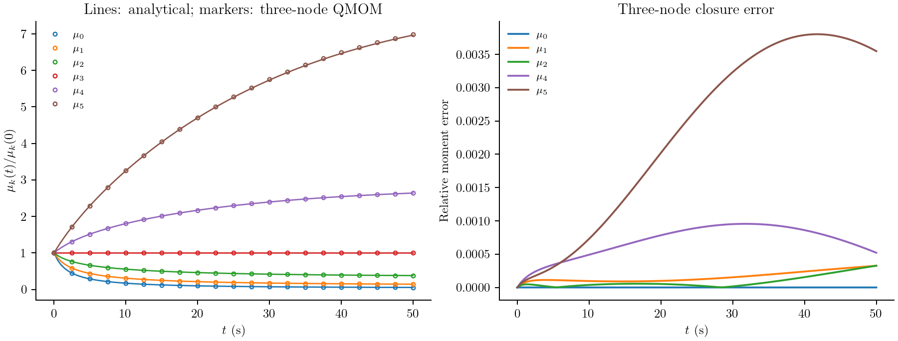
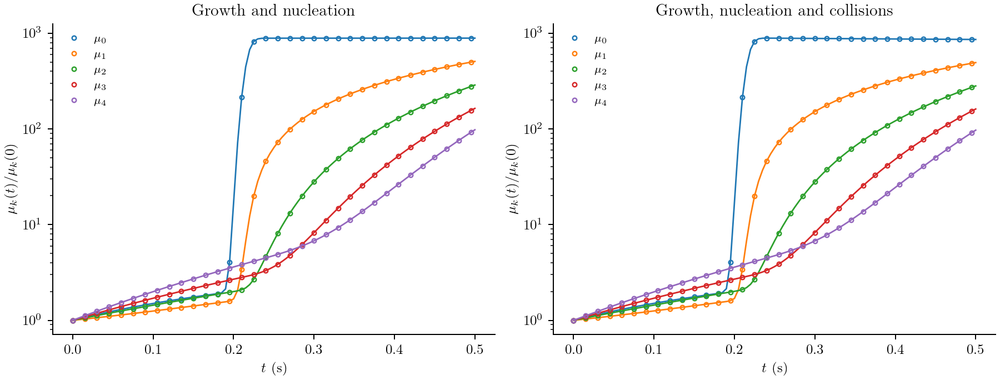
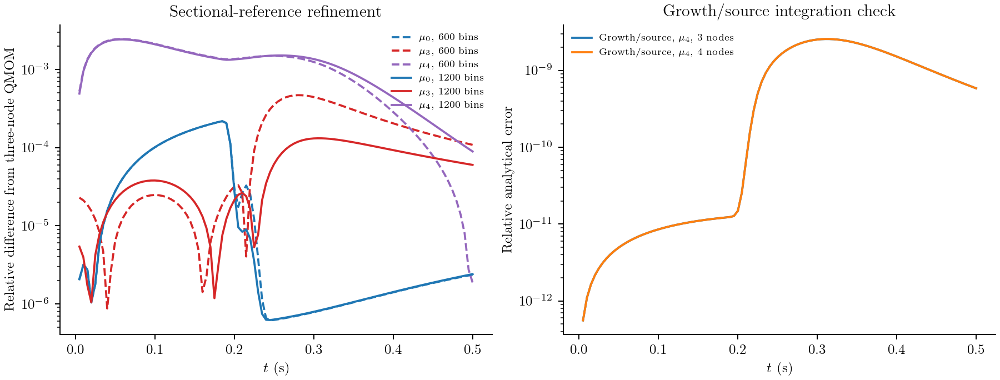

# Aggregation, fragmentation and a nucleation pulse

When particles merge, their number falls and their average size increases.
Fragmentation reverses that trend. Neither mechanism changes the total solid
volume in a closed batch. A model that follows only a few moments should retain
that balance while predicting how the number and size measures change.

A second question is harder: can those same moment equations follow a short,
intense burst of nuclei while existing particles grow and collide? These two
calculations answer different parts of that question. They use problems 4 and 5
of [Qamar et al., *A Gaussian quadrature method for solving batch crystallization models*](https://doi.org/10.1002/aic.12264),
published online in 2010 and in AIChE Journal in 2011. The first has an analytical
solution; the second has an analytical growth/source limit and a numerical
reference when collisions are included. They replace the earlier temperature-program
illustration on this page.

## Particle length and conserved volume

Let ``n(x,t)`` be number density per suspension volume per particle length.
Length ``x`` is in metres and time in seconds. Define

```math
\mu_k(t)=\int_0^\infty x^k n(x,t)\,dx.
```

Thus ``\mu_0`` measures number concentration and ``\mu_3`` is proportional to
solid volume concentration. Two particles of lengths ``x`` and ``y`` form one
particle of length ``(x^3+y^3)^{1/3}``. Adding lengths instead would violate the
physical balance.

For a constant aggregation kernel ``\beta_0``, the aggregation contribution is

```math
\frac{\partial n(x,t)}{\partial t}
=\frac{x^2}{2}\int_0^x
\frac{\beta_0\,n((x^3-y^3)^{1/3},t)n(y,t)}{(x^3-y^3)^{2/3}}\,dy
-\beta_0 n(x,t)\int_0^\infty n(y,t)\,dy.
```

Fragmentation contributes separately:

```math
\frac{\partial n(x,t)}{\partial t}
=\int_x^\infty a(y)b(x\mid y)n(y,t)\,dy-a(x)n(x,t).
```

The daughter count density is

```math
b(x\mid y)=\frac{6x^2}{y^3},\qquad 0<x<y.
```

It describes binary fragmentation uniform in daughter **volume**, not two
identical fragments. Its integral is two expected daughters, while its third
moment equals the parent's volume:

```math
\int_0^y b(x\mid y)\,dx=2,\qquad
\int_0^y x^k b(x\mid y)\,dx=\frac{6}{k+3}y^k.
```

`UniformVolumeDaughters()` supplies this law. Moment rules use the last integral
analytically; sectional rules use positive daughter quadrature followed by
fixed-pivot deposition. `daughter_moment` is the corresponding extension hook.

## First calculation: competing aggregation and fragmentation

Problem 4 uses ``\beta_0=1`` m³/s, ``a(x)=a_0x^3`` with
``a_0=1`` m⁻³s⁻¹, ``N_0=1`` m⁻³ and ``V_0=0.001``. In the paper's length-cubed
volume convention the initial distribution is

```math
n(x,0)=\frac{3N_0^2}{V_0}x^2
\exp\left(-\frac{N_0x^3}{V_0}\right),
\qquad
\mu_k(0)=N_0\left(\frac{V_0}{N_0}\right)^{k/3}
\Gamma\left(1+\frac{k}{3}\right).
```

``V_0=\mu_3(0)`` is the length-cubed concentration scale in this formula;
it is not a particle length or a size-grid width. The paper prints units of
m³ beside ``V_0`` while also assigning ``N_0`` units m⁻³. Here the equations
and their resulting moments fix its convention; no additional shape factor or
unit conversion is inserted into these stated benchmark values.

The complete moment equations are

```math
\frac{d\mu_k}{dt}
=\frac{\beta_0}{2}\int_0^\infty\int_0^\infty
\left[(x^3+y^3)^{k/3}-x^k-y^k\right]n(x,t)n(y,t)\,dx\,dy
+a_0\left(\frac{6}{k+3}-1\right)\mu_{k+3}.
```

In particular,

```math
\frac{d\mu_0}{dt}=-\frac{\beta_0}{2}\mu_0^2+a_0\mu_3,
\qquad \frac{d\mu_3}{dt}=0.
```

The higher equations need closure. A three-node QMOM uses moments 0 through 5
to recover a quadrature and evaluate those integrals. It does not approximate
the daughter law by an equal-volume split:

```@example qamar_case
using PopulationBalanceModels
include(joinpath(pkgdir(PopulationBalanceModels),"examples","qamar_moment_benchmarks.jl"))
import .QamarMomentBenchmarks
const benchmark = QamarMomentBenchmarks
volume = AdditiveCoordinate(x->x^3,cbrt)
model = PBMModel(
    aggregation=Aggregation(ConstantKernel(1.);coordinate_map=volume),
    breakage=Breakage((x,p,t,ctx)->x^3,UniformVolumeDaughters();
        coordinate_map=volume),
)
basis = MomentSet(0:5;coordinate=:length)
operator = compile(model,basis;method=QMOM(3))
problem = PBMProblem(operator,benchmark.exact4(0.),(0.,50.))
solution = simulate(problem;dt=0.01,saveat=[0.,10.,50.])
vec(last(solution.u))
```

The analytical solution retains the initial exponential-in-volume form. With
``N(t)=N_0\phi(t)``, all moments are

```math
\mu_k(t)=N(t)\left[\frac{V_0}{N(t)}\right]^{k/3}
\Gamma\left(1+\frac{k}{3}\right).
```

`exact4` evaluates the hyperbolic-tangent expression for ``\phi`` in the paper's
Eq. 42. The printed expression contains a ``C_0`` not defined in problem 4;
setting it to the stated aggregation coefficient ``\beta_0=1`` is independently
checked by the number equation above and by ``\mu_3=V_0``.



Three nodes give a maximum relative moment error of about 0.38% over this run.
Four nodes reduce it to about 0.027%. Halving the integration step changes the
results by much less than either error: these differences mainly assess
quadrature closure, rather than time integration. The material moment remains
constant. The results correspond to the moment comparison in Figure 9; QMOM
nodes are not plotted as a reconstructed PSD.

## Second calculation: a short burst of nuclei

Problem 5 adds constant growth ``G=1`` m/s and a prescribed boundary density:

```math
n(0,t)=100+10^6\exp[-10^4(t-0.215)^2].
```

`Nucleation` expects an inward **number flux**, so its rate is
``J(t)=G n(0,t)``. The large coefficient is a density amplitude, not a particle
count. The exponent sets a physical pulse duration independent of mesh spacing.
The initial condition on the stated window is

```math
n(x,0)=\begin{cases}
100,&0.4\le x\le0.6,\\
0.01,&0\le x\le2\text{ outside that interval},\\
0,&x>2.
\end{cases}
```

The background must have a finite support to define full moments. We retain
that support at initialization and include particles that subsequently grow
past ``x=2``; a reference distribution therefore needs a larger size domain.
Extending the constant background to infinity would give divergent moments.

With collisions included, the PDE is

```math
\frac{\partial n(x,t)}{\partial t}
+\frac{\partial[G n(x,t)]}{\partial x}
=\frac{x^2}{2}\int_0^x
\frac{\beta_0 n((x^3-y^3)^{1/3},t)n(y,t)}{(x^3-y^3)^{2/3}}\,dy
-\beta_0n(x,t)\int_0^\infty n(y,t)\,dy
+\int_x^\infty y^6\frac{6x^2}{y^3}n(y,t)\,dy-x^6n(x,t),
```

where ``\beta_0=1.5\times10^{-5}`` m³/s and the breakage hazard is ``a(x)=x^6``
in the paper's benchmark units. The coefficient of that hazard is one in
m⁻⁶s⁻¹. There is no solute or temperature balance in either of these tests.

```julia
boundary_density(t) = 100 + 1e6*exp(-1e4*(t-0.215)^2)
model = PBMModel(
    growth=Growth(PolynomialRate((1.,))),
    primary=Nucleation((p,t,ctx)->p.G*boundary_density(t),0.),
    aggregation=Aggregation(ConstantKernel(1.5e-5);coordinate_map=volume),
    breakage=Breakage((x,p,t,ctx)->x^6,UniformVolumeDaughters();
        coordinate_map=volume),
)
operator = compile(model,MomentSet(0:5;coordinate=:length);method=QMOM(3),
    methods=TermMethods(by_term=(growth=ExactMomentRule(),primary=ExactMomentRule())))
```

The reconstruction closes collision integrals. Growth and boundary creation use
exact moment rules: ``d\mu_0/dt`` receives ``J(t)`` and growth adds
``kG\mu_{k-1}`` to each higher equation. The source at zero adds no higher
moment directly. That separation makes the treatment of each term visible.

Without collisions, characteristics give ``n(x,t)=n(x-t,0)`` for ``x\ge t``
and ``n(x,t)=n(0,t-x)`` for ``0\le x<t``. `exact5` integrates that solution,
subdividing around the short pulse. It is an independent analytical check on
both the moment ODEs and the temporal resolution.



Lines in the left panel are analytical; lines in the right are a new sectional
reference, rather than digitized author FVS curves. Markers show three-node
QMOM. These are the two comparisons made in Figure 10. The narrow population
appears abruptly in number, then contributes to higher moments as it grows.
Aggregation and fragmentation alter the full-process histories.

## Separate closure and reference errors



The runner compares three and four nodes, and halves the native integration
step. A separate resolved reference uses 600 and 1200 uniform length bins on
``[0,3]``. It applies Strang splitting: fixed-pivot collision half-steps bracket
an exact ``C=1`` growth shift. Boundary births are integrated over each shift
using the Gaussian error function. The collision substeps use SSPRK33 with a conservative outgoing-rate step
estimate and checks on every Runge–Kutta stage. This is a stated reference algorithm,
not a claim to implement the paper's FVS solver.

Grid refinement also changes the split step, since its growth update requires
``\Delta t=\Delta x/G``. Their differences include spatial and splitting error.
They must not be called QMOM error alone. The initial domain and the extended
reference domain are stated separately; unresolved fixed-pivot products are
discarded explicitly. Further domain and time refinement are needed before
interpreting very small differences as validated closure accuracy. Full raw
moments do not determine a unique continuous PSD.

Results are in [aggregation_breakage.csv](../assets/qamar_moments/aggregation_breakage.csv),
[pulse.csv](../assets/qamar_moments/pulse.csv),
[sectional_reference.csv](../assets/qamar_moments/sectional_reference.csv) and
[refinement.csv](../assets/qamar_moments/refinement.csv).
Final unresolved collision rates and the resolved-plus-unresolved volume balance
are recorded in [reference_checks.csv](../assets/qamar_moments/reference_checks.csv).
These endpoint rates are not cumulative escaped-volume reservoirs.

```sh
julia --project=. examples/qamar_moment_benchmarks.jl
python docs/benchmarks/plot_case_studies.py moments --usetex
julia --project=docs docs/make.jl
```

## Complete runnable script

The code below is read from the example source during the documentation build.

```@eval
using Markdown, PopulationBalanceModels
Markdown.MD([Markdown.Code("julia",read(joinpath(pkgdir(PopulationBalanceModels),"examples","qamar_moment_benchmarks.jl"),String))])
```
