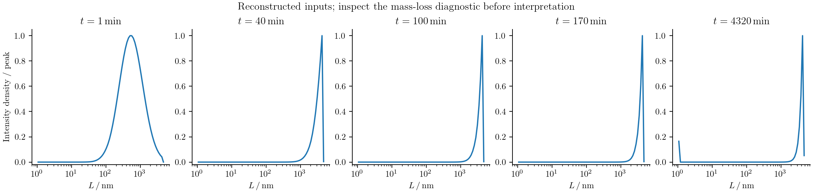
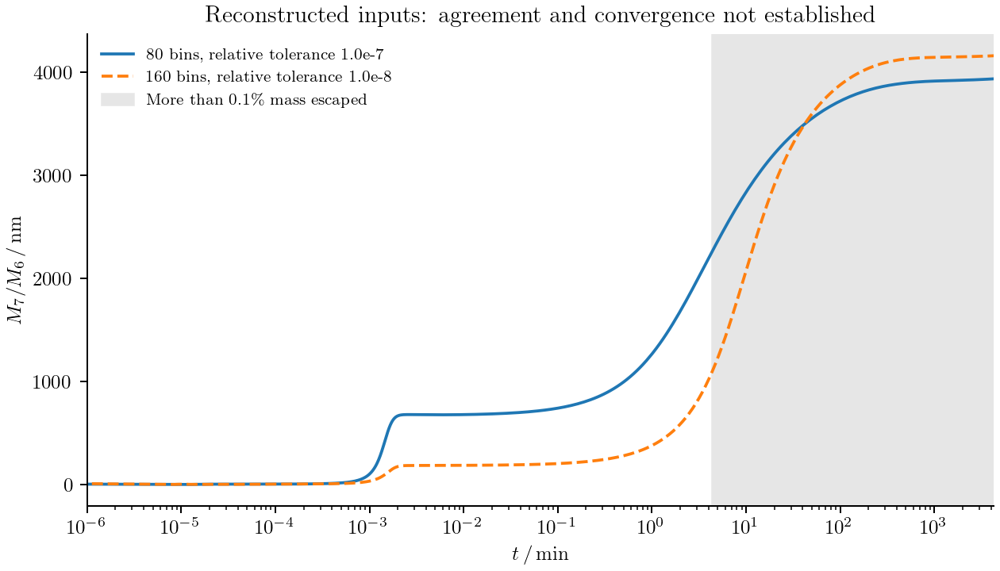
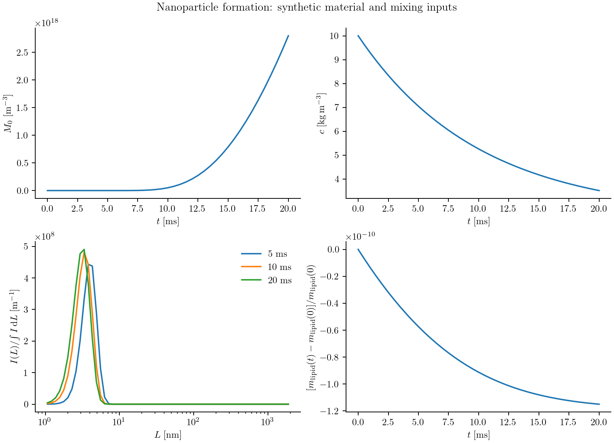

# Lipid nanoparticle formation

Mixing an ethanolic lipid solution with water lowers lipid solubility. The
resulting supersaturation creates particles, feeds their growth, and changes
as lipid leaves solution. Coalescence then changes the size distribution even
when little free lipid remains. Predicting a measured mean diameter requires
following the distribution through both formation and subsequent incubation.

We model these processes with a diameter population balance coupled to free
lipid. The formulation is based on
[Shin et al. (2025)](https://web.mit.edu/braatzgroup/Shin_ChemEngJ_2025.pdf).
The comparison of interest is the calculated distributions and mean-diameter
history in Figure 4. We start with no particles and follow the calculation to
4320 minutes; the material inputs needed to complete that comparison are
listed below.

## Start with dissolved lipid

Let ``f(L,t)`` be the number density per unit diameter and per unit process
volume. Initially,

```math
f(L,0)=0.
```

For instantaneous mixing, an organic-feed concentration of 10 mg/mL and an
aqueous-to-organic flow-rate ratio of 3 give

```math
c(0)=\frac{10}{1+3}=2.5\ \mathrm{kg\,m^{-3}},\qquad
w=\frac{3}{1+3}=0.75,
```

where ``w`` is the aqueous volume fraction. A concentration in mg/mL has the
same numerical value in kg/m³. Empty particle bins therefore coexist with a
nonzero dissolved concentration.

The recipe uses meters, seconds, kelvin, and kg/m³ internally. Its adapter
sets these operating conditions and rejects a nonzero initial particle array:

```julia
using PopulationBalanceModels
include("examples/shin_lnp_reproduction.jl")
import .ShinLNPReproduction

# The input file supplies the grid and material functions described below.
config = include("/path/to/nanoparticle_inputs.jl")
problem = ShinLNPReproduction.figure4_problem(;config.inputs...)
@assert all(iszero,population(problem,problem.u0,:lnp))
```

## Write the population balance

The balance contains diameter transport, nucleation, and coalescence:

```math
\frac{\partial f(L,t)}{\partial t}
+\frac{\partial\!\left[G(L,t)f(L,t)\right]}{\partial L}
=B_n(L,t)+B_c(L,t)-D_c(L,t).
```

Here ``D_c`` is a positive removal rate. Each coalescence event removes both
parents and creates one product. The signs in the calculation follow that event
balance; the printed positive loss integral must be subtracted.

Define the supersaturation ``S(t)=c(t)/C_\infty(w,T)``. Classical nucleation gives

```math
L_c(t)=\frac{4\gamma V_m}{k_BT\ln S(t)},\qquad
J(t)=A_n\exp\!\left[-\frac{16\pi\gamma^3V_m^2}
{3(k_BT)^3[\ln S(t)]^2}\right],\quad S>1.
```

For ``S\le1``, ``J=0``. ``V_m`` is volume per molecule, consistent with the
Boltzmann constant ``k_B``. Under a total-rate convention, the source is

```math
B_n(L,t)=\frac{J(t)}{\sqrt{2\pi}\,\sigma_L}
\exp\!\left[-\frac{(L-L_c(t))^2}{2\sigma_L^2}\right].
```

``\sigma_L`` is the physical spread in nucleation diameters. It is distinct
from interfacial energy ``\gamma`` and from numerical bin width. The source
study prints an unnormalized Gaussian; selecting a total-rate source or a
source-density amplitude is therefore an explicit input convention.

Growth and dissolution follow

```math
G(L,t)=k_gL C_\infty(w,T)[S(t)-S^*(L,w,T)].
```

The material function ``S^*`` sets equilibrium at each diameter. A negative
velocity means dissolution; it is handled by the same signed face flux as growth.

## Define the rate callbacks

The implementation is in `examples/papers/cej2025_lnp.jl`. The kinetic constants
are passed as builder keywords and stored in `problem.p`: `An=2.0e22`, `kg=11.88`,
`kPEG=6.5e-6`, and `gamma=0.010`. Other physical scales, including molecular
volume and nucleation width, must be supplied.

Inside the builder, the rates are defined using the current free-lipid state
and prescribed material properties:

```julia
supersaturation(ctx) = ctx.bulk.lipid / ctx.fields.Cinfinity

function J(p,t,ctx)
    nucleation_rate(supersaturation(ctx),ctx.fields.T,p.gamma,p.Vm,p.An)
end

function growth_rate(L,p,t,ctx)
    p.kg * L * ctx.fields.Cinfinity *
        (supersaturation(ctx) - equilibrium_ratio(L,ctx.fields.w,ctx.fields.T))
end

function coalescence_kernel(L,M,p,t,ctx)
    p.kPEG * attachment_without_peg(L,M,ctx.fields.w,ctx.fields.T) *
        brownian_kernel(L,M,ctx.fields.T,ctx.fields.mu)
end
```

`nucleation_rate` and `brownian_kernel` are recipe functions. `equilibrium_ratio`
and `attachment_without_peg` are supplied material functions, captured by the
builder. The latter excludes the separately applied PEG factor.

A moving critical diameter is supplied as a callback too. With
`nucleation_normalization=:total_rate`, the source declaration is:

```julia
center = (p,t,ctx)->supersaturation(ctx)>1 ?
    critical_length(supersaturation(ctx),ctx.fields.T,p.gamma,p.Vm) :
    first(grid.centers)

source = GaussianNucleation(rate=J,center=center,
    width=(p,t,ctx)->p.nucleation_width,truncation=:renormalize)
```

The inactive source uses an unused finite centre when ``S\le1``. Bin integration
then deposits a narrow peak even if it lies between bin centres. Renormalization
puts the full declared rate into the finite diameter range. With
`:density_amplitude`, the recipe instead integrates the unnormalized exponential
without redistributing its outside-domain tail. These conventions require
consistent units for the amplitude; they are not interchangeable quadrature choices.

## Coalesce in particle volume

The Brownian collision kernel is

```math
K(L,M,t)=k_{\mathrm{PEG}}\alpha_{\mathrm{base}}(L,M,w,T)
\frac{2k_BT(L+M)^2}{3\eta(w,T)LM}.
```

For ``\ell=(L^3-M^3)^{1/3}``, its diameter-coordinate birth and loss terms are

```math
B_c(L,t)=\frac{L^2}{2}\int_0^L
\frac{K(\ell,M,t)f(\ell,t)f(M,t)}{\ell^2}\,dM,
```

```math
D_c(L,t)=f(L,t)\int_0^\infty K(L,M,t)f(M,t)\,dM.
```

The numerical event calculation avoids evaluating this birth integral's
endpoint directly. It combines parent volumes and deposits the product on fixed
pivots. Specify volume addition on a diameter grid as follows:

```julia
model = PBMModel(
    nucleation = source,
    growth = Growth(rate=growth_rate),
    coalescence = Aggregation(coalescence_kernel;
        coordinate_map=AdditiveCoordinate(L->L^3,cbrt)),
    dilution = Dilution(rate=(L,p,t,ctx)->ctx.fields.dilution),
)
methods = TermMethods(growth=MUSCL(),aggregation=FixedPivot())
operator = compile(model,grid;methods,bc=SizeBC(NoFlux(),NoFlux()))
```

A product diameter is ``(L_1^3+L_2^3)^{1/3}``. FixedPivot preserves this volume
and one product per event within the pivot range. Products outside that range
raise an error by default. The size boundaries above are closed, including for
dissolution; there is no extinction model at the lower diameter edge. Choose
positive diameter limits and check that neither edge controls the result.
The dilution hazard is zero for instantaneous mixing.

## [DLVO interactions and the collision kernel](@id lnp_dlvo)

DLVO theory modifies the chance that a Brownian encounter leads to attachment.
It does not change the additive-volume deposition rule. Separate three steps:
calculate an interaction energy, convert it into an attachment modifier, then
multiply the Brownian encounter kernel. The recipe's callback
`attachment_without_peg(L,M,w,T)` supplies the second step, excluding the PEG
factor. The builder computes

```math
K(L,M,t)=k_{\mathrm{PEG}}\,\alpha_{\mathrm{base}}(L,M,w,T)\,
K_{\mathrm{Brownian}}(L,M,T,\eta).
```

The fixed-pivot implementation receives this final kernel in process-volume/time
units. It does not evaluate an electrostatic potential internally. In particular,
setting `attachment_without_peg=(L,M,w,T)->1.0` disables the DLVO size dependence;
it is a material assumption, not a default DLVO calculation.

### Radii, gaps, and energy units

The population coordinate is **diameter**, while the supplement's energy laws
use radii ``r_1=L/2`` and ``r_2=M/2``. Let ``h>0`` be the surface-to-surface gap.
The centre separation is ``r_1+r_2+h``. The reported van der Waals contribution is

```math
U_{\mathrm{vdW}}(h)=-\frac{A_H}{6}\left[
\frac{2r_1r_2}{h^2+2h(r_1+r_2)}
+\frac{2r_1r_2}{h^2+2h(r_1+r_2)+4r_1r_2}
+\ln\!\frac{h^2+2h(r_1+r_2)}{h^2+2h(r_1+r_2)+4r_1r_2}
\right].
```

The recipe now provides `vdw_energy(r1,r2,gap,hamaker)` for this component in
joules. Its far-field series avoids subtracting nearly equal terms. The
Hamaker constant used in the supplement is ``A_H=1.7\times10^{-22}`` J.

For an ideal electrolyte, the inverse Debye length is

```math
\kappa=\sqrt{\frac{2e^2N_AI}{\epsilon_0\epsilon_r k_BT}},
```

where ionic strength ``I`` is in **mol/m³**, not mol/L. `debye_wavenumber`
implements this expression; ``1/\kappa`` is the Debye length. The supplement
calls ``\kappa`` a length, but its formula has inverse-length units.

```@example lnp_dlvo
using PopulationBalanceModels
include(joinpath(pkgdir(PopulationBalanceModels),"examples","papers","cej2025_lnp.jl"))
import .CEJ2025LNP
kappa = CEJ2025LNP.debye_wavenumber(1.0,298.15,78.4) # 1 mol/m³ = 1 mmol/L
u = CEJ2025LNP.vdw_energy(25e-9,25e-9,1e-9,1.7e-22)
(debye_length_nm=1e9/kappa,vdw_energy_in_kBT=u/(CEJ2025LNP.kB*298.15))
```

Temperature 298.15 K and relative permittivity 78.4 are explicit illustrative
values here. The mixture's ionic strength and permittivity must be supplied as
functions of its composition and temperature for the actual material system.
Electrostatic repulsion also needs a surface potential. The supplement uses
10 mV, adjusted from a reported zeta potential of 7 mV; surface and zeta
potentials are not identical physical quantities.

### Convert energy into attachment

An attachment calculation combines attraction and repulsion through
``U(h)=U_{\mathrm{vdW}}(h)+U_{\mathrm{elec}}(h)`` and a stability integral.
For example, one common no-hydrodynamic-correction convention is

```math
W=(r_1+r_2)\int_0^\infty
\frac{\exp[U(h)/(k_BT)]}{(r_1+r_2+h)^2}\,dh,
\qquad \alpha_{\mathrm{base}}=\frac1W.
```

This convention has ``W=1`` when ``U=0``. A finite contact gap or a hydrodynamic
mobility correction changes the integral and its normalization. It must be
specified and tested explicitly. The main paper's printed attachment expression
and the supplement's electrostatic prefactor leave reciprocal, separation,
and concentration/energy conventions to be reconciled. The recipe does **not**
silently substitute the expression above as a verified implementation of that
paper. Only the dimensionally specified Debye and van der Waals helpers are
provided; the complete attachment closure remains an explicit input.

Once an independently checked closure is available, connect it without changing
the population or collision discretization:

```julia
attachment_without_peg = (L,M,w,T)->dlvo_attachment(L/2,M/2,w,T)
material = merge(material,(attachment_without_peg=attachment_without_peg,))
problem = ShinLNPReproduction.figure4_problem(;grid,material...)
```

Here `dlvo_attachment(r1,r2,w,T)` is the supplied, audited stability calculation.
It must return a finite nonnegative dimensionless modifier and must exclude
``k_{\mathrm{PEG}}``. Verify the neutral-energy limit, radius symmetry, energy
and ionic-strength units, and gap-integral convergence. Physical cutoffs stay
fixed when diameter bins are refined. Logarithmic evaluation may be needed for
large energy barriers; clipping exponentials is not a convergence treatment.

The fitted PEG factor is a phenomenological suppression of contact. The current
recipe does not resolve a polymer-brush steric potential. Its material closures
are fixed functions; fitting additional closure parameters requires making them
explicit parameters in the physical rate callbacks rather than mutating captured
constants during optimization.

## Return particle uptake to the lipid balance

Nucleation and growth consume free lipid; volume-conserving coalescence does
not consume it again. The fixed-volume balance is

```math
\frac{dc(t)}{dt}=-\rho_p\frac{\pi}{6}
\left[\left.\frac{dM_3(t)}{dt}\right|_{\mathrm{growth}}
+\left.\frac{dM_3(t)}{dt}\right|_{\mathrm{nucleation}}\right],
\qquad M_3(t)=\int_0^\infty L^3f(L,t)\,dL.
```

The builder obtains those rates from the actual discrete population terms:

```julia
exchange = ConservativeExchange(:lnp,:lipid,
    (L,p,t,ctx)->p.rho*π/6*L^3;
    mechanisms=(:growth,:nucleation))
```

This closes ``c+\rho_p\pi\sum_iL_i^3N_i/6`` for the resolved closed system.
The builder places the exchange in PBMSystem and advances free lipid with the
particle bins. Its delayed-mixing option also dilutes particles and free lipid
at the same volume-growth rate; that option is a different operating condition.

## Provide the material inputs

The adapter's `inputs` named tuple contains `grid` and these builder keywords:

| Input | Meaning and units |
|:--|:--|
| `temperature(t)` | kelvin |
| `viscosity(w,T)` | Pa s |
| `solubility(w,T)` | ``C_\infty`` in kg/m³, after conversion from any mole-fraction correlation |
| `equilibrium_ratio(L,w,T)` | dimensionless ``S^*`` |
| `attachment_without_peg(L,M,w,T)` | dimensionless attachment modifier excluding ``k_{\mathrm{PEG}}`` |
| `molecular_volume`, `particle_density` | m³ per molecule and kg/m³ |
| `nucleation_width` | diameter standard deviation in meters |
| `nucleation_normalization` | `:total_rate` or `:density_amplitude` |

For example, a 200-bin logarithmic diameter grid is constructed with
`Grid1D(exp.(range(log(Lmin),log(Lmax);length=201));coordinate=:diameter)`.
The positive limits must resolve the chosen material model.

The [supplement](https://ars.els-cdn.com/content/image/1-s2.0-S1385894725086267-mmc1.pdf)
gives DLVO energy expressions, a Hamaker constant of ``1.7\times10^{-22}`` J,
and a surface potential of 10 mV. Matching the attachment convention still
requires resolving its ion-concentration and energy units; the quantity called
Debye length has an inverse-length formula. Numerical solubility inputs,
physical properties, equilibrium closure, and Gaussian width also remain to be
established for the published comparison. The recipe keeps them explicit rather
than selecting values to fit a target curve.

## Integrate formation and incubation

The output times include 1, 40, 100, 170, and 4320 **minutes**. Internally the last
time is 259200 **seconds**. A fixed microsecond step is unsuitable for this
horizon. An adaptive stiff solver can integrate the same coupled residual in a
working environment containing SciMLBase, OrdinaryDiffEqRosenbrock, and ADTypes:

```julia
using SciMLBase, OrdinaryDiffEqRosenbrock
using ADTypes: AutoFiniteDiff

function solve_for_outputs(problem,times)
    result = SciMLBase.solve(odeproblem(problem),Rodas5P(autodiff=AutoFiniteDiff());
        saveat=times,save_everystep=false,reltol=1e-7,abstol=1e-10)
    SciMLBase.successful_retcode(result) || error("Nanoparticle integration failed")
    result
end

times = ShinLNPReproduction.figure4_saveat()
solution = ShinLNPReproduction.run_case(problem;saveat=times,
    solver=solve_for_outputs,provenance=config.provenance,
    output="docs/src/assets/shin_case")
```

The tolerances are starting values; verify them against the state scales of the
chosen inputs. The exporter checks output times, finite values, and substantial
negative concentrations without clipping. Repeat with tighter tolerances and
refined grids. The source study used central growth differences and MATLAB
ode15s; the package uses a different growth discretization.

## Calculate the observation

Large particles contribute disproportionately to scattering. The reported
intensity weighting and mean diameter are

```math
I(L,t)=L^6f(L,t),\qquad
\overline L(t)=\frac{\int_0^\infty L^7f(L,t)\,dL}
{\int_0^\infty L^6f(L,t)\,dL}.
```

For example, the recipe evaluates the mean as

```julia
N = population(problem,solution.u[end],:lnp)
grid = problem.operator.system.populations.lnp.grid
mean_diameter = moment(grid,N,7) / moment(grid,N,6)
```

It is undefined for the empty initial state. The exporter omits that point from
the mean-time plot and writes both area-normalized and unit-peak intensity
densities. The distribution panels use unit-peak scaling, while the mean-time
panel uses minutes and nanometers. Logarithmic-bin counts are divided by their
individual widths before plotting a density.

An input file returning `(inputs=...,solver=solve_for_outputs,provenance="...")`
can be run with:

```sh
julia --project=/path/to/working_environment examples/shin_lnp_reproduction.jl /path/to/nanoparticle_inputs.jl
python docs/benchmarks/plot_case_studies.py lnp
```

The plotting command recreates the model-panel layout after a full-horizon run.
No experimental observations are substituted for missing model inputs. Agreement
with the published curves remains unverified until those inputs are resolved
and the calculation is converged.

```@eval
using Markdown, PopulationBalanceModels
folder=joinpath(pkgdir(PopulationBalanceModels),"docs","src","assets","shin_case")
ready=all(isfile(joinpath(folder,f)) for f in ("figure4a_model.png","figure4b_model.png"))
Markdown.parse(ready ? "\n\n" : "The distribution and mean-diameter panels will appear here after the full-horizon calculation and plotting commands have been run.")
```


## Numerical illustration of the coupling

The retained run below uses the explicit synthetic inputs in
`examples/lipid_nanoparticle_demo.jl`: delayed mixing with ``\tau=0.01`` s,
constant viscosity ``10^{-3}`` Pa s, a demonstration solubility correlation,
``S^*=1``, and ``\alpha_{\mathrm{base}}=1``. It starts with zero particles.
The source and coupling are evaluated by the same recipe, but these choices
neither exercise a DLVO barrier nor reproduce the 4320-minute model curves.



The panels use real exported simulation data from
`docs/benchmarks/diagnostics/lnp_demo/`; their provenance remains alongside the
CSVs. They illustrate the numerical coupling over 20 ms. Re-render with
`python docs/benchmarks/plot_case_studies.py illustrations --usetex`. The
full-horizon Figure 4 exporter above is kept separate from this illustration.
