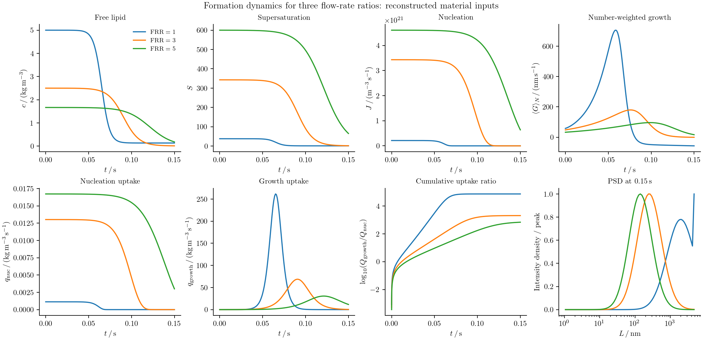
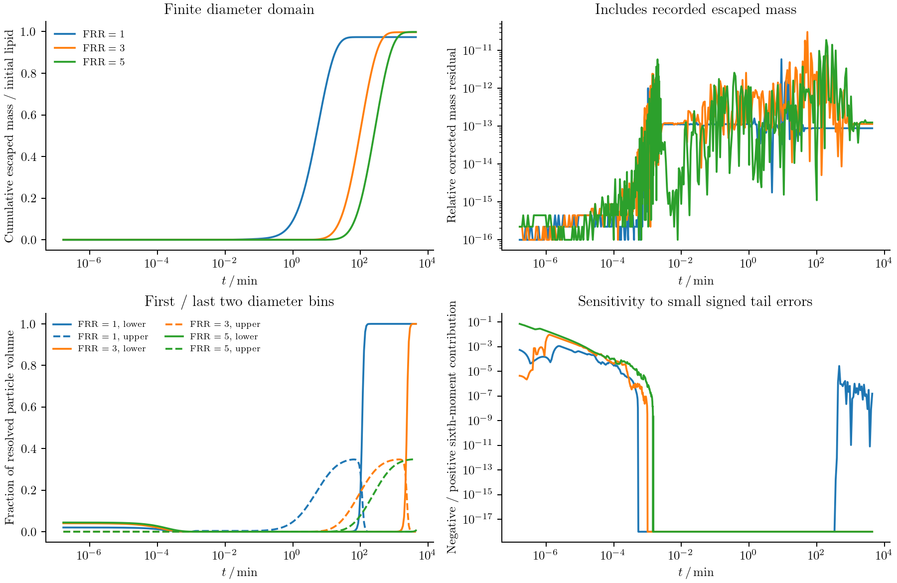
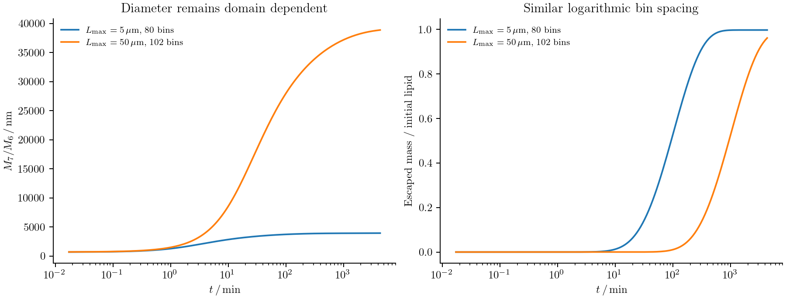

# Lipid nanoparticle formation

Mixing an ethanolic lipid solution with water lowers lipid solubility. The
resulting supersaturation creates particles, feeds their growth, and changes
as lipid leaves solution. Coalescence then changes the size distribution even
when little free lipid remains. Predicting a measured mean diameter requires
following the distribution through both formation and subsequent incubation.

We model these processes with a diameter population balance coupled to free
lipid. The formulation is based on
[Shin et al. (2025)](https://web.mit.edu/braatzgroup/Shin_ChemEngJ_2025.pdf).
The comparison of interest is the calculated distributions and mean-diameter
history in Figure 4. We start with no particles and integrate formation and incubation to
4320 minutes. The paper and SI leave some material inputs and conventions
unspecified. The runnable reconstruction below makes those assumptions explicit;
its current results do not establish reproduction of the published curves.

## Start with dissolved lipid

Let ``f(L,t)`` be the number density per unit diameter and per unit process
volume. Initially,

```math
f(L,0)=0.
```

For instantaneous mixing, an organic-feed concentration of 10 mg/mL and an
aqueous-to-organic flow-rate ratio of 3 give

```math
c(0)=\frac{10}{1+3}=2.5\ \mathrm{kg\,m^{-3}},\qquad
w=\frac{3}{1+3}=0.75,
```

where ``w`` is the aqueous volume fraction. A concentration in mg/mL has the
same numerical value in kg/m³. Empty particle bins therefore coexist with a
nonzero dissolved concentration.

The recipe uses meters, seconds, kelvin, and kg/m³ internally. Its adapter
sets these operating conditions and rejects a nonzero initial particle array:

```julia
using PopulationBalanceModels
include("examples/shin_lnp_long_time.jl")
import .ShinLNPLongTime

# Explicit reconstructed inputs, described below; requires the optional solver environment.
problem = ShinLNPLongTime.make_problem(bins=160,FRR=3.0)
@assert all(iszero,population(problem,problem.u0,:lnp))
```

## Write the population balance

The balance contains diameter transport, nucleation, and coalescence:

```math
\frac{\partial f(L,t)}{\partial t}
+\frac{\partial\!\left[G(L,t)f(L,t)\right]}{\partial L}
=B_n(L,t)+B_c(L,t)-D_c(L,t).
```

Here ``D_c`` is a positive removal rate. Each coalescence event removes both
parents and creates one product. The signs in the calculation follow that event
balance; the printed positive loss integral must be subtracted.

Define the supersaturation ``S(t)=c(t)/C_\infty(w,T)``. Classical nucleation gives

```math
L_c(t)=\frac{4\gamma V_m}{k_BT\ln S(t)},\qquad
J(t)=A_n\exp\!\left[-\frac{16\pi\gamma^3V_m^2}
{3(k_BT)^3[\ln S(t)]^2}\right],\quad S>1.
```

For ``S\le1``, ``J=0``. ``V_m`` is volume per molecule, consistent with the
Boltzmann constant ``k_B``. Under a total-rate convention, the source is

```math
B_n(L,t)=\frac{J(t)}{\sqrt{2\pi}\,\sigma_L}
\exp\!\left[-\frac{(L-L_c(t))^2}{2\sigma_L^2}\right].
```

``\sigma_L`` is the physical spread in nucleation diameters. It is distinct
from interfacial energy ``\gamma`` and from numerical bin width. The source
study prints an unnormalized Gaussian; selecting a total-rate source or a
source-density amplitude is therefore an explicit input convention.

Growth and dissolution follow

```math
G(L,t)=k_gL C_\infty(w,T)[S(t)-S^*(L,w,T)].
```

The material function ``S^*`` sets equilibrium at each diameter. A negative
velocity means dissolution; it is handled by the same signed face flux as growth.

## Define the rate callbacks

The implementation is in `examples/papers/cej2025_lnp.jl`. The kinetic constants
are passed as builder keywords and stored in `problem.p`: `An=2.0e22`, `kg=11.88`,
`kPEG=6.5e-6`, and `gamma=0.010`. Other physical scales, including molecular
volume and nucleation width, must be supplied.

Inside the builder, the rates are defined using the current free-lipid state
and prescribed material properties:

```julia
supersaturation(ctx) = ctx.bulk.lipid / ctx.fields.Cinfinity

function J(p,t,ctx)
    nucleation_rate(supersaturation(ctx),ctx.fields.T,p.gamma,p.Vm,p.An)
end

function growth_rate(L,p,t,ctx)
    p.kg * L * ctx.fields.Cinfinity *
        (supersaturation(ctx) - equilibrium_ratio(L,ctx.fields.w,ctx.fields.T))
end

function coalescence_kernel(L,M,p,t,ctx)
    p.kPEG * attachment_without_peg(L,M,ctx.fields.w,ctx.fields.T) *
        brownian_kernel(L,M,ctx.fields.T,ctx.fields.mu)
end
```

`nucleation_rate` and `brownian_kernel` are recipe functions. `equilibrium_ratio`
and `attachment_without_peg` are supplied material functions, captured by the
builder. The latter excludes the separately applied PEG factor.

A moving critical diameter is supplied as a callback too. With
`nucleation_normalization=:total_rate`, the source declaration is:

```julia
center = (p,t,ctx)->supersaturation(ctx)>1 ?
    critical_length(supersaturation(ctx),ctx.fields.T,p.gamma,p.Vm) :
    first(grid.centers)

source = GaussianNucleation(rate=J,center=center,
    width=(p,t,ctx)->p.nucleation_width,truncation=:renormalize)
```

The inactive source uses an unused finite centre when ``S\le1``. Bin integration
then deposits a narrow peak even if it lies between bin centres. Renormalization
puts the full declared rate into the finite diameter range. With
`:density_amplitude`, the recipe instead integrates the unnormalized exponential
without redistributing its outside-domain tail. These conventions require
consistent units for the amplitude; they are not interchangeable quadrature choices.

## Coalesce in particle volume

The Brownian collision kernel is

```math
K(L,M,t)=k_{\mathrm{PEG}}\alpha_{\mathrm{base}}(L,M,w,T)
\frac{2k_BT(L+M)^2}{3\eta(w,T)LM}.
```

For ``\ell=(L^3-M^3)^{1/3}``, its diameter-coordinate birth and loss terms are

```math
B_c(L,t)=\frac{L^2}{2}\int_0^L
\frac{K(\ell,M,t)f(\ell,t)f(M,t)}{\ell^2}\,dM,
```

```math
D_c(L,t)=f(L,t)\int_0^\infty K(L,M,t)f(M,t)\,dM.
```

The numerical event calculation avoids evaluating this birth integral's
endpoint directly. It combines parent volumes and deposits the product on fixed
pivots. Specify volume addition on a diameter grid as follows:

```julia
model = PBMModel(
    nucleation = source,
    growth = Growth(rate=growth_rate),
    coalescence = Aggregation(coalescence_kernel;
        coordinate_map=AdditiveCoordinate(L->L^3,cbrt)),
    dilution = Dilution(rate=(L,p,t,ctx)->ctx.fields.dilution),
)
methods = TermMethods(growth=MUSCL(),aggregation=FixedPivot())
operator = compile(model,grid;methods,bc=SizeBC(NoFlux(),NoFlux()))
```

This is the general recipe's default MUSCL treatment. The long-time runner
below explicitly selects `Upwind()` and records that choice in its input file.
Its incubation curves therefore do not demonstrate a completed MUSCL solve.

A product diameter is ``(L_1^3+L_2^3)^{1/3}``. FixedPivot preserves this volume
and one product per event within the pivot range. Products outside that range
raise an error by default. The size boundaries above are closed, including for
dissolution; there is no extinction model at the lower diameter edge. Choose
positive diameter limits and check that neither edge controls the result.
The dilution hazard is zero for instantaneous mixing.

## [DLVO interactions and the collision kernel](@id lnp_dlvo)

DLVO theory modifies the chance that a Brownian encounter leads to attachment.
It does not change the additive-volume deposition rule. Separate three steps:
calculate an interaction energy, convert it into an attachment modifier, then
multiply the Brownian encounter kernel. The recipe's callback
`attachment_without_peg(L,M,w,T)` supplies the second step, excluding the PEG
factor. The builder computes

```math
K(L,M,t)=k_{\mathrm{PEG}}\,\alpha_{\mathrm{base}}(L,M,w,T)\,
K_{\mathrm{Brownian}}(L,M,T,\eta).
```

The fixed-pivot implementation receives this final kernel in process-volume/time
units. It does not evaluate an electrostatic potential internally. In particular,
setting `attachment_without_peg=(L,M,w,T)->1.0` disables the DLVO size dependence;
it is a material assumption, not a default DLVO calculation.

### Radii, gaps, and energy units

The population coordinate is **diameter**, while the supplement's energy laws
use radii ``r_1=L/2`` and ``r_2=M/2``. Let ``h>0`` be the surface-to-surface gap.
The centre separation is ``r_1+r_2+h``. The reported van der Waals contribution is

```math
U_{\mathrm{vdW}}(h)=-\frac{A_H}{6}\left[
\frac{2r_1r_2}{h^2+2h(r_1+r_2)}
+\frac{2r_1r_2}{h^2+2h(r_1+r_2)+4r_1r_2}
+\ln\!\frac{h^2+2h(r_1+r_2)}{h^2+2h(r_1+r_2)+4r_1r_2}
\right].
```

The recipe now provides `vdw_energy(r1,r2,gap,hamaker)` for this component in
joules. Its far-field series avoids subtracting nearly equal terms. The
Hamaker constant used in the supplement is ``A_H=1.7\times10^{-22}`` J.

For an ideal electrolyte, the inverse Debye length is

```math
\kappa=\sqrt{\frac{2e^2N_AI}{\epsilon_0\epsilon_r k_BT}},
```

where ionic strength ``I`` is in **mol/m³**, not mol/L. `debye_wavenumber`
implements this expression; ``1/\kappa`` is the Debye length. The supplement
calls ``\kappa`` a length, but its formula has inverse-length units.

```@example lnp_dlvo
using PopulationBalanceModels
include(joinpath(pkgdir(PopulationBalanceModels),"examples","papers","cej2025_lnp.jl"))
import .CEJ2025LNP
kappa = CEJ2025LNP.debye_wavenumber(1.0,298.15,78.4) # 1 mol/m³ = 1 mmol/L
u = CEJ2025LNP.vdw_energy(25e-9,25e-9,1e-9,1.7e-22)
(debye_length_nm=1e9/kappa,vdw_energy_in_kBT=u/(CEJ2025LNP.kB*298.15))
```

Temperature 298.15 K and relative permittivity 78.4 are explicit illustrative
values here. The mixture's ionic strength and permittivity must be supplied as
functions of its composition and temperature for the actual material system.
Electrostatic repulsion also needs a surface potential. The supplement uses
10 mV, adjusted from a reported zeta potential of 7 mV; surface and zeta
potentials are not identical physical quantities.

### Convert energy into attachment

An attachment calculation combines attraction and repulsion through
``U(h)=U_{\mathrm{vdW}}(h)+U_{\mathrm{elec}}(h)`` and a stability integral.
For example, one common no-hydrodynamic-correction convention is

```math
W=(r_1+r_2)\int_0^\infty
\frac{\exp[U(h)/(k_BT)]}{(r_1+r_2+h)^2}\,dh,
\qquad \alpha_{\mathrm{base}}=\frac1W.
```

This convention has ``W=1`` when ``U=0``. A finite contact gap or a hydrodynamic
mobility correction changes the integral and its normalization. It must be
specified and tested explicitly. The main paper's printed attachment expression
and the supplement's electrostatic prefactor leave reciprocal, separation,
and concentration/energy conventions to be reconciled. The recipe does **not**
silently substitute the expression above as a verified implementation of that
paper. The recipe now supplies `dlvo_attachment` for this **specified reconstruction**,
while keeping `attachment_without_peg` as an overridable input. It uses

```math
U_{\mathrm{elec}}(h)=64\pi\epsilon_0\epsilon_r
\frac{r_1r_2}{r_1+r_2}\left(\frac{k_BT}{e}\right)^2
\tanh^2\!\left(\frac{e\psi}{4k_BT}\right)\exp(-\kappa h).
```

This is a constant-potential Derjaguin approximation, without a hydrodynamic
correction or a polymer-brush energy. The change of variable
``q=(r_1+r_2)/(r_1+r_2+h)`` maps the stability integral to ``0<q<1``.
Gauss–Legendre quadrature and logarithmic summation evaluate it without an
arbitrary exponential cap. Tests check the zero-energy limit, exchange of the
two radii, ionic-strength units, and quadrature refinement. For fixed mixture
composition and temperature, the long-time example tabulates attachment at
all pivot pairs once, excluding the separately applied PEG factor.

The helper connects to the existing collision callback without changing
volume deposition. For the reconstruction above, the wrapper is:

```julia
attachment_without_peg = (L,M,w,T)->CEJ2025LNP.dlvo_attachment(L/2,M/2;
    temperature=T,ionic_strength=100*w,
    relative_permittivity=24.3*(1-w)+78.4*w)
```

Pass this function as the `attachment_without_peg` keyword to `CEJ2025LNP.build`.
The linear permittivity and ionic-strength choices remain assumptions. The
long-time runner evaluates this closure at grid pivot pairs once and reuses the
table; delayed mixing would require updating the mixture-dependent attachment.
Other closures must return a finite nonnegative dimensionless modifier and
exclude ``k_{\mathrm{PEG}}``. Check radius symmetry, energy and ionic-strength
units, and gap-integral convergence. Physical cutoffs stay fixed when diameter
bins are refined; exponential clipping does not establish convergence.

The fitted PEG factor is a phenomenological suppression of contact. The current
recipe does not resolve a polymer-brush steric potential. Its material closures
are fixed functions; fitting additional closure parameters requires making them
explicit parameters in the physical rate callbacks rather than mutating captured
constants during optimization.

## Return particle uptake to the lipid balance

Nucleation and growth consume free lipid; volume-conserving coalescence does
not consume it again. The fixed-volume balance is

```math
\frac{dc(t)}{dt}=-\rho_p\frac{\pi}{6}
\left[\left.\frac{dM_3(t)}{dt}\right|_{\mathrm{growth}}
+\left.\frac{dM_3(t)}{dt}\right|_{\mathrm{nucleation}}\right],
\qquad M_3(t)=\int_0^\infty L^3f(L,t)\,dL.
```

The builder obtains those rates from the actual discrete population terms:

```julia
exchange = ConservativeExchange(:lnp,:lipid,
    (L,p,t,ctx)->p.rho*π/6*L^3;
    mechanisms=(:growth,:nucleation))
```

This closes ``c+\rho_p\pi\sum_iL_i^3N_i/6`` for the resolved closed system.
The builder places the exchange in PBMSystem and advances free lipid with the
particle bins. Its delayed-mixing option also dilutes particles and free lipid
at the same volume-growth rate; that option is a different operating condition.

## Provide the material inputs

The adapter's `inputs` named tuple contains `grid` and these builder keywords:

| Input | Meaning and units |
|:--|:--|
| `temperature(t)` | kelvin |
| `viscosity(w,T)` | Pa s |
| `solubility(w,T)` | ``C_\infty`` in kg/m³, after conversion from any mole-fraction correlation |
| `equilibrium_ratio(L,w,T)` | dimensionless ``S^*`` |
| `attachment_without_peg(L,M,w,T)` | dimensionless attachment modifier excluding ``k_{\mathrm{PEG}}`` |
| `molecular_volume`, `particle_density` | m³ per molecule and kg/m³ |
| `nucleation_width` | diameter standard deviation in meters |
| `nucleation_normalization` | `:total_rate` or `:density_amplitude` |

For example, a 200-bin logarithmic diameter grid is constructed with
`Grid1D(exp.(range(log(Lmin),log(Lmax);length=201));coordinate=:diameter)`.
The positive limits must resolve the chosen material model.

The [supplement](https://ars.els-cdn.com/content/image/1-s2.0-S1385894725086267-mmc1.pdf)
supplies the DLVO expressions, ``A_H=1.7\times10^{-22}`` J, and surface
potential 10 mV. It is not a complete material-property table. The full-horizon
runner, `examples/shin_lnp_long_time.jl`, therefore records the following choices:

| Quantity | Value or construction | Status |
|:--|:--|:--|
| Feed, FRR, initial particles | 10 kg/m³ organic feed; FRR 1, 3, 5; no particles | Reported operating conditions |
| ``A_n,k_g,k_{\mathrm{PEG}},\gamma`` | ``2\times10^{22},11.88,6.5\times10^{-6},0.010`` in the recipe's SI units | Reported kinetic inputs |
| Buffer | 0.1 mol/L aqueous buffer; mixture ionic strength set to ``100w`` mol/m³ | Reported buffer concentration; ideal-mixture ionic-strength assumption |
| Temperature, molecular volume, particle density | 298.15 K, ``5\times10^{-28}`` m³/molecule, 1000 kg/m³ | Reconstruction assumptions |
| Nucleation spread | 1 nm, normalized total-rate Gaussian | Reconstruction and source-unit convention |
| Mixture viscosity and permittivity | Linear interpolation of 1.2/0.89 mPa s and 24.3/78.4 | Reconstruction assumptions |
| Solubility | Log-linear **mass** correlation through approximate initial supersaturations reported for FRR 3 and 5 | Inferred from model outputs, not independent solubility data |
| Equilibrium | Kelvin ratio ``\exp[4\gamma V_m/(k_BTL)]`` | Explicit curvature closure |
| Attachment | Inverse stability integral with the electrostatic law above | Specified reconstruction of unresolved printed conventions |

Specifically, ``C_\infty(0.75)=(7/4)/240`` and
``C_\infty(5/6)=(10/6)/600`` kg/m³ are inferred from the paper's approximate
initial supersaturation statements. Interpolation is linear in ``\log C_\infty``.
This is not the paper's independently specified mole-fraction correlation.
No parameter is calibrated to the Figure 4 diameter curve. These distinctions
limit what agreement with that curve could demonstrate.

## Integrate formation and incubation

The runner exports 1, 40, 100, 170, and 4320 **minutes**, with additional dense
outputs during the first 0.15 s. The final time is 259200 **seconds**. Upwind
transport is the baseline for this stiff calculation; the mesh and time-method
comparison elsewhere does not establish accuracy for this distribution.
`make_problem(scheme=MUSCL())` selects limited growth instead.

Install the optional solver into a separate working environment:

```julia
using Pkg
Pkg.activate("/path/to/lnp_environment")
Pkg.develop(path="/path/to/PopulationBalanceModels.jl")
Pkg.add(["SciMLBase","OrdinaryDiffEqRosenbrock","ADTypes"])
```

Run the full reconstruction and render the figures:

```sh
julia --project=/path/to/lnp_environment examples/shin_lnp_long_time.jl 80 1e-7 docs/src/assets/shin_case
julia --project=/path/to/lnp_environment examples/shin_lnp_long_time.jl 160 1e-8 docs/src/assets/shin_case/refinement 1,3
python docs/benchmarks/plot_lnp_dynamics.py --comparison docs/src/assets/shin_case/refinement --usetex
julia --project=docs docs/make.jl
```

`stiff_solve` scales bin numbers by the number concentration associated with a
100 nm particle and scales bulk variables by the initial mixed lipid
concentration. Rodas5P then controls errors on these scaled states using a
finite-difference Jacobian. This scaling does not alter the equations. It avoids
asking one unscaled absolute tolerance to control both particle counts near
``10^{20}`` and concentrations near one. Output values are not clipped. `max_evaluations` bounds the number of RHS calls
(default two million). A 120-bin MUSCL/Rodas5P attempt was stopped for cost after
a progress report of 300000 RHS calls at about 1882 s; it did not reach the full
horizon. This is not evidence of instability, and no completed MUSCL incubation
curve is claimed.
The adapter checks solve status, requested output times, finite values, and
substantial negative concentrations. Small tail errors can still matter greatly
for intensity moments, which require their own refinement checks.

Set `track_consumption=true` in the general builder to integrate cumulative
nucleation uptake, growth uptake, and escaped collision-product mass alongside
free lipid. The first two reuse the actual discrete term derivatives; they do
not consume lipid a second time. For instantaneous mixing and zero initial
particles, the numerical balances are

```math
c(t)+Q_{\mathrm{nuc}}(t)+Q_{\mathrm{growth}}(t)=c(0),
```

```math
c(t)+\rho_p\frac{\pi}{6}M_3(t)+Q_{\mathrm{escaped}}(t)=c(0).
```

`Q_growth` is signed if dissolution returns lipid. The current example uses
`overflow=:discard` and records that lost mass explicitly. Closed diameter faces
also retain shrinking particles at the lower edge; no extinction law is supplied.
Large edge fractions or escaped mass invalidate interpretation as an effectively
unbounded size calculation even when the corrected numerical mass balance closes.


## Calculate the observation

Large particles contribute disproportionately to scattering. The reported
intensity weighting and mean diameter are

```math
I(L,t)=L^6f(L,t),\qquad
\overline L(t)=\frac{\int_0^\infty L^7f(L,t)\,dL}
{\int_0^\infty L^6f(L,t)\,dL}.
```

For example, the recipe evaluates the mean as

```julia
N = population(problem,solution.u[end],:lnp)
grid = problem.operator.system.populations.lnp.grid
mean_diameter = moment(grid,N,7) / moment(grid,N,6)
```

It is undefined for the empty initial state. The exporter omits that point from
the mean-time plot and writes both area-normalized and unit-peak intensity
densities. The distribution panels use unit-peak scaling, while the mean-time
panel uses minutes and nanometers. Logarithmic-bin counts are divided by their
individual widths before plotting a density.

## Formation profiles and long-time checks

These figures retain historical exports. The current optional stiff driver
rejects an internal negative collision rate during startup, so the long-time
trajectory has not been revalidated with the audited checks. The minimal run
below instead uses checked native integration over a short startup interval.



The panels show free lipid, supersaturation, nucleation rate, number-weighted
growth rate, both lipid-uptake rates, the ratio of **cumulative** uptake, and
the intensity distribution at 0.15 s. The cumulative ratio is distinct from
the instantaneous rate ratio, which becomes undefined when both rates vanish.
These are computed model outputs; no experimental points have been invented.


The displayed formation profiles and PSD snapshots use the 80-bin run.
The FRR=3 time-history comparison retains both that run at relative tolerance
``10^{-7}`` and the 160-bin run at ``10^{-8}``. The finer checks cover FRR=1 and FRR=3; FRR=5 has the baseline run.
Changing the mesh and tolerance together is a combined check, not a measurement of either error separately.
The gray region marks escaped particle mass above 0.1% of initial lipid.
The current curves disagree with the published approximately 120–200 nm
incubation trend. They are a diagnostic of the stated reconstruction, not a
reproduced Figure 4.



The corrected mass residual checks the implementation's accounting. It does
not validate the material closures or repair loss through an insufficient size
domain. Substantial escaped mass and edge accumulation occur in this run; its
late-time diameter should not be interpreted as a converged physical prediction.
Before fitting parameters, the size domain, transport resolution, lower-boundary
physics, solubility, and attachment/equilibrium conventions must be resolved.
A separate FRR=3 run increases the upper diameter limit from 5 to 50 µm and
uses 102 bins to approximately preserve logarithmic bin spacing. The comparison
starts at one second; the earlier near-empty intensity moments are checked in
the separate signed-tail diagnostic. The predicted
late-time intensity mean increases from about 3.94 to 38.9 µm, while escaped
mass is still about 96% of initial lipid. The output is therefore strongly
domain dependent. A finer mesh inside the original domain does not fix that
problem.



This check is reproducible with the same material reconstruction:

```julia
problem = ShinLNPLongTime.make_problem(bins=102,FRR=3.0,
    diameter_limits=(1e-9,50e-6))
times = ShinLNPLongTime.figure4_saveat()
ShinLNPLongTime.run_case(problem;saveat=times,
    solver=(p,t)->ShinLNPLongTime.stiff_solve(p,t),
    psd_times=60 .*collect(ShinLNPLongTime.FIGURE4_MINUTES),
    provenance=ShinLNPLongTime.provenance * "\nEnlarged domain: 1 nm to 50 µm; 102 bins; FRR=3.\n",
    output="docs/src/assets/shin_case/domain_check/frr3")
```

The fourth panel checks negative contributions to the sixth moment, relative to
its positive contributions. Tiny signed errors in nearly empty bins can affect
intensity before appreciable particles form, despite an acceptable total-number
error. The displayed floor of ``10^{-18}`` only makes zero diagnostic values
visible; it does not alter a state. The raw histories, selected PSD snapshots, input provenance, and
[verification table](../assets/shin_case/verification.csv) accompany the plots.


An earlier [20-ms synthetic illustration](../assets/illustrations/lnp/demonstration.png)
and its inputs remain in `docs/benchmarks/diagnostics/lnp_demo/`. It uses simplified
material functions and no DLVO barrier; it is separate from the reconstructed
long-time calculation above.

## Minimal run and full reproduction

Run this block from the repository root. It constructs and solves one problem;
including a driver does not run its CSV exports.

```julia
using PopulationBalanceModels
# Also requires OrdinaryDiffEqRosenbrock, ADTypes and SciMLBase in this environment.
include("examples/shin_lnp_long_time.jl")
problem = remake(ShinLNPLongTime.make_problem(; bins=80, FRR=3.0);
    tspan=(0.0, 1e-5))
solution = simulate(problem; method=SSPRK33(), dt=1e-8, saveat=[0.0, 1e-5])
free_lipid = [bulk(problem, u, :lipid) for u in solution.u]
```

This 10-µs native run does not regenerate the historical long-time figures.
Their reproduction limit is stated above; no clipping or relaxed deposition
checks are applied.

The figure-generation drivers and supporting sources are available below. Keep
the repository's relative paths; the [benchmark guide](../assets/source/plotting/README.txt)
lists plotting commands and optional environments.

- [shin_lnp_long_time.jl](../assets/source/examples/shin_lnp_long_time.jl)
- [shin_lnp_reproduction.jl](../assets/source/examples/shin_lnp_reproduction.jl)
- [papers/cej2025_lnp.jl](../assets/source/examples/papers/cej2025_lnp.jl)
