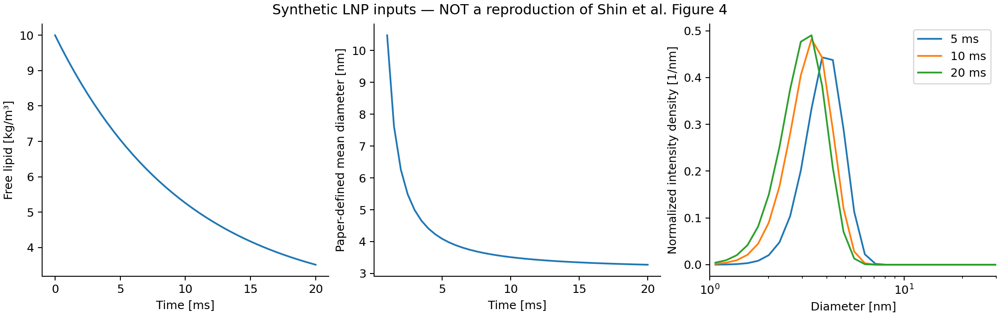

# Shin: lipid nanoparticle formation

## Equation and process balances

[Shin et al. (2025)](https://web.mit.edu/braatzgroup/Shin_ChemEngJ_2025.pdf)
models a diameter distribution through nucleation, growth, and binary coalescence.
For a concentration basis per current mixture volume, the implemented balance is

```math
\frac{\partial n(L,t)}{\partial t}
+\frac{\partial [G(L,t)n(L,t)]}{\partial L}
=B_n(L,t)+B_c(L,t)-D_c(L,t)-\lambda(t)n(L,t).
```

``D_c`` is a positive removal magnitude. The paper's printed PBE has a plus sign
beside its positive loss integral; the implementation uses physical parent
removal. This convention must be reconciled with author code before reproducing
its figures. Lengths are meters, time is seconds, and lipid concentrations are kg/m³.

The growth and classical-nucleation laws are

```math
G(L,t)=k_gLC_\infty(w,T)[S(t)-S^*(L,w,T)],\qquad
S(t)=\frac{c(t)}{C_\infty(w,T)},
```

```math
L_c=\frac{4\gamma V_m}{k_BT\ln S},\qquad
J=A_n\exp\!\left[-\frac{16\pi\gamma^3V_m^2}{3(k_BT)^3(\ln S)^2}\right].
```

Nucleation is zero for ``S\le1``. ``V_m`` is volume per molecule, matching ``k_B``;
a molar volume needs a different thermodynamic convention. The Gaussian source
is centred at ``L_c`` with a separately specified size width. The printed Gaussian
omits its normalization factor and uses the same symbol as interfacial energy.
The recipe requires a normalization choice instead of treating those conventions
as interchangeable. With a total-rate choice it integrates each Gaussian bin;
midpoint sampling can miss a narrow moving source entirely.

The coalescence kernel is

```math
K(L,M,t)=k_{\mathrm{PEG}}\alpha_{\mathrm{base}}(L,M,w,T)
\frac{2k_BT(L+M)^2}{3\eta LM}.
```

The supplied attachment function must exclude ``k_{\mathrm{PEG}}`` to avoid
counting the fitted factor twice. Fixed-pivot deposition uses additive property
``L^3``. Thus ``L_*=(L_1^3+L_2^3)^{1/3}``; diameter is retained for growth and
observations while coalescence conserves volume. The expected physical loss is
``D_c(L,t)=n(L,t)\int K(L,M,t)n(M,t)\,dM``.

For delayed mixing, the paper supplies

```math
w(t)=\frac{\mathrm{FRR}}{\mathrm{FRR}+1}(1-e^{-t/\tau}).
```

The recipe declares a material-element closure ``V/V_{\mathrm{organic}}=1/(1-w)``
and dilution hazard ``\lambda=(dw/dt)/(1-w)``. Free lipid obeys

```math
\frac{dc}{dt}=-\lambda c-\rho_p\frac{\pi}{6}
\left[\left.\frac{dM_3}{dt}\right|_{\mathrm{growth}}
+\left.\frac{dM_3}{dt}\right|_{\mathrm{nucleation}}\right].
```

Coalescence redistributes particle volume without consuming dissolved lipid.
In the absence of unresolved product loss, the invariant is
``V(t)[c(t)+\rho_p\pi M_3(t)/6]``. This free-lipid/volume closure is explicit;
the main paper does not print a complete free-lipid ODE. Instantaneous mixing
starts at ``c_0/(1+\mathrm{FRR})``; delayed mixing starts before that dilution.

## Target comparison and missing inputs

Figure 4 is the intended first comparison: intensity-weighted PSDs and the
paper-defined mean diameter during formation and incubation. The reported
kinetic values are ``A_n=2.0\times10^{22}``, ``k_g=11.88``,
``k_{\mathrm{PEG}}=6.5\times10^{-6}``, with interfacial energy near 0.010 N/m.
Those values alone do not define a forward calculation.

A reproducible run still needs the exact initial state/grid limits, temperature
and viscosity, molecular volume and density, a solubility conversion from mole
fraction to concentration, ``S^*``, nucleation width/normalization, and the
attachment law. The DLVO integral's separation, screening, and reciprocal
conventions also need confirmation. The publisher supplement was unavailable
to this session; the main article states that data are available on request.
No experimental arrays or author implementation are included in the repository.

The paper uses 200 logarithmic bins, a second-order central growth difference,
and MATLAB ode15s. This package's current sectional recipe uses conservative
upwind/MUSCL or uniform-grid WENO, fixed-pivot collisions, and explicit SSPRK
unless exported to an external solver. These numerical differences must be
reported and refined; they must not be labelled a reproduction of the paper's
numerical method.

## Code deployment

The reusable builder in `examples/papers/cej2025_lnp.jl` makes the mechanisms
individually inspectable:

```julia
model = PBMModel(
    nucleation=source,
    growth=Growth(rate=G),
    coalescence=Aggregation(beta;
        coordinate_map=AdditiveCoordinate(L->L^3,cbrt),overflow=:error),
    dilution=Dilution(rate=(L,p,t,ctx)->ctx.fields.dilution),
)
```

`source` is a bin-integrated Gaussian for total-rate nucleation. `G` reads free
lipid and prescribed solvent fields. `beta` combines the Brownian kernel with
the supplied attachment law and PEG factor. `PBMSystem` adds free lipid,
volume-consistent dilution, and `ConservativeExchange` based on actual discrete
growth/nucleation contributions.

`examples/shin_lnp_reproduction.jl` exports PSD and concentration histories from
an explicitly supplied configuration. An input Julia file must return a named
tuple with `inputs` (keywords for `CEJ2025LNP.build`), `dt`, `saveat`, and
`provenance` describing the data source and target figure. Run it with

```sh
julia --project=. examples/shin_lnp_reproduction.jl /path/to/confirmed_inputs.jl /path/to/output
```

It deliberately has no default paper inputs. Use the paper's actual output
times and obtain the reference data before overlaying measurements. A fitted
curve without those inputs would hide model substitutions rather than test the
implementation.

## Observation definition and demonstration

The paper compares intensity weighting ``n_{\mathrm{intensity}}(L)=L^6n(L)`` and
its stated mean

```math
d_{\mathrm{paper}}=
\frac{\int_0^\infty L^7n(L,t)\,dL}{\int_0^\infty L^6n(L,t)\,dL}.
```

The export distinguishes density per meter from number or intensity per bin.
A logarithmic grid changes bin widths; connecting per-bin fractions as though
they were density values changes the PSD. Normalization is over the modeled
window. Finite domain losses can therefore affect both tails and the mean.

Run the existing synthetic recipe and plot its exports with

```sh
julia --project=. examples/lipid_nanoparticle_demo.jl
python docs/benchmarks/plot_case_studies.py lnp
```



These plots show code behavior with the clearly labelled demonstration closures;
they are not an overlay of Figure 4. The integrated-source correction changes
the demonstration mean to approximately 3.27547 nm. That result is unrelated
to the paper's fitted 100-nm-scale PSD and must not be used to claim agreement.
[Inputs](../assets/lnp_demo/inputs.txt), [histories](../assets/lnp_demo/history.csv),
and [PSD arrays](../assets/lnp_demo/psd.csv) record what was actually calculated.
