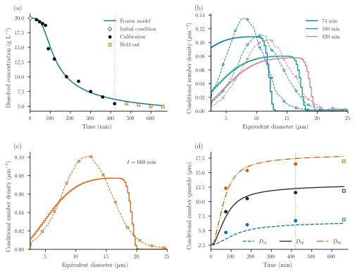
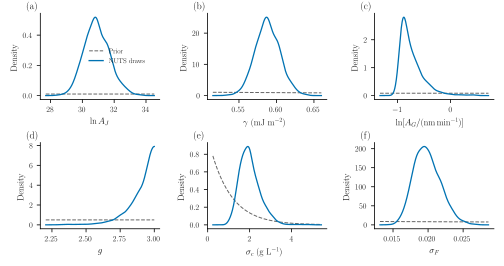
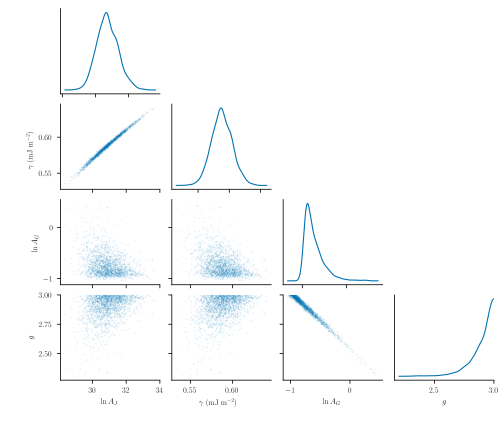

# Inferring protein crystallization kinetics

How much can dissolved concentration and crystal-size distributions tell us
about nucleation and growth? This example assembles an initially unseeded,
isothermal lysozyme batch, estimates four kinetic parameters jointly, and
predicts observations withheld from calibration.

## Data

The observations are the original 100 mL experiment at 20 °C from
[Tang et al. (2018), Figures 11(d) and 12(a)](https://doi.org/10.1016/j.jcrysgro.2018.06.023).
The supplied graph readings are unchanged. Concentrations are in g/L and sizes
are microscopy equivalent diameters in μm.

| Observations | Use |
|:--|:--|
| Initial concentration, 19.96584 g/L | Fixed initial condition at model time zero |
| Eleven subsequent concentrations | Calibration |
| Conditional **number** distributions at 74, 180 and 420 min | Calibration |
| Four later concentrations and the 660-min distribution | Held-out prediction |

The distributions are conditioned on 2.5–25 μm. Their reconstructed 0.5 μm
ordinates are neither raw particle counts nor independent measurements.
Diagnostic quantiles are derived from these curves and are not fitted again.
The [data directory](https://github.com/pavaninguva/PopulationBalanceModels.jl/tree/main/examples/data/protein_crystallization/tang2018_isothermal)
retains the original readings, time labels and digitization provenance.

## Model

Let ``n(L,t)`` be number density per unit process volume and particle length.
With no aggregation or breakage,

```math
\frac{\partial n(L,t)}{\partial t}
+\frac{\partial [G(c(t))n(L,t)]}{\partial L}=0,
\qquad G(c(t))n(0,t)=J(c(t)),\qquad n(L,0)=0.
```

Classical nucleation theory (CNT) makes nucleation fall rapidly as dissolved
protein is consumed. We use the CNT/empirical-growth combination in
[Mitchell et al. (2023), Case 3, equations (3) and (9)](https://doi.org/10.1016/j.cherd.2023.02.016):

```math
S=\frac{c}{c_*},\qquad
J=A_J\exp\!\left[-\frac{16\pi\gamma^3\nu^2}
 {3(k_{\mathrm B}T)^3(\ln S)^2}\right],\qquad
G=A_G(S-1)^g.
```

Both rates are zero for ``S\leq1``. Growth is independent of particle size.
Temperature is fixed at 293.15 K, so the growth Arrhenius factor is absorbed
into ``A_G``. There is no extra supersaturation prefactor in the CNT law.
This is the same kinetic form as Mitchell's Case 3; the observations and
observation model here differ from that paper's parameter-estimation exercise.

The code accepts ``\gamma`` in mJ/m², ``A_J`` in particles/(m³ s), and
``A_G`` in nm/min. It follows the growth units printed in Mitchell's
parameter-estimation Tables 3, 5 and 7; Table 2 instead lists μm/min.
The conversion to min and μm is explicit in the code.
Molecular volume is fixed at ``\nu=2.97\times10^{-26}`` m³/molecule, as used by
[Lin et al. (2017)](https://doi.org/10.1016/j.jcrysgro.2016.10.028).
Only the combination ``\gamma^3\nu^2`` enters the CNT barrier, so the
inferred surface energy is conditional on this molecular-volume convention.
Nominal solubility ``c_*=2.16`` g/L, density ``\rho=1240`` kg/m³ and shape
factor ``k_v=0.81`` are conditional modelling assumptions, not fitted quantities.

In SI length units, dissolved material and crystals share the balance

```math
\frac{\mathrm dc}{\mathrm dt}
=-\rho k_v\frac{\mathrm d}{\mathrm dt}
 \int_0^\infty L^3n(L,t)\,\mathrm dL.
```

Concentrations in g/L equal kg/m³. Internally, lengths are in μm and bin
populations are divided by ``10^{12}``; the discrete solid concentration is
``10^{-6}\rho k_v\sum_iL_i^3N_i``. The bulk callback uses the **same stage's**
population derivative, so the discrete total is conserved without lagging
solute exchange. This conservation statement does not establish grid accuracy.

The essential package assembly is:

```julia
include("examples/isothermal_protein_crystallization.jl")
using PopulationBalanceModels, .IsothermalProteinCrystallization

p = parameters(logAJ=41.0, gamma=0.76, AG=1.0, g=2.4)
problem = build(bins=200, p=p)  # empty population and one dissolved state
solution = cfl_solve(problem, [0.0, 74.0, 180.0, 420.0, 660.0])
```

Inside `build`, the physical terms are declared directly:

```julia
growth_rate = IsothermalProteinCrystallization.growth_rate
nucleation_rate = IsothermalProteinCrystallization.nucleation_rate
model = PBMModel(
    growth = Growth(PolynomialRate(((p,t,ctx) -> growth_rate(p,ctx.bulk.c),))),
    primary = Nucleation(rate=(p,t,ctx) -> nucleation_rate(p,ctx.bulk.c)/1e12,
                         size=0.0),
)
methods = TermMethods(growth=MUSCL(), by_term=(primary=BoundaryInjection(:left),))
```

The degree-zero polynomial declares size-independent growth while allowing
current dissolved concentration to change its rate. The actual example keeps
these rate functions inside its module. `BoundaryInjection(:left)` inserts the nucleation number flux once.
MUSCL and native SSPRK33 advance the bin integrals. Boundary births enter
the first bin; their discrete material uses the same centre-cubed weight as
the bulk exchange and vanishes with grid refinement. The upper boundary is
closed on the 0–50 μm domain; upper-bin occupancy and a 75 μm domain check
must confirm that it is inactive. No seeds or normalization floors are added.
An empty predicted observation window is an invalid likelihood evaluation.

## Bayesian estimation

Concentration uses a Gaussian likelihood with inferred scale ``\sigma_c``.
Each calibration distribution contributes **one correlated CDF block**:

```math
F_\theta(L,t)=\frac{\int_{2.5}^{L}n(\ell,t)\,\mathrm d\ell}
 {\int_{2.5}^{25}n(\ell,t)\,\mathrm d\ell},\qquad
\mathbf F_{\rm obs}(t)\sim\mathcal N(\mathbf F_\theta(t),\sigma_F^2R),
\qquad R_{ij}=\exp\!\left(-\frac{|L_i-L_j|}{2\,\mu\mathrm m}\right).
```

We evaluate 22 interior ordinates at 1 μm spacing; the fixed endpoints are
excluded. `PopulationCDF` integrates partial grid cells and normalizes over
the stated window. The Gaussian CDF discrepancy and its 2 μm correlation
length are explicit observation-model assumptions. They do not recover an
unknown microscope sample count or a measured instrument covariance.
Likelihood normalization is retained when estimating both scales. The code
factorizes the fixed correlation matrix once and whitens observations and
predictions through `Measurement.response`. The normalized Gaussian likelihood
is evaluated in these whitened coordinates. Its density differs from the
original-CDF density by a known, parameter-independent determinant; the MAP
export records that conversion and the posterior is unchanged.

Mitchell's Table 3 gives **initial search ranges**, not Bayesian prior
distributions. We use them to inform the following declared priors. We do
not use that paper's final estimates from the same experiment as independent
prior information.

| Parameter | Prior | Interpretation/source |
|:--|:--|:--|
| ``\ln A_J`` | Uniform(0, 100) | Table 3's broad initial bounds |
| ``\gamma`` (mJ/m²) | LogNormal(log(0.64), 0.7) | Table 3's 0.64 value; log width is our assumption |
| ``\ln[A_G/(\mathrm{nm/min})]`` | Uniform(log(0.01), log(1500)) | Broad log-uniform growth scale |
| ``g`` | Uniform(1, 3) | Table 3's initial exponent range |
| ``\sigma_c`` (g/L) | Exponential(mean 1) | Inferred concentration discrepancy |
| ``\sigma_F`` | Exponential(mean 0.1) | Inferred dimensionless CDF discrepancy |

Table 3's initial growth range, 600–1500 nm/min, excludes even the paper's
final fitted coefficient. Treating it as hard prior support would rule out
much slower growth in advance. We therefore extend its lower bound to
0.01 nm/min and state that choice explicitly.

The example defines `Measurement` blocks and an `InferenceExperiment`, then
uses the package's shared posterior for MAP, optional Laplace and NUTS:

```julia
using Optim
estimation = estimation_problem(bins=200)
map = IsothermalProteinCrystallization.fit_model(estimation) # three starts
map.converged || error("Inspect optimizer diagnostics")
physical_parameters(estimation, map.minimizer, :batch)
```

Positive parameters use logarithmic coordinates; bounded parameters use logit
coordinates. The prior Jacobian is included exactly once. The reported MAP
is a mode in these inference coordinates, transformed to physical values.
Optional NUTS uses initial log-rate coordinates to reduce coefficient
correlation while preserving this posterior. Its starting metric comes from noise-scaled prediction sensitivities and
expected Gaussian information. It is sampler tuning, not a verified posterior
covariance. The retained diagnostic report determines
whether draws may supply posterior summaries or predictive bands. A failed
Laplace verification is reported rather than repaired.

## Fits and held-out prediction



Solid curves are the CNT MAP prediction; dashed density curves and sparse
markers are the supplied observations. Concentration and the three earlier
number distributions calibrate jointly. Open squares and the complete 660-min
distribution are held out. Panel (d) shows signed CDF residuals, making shape
errors visible even when quantiles look reasonable. A CDF difference of 0.03
means three percentage points of the conditional number fraction. The conditional densities
integrate to one over 2.5–25 μm; they do not measure absolute particle number.
A concentration band, when present, summarizes latent NUTS predictions and
excludes additional observation noise.

The MAP concentration RMSE is **1.96 g/L** on calibration and **0.31 g/L** on
held-out observations. Distribution ``W_2`` distances are 1.19, 0.86 and 0.85 μm
at the calibration times, and **0.87 μm** at 660 min. These distances describe
distribution discrepancy; they are not likelihood standard deviations.
The early concentration plateau/drop remains poorly captured. The steep upper
edges in the computed densities have a physical origin within this idealized
model: with births starting at zero and the same growth rate for every
particle, the oldest particles reach only
``L_{\max}(t)=\int_0^t G(c(s))\,\mathrm ds``. The numerical method broadens this
finite-age front; refining the grid does not supply the measured long tail.
These edges are well inside the inactive 50 μm computational boundary.

The retained CSVs report individual concentration and CDF residuals and
diagnostic Wasserstein distances separately for calibration and prediction. CNT can
produce a nucleation burst as supersaturation falls, but changing the rate law
is not evidence of adequate agreement. The remaining concentration and shape
residuals must be judged alongside the inferred discrepancy scales.





The corner plot shows actual joint draws and smoothed marginals; nuisance
scales are integrated over, not fixed at their MAP values. Correlation ridges
show how coefficients and the barrier/exponent can compensate. The growth
exponent posterior accumulates near the chosen upper prior bound, ``g=3``.
That bound influences the inference: this is not evidence for a precisely
identified universal exponent, or for a model that explains every measured
shape. A wider range would be a different declared prior analysis.

The central 95% posterior intervals below use the retained NUTS draws.
They include uncertainty in both discrepancy scales and are conditional on
the model, priors, fixed inputs and mesh.

| Quantity | MAP | Posterior median | Central 95% interval |
|:--|--:|--:|:--|
| ``\ln A_J`` | 30.848 | 30.863 | 29.446–32.596 |
| ``\gamma`` (mJ/m²) | 0.5872 | 0.5877 | 0.5571–0.6218 |
| ``A_G`` (nm/min) | 0.4834 | 0.4482 | 0.3758–0.8363 |
| ``g`` | 2.890 | 2.927 | 2.629–2.997 |
| ``\sigma_c`` (g/L) | 1.889 | 1.951 | 1.233–3.099 |
| ``\sigma_F`` | 0.01908 | 0.01969 | 0.01664–0.02395 |

All four chains pass the declared screen: maximum rank ``\widehat R=1.0049``,
minimum bulk/tail ESS 886/879, no retained divergences or depth-limit hits.
The correlations are 0.995 between ``\ln A_J`` and ``\gamma``, and −0.989
between ``\ln A_G`` and ``g``. These compensations remain important despite
successful chain mixing.

Prior and posterior curves use the labelled parameter coordinates. The display
zooms to the posterior region; the table above gives full prior support.
Coefficient–barrier and coefficient–exponent trade-offs remain possible.
Good chain diagnostics do not establish identifiability, numerical convergence
or physical validity. These are conditional kinetic estimates: digitization,
fixed solubility and molecular volume, diameter-to-length mapping, uncertain detection and sparse
observation times still limit interpretation.

## Run it

From the repository root:

```sh
julia --project=paper paper/setup.jl
julia --project=paper paper/case_studies/04_protein_crystallization/run.jl --smoke
julia --project=paper paper/case_studies/04_protein_crystallization/run.jl
# Optional posterior sampling through the same statistical model:
julia --project=paper paper/case_studies/04_protein_crystallization/run.jl --sample
python paper/plot_all.py --case 4
python paper/check_protein.py
```

The default production command fits and predicts without waiting for MCMC.
The sampling command uses 300 warmup and 500 retained draws in each of four
chains; its diagnostic screen, rather than this budget alone, determines
whether posterior plots and prediction bands are exported.
The [example](https://github.com/pavaninguva/PopulationBalanceModels.jl/blob/main/examples/isothermal_protein_crystallization.jl)
contains the model and Bayesian definitions; the
[existing paper entry point](https://github.com/pavaninguva/PopulationBalanceModels.jl/blob/main/paper/case_studies/04_protein_crystallization/run.jl)
handles export. Results record the checkout, dirty state, data/source hashes,
solver settings, optimizer diagnostics, conservation and independent temporal,
size-grid and domain checks. Validation is never used to choose the fit.
Reducing the maximum timestep from 2 to 0.1 min changes calibration CDFs by
at most ``1.54\times10^{-5}``. Doubling to 400 bins changes them by up to 0.0078
at fixed parameters; a calibration-only refined refit changes predictions by
up to 0.166 g/L and 0.0101 in CDF. Extending the domain to 75 μm at unchanged
bin width has no observed effect. The material residual is below
``6\times10^{-13}`` g/L, with negligible upper-bin occupancy. Spatial error
therefore remains more relevant than time or domain error; posterior summaries
are conditional on the stated 200-bin discretization. Selected posterior-draw
refinement checks are exported separately: the four tested rate/barrier extremes
change CDFs by at most 0.0084 on doubling the grid, and have no observed domain
effect.

The older Mitchell-based example remains a historical audit reproduction;
its posterior and adequacy findings are separate from this calculation.
