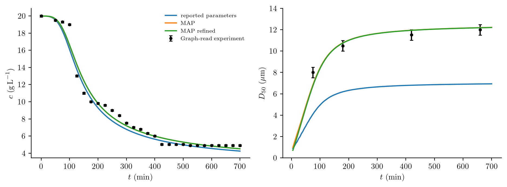

# Inferring protein crystallization kinetics

A protein solution may lose dissolved material quickly while its crystals
continue to grow for hours. Concentration measurements constrain the amount of
material transferred to crystals, but do not reveal how that material is divided
among them. A few particle-size measurements can therefore change the kinetic
parameters inferred from the same concentration history.

Here an unseeded lysozyme batch at 20 °C supplies both kinds of measurement.
The model and experimental markers come from
[Mitchell et al. (2023)](https://doi.org/10.1016/j.cherd.2023.02.016), Figure 4,
using the power-law nucleation and growth combination called Case 2 in that
article. The 100 mL conditions are pH 4.5, 5% w/v NaCl and 210 rpm. We do not
pool the 1 L experiment with this one: the paper found that transferring the
100 mL kinetics did not reproduce the larger experiment.

## Population and solute balances

For crystal length ``\ell`` in µm and time in minutes,

```math
\frac{\partial n(\ell,t)}{\partial t}
+\frac{\partial[G(t)n(\ell,t)]}{\partial\ell}=0,
\qquad G(t)n(0,t)=J(t).
```

The initial population is empty, ``n(\ell,0)=0``. With constant solution volume,

```math
\frac{dc(t)}{dt}
=-3\times10^{-18}\rho k_v\int_0^\infty G(t)\ell^2n(\ell,t)\,d\ell,
\qquad c(0)=19.9883\ \mathrm{g\,L}^{-1}.
```

Here ``n`` counts actual particles per m³ per µm; ``10^{-18}`` converts µm³
to m³. The code additionally rescales particle counts as described below. Nuclei enter at zero length and initially carry no mass.
The rates are

```math
s(t)=\max\!\left(\frac{c(t)}{c_{\mathrm{eq}}}-1,0\right),
\qquad J(t)=60A_Js(t)^j,\qquad G(t)=10^{-3}A_Gs(t)^g.
```

The solubility is 2.16 g/L, crystal density 1240 kg/m³ and volume shape factor
0.81. Temperature is fixed, so activation energies are not inferred. Aggregation,
breakage, shear-induced nucleation and dissolution are omitted. These assumptions
can cause systematic residuals even if optimization converges.

## Units and term definitions in code

Table 7 prints ``A_J`` in particles m⁻³ s⁻¹ and ``A_G`` in nm/min. The script uses
µm, minutes, and particle concentration divided by ``10^{12}``. The conversions
are explicit:

```julia
saturation(p,ctx) = max(ctx.bulk.c/p.ceq-1,zero(ctx.bulk.c))
growth(L,p,t,ctx) = 1e-3*p.AG*saturation(p,ctx)^p.g
nucleation(p,t,ctx) = 60/1e12*exp(p.logAJ)*saturation(p,ctx)^p.j
model = PBMModel(
    growth=Growth(rate=growth),
    primary=Nucleation(rate=nucleation,size=0.),
)
operator = compile(model,grid;methods=TermMethods(
    growth=MUSCL(),by_term=(primary=BoundaryInjection(:left),)))
system = PBMSystem((crystals=operator,);nonnegative_bulk=(:c,),
    exchanges=(ConservativeExchange(:crystals,:c,
        (L,p,t,ctx)->1e-6*p.rho*p.kv*L^3),))
```

The factor ``10^{-6}=10^{12}(10^{-6})^3`` converts a scaled particle count times
µm³ to material volume per solution volume. The exchange uses the numerical
third-moment change, including finite first-bin deposition. Grid refinement
checks that this finite-bin effect is small. No numerical seed population is
inserted.

## Experimental readings and observation model

The supplied CSV contains 28 red concentration markers and four green diameter
markers read from the native Figure 4 image. They are **digitized experimental
readings**, not raw laboratory records or synthetic measurements. The extraction
script retains pixel centres, axis calibration, PDF hash and a source citation.
The zero-time diameter symbol is excluded because a median is undefined for an
empty population.

Concentration is observed directly. The script interprets diameter ``D_{50}``
as a volume-weighted median and integrates the piecewise-constant number density
with weight ``\ell^3``:

```math
\int_0^{D_{50}(t)}\ell^3n(\ell,t)\,d\ell
=\frac12\int_0^\infty\ell^3n(\ell,t)\,d\ell.
```

This observation convention needs confirmation against the original sizing
instrument. It is stated as an assumption, not recovered metadata. A median is
not ``\mu_4/\mu_3``. Nor can it be uniquely determined from four moments without
an additional reconstruction model. The example therefore fits a sectional PSD.

```julia
concentration = Measurement(data.concentration.t,data.concentration.y,
    BulkObservable(:c);likelihood=GaussianLikelihood(sigma=0.1),
    source=:figure4_concentration)
sizes = Measurement(data.D50.t,data.D50.y,FunctionObservable(volume_median);
    likelihood=GaussianLikelihood(sigma=0.5),source=:figure4_D50)
```

The article calls 0.1 g/L and 0.5 µm variances despite giving unsquared units.
We interpret them as Gaussian standard deviations. The two blocks are assumed
independent; laboratory covariance and instrument response are unavailable.
Graph-reading error and model inadequacy are additional uncertainties, not
eliminated by choosing these noise scales.

## Declare priors and estimate parameters

Table 3 lists **initial guesses and fitting ranges**, not Bayesian priors.
In particular, its initial growth-coefficient range 600–1500 nm/min excludes
the final reported value 0.367 nm/min. Reusing that range as a hard prior would
prevent recovery of the reported fit.

The example makes its own choices: uniform physical densities for
``\log A_J\in[0,100]``, ``j\in[1,10]`` and ``g\in[1,3]``. The first quantity is
itself the named physical parameter `logAJ`. A normal prior on ``\log A_G`` is
centred on the reported final coefficient, with standard deviation 1.5. That
last prior is informed by the published fit to the same data, so this is an
illustrative conditional analysis, not independent validation. Change
`growth_prior_sd` and refit to assess its influence.

```julia
ParameterSpec(:AG;initial=0.367,transform=LogTransform(),
    prior=Prior(Normal(log(0.367),1.5);coordinates=:inference))
ParameterSpec(:j;initial=2.14,transform=LogitTransform(1,10),
    prior=Prior(Uniform(1,10);coordinates=:physical))
```

`estimation_problem` joins the parameter declarations, both measurement blocks
and the coupled PBM. `fit` uses the shared posterior with ForwardDiff gradients;
its starting gradient is independently checked. Transform Jacobians are applied
once for physical-coordinate priors. The reported physical values are transforms
of an inference-coordinate MAP; their mode depends on that coordinate choice.

```julia
using PopulationBalanceModels, Optim
include("examples/protein_crystallization.jl")
problem = ProteinCrystallization.estimation_problem(bins=100)
result = fit(problem;maxiters=200)
result.diagnostics
```

## Fit, interpretation and refinement



The plot includes predictions using the printed Table 7 coefficients, this
example's MAP fit, and predictions on a doubled size grid with those fitted
parameters. Differences from the paper include finite-volume treatment, the
stated observation convention, graph-read data and prior assumptions. Agreement
with some concentration points is not enough to establish that all four kinetic
parameters are identifiable. The sharp concentration decrease and the small
number of size observations also leave room for model discrepancy.

The committed 80-bin run converged with an infinity-norm gradient of about
0.008. Its verified Laplace calculation was rejected because the Hessian did
not stabilize under step halving. The PSD median and limiter introduce changes
of derivative across bin and limiter branches; tighter numerics and profiles
are needed before reporting uncertainty. The scripts report this failure openly.

[fit.txt](../assets/protein_crystallization/fit.txt) records convergence, the gradient norm, likelihood/prior contributions
and whether a verified Laplace calculation succeeded. Invalid curvature is
reported rather than regularized. No MCMC convergence or reproduction of the
paper's confidence intervals is claimed. A doubled-grid prediction check is
not a refit: use `refinement_study` to compare fitted parameters under numerical
refinement before treating intervals as reliable.

Run from an environment containing the package and optional Optim dependency:

```sh
julia --project=. examples/protein_crystallization.jl
python docs/benchmarks/plot_new_case_studies.py protein --usetex
```

`Optim` must be installed in that environment. The CSV is included, so the PDF
and Python extraction tools are not needed to run Julia. The optional `solver`
argument accepts a checked SciML solver adapter when adaptive integration is
preferred. `examples/data/protein_crystallization/README.md` gives extraction
provenance and the assumptions that still need experimental confirmation.

## Complete runnable script

The code below is read from the example source during the documentation build.
Run it from the repository root using the environment described above.

### `examples/protein_crystallization.jl`

```@eval
using Markdown, PopulationBalanceModels
Markdown.MD([Markdown.Code("julia",read(joinpath(pkgdir(PopulationBalanceModels),"examples","protein_crystallization.jl"),String))])
```
