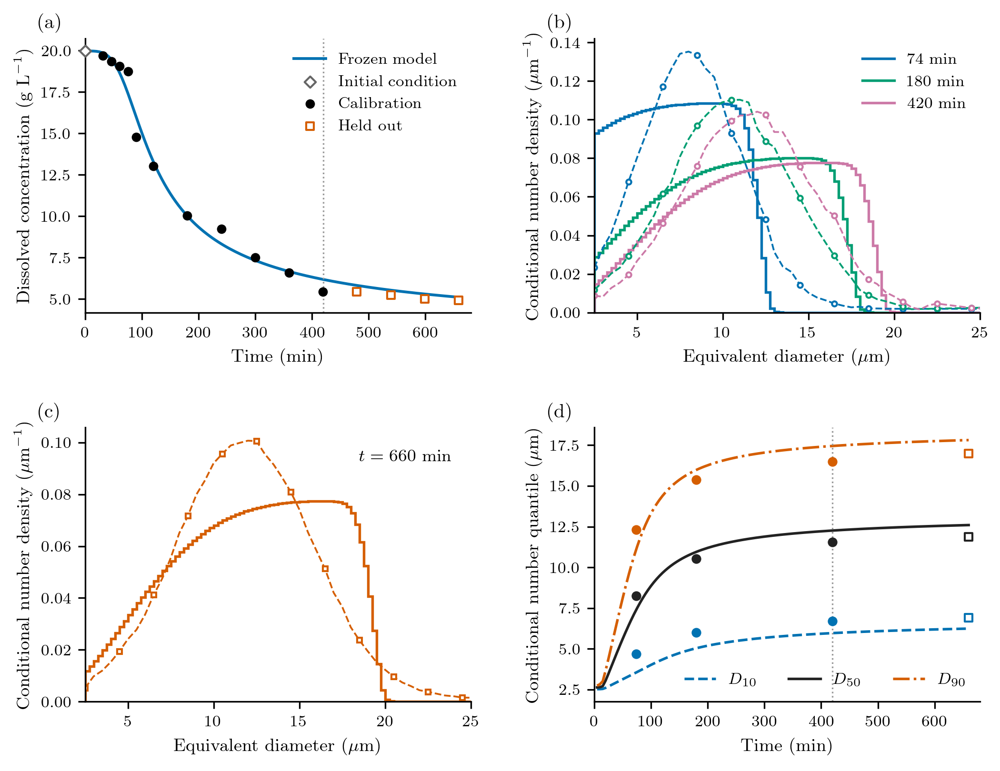

# Calibrating an isothermal protein batch

How much can concentration and microscopy tell us about crystal formation?
Concentration measures material transferred out of solution. A number-weighted
size distribution describes how that material is divided among particles.
Here we use both to calibrate an initially unseeded lysozyme batch, then predict
later measurements without refitting.

The experiment is the original 100 mL, 20 °C isothermal batch in
[Tang et al. (2018)](https://doi.org/10.1016/j.jcrysgro.2018.06.023),
Figures 11(d) and 12(a), at pH 4.5 in 0.1 M sodium acetate buffer. The supplied
graph readings retain their source coordinates and units. This calculation
uses neither Mitchell's replot nor its fitted kinetic parameters.

## A population coupled to dissolved protein

Let ``L`` be equivalent diameter in μm, ``t`` time in min, and ``n(L,t)``
number density in particles m⁻³ μm⁻¹. With size-independent growth,

```math
\frac{\partial n(L,t)}{\partial t}
+\frac{\partial [G(t)n(L,t)]}{\partial L}=0,
\qquad G(t)n(0,t)=J(t),\qquad n(L,0)=0.
```

There are no intentional seeds, aggregation or breakage. For constant solution
volume, the continuum dissolved concentration ``c`` in g/L (= kg/m³) satisfies

```math
\frac{dc(t)}{dt}
=-3\times10^{-18}\rho k_v G(t)\int_0^\infty L^2n(L,t)\,dL,
\qquad c(0)\approx19.97\ \mathrm{g\,L}^{-1}.
```

The initial reading fixes the initial condition; it is not a fitted residual.
The code retains its unrounded supplied value.
Define the normalized driving force and reference-rate laws by

```math
r(t)=\frac{c(t)-c_*}{c(0)-c_*},\qquad
J(t)=J_{\mathrm{ref}}r(t)^j,\qquad
G(t)=G_{\mathrm{ref}}r(t)^g\quad(c(t)>c_*).
```

Both rates are zero at or below ``c_*``, including when an exponent is zero.
The reference rates have units particles m⁻³ min⁻¹ and μm min⁻¹, respectively.
They describe the rate at the initial driving force, rather than a coefficient
whose magnitude changes with the chosen supersaturation convention.

| Quantity | Treatment |
|:--|:--|
| ``\log J_{\mathrm{ref}}``, ``\log G_{\mathrm{ref}}`` | Fitted natural logarithms of rates in the units above |
| ``j``, ``g`` | Fitted nonnegative exponents |
| ``c_*`` | Nominal assumption 2.16 g/L, reported by Mitchell; not measured equilibrium here; separate sensitivity runs |
| ``\rho``, ``k_v`` | Fixed 1240 kg/m³ and 0.81 |
| Size mapping | Microscopy equivalent diameter is the model length; fixed shape factor |
| Clock and initial population | Original times, initial marker at model time zero, empty population |

The source's salt basis and stirring-speed descriptions conflict. We retain
those uncertainties; fitting this conditional model does not resolve them.
Tang's printed solubility relation at 20 °C also conflicts with the late
concentration readings. We do not impose that relation or interpret the last
measurement as equilibrium.

## Assemble and solve with package components

The [runnable example](https://github.com/pavaninguva/PopulationBalanceModels.jl/blob/main/examples/isothermal_protein_crystallization.jl)
defines the rate callbacks and this model assembly:

```julia
model = PBMModel(
    growth=Growth(rate=growth),
    primary=Nucleation(rate=nucleation, size=0.))
operator = compile(model, grid;
    bc=SizeBC(NoFlux(), OpenBoundary()),
    methods=TermMethods(growth=MUSCL(),
        by_term=(primary=BoundaryInjection(:left),)))
system = PBMSystem((crystals=operator,);
    nonnegative_bulk=(:c,),
    accounting=(CumulativeAccounting(:crystals; properties=(material=3,)),),
    exchanges=(ConservativeExchange(:crystals, :c,
        (L,p,t,ctx)->1e-6*p.rho*p.kv*L^3),))
problem = PBMProblem(system, (crystals=zeros(length(grid)),), (0.,660.);
    bulk0=(c=p.c0,), p=p)
solution = simulate(problem; dt=0.0875, saveat=[0.,74.,180.,420.,660.])
```

Here `grid` spans 0–50 μm with 100 bins. `growth` returns μm/min;
`nucleation` divides the physical birth rate by ``10^{12}``. The sectional state
contains bin-integrated particle concentrations divided by ``10^{12}``.
Therefore ``10^{-6}=10^{12}(10^{-6})^3`` converts its third moment to material
volume per solution volume. `ConservativeExchange` computes solute depletion
from the same numerical population increment. Adding a second depletion ODE
would count the transfer twice. The invariant uses the package's pivot-weighted
discrete sum ``\sum_i L_i^3 N_i``; the number observer uses a piecewise-constant
subcell density. These are different numerical approximations to the continuum
measure, checked by spatial refinement and the closed-moment reference.

Boundary injection deposits into the first finite bin, which carries a small
discrete material amount. It is paid for by the same exchange, not ignored.
The upper-boundary ledger records any material leaving the resolved domain;
it is not dissolved protein. The reported invariant includes that ledger.

A complete short forward run needs only the package environment:

```sh
julia --project=. examples/isothermal_protein_crystallization.jl
```

This uses an illustrative parameter set and reports conditional number
quantiles. It is a smoke calculation, not the calibrated result below.

## Concentration and full number distributions

The active CSVs are in
[`examples/data/protein_crystallization/tang2018_isothermal/`](https://github.com/pavaninguva/PopulationBalanceModels.jl/tree/main/examples/data/protein_crystallization/tang2018_isothermal).
Eleven concentrations and the distributions at 74, 180 and 420 min calibrate.
Four later concentrations and the 660-min distribution are held out. Other
than resetting the initial marker to model time zero, graph-read concentration
times remain unrounded.

The microscopy curves are **number** distributions. They are not volume
medians. We condition each observed and predicted distribution on 2.5–25 μm:

```math
F(L,t)=\frac{\int_{2.5}^{L}n(\ell,t)\,d\ell}
 {\int_{2.5}^{25}n(\ell,t)\,d\ell},\qquad 2.5\le L\le25.
```

The observer integrates partial grid cells exactly for the piecewise-constant
sectional density. An empty predicted window is invalid; it receives neither
a seed nor an invented median. For example:

```julia
number_quantiles = PopulationQuantiles(:crystals, [.1,.5,.9]; window=(2.5,25.))
F = conditional_cdf(grid, N, [5.,10.,15.]; window=(2.5,25.))
```

One distribution block compares its entire quantile function ``Q=F^{-1}``:

```math
W_2^2(t)=\int_0^1[Q_{\mathrm{model}}(u,t)-Q_{\mathrm{data}}(u,t)]^2\,du.
```

Its units are μm². The 0.5 μm tabulation reconstructs a published curve; its
points are not independent counted particles. A block is constructed as
`WassersteinObservation(t, sizes, cdf, :crystals; window=(2.5,25.),
points=256, scale=.5, weight=1/3)`. The midpoint quantile quadrature is checked
at 512 and 1024 points. Reported distribution distances use 1024 points; the fitted loss uses
256. Diagnostic D10/D50/D90 values are not fitted again.

## Calibration followed by held-out prediction

The deterministic calibration loss is

```math
\mathcal L=\frac1{11}\sum_{i\in\mathrm{cal}}
 \left(\frac{c(t_i)-c_i}{0.1\ \mathrm{g\,L}^{-1}}\right)^2
+\frac{\lambda}{3}\sum_{t\in\{74,180,420\}}
 \frac{W_2^2(t)}{(0.5\ \mu\mathrm m)^2},\qquad\lambda=1.
```

The two scales set the comparison, not measured sensor standard deviations.
This is not a likelihood or posterior; there are no informative literature
priors, confidence intervals or mandatory MCMC runs. `CalibrationProblem`
collects `ResidualObservation` blocks, and the optional Optim extension fits
them with forward-mode derivatives:

```julia
include("examples/isothermal_protein_crystallization.jl")
using .IsothermalProteinCrystallization, PopulationBalanceModels, Optim
cal = calibration()
u0 = coordinates([log(1e11), log(.2), 2., 2.])
result = fit(cal, u0)                    # one local fit
pfit = cal.parameters(result.minimizer, first(cal.experiments))
contributions = loss_contributions(cal, result.minimizer)
```

The full driver uses eight reproducible starts and transparent numerical
search bounds: ``10^6<J_{\mathrm{ref}}<10^{16}``,
``10^{-4}<G_{\mathrm{ref}}<2``, ``0<j<10``, ``0<g<6``.
Smooth box coordinates impose these search limits without a prior or Jacobian.
Each trial uses a fixed native timestep from a power-of-two upper bound on
its reference growth rate, capped at 0.5 min. Growth cannot exceed that bound
for the declared nonnegative exponents and decreasing concentration, so the
Courant number stays below 0.35 throughout the search. The schedule is locally
constant for AD; bucket boundaries are numerical schedule changes, with no
event derivative claimed. Independent finite differences and timestep halving
check the resulting sensitivities and predictions. Failed forward solves
remain invalid trials.

If the baseline leaves a systematic calibration mismatch, the driver tests
only the predeclared extension
``J=J_{\mathrm{ref}}r^j/[1+\exp(-(t-t_{\mathrm{on}})/(10\,\mathrm{min}))]``.
It adds one onset parameter in 0–150 min and fixes the transition width at
10 min. Its reference rate is the ungated amplitude. Selection requires at
least a 20% calibration-loss reduction without worsening either group by more
than 10%; this is a practical complexity rule, not a significance test.
Numerical checks and model selection precede the frozen held-out prediction.



Panel (a) compares dissolved concentration; the diamond fixes the initial
condition, filled circles calibrate and open
squares validate. The dotted line marks 420 min. Panels (b) and (c) compare
conditional number densities: solid stair curves are the computed sectional
densities, dashed curves and markers the supplied reconstructed observations.
Panel (b) calibrates; the entire 660-min curve in (c) is held out. Panel (d)
shows number quantiles derived from the same conditional distributions, not
additional fitted data. Quantiles are undefined when the resolved observation window is empty; those
entries remain blank. Before the first 74-min measurement, a small numerically
transported tail can control the conditional quantiles. These early curves
are unconstrained predictions, not measured nucleation-onset information.

The nominal fit retains the four-parameter baseline: the onset candidate lowers
calibration loss from 50.58 to 47.36 (6.4%), below the 20% selection threshold.
The fitted reference rates are approximately ``8.12\times10^{10}`` particles
m⁻³ min⁻¹ and 0.177 μm/min, with ``j=5.87`` and ``g=2.89``; the output CSV
retains unrounded values. All four selected parameters lie inside the search
bounds.

Calibration concentration RMSE is 0.670 g/L, and the 74/180/420-min distribution
``W_2`` distances are 1.600/0.918/0.953 μm. In particular, the smooth model
misses the sharp observed concentration fall between about 76 and 90 min.
The frozen prediction gives held-out concentration RMSE 0.293 g/L and
660-min ``W_2=0.891`` μm. At that time the number median is 0.729 μm too large;
D10 is 0.656 μm too small and D90 is 0.832 μm too large. Thus the later shape
is broader than the observed conditional shape, even though the concentration
trend is followed. This is an assessed prediction, not a declaration of model
adequacy.

The shape mismatch has a useful model interpretation. In the continuum model,
crystals born at time ``\tau`` reach
``L=\int_\tau^t G(s)\,ds`` and have density
``n(L,t)=J(\tau)/G(\tau)``. The power-law birth-to-growth ratio is proportional
to ``r(\tau)^{j-g}``. Because concentration decreases, this ratio changes
monotonically with birth time. The continuum prediction therefore rises
toward a sharp front; the observed curves have smooth interior peaks. The onset candidate can alter that ratio, but its calibration gain does
not meet the predeclared selection rule. We retain that evidence rather than
adding more mechanisms.

The generated result tables distinguish concentration error, distribution
transport distance and numerical error. Conditional shape observations do not
measure total particle number. Rate amplitudes and exponents can compensate
as the driving force falls. The supporting conditional loss profiles refit
the remaining parameters; neither profile spread nor the dispersion of
multistart fits is a confidence interval. In the conditional profiles, changing
``j`` by one changes loss by only about 0.12–0.20 after refitting the other
rates. Some low-``g`` profiles reach the numerical upper bound on ``j`` and are
explicitly flagged; those bounded profiles cannot establish confidence limits.
The alternative size window moves the fitted exponent ``j`` to about 1.85
while leaving concentration RMSE near 0.67 g/L. This sensitivity to which part
of the distribution is trusted is more informative than reporting extra
digits in the nominal kinetic parameters.

## Reproduce and interpret the calculation

```sh
julia --project=paper paper/setup.jl
julia --project=paper paper/case_studies/04_protein_crystallization/run.jl --smoke
julia --project=paper paper/case_studies/04_protein_crystallization/run.jl
python paper/plot_all.py --case 4
```

The production driver retains the baseline, candidate and selection, frozen
parameters, observation-level predictions, group losses, validation metrics,
conservation and refinement reports, and predeclared sensitivity fits. It
checks 200-to-400-bin and timestep refinement. The initial 100-bin fit was
refitted at 200 bins. Refinement uses maximum concentration change and RMS
quantile change (the metric in the distribution loss), with a quarter-scale
threshold. The separate maximum quantile change is also retained: tails remain
more sensitive than the integrated discrepancy. At 200 bins, doubling resolution
changes concentration by at most 0.0103 g/L and quantiles by at most 0.0357 μm
in RMS across probability; the maximum tail change is 0.309 μm. Timestep halving
changes concentration by less than ``5\times10^{-6}`` g/L. The material invariant
holds to ``2.5\times10^{-12}`` g/L, with nonnegative populations and negligible
upper-boundary loss. An independent exactly closed moment calculation checks
the population–solute equations without claiming a reconstructed PSD.

Fixed-solubility runs at 1, 3.5 and 4.5 g/L, distribution
weights 0.25 and 4, concentration scale 0.3 g/L, and the alternative 2.5–47.5 μm
window probe conditional assumptions. None is selected by held-out agreement.

The [full driver](https://github.com/pavaninguva/PopulationBalanceModels.jl/blob/main/paper/case_studies/04_protein_crystallization/run.jl)
and its reporting file preserve the reproduction workflow. Outputs and the
standalone caption live under `paper/results/04_protein_crystallization/` and
`paper/captions.tex`; plots can be regenerated without rerunning optimization.
The manifest rejects altered numerical exports. Reproduction requires Optim
and JSON3 in the paper environment; the minimal forward example does not.

These results assess a conditional model of one experiment. Digitization,
unreported particle counts and detection response, uncertain solubility,
shape and source metadata limit kinetic interpretation. A failed held-out
prediction remains evidence against this model under its stated assumptions.
The older Mitchell-based Bayesian example, its inputs and audit outputs remain
available in `examples/protein_crystallization.jl`; they are historical and
are not inputs or uncertainty estimates for this calculation.
