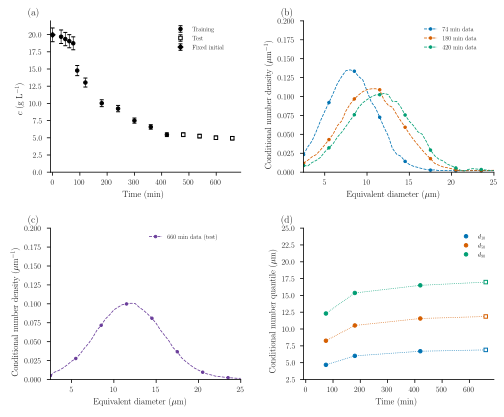
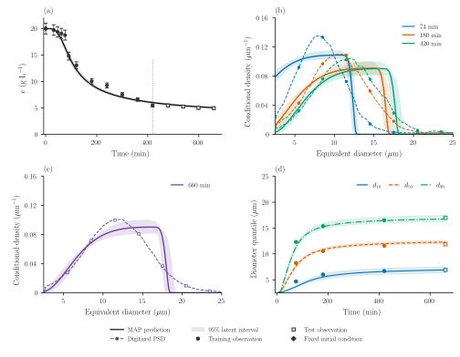
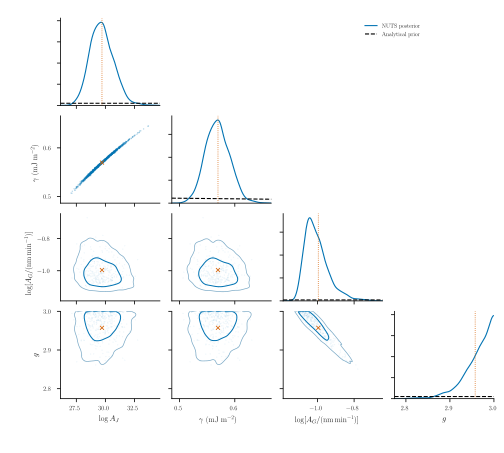
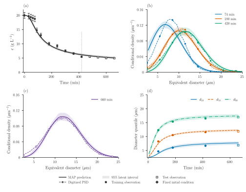
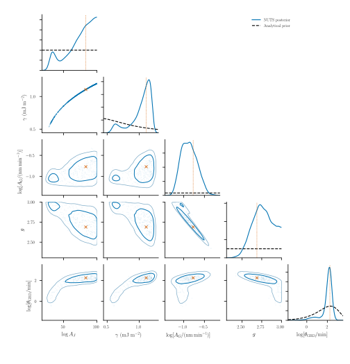

# Protein crystallization: CNT and growth dispersion

Dissolved concentration measures how much protein has crystallized; a number
size distribution measures how that material is divided among crystals. Here
we use both to calibrate two descriptions of one isothermal lysozyme batch:
CNT nucleation with a common mean growth rate, and the same model with
random-fluctuation growth-rate dispersion (GRD). Later observations test their
predictions. Neither model is presented as a universal kinetic law.

## System and measurements

The 100 mL batch at 20 °C is from
[Tang et al. (2018), Figures 11(d) and 12(a)](https://doi.org/10.1016/j.jcrysgro.2018.06.023).
The source records describe 0.1 M sodium acetate buffer at pH 4.5, with
40 g/L protein and 10% w/w NaCl stocks. The mixed-solution salt convention and
the conflicting 100/210 rpm stirring descriptions remain unresolved; we do not
infer a mixing history from them.

Concentrations were measured after 0.22 μm filtration and 50-fold dilution by
UV absorbance at 280 nm. Sizes are microscopy/image-analysis equivalent
diameters, and these are **number** distributions. The separate 1 L
laser-diffraction volume measurements are not used. Our supplied curves are
graph reconstructions, not raw crystal counts or independent 0.5 μm measurements.
The [data and provenance](https://github.com/pavaninguva/PopulationBalanceModels.jl/tree/main/examples/data/protein_crystallization/tang2018_isothermal)
retain the original readings and unrounded graph-read times.



Panel (a) shows concentration; its diamond fixes ``c(0)=19.965841161400512`` g/L.
Filled circles are the eleven training observations; open squares are the four
later test observations. Panels (b) and (c) show the three training distributions
at 74, 180 and 420 min and the held-out distribution at 660 min. Each density
integrates to one over **2.5–25 μm**, the `isothermal_core` window. Panel (d)
shows conditional number ``d_{10},d_{50},d_{90}``; dotted connections are guides
only. These quantiles agree with the supplied CDFs and are not fitted again.
The error bars in (a) are the assumed uncertainties below, not reported
experimental standard deviations. No PSD or quantile error bars are invented.

## Two population models

Let ``n(L,t)`` denote number per process volume per unit equivalent diameter.
Both models start with ``n(L,0)=0`` and share a well-mixed, constant-volume
bulk concentration ``c(t)``.
Their CNT nucleation and size-independent mean growth use the kinetic form of
[Mitchell et al. (2023), Case 3](https://doi.org/10.1016/j.cherd.2023.02.016):

```math
S=\frac{c}{c_*},\qquad
B(\gamma)=\frac{16\pi(10^{-3}\gamma)^3\nu^2}{3(k_{\mathrm B}T)^3},
```

```math
J(c)=60\exp\!\left[\log A_J-\frac{B(\gamma)}{(\log S)^2}\right],\qquad
G(c)=10^{-3}A_G(S-1)^g.
```

Both rates are zero for ``S\le1``. There is no extra S prefactor in J.
``\log A_J`` is the natural log of the numerical prefactor in particles/(m³ s);
J is returned in particles/(m³ min). Enter γ in mJ/m² and ``A_G`` in nm/min;
G is returned in μm/min. These conversions follow the growth units in Mitchell's
estimation tables, rather than silently interpreting its inconsistent table units.
This case uses Tang's original readings and a different observation model; it
is not a reproduction of Mitchell's parameter estimates.

**Model 1 (CNT)** gives every crystal the same instantaneous growth velocity:

```math
\frac{\partial n(L,t)}{\partial t}
+\frac{\partial [G(c(t))n(L,t)]}{\partial L}=0.
```

**Model 2 (CNT + GRD)** adds independent, temporally fluctuating growth:

```math
\frac{\partial n(L,t)}{\partial t}
+\frac{\partial [G(c(t))n(L,t)]}{\partial L}
=\frac{\partial^2[D_G(c(t))n(L,t)]}{\partial L^2},\qquad
D_G(c)=\theta_{\mathrm{GRD}}G(c)^2.
```

``\theta_{\mathrm{GRD}}`` (`grd_strength`) is nonnegative, in minutes; D is in
μm²/min. It combines relative fluctuation variance and correlation time, rather
than measuring either separately. This is an effective Brownian closure, not
permanent fast/slow crystal classes. D is independent of size here, so its Ito
operator reduces to ``D_G\,\partial^2 n/\partial L^2``. A better fit would not
establish the microscopic origin of that dispersion. See the reusable
[SizeDiffusion contract](../methods/growth.md#Random-fluctuation-growth-rate-dispersion).

For both models, the **total** left flux is J:

```math
F(0,t)=J(c(t)),\qquad
F=G n\quad\text{(CNT)},\qquad
F=G n-\frac{\partial(D_G n)}{\partial L}\quad\text{(CNT + GRD)}.
```

`BoundaryInjection` supplies this flux once; Model 2 does not also impose
``n(0)=J/G``. The base size boundaries are closed. Their remote upper edge must
remain inactive, as checked by occupancy and domain extension.

The package assembly uses the same rate callbacks for both models:

```julia
using PopulationBalanceModels
include("examples/isothermal_protein_crystallization.jl")
const I = IsothermalProteinCrystallization

terms = (
    growth=Growth(PolynomialRate(((p,t,ctx)->I.growth_rate(p,ctx.bulk.c),))),
    primary=Nucleation((p,t,ctx)->I.nucleation_rate(p,ctx.bulk.c)/1e12,0.0),
)
cnt = PBMModel(;terms...)
cnt_grd = PBMModel(;terms...,
    dispersion=SizeDiffusion(PolynomialRate(((p,t,ctx)->
        p.grd_strength*I.growth_rate(p,ctx.bulk.c)^2,))),
)
methods = TermMethods(growth=MUSCL(),by_term=(primary=BoundaryInjection(:left),))
```

`build(model=:cnt)` and `build(model=:cnt_grd)` complete this assembly and the
bulk balance. The degree-zero `PolynomialRate` declares size independence,
while its callback still uses **current-stage** concentration. Sectional states
are bin-integrated counts divided by ``10^{12}``, with lengths in μm. The same
stage's full population derivative, including GRD, sets

```math
\frac{\mathrm dc}{\mathrm dt}
=-10^{-6}\rho k_v\sum_i L_i^3\frac{\mathrm dN_i}{\mathrm dt}.
```

Thus ``c+10^{-6}\rho k_v\sum_iL_i^3N_i`` is the discrete material invariant.
There is no second analytical diffusion sink. Away from boundaries, the
separate continuum check is ``dM_3/dt=3GM_2+6D_GM_1``: number-conserving
diffusion can consume solute. First-bin nucleation uses the same centre-cubed
material weight and vanishes with refinement towards zero size.

The bulk callback uses `ctx.derivatives`, which already contains both active
transport mechanisms:

```julia
grid = Grid1D(range(0.0,50.0;length=101);coordinate=:length)
operator = compile(cnt_grd,grid;methods,bc=SizeBC())
function solute_balance(ctx,p,t)
    dM3 = sum(grid.centers[i]^3*ctx.derivatives.crystals[i] for i in 1:length(grid))
    (c=-1e-6*p.rho*p.kv*dM3,)
end
system = PBMSystem((crystals=operator,);bulk_rhs=solute_balance,nonnegative_bulk=(:c,))
```

For a complete short run, `build` also installs the stage-wise coefficient
checks used by the timestep controller:

```julia
problem = I.build(model=:cnt_grd,bins=100,p=I.parameters(grd_strength=10.0))
solution = I.cfl_solve(problem,[0.0,74.0,180.0,420.0,660.0])
```

The active parameter specifications generate this prior table and the corner
plot overlays:

```@eval
using Markdown, PopulationBalanceModels
Markdown.parse(read(joinpath(pkgdir(PopulationBalanceModels),"docs","src","assets","protein_isothermal","prior_table.txt"),String))
```

The four common priors are inherited modeling choices, not same-data
posteriors reused as prior information. The additional Exponential prior has
**scale/mean 10 min**, not rate 10; it is a regularizing assumption, not a
measured material property. Model 1 fixes GRD to zero and has no log(0) coordinate.

Fixed quantities are ``T=293.15`` K, the initial concentration above,
``c_*=2.16`` g/L, ``\rho=1240`` kg/m³, ``k_v=0.81``,
``\nu=2.97\times10^{-26}`` m³/molecule and
``k_{\mathrm B}=1.380649\times10^{-23}`` J/K. The molecular-volume convention
follows [Lin et al. (2017)](https://doi.org/10.1016/j.jcrysgro.2016.10.028).
Solubility, density, geometry and the diameter-to-length mapping are conditional
assumptions, not additional fitted parameters.

## Observation errors and inference

The initial concentration is excluded from the likelihood. The eleven later
training concentrations use individual, **fixed** standard deviations
``\sigma_{c,i}=0.05c_{\mathrm{obs},i}``. We do not infer any noise parameters.
For each training PSD, 22 interior conditional-CDF ordinates at 3–24 μm form
one correlated Gaussian block:

```math
F_\theta(L,t)=\frac{\int_{2.5}^{L}n(\ell,t)\,\mathrm d\ell}
 {\int_{2.5}^{25}n(\ell,t)\,\mathrm d\ell},\qquad
\Sigma_{F,ij}=(0.03)^2\exp\!\left[-\frac{|L_i-L_j|}{2\,\mu\mathrm m}\right].
```

The fixed endpoints are excluded. The 0.03 is **three percentage points** of
CDF fraction, not 3% of each reading, a size error, a physical PSD width or GRD.
These scales and the 2 μm correlation length are observation-model assumptions;
Tang did not establish them experimentally. Fixed linear whitening uses
`Measurement.response`; normalized likelihoods and the known determinant
converting back to original CDF coordinates are exported. Both models use
exactly the same measurements and likelihood. Derived quantiles are diagnostics.

```julia
using Optim
estimation = I.estimation_problem(model=:cnt_grd,bins=100)
fitted = I.fit_model(estimation) # three calibration-only starts
fitted.converged || error("Inspect optimizer diagnostics")
physical_parameters(estimation,fitted.minimizer,:batch)
```

MAP optimization uses four/five inference coordinates: logit for bounded
logAJ and g, log for positive γ and ``A_G``, and log for GRD in Model 2 only.
Physical-coordinate prior Jacobians appear exactly once. A transformed MAP is
not generally a mode of the physical-coordinate density.

Fresh NUTS chains use auxiliary rate coordinates, including the full
inverse-map Jacobian so the declared posterior is unchanged. CNT uses
sensitivity-based initial tuning; GRD uses a frozen, invertible preconditioner
from calibration-only pilots, with starts near both calibration basins.
Its mixture and conditional matrices describe **sampler geometry**, not extra
populations, priors, observation noise or a verified Laplace covariance.
The auxiliary growth rate is evaluated at fixed supersaturation 6; this
coordinate choice does not change the physical growth law. The
[sampling helper](../assets/source/examples/support/isothermal_protein_sampling.jl)
and retained settings specify these transformations. Joint rank Rhat,
bulk/tail ESS, energy diagnostics and divergences determine whether draws
may supply figures.

All priors, observation errors and calibration choices are frozen before
scoring held-out observations. The displayed 95% bands propagate parameter
draws through the PBM; they are pointwise **latent credible intervals**, conditional
on this model and fixed assumptions. They do not include new measurement noise.

## Model 1: CNT



Panels match the data overview. Solid curves/stairs are MAP predictions;
shading is the pointwise 95% latent interval. Dashed density curves are the
supplied reconstructions. Filled observations train; open squares test. The
vertical line marks 420 min. Panel (d) shows conditional number quantiles;
undefined early segments are omitted. CDF residuals remain in the CSV exports.
Common mean growth carries the earliest births to a finite upper front. The
sharp edge near 12–17 μm is inside the size domain, not escape at its 50 μm
boundary. Its plateau and abrupt cutoff miss the measured peak and tail even
when several quantiles are close. Refinement changes the front's numerical
rounding; it does not remove this restriction of the model.



Diagonal curves show normalized NUTS marginal summaries and dashed analytical
priors. Joint KDE contours, where shown, mark approximately 68% and 95%
probability. Raw draws show the thin curved prefactor–barrier relation; orange
markers identify the transformed inference-coordinate MAP. Broad priors extend
beyond these posterior-focused axes and are not renormalized over the crop.
Here logAJ and γ have correlation about 0.997. The growth exponent also presses
against its upper prior bound: about 36% of draws lie in the upper 1% of its
declared range. These are conditional estimates with strong kinetic
compensation, not four independent measurements of material constants.

## Model 2: CNT with random-fluctuation GRD



The panel roles, data colors and corresponding axis limits match Model 1.
The density bands propagate the population state itself; CDF uncertainty is not
drawn as an arbitrary density or size band. Diffusion broadens particle histories
but does not imply a Gaussian full distribution under continuous nucleation.



GRD is now a fifth inferred parameter. Correlations describe compensating
kinetics and dispersion, not evidence that every coefficient is independently
identified: logAJ and γ correlate by about 0.985, while log(AG) and g correlate
by about −0.95. The broad logAJ interval reaches close to its upper prior
bound; 2.6% of draws occupy the upper 1% of that range. GRD improves some size
profiles without resolving this kinetic ambiguity. Bound contact must be
judged alongside systematic residuals and numerical error.

## Estimates and model comparison

The table reports the inference-coordinate MAP transformed to physical units,
then posterior medians and equal-tailed 95% intervals. ``A_G`` and GRD are in
physical units even though their corner axes use natural logarithms.

```@eval
using Markdown, PopulationBalanceModels
Markdown.parse(read(joinpath(pkgdir(PopulationBalanceModels),"docs","src","assets","protein_isothermal","parameter_estimates.txt"),String))
```

```@eval
using Markdown, PopulationBalanceModels
Markdown.parse(read(joinpath(pkgdir(PopulationBalanceModels),"docs","src","assets","protein_isothermal","fit_comparison.txt"),String))
```

CDF RMSE is an unweighted fraction over the supplied tabulated ordinates
(including the two fixed endpoints), rather than the whitened likelihood.
W₂ compares conditional quantiles, using linear interpolation of the supplied
CDF table; its units are μm. Quantile errors are predicted minus observed.

The MAP tradeoff is clearest at 180 min: GRD reduces W₂ from about 0.85 to
0.23 μm, while training concentration RMSE increases from 0.98 to 1.29 g/L
(test RMSE: 0.17 to 0.24 g/L). At 660 min W₂ improves but
CDF RMSE does not; these metrics weight distribution discrepancies differently.
Both models still put the 74-min median roughly 0.6–0.7 μm below the reading.
Broadening alone does not resolve every shape or timing discrepancy.

Concentration constrains transferred material; conditional PSDs constrain
shape within the observation window and do not measure absolute particle
number. Coefficients, exponents, the CNT barrier and GRD can compensate.
Successful chain diagnostics do not establish structural identifiability,
numerical convergence or physical adequacy. The raw MAP posterior values have
different dimensions and are **not** a Bayes factor or model evidence.
A positive GRD interval under its continuous positive prior is not, by itself,
a test against the separate zero-GRD model.
The comparison remains conditional on graph digitization, solubility, molecular
volume, shape, detection and the diameter convention. The final concentration
is not assumed to be equilibrium.

## Reproduce and verify

The [model and likelihood source](../assets/source/examples/isothermal_protein_crystallization.jl)
and [sampling-coordinate helper](../assets/source/examples/support/isothermal_protein_sampling.jl)
are downloadable. The [paper driver and configuration](https://github.com/pavaninguva/PopulationBalanceModels.jl/tree/main/paper/case_studies/04_protein_crystallization)
handle complete reproduction and exports.

From the repository root, using the checkout and the paper plotting environment:

```sh
julia --project=paper paper/setup.jl
python -m pip install -r paper/requirements.txt
# Observations and data-only figure: no optimization or sampling needed.
julia --project=paper paper/case_studies/04_protein_crystallization/run.jl --data-only
python paper/plot_all.py --case 4 --data-only
# Short native forward checks, both models.
julia --project=paper paper/case_studies/04_protein_crystallization/run.jl --smoke
# MAP only, or full reproduction including BOTH posterior corners and bands.
julia --project=paper paper/case_studies/04_protein_crystallization/run.jl --map
julia --project=paper paper/case_studies/04_protein_crystallization/run.jl --full
julia --project=paper paper/case_studies/04_protein_crystallization/run.jl --verify
python paper/plot_all.py --case 4
python paper/check_protein.py
julia --project=docs docs/make.jl
```

Use `--model=cnt` or `--model=cnt_grd` for one model. `--sample` is an alias for
`--full`; the no-flag default is MAP-only. Sampling uses isolated local workers
and checkpoints each chain; matching completed results can be resumed. Explicit
`--warmup=`, `--samples=`, `--chains=`, `--seed=` and `--predictive-draws=` flags
record changed budgets. Sampling must pass Rhat ≤ 1.01, bulk/tail ESS ≥ 400,
BFMI ≥ 0.3 and zero retained divergences/depth hits before producing bands.

Both calculations use conservative bin counts, `MUSCL()` growth and native
`SSPRK33()` (SSPRK3) time integration. Model 2 adds the centred Ito flux of
`FiniteVolumeDiffusion()`, the default method for `SizeDiffusion`. Population
and concentration advance in the same RK stages.

The primary CNT mesh has 400 bins on 0–50 μm; GRD uses 100 bins. The smoother
GRD population permits a cheaper mesh: calibration-only 100/200-bin differences
were at most 0.0032 in CDF fraction at tested parameter points, compared with
the assumed 0.03 uncertainty, and below 0.007 g/L in concentration. GRD is
refitted and sampled on that mesh, with 200/400-bin checks retained separately;
no coarse/fine posterior samples are mixed. The
native combined growth/diffusion recommendation adds outgoing rates:
``G/\Delta L+2D_G/\Delta L^2`` for an interior uniform bin. The controller bounds
rates in short intervals and rejects a cap violation at any RK stage. It does
not assume `suggest_dt` automatically adapts `simulate`. Native positivity
checks remain enabled, with no clipping or seeds.
ForwardDiff differentiates the locally fixed timestep schedule; this is not a
claim of differentiability across controller or limiter branch changes. The
verification command checks gradients again at retained posterior points.
Fixed-parameter time, size and domain checks, representative posterior checks
and a separate finer-grid refit are exported. The discrete material invariant
is checked separately from continuum/grid accuracy.

```@eval
using Markdown, PopulationBalanceModels
Markdown.parse(read(joinpath(pkgdir(PopulationBalanceModels),"docs","src","assets","protein_isothermal","numerical_verification.txt"),String))
```

CDF changes are absolute fractions, comparable with the assumed 0.03 error.
Time checks halve both step controls; size checks double the bin count; domain
checks extend 50 to 75 μm at unchanged bin width. These are fixed-parameter
checks, distinct from the separately exported calibration-only finer-grid refit.
The exported third-moment rate defect compares the numerical residual with
``3GM_2+6D_GM_1`` evaluated using resolved moments. For GRD its largest relative
defect decreases under size refinement. This is a weak-form consistency check, separate from the exact
discrete material balance and from a full continuum solution.

Numerical settings, source/data hashes, producer revision/dirty state, seeds,
actual steps, sampler diagnostics and individual residuals are in
`paper/results/04_protein_crystallization/production/{cnt,cnt_grd}`.
CSV, Markdown and LaTeX tables are generated from those same draws and prior
specifications. PDF/300-dpi PNG/SVG figures are shared by the paper and manual.
Old inferred-noise results are archived as a historical target, not reused here.
