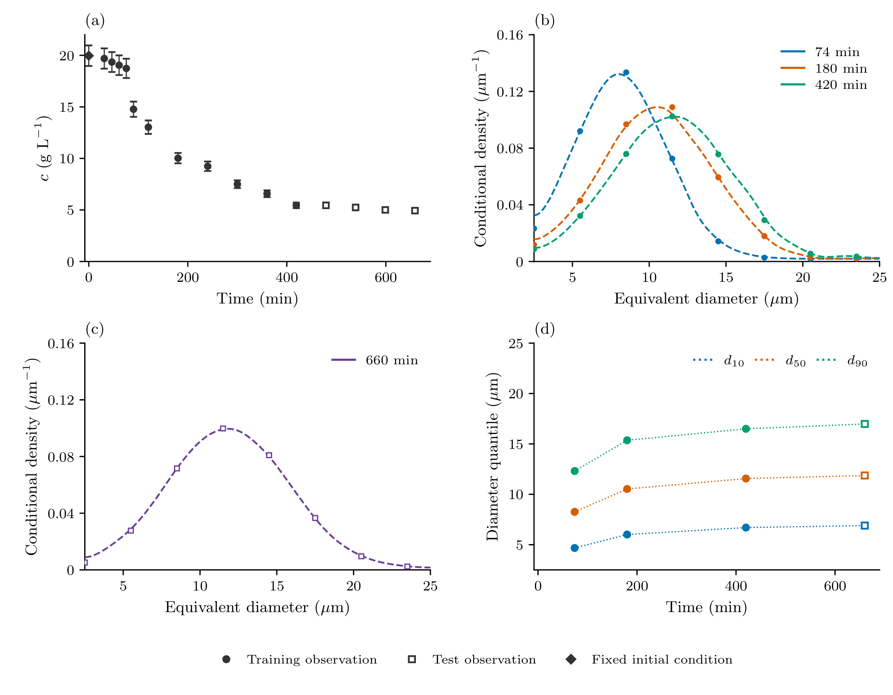
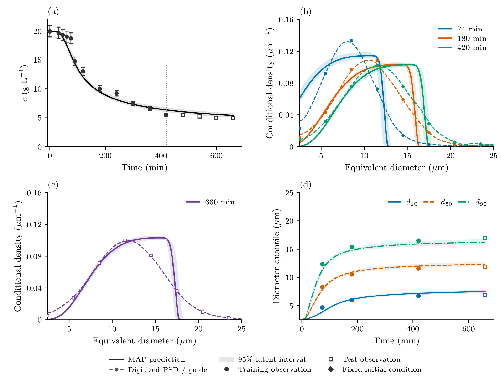
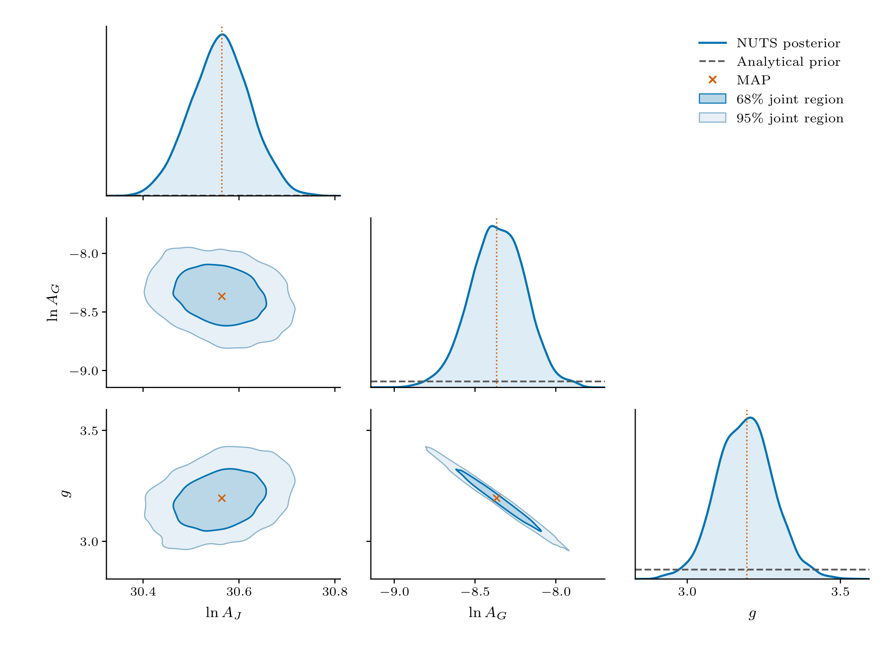
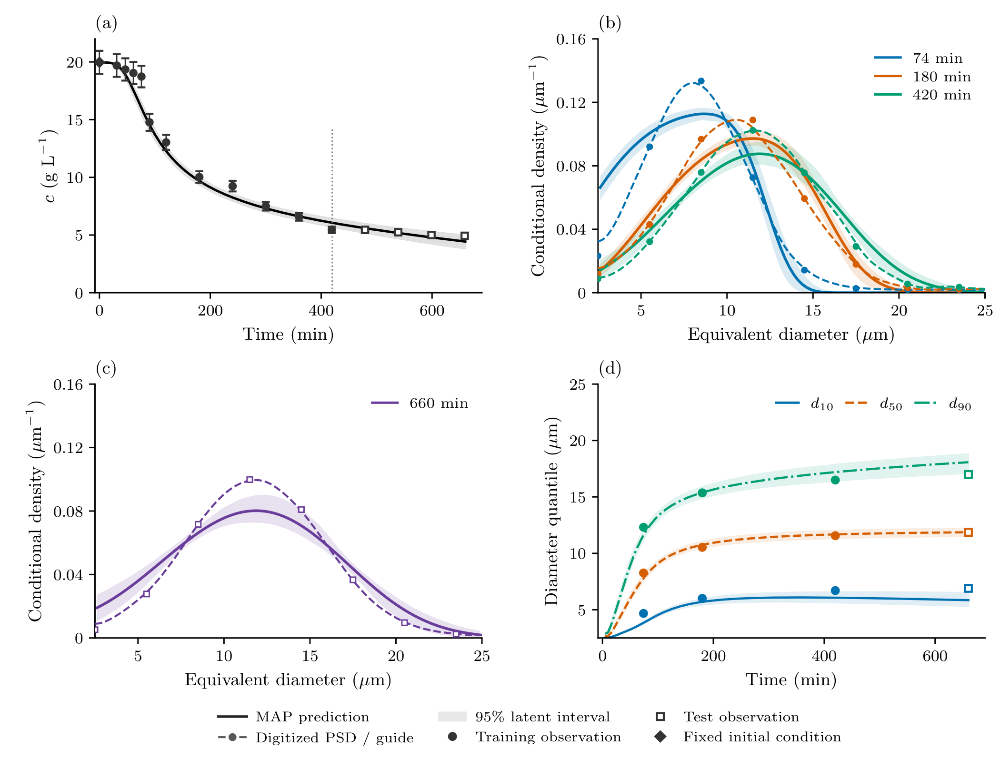
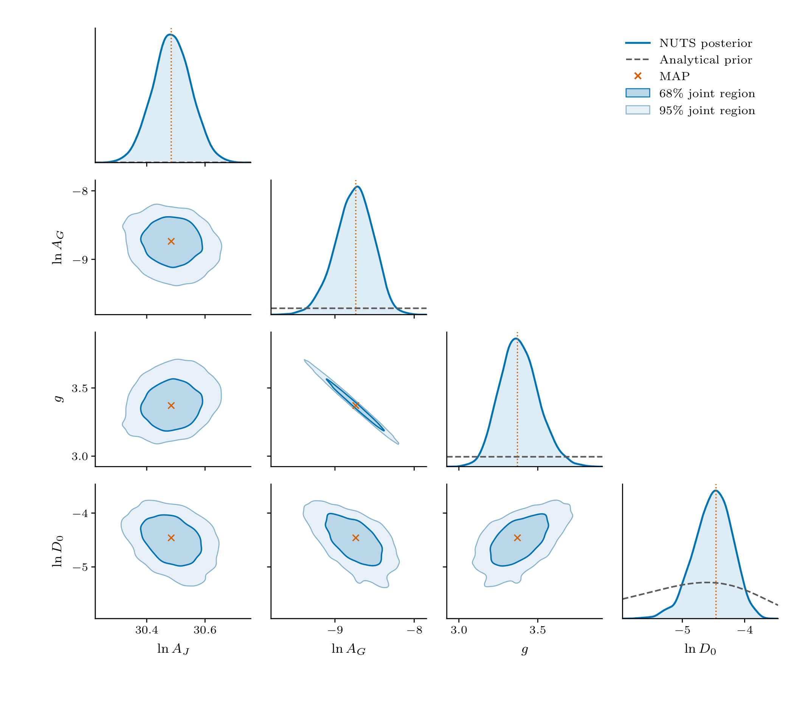

# Protein crystallization: CNT and growth dispersion

Dissolved concentration measures how much protein has crystallized; a number
size distribution measures how that material is divided among crystals. Here
we use both to calibrate two descriptions of one isothermal lysozyme batch:
CNT nucleation with a common mean growth rate, and the same model with
random-fluctuation growth-rate dispersion (GRD). Later observations test their
predictions. Neither model is presented as a universal kinetic law.

## System and measurements

The 100 mL batch at 20 °C is from
[Tang et al. (2018), Figures 11(d) and 12(a)](https://doi.org/10.1016/j.jcrysgro.2018.06.023).
The source records describe 0.1 M sodium acetate buffer at pH 4.5, with
40 g/L protein and 10% w/w NaCl stocks. The mixed-solution salt convention and
the conflicting 100/210 rpm stirring descriptions remain unresolved; we do not
infer a mixing history from them.

Concentrations were measured after 0.22 μm filtration and 50-fold dilution by
UV absorbance at 280 nm. Sizes are microscopy/image-analysis equivalent
diameters, and these are **number** distributions. The separate 1 L
laser-diffraction volume measurements are not used. Our supplied curves are
graph reconstructions, not raw crystal counts or independent 0.5 μm measurements.
The [data and provenance](https://github.com/pavaninguva/PopulationBalanceModels.jl/tree/main/examples/data/protein_crystallization/tang2018_isothermal)
retain the original readings and unrounded graph-read times.



Panel (a) shows concentration; its diamond fixes ``c(0)\simeq19.97`` g/L.
The exact graph-derived input is retained in the data file, not rounded for solving.
Filled circles are the eleven training observations; open squares are the four
later test observations. Panels (b) and (c) show the three training distributions
at 74, 180 and 420 min and the held-out distribution at 660 min. Each density
integrates to one over **2.5–25 μm**, the `isothermal_core` window. Panel (d)
shows conditional number ``d_{10},d_{50},d_{90}``; dotted connections are guides
only. These quantiles agree with the supplied CDFs and are not fitted again.
The error bars in (a) are the assumed uncertainties below, not reported
experimental standard deviations. No PSD or quantile error bars are invented.

The density readings retain small raster/marker irregularities from the source
figure. Dashed curves are **display guides**, using a fixed 0.6 μm Gaussian
bandwidth with reflection at the window ends and unit-area normalization. The
symbols show unaltered graph readings. This display treatment changes neither
the supplied CDFs nor the likelihood; it is not an instrument-response model.

## Two population models

The batch starts unseeded, ``n(L,0)=0``. Let ``n`` be number density per
litre of suspension per micrometre, ``L`` equivalent diameter in μm, ``t`` time in minutes and
``c`` dissolved concentration in g/L. Both models use the CNT nucleation and
size-independent growth forms of
[Mitchell et al. (2023), Case 3](https://doi.org/10.1016/j.cherd.2023.02.016):

```math
S=\frac{c}{c_*},\qquad
J(c)=A_J\exp\!\left[-\frac{B}{(\ln S)^2}\right],\qquad
G(c)=A_G(S-1)^g,
```

```math
B=\frac{16\pi\gamma_{\rm SI}^{3}\nu^2}{3(k_{\rm B}T)^3},\qquad
\gamma_{\rm SI}=0.00064\ {\rm J\,m^{-2}}.
```

Set J and G to zero for S ≤ 1. There is no extra S prefactor in J.
``A_J`` is in particles/(L min), ``A_G`` in μm/min and ``B`` is dimensionless.
These are the same kinetic forms with consistent units, rather than the earlier
mixture of seconds/minutes and nanometres/micrometres. In particular,
``A_{J,{\rm new}}=0.06 A_{J,{\rm old}}`` and
``A_{G,{\rm new}}=10^{-3}A_{G,{\rm old}}``. Unit conversions belong to the
parameter definitions, not extra factors in these equations.

We **fix interfacial energy at 0.64 mJ/m²**, the median of the preceding Mitchell-based LogNormal prior.
This is a conditional modelling choice that removes the nucleation-prefactor/
barrier compensation direction, not evidence that interfacial energy has been
measured precisely. Three parameters are inferred for CNT; four for CNT + GRD.
The common kinetic priors are the previous priors expressed in the new units,
except that g now has the explicitly wider Uniform(1,5) prior.

```@eval
using Markdown, PopulationBalanceModels
Markdown.parse(read(joinpath(pkgdir(PopulationBalanceModels),"docs","src","assets","protein_isothermal","prior_table.txt"),String))
```

Model 2's constant ``D_0`` has an Exponential prior with **mean 0.01 μm²/min**.
This is a declared regularizing assumption: its mean would give diffusion-only
standard-deviation growth ``\sqrt{2D_0t}\approx3.6`` μm over 660 min on an
unbounded coordinate. The numerical mean was chosen heuristically, not taken
from Tang or Mitchell or estimated independently. It is not a measured coefficient or a converted prior on
the old growth-dependent dispersion parameter. The two GRD laws are different
models, so their parameters and posterior draws cannot be interchanged.

Fixed values are T = 293.15 K, c(0) ≈ 19.97 g/L, c* = 2.16 g/L,
``\rho=1.24\times10^{-12}`` g/μm³ (= 1240 kg/m³), ``k_v=0.81``,
``\nu=2.97\times10^{-26}`` m³/molecule and
``k_{\rm B}=1.380649\times10^{-23}`` J/K. Solubility, density, shape and the
identity diameter-to-length mapping remain conditional assumptions.

**CNT** evolves

```math
\frac{\partial n(L,t)}{\partial t}
+\frac{\partial[G(c(t))n(L,t)]}{\partial L}=0.
```

**CNT + GRD** uses a constant internal-coordinate diffusivity:

```math
\frac{\partial n(L,t)}{\partial t}
+\frac{\partial[G(c(t))n(L,t)]}{\partial L}
=D_0\frac{\partial^2 n(L,t)}{\partial L^2},\qquad D_0\ge0.
```

This is the package's Ito random-fluctuation closure, with independent temporal
fluctuations between particles. It does not assign permanent fast/slow growth
classes. Constant D0 continues to act when G vanishes; this finite-horizon
model is not a thermodynamic equilibrium model. Improved agreement alone would
not identify the microscopic origin of GRD.

The total left number flux is J, where
``F=Gn`` for CNT and ``F=Gn-D_0\,\partial n/\partial L`` for CNT + GRD.
`BoundaryInjection` supplies it **once**; no separate condition n(0)=J/G is
imposed. The base size boundaries are closed, with a remote upper edge checked
by occupancy and domain extension. See the [diffusion contract](../methods/dispersion.md).

## Assemble and calibrate the batch

The short example uses the same model builder and likelihood as the reproduction
driver. `grd_strength` is retained as the Julia keyword; it now means D0 in μm²/min.

```julia
using PopulationBalanceModels, Optim
include("examples/isothermal_protein_crystallization.jl")
const I = IsothermalProteinCrystallization

p = I.parameters(grd_strength=0.01)
problem = I.build(p=p,model=:cnt_grd,bins=200)
solution = I.forward(p;model=:cnt_grd,bins=200)

estimation = I.estimation_problem(model=:cnt_grd,bins=200)
fitted = I.fit_model(estimation) # three calibration-only starts
fitted.converged || error("Inspect the MAP diagnostics")
physical_parameters(estimation,fitted.minimizer,:batch)
```

Inside `build`, the physical terms are ordinary package components:

```julia
terms = (
    growth=Growth(PolynomialRate(((p,t,ctx)->I.growth_rate(p,ctx.bulk.c),))),
    primary=Nucleation((p,t,ctx)->I.nucleation_rate(p,ctx.bulk.c),0.0),
    dispersion=SizeDiffusion(PolynomialRate(((p,t,ctx)->p.grd_strength,))),
)
methods = TermMethods(growth=MUSCL(),by_term=(primary=BoundaryInjection(:left),))
```

A `PBMSystem` couples this population to concentration. Bin states are physical
particle concentrations ``N_i=\int_{L_{i-1/2}}^{L_{i+1/2}}n\,dL``, in particles/L.
With ``L_i`` the bin centre, the same RK-stage derivative supplies the complete
exchange:

```math
\frac{dc}{dt}=-\rho k_v\sum_i L_i^3\frac{dN_i}{dt},\qquad
c+\rho k_v\sum_i L_i^3N_i=c(0).
```

Thus diffusion's material contribution is included automatically, without adding
a second analytical sink. Away from the upper boundary the continuum check is
``dM_3/dt=3GM_2+6D_0M_1``. Discrete conservation is exact up to integration/
roundoff; agreement with that continuum rate is a separate refinement check.
Boundary births are deposited into the first finite bin, whose small represented
material is included in the same balance.

### Observations and fixed errors

The initial concentration fixes c(0) and is excluded from fitting. Eleven later
concentrations and the 74-, 180- and 420-min conditional number CDFs calibrate the
model. Four later concentrations and the 660-min distribution are held out.
The original, unrounded observation times and 2.5–25 μm window are unchanged.

Concentration SD is **5% of each observed value**, computed once. Each training
CDF supplies 22 interior ordinates with covariance

```math
\Sigma_{ij}=0.03^2\exp[-|L_i-L_j|/(2\ \mu{\rm m})].
```

The normalization endpoints are excluded. Linear whitening retains the known
determinant constant; full Gaussian normalizers are reported. These error
scales and the correlation length are modelling assumptions, not experimental
uncertainties learned from these readings. No noise parameter is fitted.
Conditional d10/d50/d90 come from those same CDFs and are **not** independent
likelihood data. Conditional distributions constrain shape within the window;
they do not independently measure absolute particle count.

MAP is optimized in z = (logit(logAJ), log AG, logit g), with log D0 added only
for GRD. Physical-prior Jacobians are included once; a transformed MAP is not
generally the physical-density mode. Both models use the same training data,
likelihood and common priors. Held-out agreement does not select a start or prior.

NUTS uses four chains and the package's [diagnostic stopping policy](../inference.md#Sample-the-same-posterior).
A unit-determinant growth-rate shear improves tuning; it does not add a reference
rate parameter. Expected Gaussian information initializes sampler tuning; it is
not reported as a Laplace covariance. Sampling must pass rank Rhat ≤ 1.01, bulk/tail ESS ≥ 400,
BFMI ≥ 0.3 and zero retained divergences/depth hits. Two consecutive eligible
checkpoints are required. All figures below use **new draws for this target**.
Failed trial solves are counted and rejected; they are distinct from sampler
divergences and do not become posterior predictions.
The former four-/five-parameter, growth-dependent-GRD results are archived.

## CNT: fit and prediction



Panels follow the data overview. Solid curves are the MAP; bands are pointwise
95% **latent** intervals propagated from verified NUTS draws. They describe
parameter uncertainty conditional on this model and its fixed assumptions,
not new measurement noise. The later concentration points and the 660-min PSD
are frozen predictions. Model density curves connect computed bin averages;
they are not smoothed or assigned additional spatial resolution.



Diagonals compare normalized posterior densities with dashed analytical priors.
Logarithmic plotting coordinates use numerical AJ in particles/(L min), AG in μm/min and D0 in
μm²/min. The fixed γ is absent. In each two-parameter marginal, contours enclose
approximately 68% and 95% probability. Markers denote the transformed
inference-coordinate MAP. Broad
priors are not renormalized to the displayed crop.

## CNT with constant GRD: fit and prediction



The observation conventions and axes are identical to CNT. The fourth panel
shows conditional population-size quantiles, not parameter credible-interval
endpoints. At times when the observation window is empty, predicted quantiles
are omitted rather than defined using a numerical floor.
Constant dispersion improves the middle-time distributions, but the 74-min
peak remains too flat and the 660-min prediction is broader than the readings.
These systematic shape differences remain visible alongside the concentration
fit and should qualify the interpretation of the kinetic estimates.



## Estimates and interpretation

```@eval
using Markdown, PopulationBalanceModels
Markdown.parse(read(joinpath(pkgdir(PopulationBalanceModels),"docs","src","assets","protein_isothermal","parameter_estimates.txt"),String))
```

Values are MAP, posterior median and equal-tailed 95% intervals. The fixed
interfacial energy and CNT's fixed D0 have no posterior interval.

```@eval
using Markdown, PopulationBalanceModels
Markdown.parse(read(joinpath(pkgdir(PopulationBalanceModels),"docs","src","assets","protein_isothermal","fit_comparison.txt"),String))
```

Concentration constrains transferred material while conditional PSDs constrain
its distribution across sizes. Over a limited supersaturation range,
``\ln G=\ln A_G+g\ln(S-1)`` still permits coefficient–exponent compensation.
The GRD draws retain a correlation of about −0.99 between ``\ln A_G`` and g;
the smaller prefactor is compensated by a larger supersaturation exponent.
Fixing γ removes one compensation direction without adding experimental
information. Correlations and passed chain checks do not establish structural
identifiability, numerical convergence or physical adequacy. Residuals and
held-out errors remain visible; no model evidence or Bayes factor is inferred
from MAP posterior values in different dimensions.
Model 2's continuous positive prior also means that a positive equal-tailed
interval for D0 alone is not evidence for selecting it over the fixed-D0=0 model.

## Numerical checks and reproduction

Both models use MUSCL growth and native SSPRK33. GRD uses native
`SizeDiffusion`/`FiniteVolumeDiffusion`; no custom diffusion residual is involved.
The current-stage combined growth/diffusion recommendation bounds the explicit
step on each coefficient interval. It is a recommendation with stage checks,
not automatic adaptivity. Upward rate buckets keep the step schedule locally
constant for ForwardDiff; derivatives across a change of bucket are not claimed.
Nonnegative populations/bulk states, upper occupancy,
material balance and time/size/domain refinement are checked at the MAP and
representative posterior draws. No negative state is clipped.

```@eval
using Markdown, PopulationBalanceModels
Markdown.parse(read(joinpath(pkgdir(PopulationBalanceModels),"docs","src","assets","protein_isothermal","numerical_verification.txt"),String))
```

The interval estimates condition on the primary mesh. In particular, CNT's
800-bin calibration-only refit shifts predictions more than its fixed-parameter
grid comparison. The table retains this difference; the MCMC bands do not include
discretization or model error.

From the checkout root:

```sh
julia --project=paper -e 'using Pkg; Pkg.develop(path=pwd()); Pkg.instantiate()'
python -m pip install -r paper/requirements.txt
julia --project=paper paper/protein/run.jl --smoke
julia --project=paper paper/protein/run.jl --full --output=/tmp/protein-constant-D0
python paper/protein/plot.py --tables --input=/tmp/protein-constant-D0
# Retained active results: no fits, sampling or forward solves.
python paper/protein/plot.py --tables
python test/protein_results.py
```

Use `--model=cnt` or `--model=cnt_grd` to run one model, `--map` for calibration
without sampling, and `--verify` to check active posterior densities and gradients.
Explicit `--samples=N` selects fixed-length sampling; `--min-samples=`,
`--batch-samples=`, `--max-samples=` and `--consecutive-passes=` control diagnostic
stopping. New output directories protect existing samples. The main model and
likelihood are in the [downloadable example](../assets/source/examples/isothermal_protein_crystallization.jl);
[the paper driver](https://github.com/pavaninguva/PopulationBalanceModels.jl/tree/main/paper/protein)
adds reporting, figures and saved provenance. Plotting the data alone needs no fit:
`python paper/protein/plot.py --data-only`.
