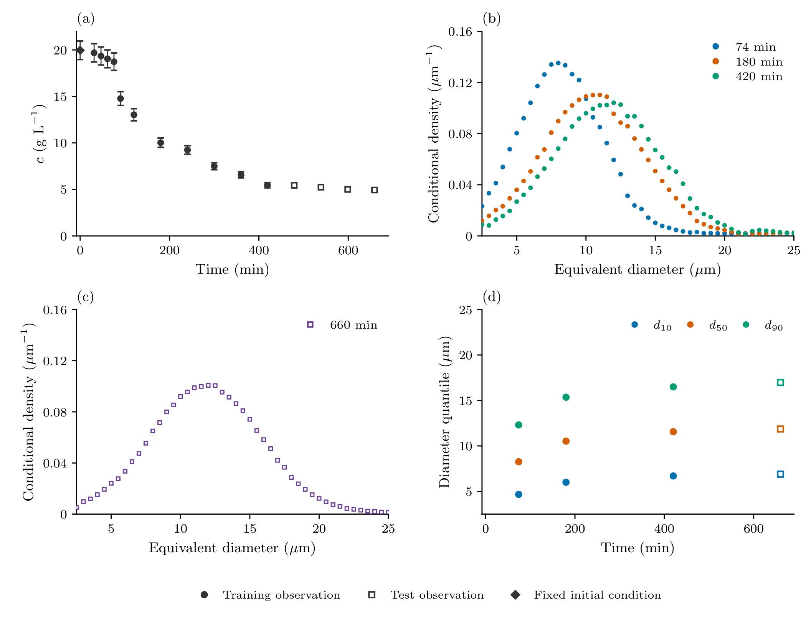
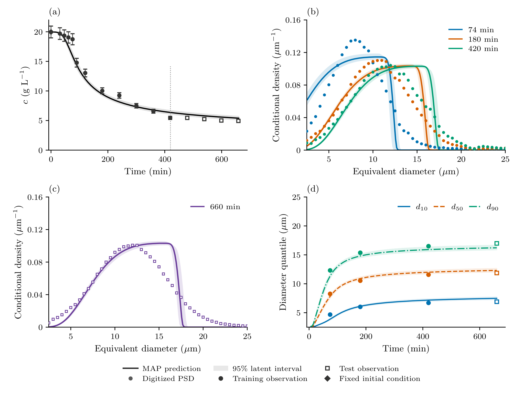
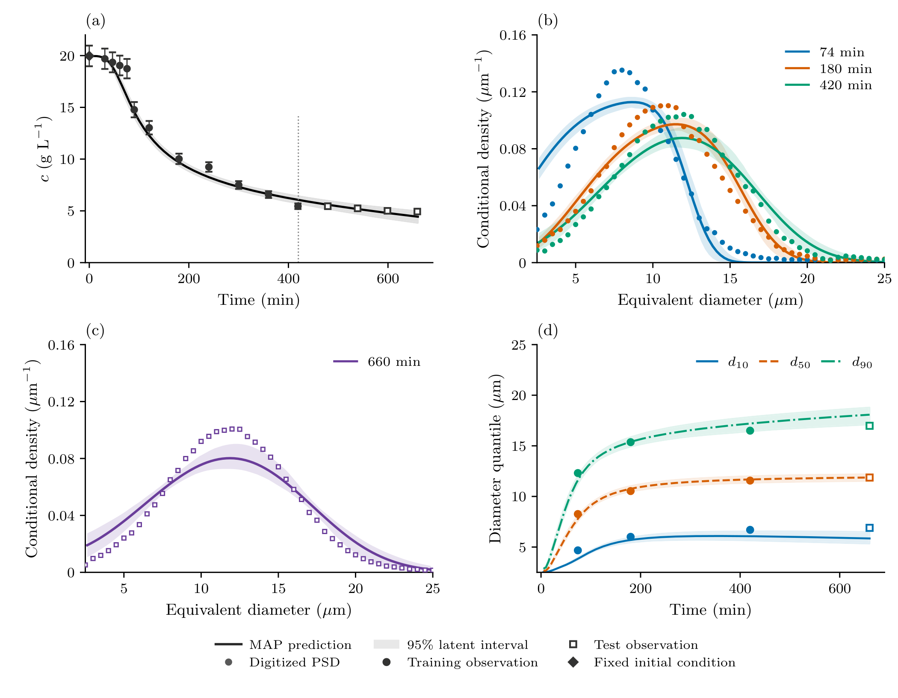
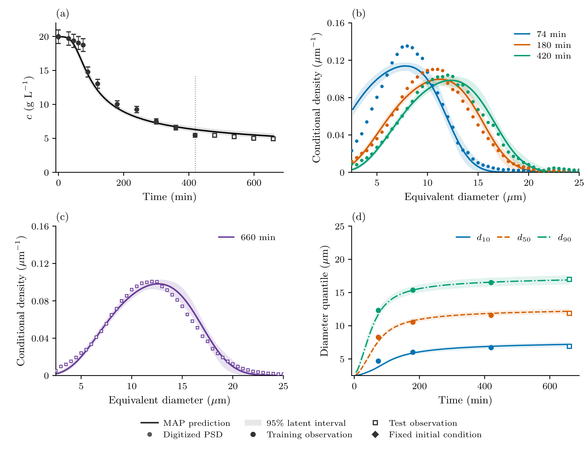
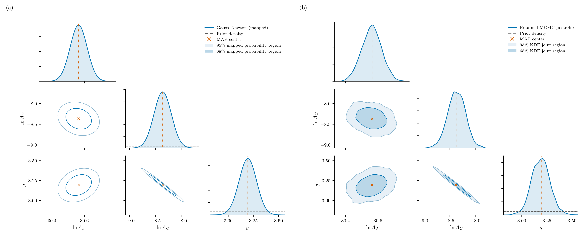
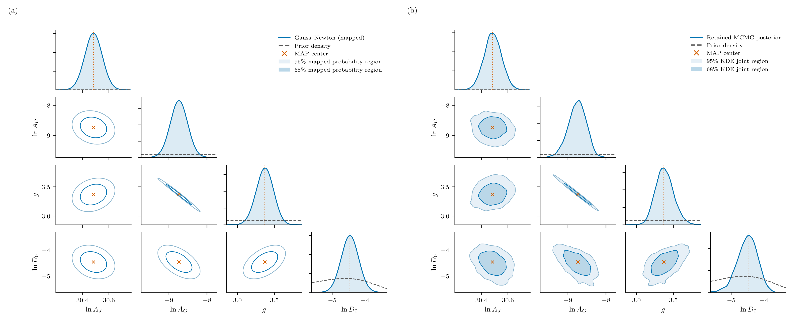
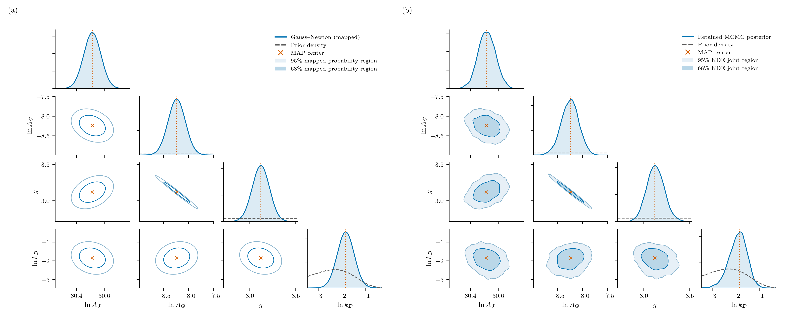

# Protein crystallization: CNT and growth dispersion

**Result conventions.** The original CNT and constant-``D_0`` MCMC draws,
MAP fits and latent bands retain their producer records. A separately recorded
source review and posterior/gradient checks establish compatibility at the saved
MAP and representative retained points before new Gauss–Newton calculations.
The third scenario is a new calculation. Current local approximations use the
[declared inference-coordinate posterior](../inference.md#Migration-and-retained-results),
including physical-prior Jacobians once. Untagged original MAP records are not
relabelled: local refinement from their saved coordinates supplies a checked,
versioned center for the new uncertainty analysis.

Dissolved concentration measures how much protein has crystallized; a number
size distribution measures how that material is divided among crystals. Here
we use both to calibrate three descriptions of one isothermal lysozyme batch:
CNT nucleation with a common mean growth rate, and two random-fluctuation growth-rate dispersion (GRD) closures: constant
diffusivity and diffusivity proportional to mean growth. Later observations test their
predictions. None is presented as a universal kinetic law.

## System and measurements

The 100 mL batch at 20 °C is from
[Tang et al. (2018), Figures 11(d) and 12(a)](https://doi.org/10.1016/j.jcrysgro.2018.06.023).
The source records describe 0.1 M sodium acetate buffer at pH 4.5, with
40 g/L protein and 10% w/w NaCl stocks. The mixed-solution salt convention and
the conflicting 100/210 rpm stirring descriptions remain unresolved; we do not
infer a mixing history from them.

Concentrations were measured after 0.22 μm filtration and 50-fold dilution by
UV absorbance at 280 nm. Sizes are microscopy/image-analysis equivalent
diameters, and these are **number** distributions. The separate 1 L
laser-diffraction volume measurements are not used. Our supplied curves are
graph reconstructions, not raw crystal counts or independent 0.5 μm measurements.
The [data and provenance](https://github.com/pavaninguva/PopulationBalanceModels.jl/tree/main/examples/data/protein_crystallization/tang2018_isothermal)
retain the original readings and unrounded graph-read times.



Panel (a) shows concentration; its diamond fixes ``c(0)\simeq19.97`` g/L.
The exact graph-derived input is retained in the data file, not rounded for solving.
Filled circles are the eleven training observations; open squares are the four
later test observations. Panels (b) and (c) show the three training distributions
at 74, 180 and 420 min and the held-out distribution at 660 min. Each density
integrates to one over **2.5–25 μm**, the `isothermal_core` window. Panel (d)
shows conditional number ``d_{10},d_{50},d_{90}`` as scatter. These quantiles agree with the supplied CDFs and are not fitted again.
The error bars in (a) are the assumed uncertainties below, not reported
experimental standard deviations. No PSD or quantile error bars are invented.

The density readings retain the source figure's raster/marker irregularities.
They are shown as **scatter only**, without smoothing or connecting guides.
The supplied CDFs and likelihood are unchanged.

## Three population models

The batch starts unseeded, ``n(L,0)=0``. Let ``n`` be number density per
litre of suspension per micrometre, ``L`` equivalent diameter in μm, ``t`` time in minutes and
``c`` dissolved concentration in g/L. All three models use the CNT nucleation and
size-independent growth forms of
[Mitchell et al. (2023), Case 3](https://doi.org/10.1016/j.cherd.2023.02.016):

```math
S=\frac{c}{c_*},\qquad
J(c)=A_J\exp\!\left[-\frac{B}{(\ln S)^2}\right],\qquad
G(c)=A_G(S-1)^g,
```

```math
B=\frac{16\pi\gamma_{\rm SI}^{3}\nu^2}{3(k_{\rm B}T)^3},\qquad
\gamma_{\rm SI}=0.00064\ {\rm J\,m^{-2}}.
```

Set J and G to zero for S ≤ 1. There is no extra S prefactor in J.
``A_J`` is in particles/(L min), ``A_G`` in μm/min and ``B`` is dimensionless.
These are the same kinetic forms with consistent units, rather than the earlier
mixture of seconds/minutes and nanometres/micrometres. In particular,
``A_{J,{\rm new}}=0.06 A_{J,{\rm old}}`` and
``A_{G,{\rm new}}=10^{-3}A_{G,{\rm old}}``. Unit conversions belong to the
parameter definitions, not extra factors in these equations.

We **fix interfacial energy at 0.64 mJ/m²**, the median of the preceding Mitchell-based LogNormal prior.
This is a conditional modelling choice that removes the nucleation-prefactor/
barrier compensation direction, not evidence that interfacial energy has been
measured precisely. Three parameters are inferred for CNT; four for CNT + GRD.
The common kinetic priors are the previous priors expressed in the new units,
except that g now has the explicitly wider Uniform(1,5) prior.

```@eval
using Markdown, PopulationBalanceModels
Markdown.parse(read(joinpath(pkgdir(PopulationBalanceModels),"docs","src","assets","protein_isothermal","prior_table.txt"),String))
```

Model 2's constant ``D_0`` has an Exponential prior with **mean 0.01 μm²/min**.
This is a declared regularizing assumption: its mean would give diffusion-only
standard-deviation growth ``\sqrt{2D_0t}\approx3.6`` μm over 660 min on an
unbounded coordinate. The numerical mean was chosen heuristically, not taken
from Tang or Mitchell or estimated independently. It is not a measured coefficient or a converted prior on
the old growth-dependent dispersion parameter. The two GRD laws are different
models, so their parameters and posterior draws cannot be interchanged.

Model 3's ``k_D`` has an Exponential prior with **mean 0.1 μm** and a log
inference transform. This is a regularizing length scale, not a literature
measurement: for a crystal cohort in an unbounded coordinate, ``D_G=k_DG`` gives an added variance
``2k_D\int G\,dt``; a 10 μm mean advance at the prior mean corresponds to
about 1.4 μm added standard deviation. Its prior is distinct from that of ``D_0``.

Fixed values are T = 293.15 K, c(0) ≈ 19.97 g/L, c* = 2.16 g/L,
``\rho=1.24\times10^{-12}`` g/μm³ (= 1240 kg/m³), ``k_v=0.81``,
``\nu=2.97\times10^{-26}`` m³/molecule and
``k_{\rm B}=1.380649\times10^{-23}`` J/K. Solubility, density, shape and the
identity diameter-to-length mapping remain conditional assumptions. We retain
the Pusey value: [Cacioppo and Pusey (1991), Table 1](https://doi.org/10.1016/0022-0248(91)90043-5)
gives ``0.347+0.04979T_C-0.001632T_C^2+0.0001832T_C^3=2.1556`` mg/mL
at 20 °C, pH 4.5 and 5% NaCl, rounded here to 2.16 g/L. Their column method
approaches equilibrium from both sides. Applying that value to Tang's mixed
batch remains conditional on the unresolved salt-basis details above; late-time
concentration alone is not a direct solubility measurement.

**CNT** evolves

```math
\frac{\partial n(L,t)}{\partial t}
+\frac{\partial[G(c(t))n(L,t)]}{\partial L}=0.
```

**CNT + constant GRD (model 2)** uses a constant internal-coordinate diffusivity:

```math
\frac{\partial n(L,t)}{\partial t}
+\frac{\partial[G(c(t))n(L,t)]}{\partial L}
=D_0\frac{\partial^2 n(L,t)}{\partial L^2},\qquad D_0\ge0.
```

This is the package's Ito random-fluctuation closure, with independent temporal
fluctuations between particles. It does not assign permanent fast/slow growth
classes. Constant D0 continues to act when G vanishes; this finite-horizon
model is not a thermodynamic equilibrium model. Improved agreement alone would
not identify the microscopic origin of GRD.

**CNT + growth-dependent GRD (model 3)** instead uses

```math
D_G(c)=k_DG(c),\qquad k_D\ge0,\qquad
\partial_t n+\partial_L(Gn)=\partial_L^2(D_G n).
```

Here ``G`` and ``D_G`` depend on current concentration, not on particle size;
``k_D`` has units of μm. A proportionality of size diffusivity to growth is used
by [Makoveeva and Alexandrov (2018)](https://doi.org/10.1098/rsta.2017.0327).
This motivates a phenomenological closure, rather than identifying microscopic
lysozyme fluctuations or importing a measured coefficient. The source's radius
coordinate and our equivalent diameter also require different coefficient
scales. This is still an Ito/Fokker–Planck population model, not permanent
fast/slow crystal classes. Both growth and dispersion vanish for ``c≤c_*``;
there is no diffusion-driven depletion at zero growth. It remains a growth-only
model, without dissolution or a reversible equilibrium description.

The total left number flux is J, where
``F=Gn`` for CNT and ``F=Gn-D_G\,\partial n/\partial L`` for either GRD model.
`BoundaryInjection` supplies it **once**; no separate condition n(0)=J/G is
imposed. The base size boundaries are closed, with a remote upper edge checked
by occupancy and domain extension. See the [diffusion contract](../methods/dispersion.md).

## Assemble and calibrate the batch

The model uses ordinary package terms and conservative solute exchange.
`grd_strength` is retained as the Julia keyword; it means D0 in μm²/min.
Start with CNT alone, using the kinetic functions and stage guard defined in
the complete walkthrough below. Measurements, priors, calibration and held-out
prediction follow that first forward calculation. Each GRD law is added afterward:

```julia
# After defining parameters, growth_rate, nucleation_rate and the shared stage guard:
p = parameters() # grd_strength=0; fixed gamma=0.64 mJ/m^2.
model = PBMModel(
    growth=Growth(PolynomialRate(((p,t,ctx)->growth_rate(p,stage_concentration(p,ctx)),))),
    primary=Nucleation((p,t,ctx)->nucleation_rate(p,stage_concentration(p,ctx)),0.0),
)
problem = batch_problem(model;p) # The visible repeated-construction builder below.
solver = cfl_solve
nominal = solver(problem,[0.0,74.0,180.0,420.0,660.0])
```

A `PBMSystem` couples this population to concentration. Bin states are physical
particle concentrations ``N_i=\int_{L_{i-1/2}}^{L_{i+1/2}}n\,dL``, in particles/L.
With ``L_i`` the bin centre, the same RK-stage derivative supplies the complete
exchange:

```math
\frac{dc}{dt}=-\rho k_v\sum_i L_i^3\frac{dN_i}{dt},\qquad
c+\rho k_v\sum_i L_i^3N_i=c(0).
```

Thus diffusion's material contribution is included automatically, without adding
a second analytical sink. Away from the upper boundary the continuum check is
``dM_3/dt=3GM_2+6D_GM_1``. Discrete conservation is exact up to integration/
roundoff; agreement with that continuum rate is a separate refinement check.
Boundary births are deposited into the first finite bin, whose small represented
material is included in the same balance.

### Observations and fixed errors

The initial concentration fixes c(0) and is excluded from fitting. Eleven later
concentrations and the 74-, 180- and 420-min conditional number CDFs calibrate the
model. Four later concentrations and the 660-min distribution are held out.
The original, unrounded observation times and 2.5–25 μm window are unchanged.

Concentration SD is **5% of each observed value**, computed once. Each training
CDF supplies 22 interior ordinates with covariance

```math
\Sigma_{ij}=0.03^2\exp[-|L_i-L_j|/(2\ \mu{\rm m})].
```

The normalization endpoints are excluded. In the tutorial,
`GaussianLikelihood(covariance=...)` performs whitening and normalization
internally. The retained reproduction driver whitens data and predictions
explicitly and records the known determinant correction. Both describe the
same correlated-error posterior law; their reported log densities must be
compared with that constant included. These error
scales and the correlation length are modelling assumptions, not experimental
uncertainties learned from these readings. No noise parameter is fitted.
Conditional d10/d50/d90 come from those same CDFs and are **not** independent
likelihood data. Conditional distributions constrain shape within the window;
they do not independently measure absolute particle count.

MAP is optimized in z = (logit(logAJ), log AG, logit g), adding log D0
for constant GRD or log k_D for growth-dependent GRD. Physical-prior Jacobians are included once; a transformed MAP is not
generally the physical-density mode. All three models use the same training data,
likelihood and common priors. Held-out agreement does not select a start or prior.

NUTS uses four chains and the package's [diagnostic stopping policy](../inference.md#Sample-the-same-posterior).
A unit-determinant growth-rate shear improves tuning; it does not add a reference
rate parameter. Expected Gaussian information initializes sampler tuning; it is
not reported as a Laplace covariance. Sampling must pass rank Rhat ≤ 1.01, bulk/tail ESS ≥ 400,
BFMI ≥ 0.3 and zero retained divergences/depth hits. Two consecutive eligible
checkpoints are required. The original two scenarios reuse their screened chains and latent bands;
model 3 is sampled separately under its own ``k_D`` prior. Original producer
records remain separate from compatibility evidence.
Failed trial solves are counted and rejected; they are distinct from sampler
divergences and do not become posterior predictions.
The former variable-γ, four-/five-parameter results remain archived; their dispersion law differs from the new model 3.

## CNT: fit and prediction



Panels follow the data overview. Solid curves are the MAP; bands are pointwise
95% **latent** intervals propagated from verified NUTS draws. They describe
parameter uncertainty conditional on this model and its fixed assumptions,
not new measurement noise. The later concentration points and the 660-min PSD
are frozen predictions. Model density curves connect computed bin averages;
they are not smoothed or assigned additional spatial resolution.

[Standalone CNT MCMC corner](../assets/protein_isothermal/protein_corner_cnt.png).
The matched Gauss–Newton/MCMC comparisons are shown below.

Diagonals compare normalized posterior densities with dashed analytical priors.
Logarithmic plotting coordinates use numerical AJ in particles/(L min), AG in
μm/min, D0 in μm²/min and k_D in μm. The fixed γ is absent. In each two-parameter marginal, contours enclose
approximately 68% and 95% probability. Markers denote the transformed
inference-coordinate MAP. Broad
priors are not renormalized to the displayed crop.

## CNT with constant GRD: fit and prediction



The observation conventions and axes are identical to CNT. The fourth panel
shows conditional population-size quantiles, not parameter credible-interval
endpoints. At times when the observation window is empty, predicted quantiles
are omitted rather than defined using a numerical floor.
Constant dispersion improves the middle-time distributions, but the 74-min
peak remains too flat and the 660-min prediction is broader than the readings.
These systematic shape differences remain visible alongside the concentration
fit and should qualify the interpretation of the kinetic estimates.

[Standalone constant-GRD MCMC corner](../assets/protein_isothermal/protein_corner_cnt_grd.png).

## CNT with growth-dependent GRD: fit and prediction



The same four panels now use ``D_G=k_DG``. Shading still comes from MCMC
parameter propagation, not from Gauss–Newton and not from measurement noise.
The new run stopped at 750 retained draws per chain after passing the eligible
500- and 750-draw checkpoints. Maximum Rhat is 1.0021, minimum bulk/tail ESS
is about 1,401, and no retained divergence or maximum-depth hit occurred.
The extra coefficient controls broadening per unit mean growth; it cannot
sustain broadening when growth stops. Comparing held-out concentration and
conditional PSD shape remains necessary even when the training fit improves.
At 660 min, its CDF RMSE is about 0.016, compared with 0.033 for each of the
other models. The held-out concentration RMSE is 0.47 g/L: smaller than CNT
(0.55 g/L), but larger than constant GRD (0.28 g/L). These are different
constraints and do not identify a uniformly superior model.

[Standalone growth-dependent-GRD MCMC corner](../assets/protein_isothermal/protein_corner_cnt_growth_grd.png).

The fourth displayed coordinate is ``\ln(k_D/\mathrm{\mu m})``; no reference-rate
parameter is introduced. Numerical values are expressed in the units listed
in the prior table.

## Gauss–Newton beside MCMC



Individual panels: [Gauss–Newton](../assets/protein_isothermal/protein_gauss_newton_panel_cnt.png),
[MCMC](../assets/protein_isothermal/protein_gauss_newton_mcmc_panel_cnt.png).



Individual panels: [Gauss–Newton](../assets/protein_isothermal/protein_gauss_newton_panel_cnt_grd.png),
[MCMC](../assets/protein_isothermal/protein_gauss_newton_mcmc_panel_cnt_grd.png).



Individual panels: [Gauss–Newton](../assets/protein_isothermal/protein_gauss_newton_panel_cnt_growth_grd.png),
[MCMC](../assets/protein_isothermal/protein_gauss_newton_mcmc_panel_cnt_growth_grd.png).

Each figure places the joint Gauss–Newton approximation on the **left** and
screened MCMC draws on the **right**, with matched parameter order, prior
curves, axis limits and selected MAP markers. Individual corners are also
exported for larger layouts. The covariance is joint in
``z=(\operatorname{logit}(\ln A_J),\ln A_G,\operatorname{logit}(g))``, augmented
by ``\ln D_0`` or ``\ln k_D``. Logit bounds are those of the declared priors.
Its precision is ``J_z^\mathsf{T}J_z+\nabla_z^2[-\ln\pi_z]`` for the stacked
whitened residuals. It includes transformed-prior curvature and omits
residual-weighted second prediction derivatives. It is **not full-Hessian
Laplace** and is not the sampler tuning matrix.

Gaussian marginals are transformed analytically. Joint curves transform the
68%/95% Gaussian probability ellipses; after a nonlinear map these need not be
highest-density contours in displayed coordinates. MCMC contours summarize
68%/95% probability under a joint KDE. Cheap seeded Gaussian draws supply
correlation summaries; they require no PBM solves, are not clipped or
resampled, and their support/nonfinite diagnostics are exported.

```@eval
using Markdown, PopulationBalanceModels
Markdown.parse(read(joinpath(pkgdir(PopulationBalanceModels),"docs","src","assets","protein_isothermal","gauss_newton_verification.txt"),String))
```

For the reused CNT draws, Gauss–Newton gives a narrower ``\ln A_J`` interval
(approximately 30.46–30.67) than MCMC (30.44–30.68), while growth-prefactor
intervals are close. In the constant-GRD case, both methods recover the strong
``\ln A_G``–g compensation (correlation about −0.99). These comparisons use
full joint covariance, not independent marginal error bars.

For growth-dependent GRD, both methods recover a correlation near −0.989
between ``\ln A_G`` and g. MCMC gives a ``k_D`` median of 0.151 μm and a
95% interval of 0.066–0.283 μm; the local Gauss–Newton approximation has median
0.158 μm and an interval of approximately 0.08–0.32 μm. Its interval is shifted
toward larger coefficients and misses some of the sampled lower-tail weight.
The local covariance captures the main kinetic compensation but does not
reproduce every marginal tail.

Acceptance establishes numerical consistency of the local Gauss–Newton
calculation. Curved compensation, prior boundaries or separate basins can
still disagree with its local Gaussian shape. Existing full-Hessian Laplace
rejections belong to the archived variable-γ study; they are not successful
Laplace results for these three models. No full-Hessian approximation is
substituted for Gauss–Newton in these comparisons. Marginal medians/95% intervals
and selected display-coordinate correlations are downloadable for
[CNT](../assets/protein_isothermal/gauss_newton_marginal_comparison_cnt.csv),
[constant GRD](../assets/protein_isothermal/gauss_newton_marginal_comparison_cnt_grd.csv) and
[growth-dependent GRD](../assets/protein_isothermal/gauss_newton_marginal_comparison_cnt_growth_grd.csv);
correlation summaries accompany them in the same asset directory.

## Estimates and interpretation

```@eval
using Markdown, PopulationBalanceModels
Markdown.parse(read(joinpath(pkgdir(PopulationBalanceModels),"docs","src","assets","protein_isothermal","parameter_estimates.txt"),String))
```

Values are MAP, posterior median and equal-tailed 95% intervals. The fixed
interfacial energy and CNT's fixed D0 have no posterior interval. The unused
constant ``D_0=0`` in model 3 is not a fitted coefficient; its dispersion is
entirely specified by ``k_DG``.

```@eval
using Markdown, PopulationBalanceModels
Markdown.parse(read(joinpath(pkgdir(PopulationBalanceModels),"docs","src","assets","protein_isothermal","fit_comparison.txt"),String))
```

Concentration constrains transferred material while conditional PSDs constrain
its distribution across sizes. Over a limited supersaturation range,
``\ln G=\ln A_G+g\ln(S-1)`` still permits coefficient–exponent compensation.
The constant-GRD draws retain a correlation of about −0.99 between ``\ln A_G`` and g;
the smaller prefactor is compensated by a larger supersaturation exponent.
Fixing γ removes one compensation direction without adding experimental
information. Correlations and passed chain checks do not establish structural
identifiability, numerical convergence or physical adequacy. Residuals and
held-out errors remain visible; no model evidence or Bayes factor is inferred
from MAP posterior values in different dimensions.
Both dispersion coefficients have continuous positive priors. A positive
equal-tailed interval for D0 or k_D alone is therefore not evidence for
selecting that model over CNT's fixed zero dispersion.

## Numerical checks and reproduction

All three models use MUSCL growth and native SSPRK33. GRD uses native
`SizeDiffusion`/`FiniteVolumeDiffusion`; no custom diffusion residual is involved.
The current-stage combined growth/diffusion recommendation bounds the explicit
step on each coefficient interval. It is a recommendation with stage checks,
not automatic adaptivity. Upward rate buckets keep the step schedule locally
constant for ForwardDiff; derivatives across a change of bucket are not claimed.
Nonnegative populations/bulk states, upper occupancy,
material balance and time/size/domain refinement are checked at the MAP and
representative posterior draws. No negative state is clipped.

```@eval
using Markdown, PopulationBalanceModels
Markdown.parse(read(joinpath(pkgdir(PopulationBalanceModels),"docs","src","assets","protein_isothermal","numerical_verification.txt"),String))
```

The interval estimates condition on the primary mesh. In particular, CNT's
800-bin calibration-only refit shifts predictions more than its fixed-parameter
grid comparison. The table retains this difference; the MCMC bands do not include
discretization or model error.

To redraw the retained comparison from the checkout root:

```sh
python -m pip install -r paper/requirements.txt
python tools/retained_data.py fetch --profile paper
# Figures only: no fits, sampling, forward solves or result-table rewrites.
python paper/protein/plot.py
python paper/protein/plot.py --gauss-newton
python test/protein_results.py --retained
```

Fetching and plotting preserve the original producers; they do not establish
equivalence to a later checkout. A new calibration/sampling calculation is
separate and uses a fresh output directory:

```sh
julia --project=paper -e 'using Pkg; Pkg.develop(path=pwd()); Pkg.instantiate()'
julia --project=paper paper/protein/run.jl --smoke
julia --project=paper paper/protein/run.jl --full --output=/tmp/protein-declared-coordinates
python paper/protein/plot.py --tables --input=/tmp/protein-declared-coordinates
```

Separate `--gauss-newton`/`--laplace` analysis performs new derivative/forward
evaluations and requires its compatibility checks; it never samples or propagates
latent predictions automatically. See the
[paper driver guide](https://github.com/pavaninguva/PopulationBalanceModels.jl/tree/main/paper).
`--tables` explicitly regenerates derived plotting
summaries; ordinary redraws leave numerical tables unchanged.

Use `--model=cnt`, `--model=cnt_grd` or `--model=cnt_growth_grd` to run one model, `--map` for calibration
without sampling, and `--verify` to check active posterior densities and gradients.
Explicit `--samples=N` selects fixed-length sampling; `--min-samples=`,
`--batch-samples=`, `--max-samples=` and `--consecutive-passes=` control diagnostic
stopping. New output directories protect existing samples. The main model and
likelihood are in the [downloadable example](../assets/source/examples/isothermal_protein_crystallization.jl);
[the paper driver](https://github.com/pavaninguva/PopulationBalanceModels.jl/tree/main/paper/protein)
adds reporting, figures and saved provenance. Plotting the data alone needs no fit:
`python paper/protein/plot.py --data-only`.

### Complete script

The script first constructs and simulates CNT. It then shows the 11 calibration
concentrations, the three 22-ordinate conditional number CDF blocks, fixed errors
and correlated covariance, physical prior laws and explicit inference transforms.
The fixed initial concentration, four later concentrations, 660-min PSD and
PSD-derived quantiles are excluded from calibration. The MAP is defined in the
declared inference coordinates; transformations do not change the physical
parameters passed to the PBM.

[Data reading and selection](../assets/source/examples/support/protein_data.jl)
and the [checked interval solver and prescribed calibration starts](../assets/source/examples/support/protein_execution.jl)
are the two companions. The power-of-two rate buckets, stage bounds, interval
lengths, SSPRK33 schedule and three starts are unchanged. Generic `StepControl`
is not a derivative-equivalent replacement. The original-CDF covariance below
is probability-equivalent to the producer's whitened blocks; their normalized
log likelihoods differ by the known, parameter-independent whitening determinant.

Executing the file performs the nominal CNT solve and CNT calibration, then
freezes its parameters for held-out prediction. These steps can take minutes.
The final blocks prepare constant and growth-dependent GRD as separate extensions;
`grd_fitted = fit_model(grd_estimation)` runs its calibration explicitly.
No tutorial path automatically calculates local uncertainty, runs MCMC, or writes
retained results. We verify construction, likelihoods/priors/gradients and short
forward paths here, without repeating either production fit.

[Download the authored script](../assets/source/tutorials/protein_crystallization.jl).
The displayed code below is read verbatim from `examples/tutorials/protein_crystallization.jl`;
the download is a byte-for-byte copy. Run from the checkout root:

```sh
julia --project=docs examples/tutorials/protein_crystallization.jl
```

For downloaded files, preserve the relative directory layout described in the
[tutorial source guide](../assets/source/examples/tutorials/README.txt).

The data companion reads the supplied [concentration CSV](../assets/source/examples/data/protein_crystallization/tang2018_isothermal/concentration.csv),
[CDF CSV](../assets/source/examples/data/protein_crystallization/tang2018_isothermal/psd_cdf.csv)
and [summary CSV](../assets/source/examples/data/protein_crystallization/tang2018_isothermal/psd_summary.csv).
Preserve their `../data/protein_crystallization/tang2018_isothermal/` paths.

```@eval
using Markdown
Markdown.MD([Markdown.Code("julia", Main.CaseStudyScripts.script(:protein_crystallization))])
```

Optional plotting calls at the end use existing results after explicitly loading
`PythonPlot`; they perform no simulation, fitting or propagation. See the
[plotting guide](../plotting.md) for the optional environment and saving figures.
