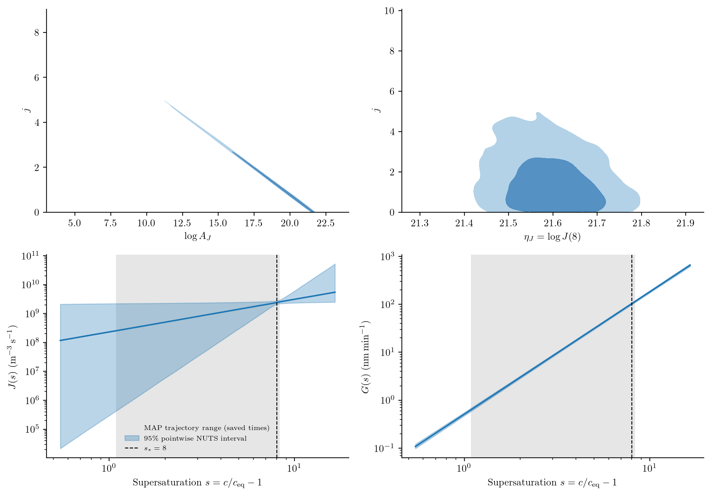

# Inferring protein crystallization kinetics

A protein solution may lose dissolved material quickly while its crystals
continue to grow for hours. Concentration measurements constrain the amount of
material transferred to crystals, but do not reveal how that material is divided
among them. A few particle-size measurements can therefore change the kinetic
parameters inferred from the same concentration history.

Here an unseeded lysozyme batch at 20 °C supplies both kinds of measurement.
The model and experimental markers come from
[Mitchell et al. (2023)](https://doi.org/10.1016/j.cherd.2023.02.016), Figure 4,
using the power-law nucleation and growth combination called Case 2 in that
article. The 100 mL conditions are pH 4.5, 5% w/v NaCl and 210 rpm. We do not
pool the 1 L experiment with this one: the paper found that transferring the
100 mL kinetics did not reproduce the larger experiment.

## Population and solute balances

For crystal length ``\ell`` in µm and time in minutes,

```math
\frac{\partial n(\ell,t)}{\partial t}
+\frac{\partial[G(t)n(\ell,t)]}{\partial\ell}=0,
\qquad G(t)n(0,t)=J(t).
```

The initial population is empty, ``n(\ell,0)=0``. With constant solution volume,

```math
\frac{dc(t)}{dt}
=-3\times10^{-18}\rho k_v\int_0^\infty G(t)\ell^2n(\ell,t)\,d\ell,
\qquad c(0)=19.9883\ \mathrm{g\,L}^{-1}.
```

Here ``n`` counts actual particles per m³ per µm; ``10^{-18}`` converts µm³
to m³. The code additionally rescales particle counts as described below. Nuclei enter at zero length and initially carry no mass.
The rates are

```math
s(t)=\max\!\left(\frac{c(t)}{c_{\mathrm{eq}}}-1,0\right),
\qquad J(t)=60A_Js(t)^j,\qquad G(t)=10^{-3}A_Gs(t)^g.
```

The solubility is 2.16 g/L, crystal density 1240 kg/m³ and volume shape factor
0.81. Temperature is fixed, so activation energies are not inferred. Aggregation,
breakage, shear-induced nucleation and dissolution are omitted. These assumptions
can cause systematic residuals even if optimization converges.

## Units and term definitions in code

Table 7 prints ``A_J`` in particles m⁻³ s⁻¹ and ``A_G`` in nm/min. The script uses
µm, minutes, and particle concentration divided by ``10^{12}``. The conversions
are explicit:

```julia
saturation(p,ctx) = max(ctx.bulk.c/p.ceq-1,zero(ctx.bulk.c))
growth(L,p,t,ctx) = 1e-3*p.AG*saturation(p,ctx)^p.g
nucleation(p,t,ctx) = 60/1e12*exp(p.logAJ)*saturation(p,ctx)^p.j
model = PBMModel(
    growth=Growth(rate=growth),
    primary=Nucleation(rate=nucleation,size=0.),
)
operator = compile(model,grid;methods=TermMethods(
    growth=MUSCL(),by_term=(primary=BoundaryInjection(:left),)))
system = PBMSystem((crystals=operator,);nonnegative_bulk=(:c,),
    exchanges=(ConservativeExchange(:crystals,:c,
        (L,p,t,ctx)->1e-6*p.rho*p.kv*L^3),))
```

The factor ``10^{-6}=10^{12}(10^{-6})^3`` converts a scaled particle count times
µm³ to material volume per solution volume. The exchange uses the numerical
third-moment change, including finite first-bin deposition. Grid refinement
checks that this finite-bin effect is small. No numerical seed population is
inserted.

## Experimental readings and observation model

The supplied CSV contains 28 red concentration markers and four green diameter
markers read from the native Figure 4 image. They are **digitized experimental
readings**, not raw laboratory records or synthetic measurements. The extraction
script retains pixel centres, axis calibration, PDF hash and a source citation.
The zero-time diameter symbol is excluded because a median is undefined for an
empty population.

Concentration is observed directly. The script interprets diameter ``D_{50}``
as a volume-weighted median and integrates the piecewise-constant number density
with weight ``\ell^3``:

```math
\int_0^{D_{50}(t)}\ell^3n(\ell,t)\,d\ell
=\frac12\int_0^\infty\ell^3n(\ell,t)\,d\ell.
```

This observation convention needs confirmation against the original sizing
instrument. It is stated as an assumption, not recovered metadata. A median is
not ``\mu_4/\mu_3``. Nor can it be uniquely determined from four moments without
an additional reconstruction model. The example therefore fits a sectional PSD.

```julia
concentration = Measurement(data.concentration.t,data.concentration.y,
    BulkObservable(:c);likelihood=GaussianLikelihood(sigma=0.1),
    source=:figure4_concentration)
sizes = Measurement(data.D50.t,data.D50.y,FunctionObservable(volume_median);
    likelihood=GaussianLikelihood(sigma=0.5),source=:figure4_D50)
```

The article calls 0.1 g/L and 0.5 µm variances despite giving unsquared units.
We interpret them as Gaussian standard deviations. The two blocks are assumed
independent; laboratory covariance and instrument response are unavailable.
Graph-reading error and model inadequacy are additional uncertainties, not
eliminated by choosing these noise scales.

## Declare priors and estimate parameters

Table 3 lists **initial guesses and fitting ranges**, not Bayesian priors.
In particular, its initial growth-coefficient range 600–1500 nm/min excludes
the final reported value 0.367 nm/min. Reusing that range as a hard prior would
prevent recovery of the reported fit.

We estimate four shared kinetic parameters jointly from both observation
blocks. The default `:broad` scenario relaxes the former bounds, particularly
the lower bound ``j=1`` that cut into the weak nucleation tradeoff. Exponents
remain nonnegative, allowing a rate independent of supersaturation at zero
exponent. All priors are proper. Table 3's fitting ranges are not substituted
for Bayesian priors.

| Fitted parameter | Meaning and units | Inference coordinate | Start | Broad prior | Previous prior |
|:--|:--|:--|--:|:--|:--|
| `logAJ` | Natural log of the numerical value of ``A_J`` in m⁻³ s⁻¹ | Identity | 18.9 | Uniform ``[-25,100]`` | Uniform ``[0,100]`` |
| `j` | Nucleation exponent, dimensionless | Logit on declared bounds | 2.14 | Uniform ``[0,20]`` | Uniform ``[1,10]`` |
| `AG` | Growth coefficient, nm min⁻¹ | ``\log A_G`` | 0.367 | `Normal(log(0.367),3)` on log coefficient | `Normal(log(0.367),1.5)` |
| `g` | Growth exponent, dimensionless | Logit on declared bounds | 2.45 | Uniform ``[0,6]`` | Uniform ``[1,3]`` |

The uniform densities are declared in physical coordinates; `logAJ` is itself
the named physical log coefficient. The normal density is declared in inference
coordinates. The package accounts for the respective transformation Jacobians.
The broad exponent bounds are modelling assumptions, not measured limits.
The growth prior still uses the published same-data estimate as its centre;
doubling its log scale does not make it independent of this experiment.

Initial concentration, equilibrium concentration, density, shape factor and
empty initial population are fixed at the values above. Calibration and the
two Gaussian noise scales are fixed too; no nuisance parameters are inferred
in this example. Thus posterior intervals remain conditional on those choices.

```julia
using PopulationBalanceModels, Distributions
include("examples/protein_crystallization.jl")
problem = ProteinCrystallization.estimation_problem(
    bins=80,solver=ProteinCrystallization.scheduled_solver,priors=:broad)
# Refit with the former priors; keep its results in a separate directory:
previous = ProteinCrystallization.estimation_problem(
    bins=80,solver=ProteinCrystallization.scheduled_solver,priors=:previous)
```

The retained figures below are regenerated under the broad target. A
[prior-sensitivity summary](../assets/protein_crystallization/prior_sensitivity.csv)
retains the previous marginal quantiles and correlations with their source
revision. That historical run is a different posterior; its draws are not
pooled with the new chains.

`estimation_problem` joins the parameter declarations, both measurement blocks
and the coupled PBM. `fit` uses the shared posterior with ForwardDiff gradients;
its starting gradient is independently checked. Transform Jacobians are applied
once for physical-coordinate priors. The reported physical values are transforms
of an inference-coordinate MAP; their mode depends on that coordinate choice.

```julia
using Optim
result = fit(problem;maxiters=300,gradient_tolerance=0.02)
result.diagnostics
```

## Fit, interpretation and refinement


The plot includes predictions using the printed Table 7 coefficients, this
example's MAP fit, and predictions on a doubled size grid with those fitted
parameters. Differences from the paper include finite-volume treatment, the
stated observation convention, graph-read data and prior assumptions. Agreement
with some concentration points is not enough to establish that all four kinetic
parameters are identifiable. The sharp concentration decrease and the small
number of size observations also leave room for model discrepancy.

The driver checks MAP convergence, then attempts a verified Laplace
approximation. The [fit report](../assets/protein_crystallization/fit.txt)
records the outcome, gradient norm and separate likelihood/prior contributions.
A rejected Hessian is not regularized into a covariance. Limiter and PSD-median
branches can change derivatives; sampling below evaluates the actual posterior
rather than substituting any attempted Laplace approximation.

The doubled-grid curve is a prediction check at the fitted parameters, **not a
refit**. Differences remain relevant when interpreting intervals: temporal
agreement alone does not establish spatial convergence. Use `refinement_study`
to refit under numerical refinement before treating small intervals as reliable.
The residual discussion below assesses physical fit separately.

## Sample the joint posterior

A fitted trajectory hides the dependence among kinetic parameters. For example,
a larger nucleation exponent can be offset by a smaller coefficient over the
supersaturation range sampled by one experiment. We therefore sample all four
parameters jointly with the optional AdvancedHMC NUTS adapter, using exactly the
same observations, noise scales and priors as above. The sampler evaluates the
shared `logposterior`; it does not substitute a quadratic approximation.

For efficient sampling, the example uses kinetic rates at a fixed reference
supersaturation, ``s_*=8``:

```math
\eta_J=\log A_J+j\log s_*,\qquad
\eta_G=\log A_G+g\log s_*.
```

The other two sampling coordinates remain the existing logit coordinates for
``j`` and ``g``. This triangular change has determinant one. The adapter checks
the inverse, Jacobian and gradients at chain starts, then transforms draws back
to the original declared coordinates and physical parameters. The prior model
is unchanged. A positive matrix constructed from likelihood sensitivities and
prior curvature initializes the sampler metric; it is **tuning**, not a
verified posterior covariance or a confidence ellipse.

```julia
using AdvancedHMC, MCMCDiagnosticTools
posterior = ProteinCrystallization.run_posterior(
    initial=result.minimizer,samples=1500,warmup=750,chains=4,seed=2027,
    parallel=true,
)
report = diagnostics(posterior.draws)
report.rhat, report.ess_bulk, report.ess_tail, report.divergences
```

`run_posterior` can reuse the saved MAP as an initial location. It disperses
chain starts and exports the draws and diagnostics even when a convergence
screen fails. The screen requires rank-normalized ``\widehat R\leq1.01``, bulk
and tail effective sample sizes of at least 400, no retained divergences or
maximum-depth hits, and BFMI of at least 0.3 in every chain. Passing these checks
is evidence to assess, not proof that every posterior feature was explored.

The first broad-prior budget (four chains with 500 warmup and 750 retained
draws) missed the screen: ``j`` had R-hat 1.01006 and tail ESS 340, with no
retained divergences. Its [diagnostics](../assets/protein_crystallization/sampling_budget_750/sampler_diagnostics.csv),
[run report](../assets/protein_crystallization/sampling_budget_750/posterior.txt)
and [draws](../assets/protein_crystallization/sampling_budget_750/posterior_draws.csv)
are retained as a failed sampling check. They are not pooled with the longer run.
The current budget uses 750 warmup and 1,500 retained draws in each of four
fresh chains. With `parallel=true`, each chain runs the same AdvancedHMC adapter
in a separate Julia process, with an independent seed and its own PBM caches.
R-hat and ESS are recomputed jointly from all four chains; per-chain diagnostic
values are not averaged into a convergence claim. `parallel=false` keeps the
sequential option. The modes use different random streams while targeting
the same posterior; the report records the isolated-chain seeds.

The same 80-bin sectional residual and SSPRK33 stages are used for sampling.
A fixed schedule uses maximum steps of 1 min to 50 min, 3 min to 150 min, and
10 min thereafter as the rates decline. This reduces repeated forward-solve
cost without introducing an adaptive controller into the differentiated map.
[Temporal checks](../assets/protein_crystallization/posterior_time_refinement.csv)
compare a halved schedule and the original uniform `dt=0.5 min` at the initial
fit and selected posterior draws, reporting prediction changes in measurement
standard deviations. This checks time discretization; it does not establish
size-grid convergence or eliminate the observation-model assumptions.
The [exported checks](../assets/protein_crystallization/posterior_time_refinement.csv)
include the MAP and twelve selected posterior states, in observation-noise units.

The [audit register](../audit.md) records the earlier independent target and
gradient checks. The broadened-prior run uses fresh chains; the same saved-density,
gradient, diagnostic and predictive checks are rerun for this target. Sampling
convergence and numerical convergence remain separate checks.

## Read the corner and prior–posterior plots


The diagonal panels smooth the retained NUTS marginals. Off-diagonal contours
enclose 68% and 95% of a smoothed joint density, calculated by integrating density
mass, not by taking those percentages of its peak. A sheared grid resolves the
thin coefficient–exponent ridge; estimates are restricted to parameter support.
Smoothing is a display choice. The [raw draws](../assets/protein_crystallization/posterior_draws.csv)
remain available, and no Laplace approximation is used here.

Concentration constrains the amount of crystalline material, and ``D_{50}``
constrains a volume median. Neither directly measures particle number. The
coefficient–exponent dependence therefore deserves attention even when the
predicted concentration is tightly constrained.
The coefficient–exponent ridge can be summarized directly from the current draws:

```@eval
using Markdown, PopulationBalanceModels
folder=joinpath(pkgdir(PopulationBalanceModels),"docs","src","assets","protein_crystallization")
values=Dict(r[1]=>parse(Float64,r[2]) for r in split.(readlines(joinpath(folder,"posterior_summaries.csv"))[2:end],','))
Markdown.parse("Correlation of `logAJ` and `j`: **$(round(values["corr_logAJ_j"];digits=4))**; "*
    "correlation of `eta_J` and `j`: **$(round(values["corr_etaJ_j"];digits=3))**.")
```

The rate near ``s=8`` can be much better constrained than its coefficient and
exponent separately. Changing coordinates exposes that information; it does
not add an experiment or establish structural identifiability.



The top panels compare the original coefficient–exponent ridge with the
reference-rate coordinates. The bottom panels propagate the same draws through
``J(s)=A_Js^j`` and ``G(s)=A_Gs^g``. Shading marks the supersaturation range at
saved positive times of the MAP trajectory; predictions outside it are
extrapolations. The dashed line marks ``s=8``. The 95% bands are pointwise
conditional posterior intervals for rates, not additional observation noise or
simultaneous confidence bands. [Numerical summaries](../assets/protein_crystallization/posterior_summaries.csv)
include both correlations and marginal quantiles, recomputed from saved draws.

A local `identifiability_report` exports noise-scaled prediction sensitivities
and separate likelihood/prior curvature at the saved MAP. These are local,
coordinate-dependent diagnostics, not structural-identifiability tests or
verified confidence intervals. Singular values describe joint directions,
not one error bar per parameter. Inspect the
[likelihood sensitivities](../assets/protein_crystallization/identifiability.csv)
and [local curvature](../assets/protein_crystallization/local_curvature.csv),
or recompute without fitting or sampling:

```sh
julia --project=/path/to/working_environment examples/protein_crystallization.jl --identifiability-only
```

The marginal intervals below compare the previous and broadened priors.
They are conditional posterior intervals from separate NUTS runs, not
frequentist confidence intervals. For `logAJ`, the interval is for the log
coefficient itself. Differences can reflect changed support as well as density;
a wider prior need not produce a uniformly wider posterior for every parameter.

```@eval
using Markdown, PopulationBalanceModels
folder=joinpath(pkgdir(PopulationBalanceModels),"docs","src","assets","protein_crystallization")
rows=split.(readlines(joinpath(folder,"prior_sensitivity.csv"))[2:end],',')
values=Dict((r[1],r[3])=>parse(Float64,r[4]) for r in rows)
body=["| Parameter | Previous 95% interval | Broad 95% interval |", "|:--|--:|--:|"]
for name in ("logAJ","j","AG","g")
    interval(scenario)=join([string(round(values[(scenario,name*"_q"*q)];sigdigits=4)) for q in ("0.025","0.975")]," – ")
    push!(body,"| `$name` | $(interval("previous")) | $(interval("broad")) |")
end
Markdown.parse(join(body,"\n"))
```

```@eval
using Markdown, PopulationBalanceModels
folder=joinpath(pkgdir(PopulationBalanceModels),"docs","src","assets","protein_crystallization")
values=Dict(r[1]=>parse(Float64,r[2]) for r in split.(readlines(joinpath(folder,"posterior_summaries.csv"))[2:end],','))
Markdown.parse("**$(round(100 * values["probability_j_below_1"];digits=1))%** of the broad-prior draws have "*
    "`j<1`, a region excluded by the previous prior. "*
    "This comparison assesses prior sensitivity; it adds no measurements.")
```


The upper panels show the prior scale and mark the posterior range. The three
uniform priors show their full support; the unbounded lognormal prior for
``A_G`` is displayed over four prior log-standard deviations on either side
of its centre, on a logarithmic axis. The
lower panels zoom into the posterior and overlay the **unscaled** prior density.
A broad prior can be nearly invisible on that density scale; it is not
renormalized to the displayed window. ``A_G`` is plotted as a physical
coefficient. Its normal prior on ``\log A_G`` is therefore converted to a
lognormal physical density using ``p(A_G)=p(\log A_G)/A_G``. The named parameter
`logAJ` remains a log coefficient with its stated uniform prior.

Posterior narrowing is conditional on the assumed kinetics, observations and
errors. The ``A_G`` prior remains centred on a fit to the same experiment.
The prior comparison above helps assess its influence; additional experiments
and confirmation of the sizing convention are still needed.

## Inspect the chains and predictive agreement


The traces are separated by chain. Rank histograms should be similar across
chains; persistent differences can reveal poor mixing that a pooled corner
plot conceals. Effective sample size concerns independent information, not the
number of saved draws.

```@eval
using Markdown, PopulationBalanceModels
folder=joinpath(pkgdir(PopulationBalanceModels),"docs","src","assets","protein_crystallization")
rows=split.(readlines(joinpath(folder,"sampler_diagnostics.csv"))[2:end],',')
fmt(v)=begin x=parse(Float64,v);isfinite(x) ? string(round(x;sigdigits=4)) : string(x) end
body=["| Parameter | Rank R-hat | Bulk ESS | Tail ESS |", "|:--|--:|--:|--:|"]
append!(body,["| `$(r[1])` | $(fmt(r[2])) | $(fmt(r[3])) | $(fmt(r[4])) |" for r in rows])
Markdown.parse(join(body,"\n"))
```

[Per-chain diagnostics](../assets/protein_crystallization/chain_diagnostics.csv)
record BFMI, acceptance rates, warmup and retained divergences, depth hits and
leapfrog work. The [run report](../assets/protein_crystallization/posterior.txt)
records thresholds, seeds, solver settings, failures and numerical differences.
The plot titles identify a failed screen as provisional rather than silently
presenting those samples as converged inference.

The diagnostic table above and
[per-chain report](../assets/protein_crystallization/chain_diagnostics.csv)
refer to the new broad-prior run. Warmup divergences are recorded separately
from retained ones. A failed screen is labelled provisional on the plots.
[Download the physical-parameter draws](../assets/protein_crystallization/posterior_draws.csv)
to inspect other joint summaries; sampler cost and settings are in the run report.


The darker interval propagates parameter draws through the PBM. The lighter
interval additionally includes the declared Gaussian measurement noise. These
intervals are different objects. Predictions use an explicit budget of 100
posterior forward solves, so their tail quantiles also have Monte Carlo error.
The four size observations remain sparse; joining their intervals does not add
new measurements between them.

The [standardized residuals](../assets/protein_crystallization/fit_residuals.csv)
separate observed disagreement from posterior width:

```@eval
using Markdown, PopulationBalanceModels
folder=joinpath(pkgdir(PopulationBalanceModels),"docs","src","assets","protein_crystallization")
rows=split.(readlines(joinpath(folder,"fit_residuals.csv"))[2:end],',')
body=["| Observable | RMS residual / sigma | Largest absolute residual / sigma |", "|:--|--:|--:|"]
for label in ("concentration","D50")
    r=[parse(Float64,row[5]) for row in rows if row[1]==label]
    push!(body,"| $label | $(round(sqrt(sum(abs2,r)/length(r));digits=2)) | $(round(maximum(abs,r);digits=2)) |")
end
Markdown.parse(join(body,"\n"))
```

Large systematic concentration residuals call for examining kinetics,
digitization and the fixed noise assumptions even if chains mix. Broadening
priors does not repair model inadequacy. Neither these intervals nor the corner
plot reproduce the paper's confidence intervals or independently validate its model.

Run from an environment containing the package, Optim, AdvancedHMC and MCMCDiagnosticTools:

```sh
# Replot the retained fit and NUTS draws; no sampling required:
python docs/benchmarks/plot_new_case_studies.py protein --usetex
python docs/benchmarks/plot_protein_posterior.py --usetex
# Refit and resample the broad target (requires the optional packages):
julia --project=/path/to/working_environment examples/protein_crystallization.jl
julia --project=/path/to/working_environment examples/protein_crystallization.jl --posterior-parallel
```

`--posterior-parallel` reuses physical saved MAP values and runs isolated chains.
`--posterior-only` runs the same posterior budget sequentially. `--posterior`
performs MAP followed by sequential sampling.
Without a posterior flag, the script retains the shorter MAP-only run.
The optional packages must be installed in that environment. The CSV is included, so the PDF
and Python extraction tools are not needed to run Julia. The optional `solver`
argument accepts a checked SciML solver adapter when adaptive integration is
preferred. `examples/data/protein_crystallization/README.md` gives extraction
provenance and the assumptions that still need experimental confirmation.

For exact reuse of the predictive curves, the accompanying
[draw identities](../assets/protein_crystallization/posterior_predictive_indices.csv)
record each selected chain and draw. A seed alone need not select the same
indices across Julia releases.

## Minimal run and full reproduction

Run this block from the repository root. It constructs and solves one problem;
including a driver does not run its CSV exports.

```julia
using PopulationBalanceModels, Distributions
include("examples/protein_crystallization.jl")
problem = ProteinCrystallization.build(; bins=80)
solution = ProteinCrystallization.scheduled_solver(problem, [10.0, 100.0, 700.0])
D50 = [ProteinCrystallization.volume_median(u, problem.operator, problem.p, t)
    for (t, u) in zip(solution.t, solution.u)]
# To fit the joint observations (requires Optim):
# using Optim
# estimation = ProteinCrystallization.estimation_problem(; bins=80,
#     solver=ProteinCrystallization.scheduled_solver)
# fitted = fit(estimation; maxiters=200)
```

The figure-generation drivers and supporting sources are available below. Keep
the repository's relative paths; the [benchmark guide](../assets/source/plotting/README.txt)
lists plotting commands and optional environments.

- [protein_crystallization.jl](../assets/source/examples/protein_crystallization.jl)

- [Digitized observations](../assets/source/examples/data/protein_crystallization/figure4_observations.csv) and [data provenance](../assets/source/examples/data/protein_crystallization/README.txt).

- [Local identifiability export helper](../assets/source/examples/support/protein_identifiability.jl).

- [Isolated-chain runner](../assets/source/examples/support/protein_parallel_posterior.jl) and [worker](../assets/source/examples/support/protein_posterior_worker.jl).
