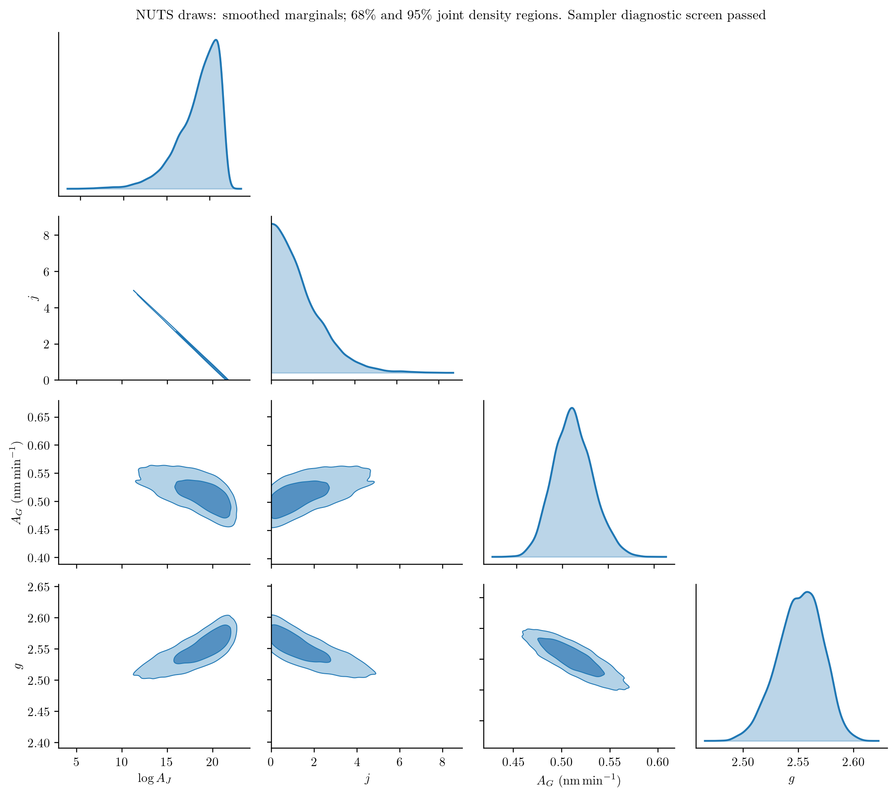
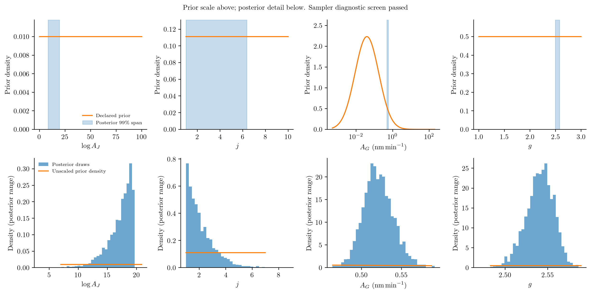
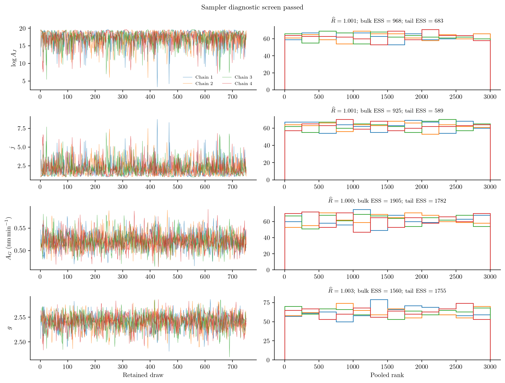
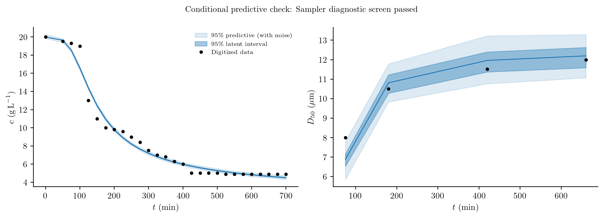

# Inferring protein crystallization kinetics

A protein solution may lose dissolved material quickly while its crystals
continue to grow for hours. Concentration measurements constrain the amount of
material transferred to crystals, but do not reveal how that material is divided
among them. A few particle-size measurements can therefore change the kinetic
parameters inferred from the same concentration history.

Here an unseeded lysozyme batch at 20 °C supplies both kinds of measurement.
The model and experimental markers come from
[Mitchell et al. (2023)](https://doi.org/10.1016/j.cherd.2023.02.016), Figure 4,
using the power-law nucleation and growth combination called Case 2 in that
article. The 100 mL conditions are pH 4.5, 5% w/v NaCl and 210 rpm. We do not
pool the 1 L experiment with this one: the paper found that transferring the
100 mL kinetics did not reproduce the larger experiment.

## Population and solute balances

For crystal length ``\ell`` in µm and time in minutes,

```math
\frac{\partial n(\ell,t)}{\partial t}
+\frac{\partial[G(t)n(\ell,t)]}{\partial\ell}=0,
\qquad G(t)n(0,t)=J(t).
```

The initial population is empty, ``n(\ell,0)=0``. With constant solution volume,

```math
\frac{dc(t)}{dt}
=-3\times10^{-18}\rho k_v\int_0^\infty G(t)\ell^2n(\ell,t)\,d\ell,
\qquad c(0)=19.9883\ \mathrm{g\,L}^{-1}.
```

Here ``n`` counts actual particles per m³ per µm; ``10^{-18}`` converts µm³
to m³. The code additionally rescales particle counts as described below. Nuclei enter at zero length and initially carry no mass.
The rates are

```math
s(t)=\max\!\left(\frac{c(t)}{c_{\mathrm{eq}}}-1,0\right),
\qquad J(t)=60A_Js(t)^j,\qquad G(t)=10^{-3}A_Gs(t)^g.
```

The solubility is 2.16 g/L, crystal density 1240 kg/m³ and volume shape factor
0.81. Temperature is fixed, so activation energies are not inferred. Aggregation,
breakage, shear-induced nucleation and dissolution are omitted. These assumptions
can cause systematic residuals even if optimization converges.

## Units and term definitions in code

Table 7 prints ``A_J`` in particles m⁻³ s⁻¹ and ``A_G`` in nm/min. The script uses
µm, minutes, and particle concentration divided by ``10^{12}``. The conversions
are explicit:

```julia
saturation(p,ctx) = max(ctx.bulk.c/p.ceq-1,zero(ctx.bulk.c))
growth(L,p,t,ctx) = 1e-3*p.AG*saturation(p,ctx)^p.g
nucleation(p,t,ctx) = 60/1e12*exp(p.logAJ)*saturation(p,ctx)^p.j
model = PBMModel(
    growth=Growth(rate=growth),
    primary=Nucleation(rate=nucleation,size=0.),
)
operator = compile(model,grid;methods=TermMethods(
    growth=MUSCL(),by_term=(primary=BoundaryInjection(:left),)))
system = PBMSystem((crystals=operator,);nonnegative_bulk=(:c,),
    exchanges=(ConservativeExchange(:crystals,:c,
        (L,p,t,ctx)->1e-6*p.rho*p.kv*L^3),))
```

The factor ``10^{-6}=10^{12}(10^{-6})^3`` converts a scaled particle count times
µm³ to material volume per solution volume. The exchange uses the numerical
third-moment change, including finite first-bin deposition. Grid refinement
checks that this finite-bin effect is small. No numerical seed population is
inserted.

## Experimental readings and observation model

The supplied CSV contains 28 red concentration markers and four green diameter
markers read from the native Figure 4 image. They are **digitized experimental
readings**, not raw laboratory records or synthetic measurements. The extraction
script retains pixel centres, axis calibration, PDF hash and a source citation.
The zero-time diameter symbol is excluded because a median is undefined for an
empty population.

Concentration is observed directly. The script interprets diameter ``D_{50}``
as a volume-weighted median and integrates the piecewise-constant number density
with weight ``\ell^3``:

```math
\int_0^{D_{50}(t)}\ell^3n(\ell,t)\,d\ell
=\frac12\int_0^\infty\ell^3n(\ell,t)\,d\ell.
```

This observation convention needs confirmation against the original sizing
instrument. It is stated as an assumption, not recovered metadata. A median is
not ``\mu_4/\mu_3``. Nor can it be uniquely determined from four moments without
an additional reconstruction model. The example therefore fits a sectional PSD.

```julia
concentration = Measurement(data.concentration.t,data.concentration.y,
    BulkObservable(:c);likelihood=GaussianLikelihood(sigma=0.1),
    source=:figure4_concentration)
sizes = Measurement(data.D50.t,data.D50.y,FunctionObservable(volume_median);
    likelihood=GaussianLikelihood(sigma=0.5),source=:figure4_D50)
```

The article calls 0.1 g/L and 0.5 µm variances despite giving unsquared units.
We interpret them as Gaussian standard deviations. The two blocks are assumed
independent; laboratory covariance and instrument response are unavailable.
Graph-reading error and model inadequacy are additional uncertainties, not
eliminated by choosing these noise scales.

## Declare priors and estimate parameters

Table 3 lists **initial guesses and fitting ranges**, not Bayesian priors.
In particular, its initial growth-coefficient range 600–1500 nm/min excludes
the final reported value 0.367 nm/min. Reusing that range as a hard prior would
prevent recovery of the reported fit.

The example makes its own choices: uniform physical densities for
``\log A_J\in[0,100]``, ``j\in[1,10]`` and ``g\in[1,3]``. The first quantity is
itself the named physical parameter `logAJ`. A normal prior on ``\log A_G`` is
centred on the reported final coefficient, with standard deviation 1.5. That
last prior is informed by the published fit to the same data, so this is an
illustrative conditional analysis, not independent validation. Change
`growth_prior_sd` and refit to assess its influence.

```julia
ParameterSpec(:AG;initial=0.367,transform=LogTransform(),
    prior=Prior(Normal(log(0.367),1.5);coordinates=:inference))
ParameterSpec(:j;initial=2.14,transform=LogitTransform(1,10),
    prior=Prior(Uniform(1,10);coordinates=:physical))
```

`estimation_problem` joins the parameter declarations, both measurement blocks
and the coupled PBM. `fit` uses the shared posterior with ForwardDiff gradients;
its starting gradient is independently checked. Transform Jacobians are applied
once for physical-coordinate priors. The reported physical values are transforms
of an inference-coordinate MAP; their mode depends on that coordinate choice.

```julia
using PopulationBalanceModels, Optim
include("examples/protein_crystallization.jl")
problem = ProteinCrystallization.estimation_problem(bins=100)
result = fit(problem;maxiters=200)
result.diagnostics
```

## Fit, interpretation and refinement


The plot includes predictions using the printed Table 7 coefficients, this
example's MAP fit, and predictions on a doubled size grid with those fitted
parameters. Differences from the paper include finite-volume treatment, the
stated observation convention, graph-read data and prior assumptions. Agreement
with some concentration points is not enough to establish that all four kinetic
parameters are identifiable. The sharp concentration decrease and the small
number of size observations also leave room for model discrepancy.

The committed 80-bin run converged with an infinity-norm gradient of about
0.008. Its verified Laplace calculation was rejected because the Hessian did
not stabilize under step halving. The PSD median and limiter introduce changes
of derivative across bin and limiter branches; tighter numerics and profiles
are needed before reporting uncertainty. The scripts report this failure openly.

[fit.txt](../assets/protein_crystallization/fit.txt) records convergence, the gradient norm, likelihood/prior contributions
and whether a verified Laplace calculation succeeded. Invalid curvature is
reported rather than regularized. The posterior sampling below does not use
that rejected Laplace calculation. A doubled-grid prediction check is not a
refit: use `refinement_study` to compare fitted parameters under numerical
refinement before treating intervals as reliable. Over the plotted trajectory,
the 80-to-160-bin prediction change reaches about 0.51 assumed standard
deviations for concentration and 0.57 for diameter. These spatial effects
remain relevant even when the temporal check below is small.

## Sample the joint posterior

A fitted trajectory hides the dependence among kinetic parameters. For example,
a larger nucleation exponent can be offset by a smaller coefficient over the
supersaturation range sampled by one experiment. We therefore sample all four
parameters jointly with the optional AdvancedHMC NUTS adapter, using exactly the
same observations, noise scales and priors as above. The sampler evaluates the
shared `logposterior`; it does not substitute a quadratic approximation.

For efficient sampling, the example uses kinetic rates at a fixed reference
supersaturation, ``s_*=8``:

```math
\eta_J=\log A_J+j\log s_*,\qquad
\eta_G=\log A_G+g\log s_*.
```

The other two sampling coordinates remain the existing logit coordinates for
``j`` and ``g``. This triangular change has determinant one. The adapter checks
the inverse, Jacobian and gradients at chain starts, then transforms draws back
to the original declared coordinates and physical parameters. The prior model
is unchanged. A positive matrix constructed from likelihood sensitivities and
prior curvature initializes the sampler metric; it is **tuning**, not a
verified posterior covariance or a confidence ellipse.

```julia
using PopulationBalanceModels, Optim, AdvancedHMC, MCMCDiagnosticTools
include("examples/protein_crystallization.jl")
posterior = ProteinCrystallization.run_posterior(
    samples=750,warmup=500,chains=4,seed=2027,
)
report = diagnostics(posterior.draws)
report.rhat, report.ess_bulk, report.ess_tail, report.divergences
```

`run_posterior` can reuse the saved MAP as an initial location. It disperses
chain starts and exports the draws and diagnostics even when a convergence
screen fails. The screen requires rank-normalized ``\widehat R\leq1.01``, bulk
and tail effective sample sizes of at least 400, no retained divergences or
maximum-depth hits, and BFMI of at least 0.3 in every chain. Passing these checks
is evidence to assess, not proof that every posterior feature was explored.

The same 80-bin sectional residual and SSPRK33 stages are used for sampling.
A fixed schedule uses maximum steps of 1 min to 50 min, 3 min to 150 min, and
10 min thereafter as the rates decline. This reduces repeated forward-solve
cost without introducing an adaptive controller into the differentiated map.
[Temporal checks](../assets/protein_crystallization/posterior_time_refinement.csv)
compare a halved schedule and the original uniform `dt=0.5 min` at the initial
fit and selected posterior draws, reporting prediction changes in measurement
standard deviations. This checks time discretization; it does not establish
size-grid convergence or eliminate the observation-model assumptions.
The largest committed half-step change is about 0.0041 standard deviations.

The [repository audit](../audit.md) rechecked the retained 3,000 draws and all
100 saved latent predictive curves without changing observations, priors or
noise assumptions. Selected saved log densities agree within ``10^{-12}`` and
the predictive curves agree to roundoff. The coordinate map is consistent at
every retained draw; independent transformed-gradient checks include the MAP
and marginal tail points. At the MAP, a ``10^{-6}`` relative difference step
and its half resolve a limiter switch crossed by the larger default stencil;
the AD discrepancy is about ``3.1\times10^{-6}``. Reconstructing inference
coordinates from physical CSV values changes a folded-rank R-hat by about
``7.6\times10^{-6}``, within the measured two-ulp reranking sensitivity. The
convergence-screen conclusion is unchanged. Reproduce these checks with
`test/audit_protein.jl` in the optional integration environment.

## Read the corner and prior–posterior plots



Off-diagonal panels show joint samples, rather than independently combined
marginal intervals. Thin or curved bands indicate parameter combinations that
the data constrain more strongly than individual parameters. The diagonal
panels show one-parameter marginals. These are samples of the conditional
posterior, not a repaired Laplace ellipse.

Concentration constrains the amount of crystalline material, and ``D_{50}``
constrains a volume median. Neither directly measures particle number. The
coefficient–exponent dependence therefore deserves attention even when the
predicted concentration is tightly constrained.
In the committed draws, the correlation between `logAJ` and ``j`` is about
−0.9995; their long, thin band is a strong coefficient–exponent tradeoff.
The 95% marginal interval for ``j`` is approximately 1.03–4.78, while its
declared prior support is 1–10. A single best-fit exponent hides that spread.



The upper panels show the prior scale and mark the posterior range. The three
uniform priors show their full support; the unbounded lognormal prior for
``A_G`` is displayed from 0.0005 to 200 nm/min on a logarithmic axis. The
lower panels zoom into the posterior and overlay the **unscaled** prior density.
A broad prior can be nearly invisible on that density scale; it is not
renormalized to the displayed window. ``A_G`` is plotted as a physical
coefficient. Its normal prior on ``\log A_G`` is therefore converted to a
lognormal physical density using ``p(A_G)=p(\log A_G)/A_G``. The named parameter
`logAJ` remains a log coefficient with its stated uniform prior.

Posterior narrowing shows what this model and its assumed errors learn from
these markers. It does not make the ``A_G`` prior independent of the data: that
prior is centred on a published fit to the same experiment. Prior sensitivity,
additional experiments and the sizing convention still matter.

## Inspect the chains and predictive agreement



The traces are separated by chain. Rank histograms should be similar across
chains; persistent differences can reveal poor mixing that a pooled corner
plot conceals. Effective sample size concerns independent information, not the
number of saved draws.

```@eval
using Markdown, PopulationBalanceModels
folder=joinpath(pkgdir(PopulationBalanceModels),"docs","src","assets","protein_crystallization")
rows=split.(readlines(joinpath(folder,"sampler_diagnostics.csv"))[2:end],',')
fmt(v)=begin x=parse(Float64,v);isfinite(x) ? string(round(x;sigdigits=4)) : string(x) end
body=["| Parameter | Rank R-hat | Bulk ESS | Tail ESS |", "|:--|--:|--:|--:|"]
append!(body,["| `$(r[1])` | $(fmt(r[2])) | $(fmt(r[3])) | $(fmt(r[4])) |" for r in rows])
Markdown.parse(join(body,"\n"))
```

[Per-chain diagnostics](../assets/protein_crystallization/chain_diagnostics.csv)
record BFMI, acceptance rates, warmup and retained divergences, depth hits and
leapfrog work. The [run report](../assets/protein_crystallization/posterior.txt)
records thresholds, seeds, solver settings, failures and numerical differences.
The plot titles identify a failed screen as provisional rather than silently
presenting those samples as converged inference.

The committed four-chain run passes this screen: the largest R-hat is 1.0031,
the smallest bulk ESS is about 925 and the smallest tail ESS about 589.
There are no retained divergences or maximum-depth hits; per-chain BFMI ranges
from 0.88 to 1.06. Eighteen divergences occurred during warmup and are recorded
separately. The 3,000 retained draws required about 30 minutes of sampling on
the calculation CPU. [Download the physical-parameter draws](../assets/protein_crystallization/posterior_draws.csv)
to inspect other joint summaries.



The darker interval propagates parameter draws through the PBM. The lighter
interval additionally includes the declared Gaussian measurement noise. These
intervals are different objects. Predictions use an explicit budget of 100
posterior forward solves, so their tail quantiles also have Monte Carlo error.
The four size observations remain sparse; joining their intervals does not add
new measurements between them.

The concentration markers are not described well at the assumed 0.1 g/L error
scale. At the saved MAP, their RMS standardized residual is about 7.3, with a
largest absolute residual near 24; the diameter RMS is about 1.3. These
systematic misses call for examining the kinetic model, digitization and noise
assumptions even though the chains mix and some marginals are narrow.
[Standardized residuals](../assets/protein_crystallization/fit_residuals.csv)
make those discrepancies inspectable. Neither these conditional intervals nor
the corner plot reproduce the paper's confidence intervals or establish
independent validation of its model.

Run from an environment containing the package, Optim, AdvancedHMC and MCMCDiagnosticTools:

```sh
julia --project=. examples/protein_crystallization.jl --posterior
python docs/benchmarks/plot_new_case_studies.py protein --usetex
python docs/benchmarks/plot_protein_posterior.py --usetex
```

`--posterior-only` reuses a saved MAP and regenerates just the posterior exports.
Without either posterior flag, the script retains the shorter MAP-only run.
The optional packages must be installed in that environment. The CSV is included, so the PDF
and Python extraction tools are not needed to run Julia. The optional `solver`
argument accepts a checked SciML solver adapter when adaptive integration is
preferred. `examples/data/protein_crystallization/README.md` gives extraction
provenance and the assumptions that still need experimental confirmation.

## Complete runnable script

The code below is read from the example source during the documentation build.
Run it from the repository root using the environment described above.

### `examples/protein_crystallization.jl`

```@eval
using Markdown, PopulationBalanceModels
Markdown.MD([Markdown.Code("julia",read(joinpath(pkgdir(PopulationBalanceModels),"examples","protein_crystallization.jl"),String))])
```
