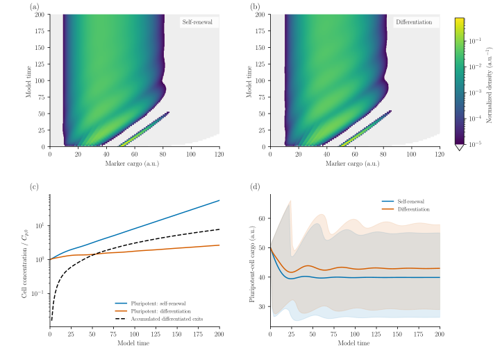
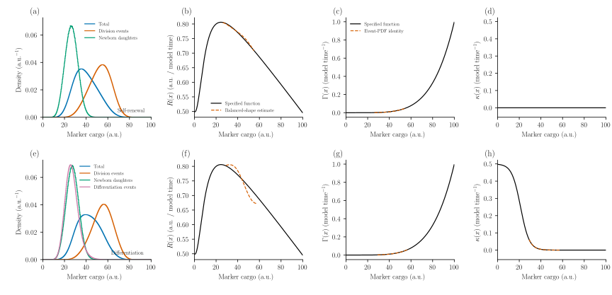

# Stem-cell self-renewal and differentiation

A stem cell can make more of a pluripotency marker, divide and partition that
marker between its daughters, or leave the pluripotent population. These events
change both the number of cells and the distribution of marker content. A
population balance connects the single-cell rates to the evolving culture.

This example uses the **synthetic OCT4-cargo model** in Figure 1A–B of
[Brown, Stoukides and Tzanakakis (2025)](https://doi.org/10.1186/s13287-025-04668-w).
We prescribe their functions and compare self-renewal with differentiation.
Cargo is in arbitrary units (a.u.) and time is **model time**; these synthetic
axes do not specify hours or measured molecule counts. There are no experimental
observations, fitted parameters or claims of experimental validation here.

## From single cells to a population

Let ``F(x,t)`` denote pluripotent-cell concentration per unit marker cargo,
``C_p(t)=\int F(x,t)\,dx`` its total concentration, and
``n_T(x,t)=F(x,t)/C_p(t)`` its normalized number density. The balance is

```math
\frac{\partial F(x,t)}{\partial t}
+\frac{\partial [R(x)F(x,t)]}{\partial x}
=-[\Gamma(x)+\kappa(x)]F(x,t)
+2\int_x^{x_{\max}}\Gamma(y)F(y,t)P(x\mid y)\,dy.
```

The prescribed functions are

```math
R(x)=\frac{50+x^2}{100+x^2}-0.005x,\qquad
\Gamma(x)=\left(\frac{x}{100}\right)^5,\qquad
\kappa(x)=\frac{0.5}{1+0.005\exp(0.25x)}.
```

``R`` is net intracellular production minus degradation, in a.u. per model
time. The hazards ``\Gamma`` and ``\kappa`` have inverse-time units. Division
removes one mother and creates two daughters. Differentiation removes a cell
from this cohort; it does **not** mean cell death. For self-renewal, set
``\kappa=0``. We use ``\kappa`` in place of the paper's ``D`` to avoid confusing
differentiation with diffusion.

For a mother with cargo ``y``, draw ``r\sim\operatorname{Beta}(40,40)`` and
give its daughters cargo ``ry`` and ``(1-r)y``. Thus

```math
P(x\mid y)=\frac{1}{y}\,\operatorname{BetaPDF}(x/y;40,40),\quad 0<x<y,
\qquad \int_0^y P(x\mid y)\,dx=1.
```

The factor **two** in the birth integral counts both daughters. Division
conserves cargo ``x``, rather than a particle-volume coordinate ``x^3``.

Initially, ``C_p(0)=1`` and the cargo follows a normal distribution with mean
50 and standard deviation 0.5, truncated to ``[0,100]``. Concentrations below
are relative to this initial culture. The calculation uses exact initial bin
probabilities and a closed cargo domain ``[0,120]``. The upper boundary is
checked to remain inactive. The numerical domain extends beyond the initial
support to accommodate marker production.

## Define and solve the model

The same terms used for particle populations describe cell cargo. `Growth`
advects cargo, `Breakage` describes binary division, and `Death` implements the
mathematical removal ``-\kappa F``. Naming that term `differentiation` makes its
biological meaning explicit:

```julia
using PopulationBalanceModels
include("examples/stem_cell_population.jl")
using .StemCellPopulation

grid = Grid1D(range(0.0, 120.0; length=601); coordinate=:oct4)
model = PBMModel(
    expression=Growth(cargo_rate),
    division=Breakage(division_rate, beta_daughters(order=12);
        overflow=:discard,
        coordinate_map=AdditiveCoordinate(identity, identity)),
    differentiation=Death(differentiation_rate),
)
operator = compile(model, grid;
    methods=TermMethods(growth=MUSCL()), bc=SizeBC())
```

`beta_daughters` constructs a positive Gauss–Jacobi rule for the beta marginal.
Its expected daughter counts sum to two and its first cargo moment is one.
The native fixed-pivot method deposits these daughters while preserving their
number and additive cargo when they lie between represented pivots. Daughters
below the first pivot are explicitly discarded into a cumulative loss ledger;
they are never silently assigned to the smallest cell. Their tiny contribution
is reported separately from biological differentiation.

To retain exit counts and cargo, the example wraps the operator in `PBMSystem`.
Its coupled scalar balances are

```math
\frac{dC_{\mathrm{exit}}}{dt}=\sum_i\kappa(x_i)N_i,\qquad
\frac{dQ_{\mathrm{exit}}}{dt}=\sum_i x_i\kappa(x_i)N_i,\qquad
\frac{dE_{\mathrm{div}}}{dt}=\sum_i\Gamma(x_i)N_i.
```

Here ``N_i`` is a bin-integrated cell concentration. These equations use the
**current integration stage**, alongside the population derivative. The first
two counters retain concentration and cargo *at exit*. They do not evolve a
second differentiated-cell distribution or prescribe its subsequent division
or expression. This choice also respects the current restriction that
inter-population transfers cannot be combined with cumulative size-loss ledgers.

`ConservativeExchange`, restricted to `mechanisms=(:growth,)`, records the
discrete cargo produced by expression. Its bookkeeping scalar is a signed
diagnostic counter, not an extracellular nutrient reservoir. Two independent
balances then check every trajectory:

```math
C_p+C_{\mathrm{exit}}+C_{\mathrm{lost}}=C_p(0)+E_{\mathrm{div}},
```

```math
Q_p+Q_{\mathrm{exit}}+Q_{\mathrm{lost}}=Q_p(0)+Q_{\mathrm{produced}}.
```

Number is not conserved during division. Total cargo changes through expression
and degradation, while binary partition itself conserves it. The
[coupling guide](../coupled_systems.md) explains the reusable exchange and
cumulative-accounting interfaces.

A complete minimal run, including those balances, is:

```julia
include("examples/stem_cell_population.jl")
using .StemCellPopulation

self = solve_case(bins=600, tf=200.0, differentiation=false)
diff = solve_case(bins=600, tf=200.0, differentiation=true)
last_self = state_summary(self.problem, last(self.u), last(self.t))
last_diff = state_summary(diff.problem, last(diff.u), last(diff.t))
@show last_self.stem last_diff.stem last_diff.differentiated
@show last_self.cargo_balance last_diff.cargo_balance
```

The native solver uses MUSCL cargo transport, fixed-pivot division and
`SSPRK33()`. The step is the smaller of 0.05 and `suggest_dt(...; cfl=0.35)`,
which combines transport and removal restrictions. Rates depend only on cargo,
so this bound remains fixed throughout the run. Stage checks are enabled with
zero negative tolerance; no cells are clipped or inserted. The limited transport
and fixed-pivot deposition introduce spatial error even though the time update
is third order for a smooth fixed-grid residual.

## How the culture changes



The top panels show ``n_T``, so each saved horizontal slice integrates to one;
their colors do not represent total cell concentration. Both panels use the
same logarithmic color scale. True zero density is white; positive density
below ``10^{-5}`` a.u.⁻¹ is light gray. The plot uses actual cargo-bin edges and
saved-time strips, with no interpolation. Division initially creates a
lower-cargo daughter population from the narrow starting cohort. Expression
moves cells toward larger cargo; repeated division redistributes it downward.

The lower-left panel shows the independently evolving concentrations. The
differentiated-exit curve is cumulative: it is not a prediction of how many
differentiated cells survive subsequently. In the lower-right panel, shading
spans the population's 10th–90th cargo quantiles, **not** a confidence interval.
Differentiation preferentially removes low-cargo cells, altering the remaining
distribution as well as its net expansion rate.

Division explains why mean cargo can initially fall even though ``R`` is
positive: it preserves cargo while increasing cell number. The sharp drop in
the upper quantile is also meaningful. In self-renewal, the fraction above 50
a.u. falls from 12.0% at ``t=22`` to 9.0% at ``t=24``; the 90th percentile
therefore switches from the high-cargo founding cohort to its descendants
(64.65 to 47.20 a.u.). Connecting saved quantiles does not imply a discontinuity
in the population's mean or its integrated cargo.

| At model time 200 | Self-renewal | Differentiation |
|:--|--:|--:|
| Pluripotent concentration / initial concentration | 55.87 | 2.662 |
| Accumulated differentiated exits / initial concentration | 0 | 7.794 |
| Mean pluripotent-cell cargo (a.u.) | 39.88 | 42.98 |
| Instantaneous net expansion rate (model time⁻¹) | 0.01918 | 0.003990 |

## Which cells are observed at an event?

A randomly sampled cell, a dividing mother and a newly born daughter have
different cargo distributions. At a given time,

```math
n_{\mathrm{div}}(x)=\frac{\Gamma(x)n_T(x)}{\mu},\qquad
\mu=\int\Gamma(x)n_T(x)\,dx,
```

```math
n_{\mathrm{diff}}(x)=\frac{\kappa(x)n_T(x)}{\bar\kappa},\qquad
\bar\kappa=\int\kappa(x)n_T(x)\,dx.
```

The newborn density comes from the same native daughter-birth operator,
normalized by ``2\mu C_p``. Its integral is one minus the recorded unresolved
daughter fraction. There is no differentiation-event density when
``\bar\kappa=0``. These are event-conditioned snapshots, not independently
evolving populations. The instantaneous net cohort expansion rate is
``\lambda=\mu-\bar\kappa`` when boundary losses are negligible.



Rows show self-renewal and differentiation at ``t=200``; the horizontal display
is restricted to ``[0,100]`` a.u. within the simulated ``[0,120]`` domain.
Dividing cells are weighted toward larger cargo, whereas differentiation events
favor smaller cargo. The specified functions are black. Dashed curves reconstruct
rates over the central 10th–90th percentile interval, leaving low-density tails
out of the division by ``n_T``.

The identities ``\Gamma=\mu n_{\mathrm{div}}/n_T`` and, when differentiation
occurs, ``\kappa=\bar\kappa n_{\mathrm{diff}}/n_T`` recover the functions algebraically
because the event distributions were generated by this model. This is a
consistency check, **not independent kinetic inference**. Recovering ``R`` from
the CDF relation in Brown et al. additionally assumes a stationary normalized
shape (balanced growth). The exports therefore include
``\int|\partial n_T/\partial t|\,dx`` and the maximum cell-centred CDF rate. Residual
transience and finite-volume quadrature can leave visible discrepancies in that
reconstruction even when the forward calculation is accurate. There is no exact
analytical transient PSD reference for this case.

At ``t=200``, the central-interval ``R`` reconstruction RMSE is 0.00334 for
self-renewal and 0.02065 with differentiation, in a.u. per model time. The
normalized-shape L1 rates are ``6.20\times10^{-4}`` and
``3.24\times10^{-3}`` per model time, respectively. Neither is exactly zero;
the differentiation curve in particular should not be interpreted as a verified
steady-state inversion. The ``\Gamma`` and ``\kappa`` identities agree to
roundoff, as expected from their construction. In self-renewal, ``\kappa=0``
is fixed: there is no differentiation-event PDF and no reconstructed curve in
that panel. Its exported zero is the fixed model value.

## Reproduce and check the calculation

From the repository root:

```sh
# Short forward check; separate temporary outputs, no final figures.
julia --project=. examples/stem_cell_population.jl --smoke

# Two full runs plus independent grid, time, quadrature and domain checks.
julia --project=. examples/stem_cell_population.jl
python docs/benchmarks/plot_stem_cells.py --usetex
python test/stem_cell_results.py
julia --project=. test/stem_cells.jl
julia --project=docs docs/make.jl
```

Plotting requires Python 3.11+, NumPy, Matplotlib and, for `--usetex`, LaTeX with
dvipng. Omitting that flag uses MathText previews. The plotter verifies the
production configuration and numerical-source/data hashes; smoke exports cannot
replace full-horizon results. Including the example module does not execute the
benchmark. No experimental data or paper-figure workflow is involved.

The [model and minimal solver](../assets/source/examples/stem_cell_population.jl),
[reporting driver](../assets/source/examples/support/stem_cell_study.jl) and
[plotting script](../assets/source/plotting/plot_stem_cells.py) preserve the full
workflow. The [summary](../assets/stem_cells/summary.csv),
[refinement table](../assets/stem_cells/refinement.csv) and
[run manifest](../assets/stem_cells/run.toml) record the actual configurations,
timings, dependency versions and source hashes. Timings are one measured solve
after a separate compilation warmup, including setup and saved-state checks,
but excluding export and plotting; they have no repeatability error bars.

The focused tests check beta daughter moments against their analytic values and
a binary division/differentiation cascade against an independent closed-form
solution. Production checks separately halve the timestep, refine 300/600/1200
cargo bins, double daughter quadrature from 12 to 24 nodes, and extend the domain
at unchanged bin width. The largest CDF changes over the saved times are:

| Change from the displayed 600-bin calculation | Self-renewal | Differentiation |
|:--|--:|--:|
| 1200 cargo bins | 0.0245 | 0.0278 |
| Halved timestep controls | 0.0000191 | 0.0000200 |
| 24 daughter-quadrature nodes | 0.00761 | 0.00727 |
| Domain extended from 120 to 160 a.u. | 0.0000167 | 0.0000175 |

These are absolute CDF fractions: 0.0278 is 2.78 percentage points. Distribution
shape remains more grid-sensitive than concentration: the 600/1200-bin
concentration differences stay below 0.013% and 0.070%, respectively. The plots
illustrate the biology and accounting; they do not establish sub-percent
convergence of the transient CDF. Domain extension also tightens the automatic
step recommendation because the division hazard is larger at high cargo, so
that row includes a temporal change comparable to the explicit timestep check.

All saved populations are nonnegative. The largest relative discrete cargo
defect is ``4.4\times10^{-13}``; daughter underflow is below
``3\times10^{-44}`` of the initial cell concentration and the upper boundary
remains inactive. These discrete balance checks are separate from continuum
accuracy. The original authors use a stochastic representative
ensemble; this deterministic sectional calculation is an adaptation of their
synthetic model, rather than a reproduction of a particular random realization.
The [authors' code](https://github.com/aedanbrown/Single-cell_Growth_and_Division_Functions_hPSCs/tree/64a069491d4895aaa6b8a3f5476dc997877f728f)
and the paper's supplement specify the source functions and initialization.
