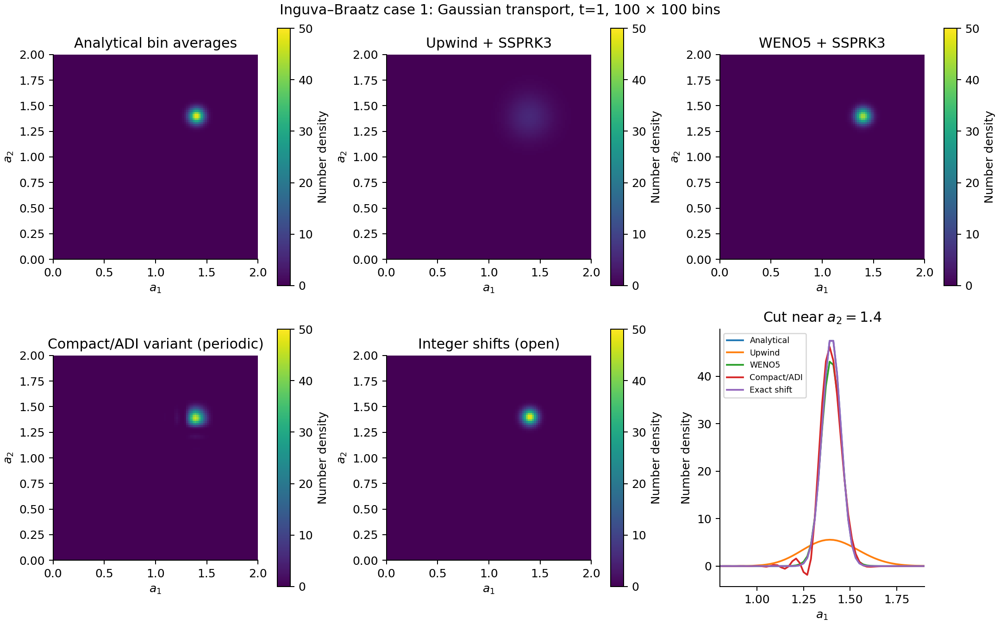
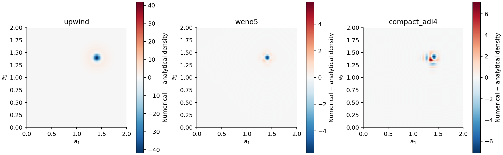

# Inguva–Braatz: two-coordinate transport

## Published problem

Section 3.1 of [Inguva and Braatz (2023)](https://web.mit.edu/braatzgroup/Inguva_ComputChemEng_2023.pdf)
uses constant growth in two internal coordinates:

```math
\frac{\partial n(a_1,a_2,t)}{\partial t}
+\frac{\partial n(a_1,a_2,t)}{\partial a_1}
+\frac{\partial n(a_1,a_2,t)}{\partial a_2}=0,
\qquad (a_1,a_2)\in[0,2]^2,
```

```math
n(a_1,a_2,0)=50\exp\!\left[-\frac{(a_1-0.4)^2}{0.005}
-\frac{(a_2-0.4)^2}{0.005}\right].
```

Both coordinate velocities are 1. The paper specifies zero ghost-node values
on the incoming left/bottom boundaries and no flux at the upper/right edges.
Figure 2 compares solutions at ``t=1``; the peak moves to ``(1.4,1.4)``. Away
from boundary effects the characteristic solution is

```math
n(a_1,a_2,t)=n(a_1-t,a_2-t,0).
```

The benchmark evaluates analytical bin integrals and compares bin-average
densities. Its initial Gaussian is truncated to the declared domain. This
avoids comparing finite-volume averages with point samples of a narrow peak.
It also means these errors should not be equated directly with the published
nodal Upwind/Exact errors. The paper's Upwind and Exact schemes used 101 nodes;
its WENO calculation used 100 cells per axis. This package uses 100 cells for
all methods in the displayed figure and its own WENO/SSPRK implementation.

## Code deployment

Run from the package root:

```sh
julia --project=. examples/inguva_braatz_case1.jl
python docs/benchmarks/plot_case_studies.py transport
```

The plotting command requires NumPy and Matplotlib. The Julia benchmark has no
plotting dependency. Its model definition is

```julia
model = PBMModel(growth=Growth2D((1.0,1.0)))
boundary = SizeBC(OpenBoundary(),NoFlux())
operator = compile(model,grid;
    methods=TermMethods(growth=WENO5(epsilon=1e-12)),
    bc=SizeBC2D(x=boundary,y=boundary))
problem = PBMProblem(operator,initial_bin_numbers,(0.0,1.0))
solution = simulate(problem;method=SSPRK33(),dt=0.2*cell_width,
    saveat=[1.0],check_nonnegative=false)
```

`reference(grid,t)` in `examples/inguva_braatz_case1.jl` integrates the shifted
Gaussian. `problem` constructs the equation, state, and boundary treatment;
`run_benchmark` changes the discretization, runs 50/100/200 bins per axis, and
exports solutions and error measures. Positivity rejection is disabled in this
diagnostic run so undershoots are measured rather than clipped or hidden.

## Method comparison and boundary differences

Upwind and WENO use zero incoming flux and a closed outgoing edge, matching the
paper's intended flux specification. The near-boundary WENO implementation falls
back to upwind; it does not reproduce SharpClaw's boundary implementation.
Their unsplit SSPRK time step has a summed directional Courant number of 0.4.

ExactShift uses one cell of travel in each direction per step. Its current
backend supports paired open boundaries, so that row declares open outflow.
The compact/ADI variant requires periodic boundaries and is reported as an
additional diagnostic, not a reproduction of a method in this paper. At this
horizon the translated Gaussian is well separated from every edge; nevertheless
the boundary declarations differ and are recorded in the CSV.



The colour limits are shared across the density panels. The cut shows diffusion
and dispersive distortion near the peak. Signed error panels below use separate
symmetric scales so negative lobes remain visible.



At 100 bins per axis, density RMSE was 1.853 for upwind, 0.1674 for WENO, and
0.3338 for compact/ADI. The eligible exact shift gave ``1.43\times10^{-14}``.
The compact minimum density was -1.851; it does not preserve positivity even
for this narrow Gaussian. Refining to 200 bins reduced its RMSE to 0.03311.
These are results of this implementation, not digitized published errors.

[All errors and declared boundaries](../assets/inguva_case1/errors.csv) and
[run metadata](../assets/inguva_case1/environment.txt) accompany the figure.
The norm definitions are RMSE over bin-average densities, maximum absolute
density error, and integrated L1 error over bin numbers.

## Compact/ADI stability audit

The periodic variant's Fourier amplification has unit magnitude, as derived in
[Time integration](../methods/time.md). A separate ten-period audit preserved
L2 norms within ``5\times10^{-14}`` over directional Courant numbers 0.25, 1,
and 4 for both temporal orders. The maximum sampled Fourier amplification
magnitude was 1.0000000000000004. Independent dense-matrix calculations agree
with the cyclic solver.

This supports linear stability of the implemented periodic constant-growth
variant. It does not support monotonicity or positivity: the rectangle develops
negative lobes while its L2 norm remains constant. Reducing time step does not
turn a central compact derivative into a positivity-preserving method.
[Audit data](../assets/compact_audit/audit.csv) reports norms, minima, and negative
number without clipping.

The variant is not a verified reproduction of the HOC–ADI paper; supplementary
coefficients and update ambiguities remain unresolved. Physical compact boundary
closures, general sources, and transformed variable-growth exact shifts remain
outside these implementations.

## Additional transport diagnostics

The earlier smooth-periodic and rectangular comparison is retained as independent
evidence in [its results](../assets/results_2d.csv),
[environment](../assets/environment.txt), and [figure](../assets/benchmark_2d.png).
It uses different velocities, domain, and initial data from this paper case.
Run `examples/two_coordinate_transport.jl` to repeat it. It is useful for smooth
convergence and sharp-front tests, but must not be labelled the paper benchmark.
