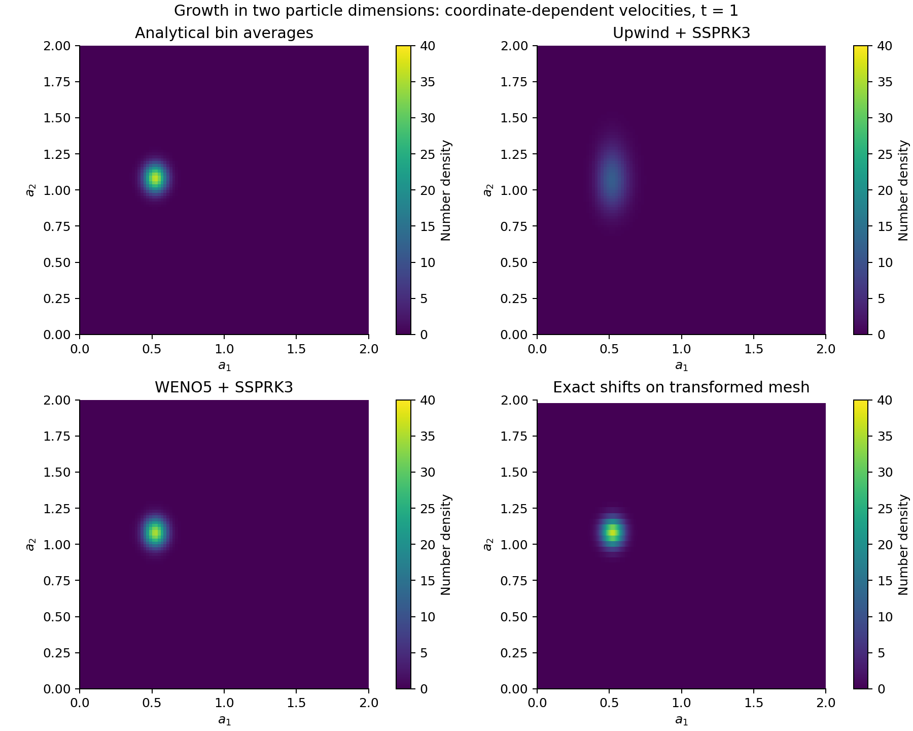
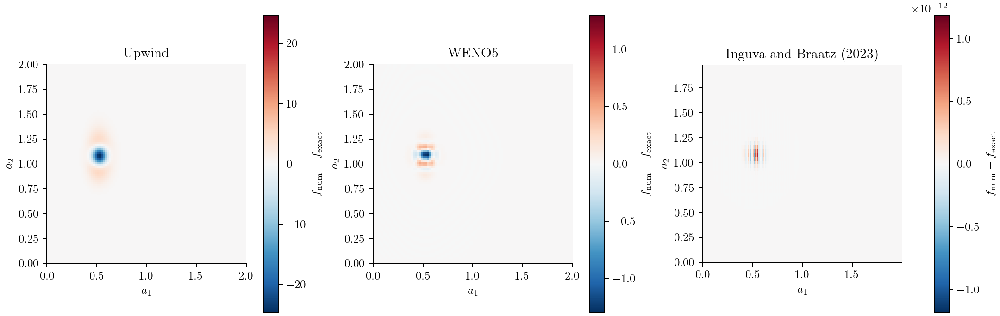
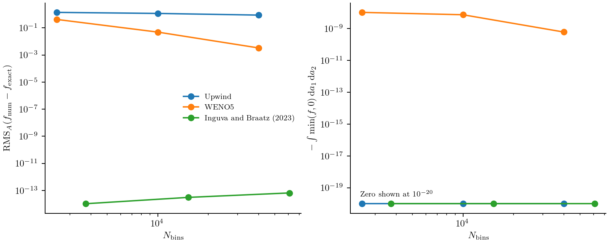

# Growth in two particle dimensions

A particle can grow at different rates along two dimensions. A distribution
that is initially narrow then moves and spreads in the plane of those particle
properties. A useful numerical test is to predict both effects without adding
artificial broadening or losing particles.

We choose a growth law for which each particle trajectory can be calculated
exactly. This gives a reference for the whole distribution and lets us compare
upwind, WENO5, and an exact shift on a transformed mesh. The model and initial
condition are those of
[Inguva and Braatz (2023), Case 2](https://web.mit.edu/braatzgroup/Inguva_ComputChemEng_2023.pdf).
The two coordinates below describe particles, not positions in a vessel.

## The population balance

Let ``f(a_1,a_2,t)`` be the joint number density. Particles grow without nucleation,
aggregation, or breakage:

```math
\frac{\partial f(a_1,a_2,t)}{\partial t}
+\frac{\partial\!\left[G_1(a_1)f(a_1,a_2,t)\right]}{\partial a_1}
+\frac{\partial\!\left[G_2(a_2)f(a_1,a_2,t)\right]}{\partial a_2}=0,
```

where

```math
G_1(a_1)=0.1+0.05a_1,\qquad G_2(a_2)=0.5+0.25a_2,
\qquad 0\le a_1,a_2\le2.
```

Both velocities depend on the particle coordinate. Consequently, growth changes
the height and width of the distribution as well as its position. Keeping the
product inside each derivative accounts for this stretching.

Initially,

```math
f(a_1,a_2,0)=50\exp\!\left[-\frac{(a_1-0.4)^2}{0.005}
-\frac{(a_2-0.4)^2}{0.005}\right].
```

The standard deviation is 0.05 in each coordinate. This is a property of the
initial population and stays fixed when the numerical grid is refined. We
compare solutions at ``t=1``, before appreciable population reaches an upper edge.
The physical-grid solve uses zero incoming density at the lower edges and
closed upper edges.

## Enter the growth law and parameters

The script `examples/inguva_braatz_case2.jl` contains the model, reference
integrals, and comparison runner. We use its parameter constructor so that the
numerical and analytical calculations read the same values:

```@example growth2d
using PopulationBalanceModels
include(joinpath(pkgdir(PopulationBalanceModels),"examples","inguva_braatz_case2.jl"))
import .InguvaBraatzCase2
const study = InguvaBraatzCase2
p = study.parameters()
```

`offset` and `slope` specify the two affine velocities; `amplitude`, `center`,
and `width` specify the initial Gaussian. The callback used in the script is:

```@example growth2d
function growth_rate(a1,a2,p,t,ctx)
    (p.offset[1] + p.slope[1]*a1,
     p.offset[2] + p.slope[2]*a2)
end
model = PBMModel(growth=Growth2D(rate=growth_rate))
growth_rate(0.4,0.4,p,0.0,nothing)
```

Growth2D passes both face coordinates and expects two coordinate velocities.
The numerical method is supplied separately when the model is compiled.

## Integrate the initial density over bins

A finite-volume state contains a number in each rectangular bin:

```math
N_{ij}(t)=\int_{a_{1,i-1/2}}^{a_{1,i+1/2}}
\int_{a_{2,j-1/2}}^{a_{2,j+1/2}}f(a_1,a_2,t)\,da_2\,da_1.
```

The reference routine evaluates these integrals from the Gaussian, avoiding
an initial midpoint approximation. Here we use a small grid for an interactive run:

```@example growth2d
grid = Grid2D(range(0,2;length=41),range(0,2;length=41))
initial = study.reference(grid,0.0,p)
sum(initial)
```

To reconstruct a density for plotting, call `density(grid,initial)`. Dividing
by one width rather than the bin area would give the wrong two-dimensional density.

## Choose face fluxes, boundaries, and a time step

```@example growth2d
boundary = SizeBC(OpenBoundary(),NoFlux())
operator = compile(model,grid;
    methods=TermMethods(growth=WENO5(epsilon=1e-12)),
    bc=SizeBC2D(x=boundary,y=boundary))
problem = PBMProblem(operator,initial,(0.0,1.0);p)
dt = suggest_dt(operator,initial,p,0.0;cfl=0.4)
solution = simulate(problem;method=SSPRK33(),dt,saveat=[1.0],
    check_nonnegative=false)
nothing # hide
```

Each directional face flux uses its own local growth velocity. The time-step
estimate limits the sum of outgoing directional Courant numbers to 0.4. The
velocity is independent of time and state here, so this estimate does not
need updating during the run.

Upwind is selected by changing `growth=WENO5(...)` to `growth=Upwind()` and
recompiling. SSPRK33 advances either residual. WENO5 has no positivity limiter;
this diagnostic run disables rejection of negative populations so that the
comparison can report undershoots. Ordinary simulation enables that check.
Neither path clips negative values.

## Compare with the analytical solution

The particle trajectories obey ``da_i/dt=G_i(a_i)``. Tracing back from a final
coordinate to its initial value gives

```math
\xi_1=(a_1+2)e^{-0.05t}-2,\qquad
\xi_2=(a_2+2)e^{-0.25t}-2.
```

Conservation of particle number along these expanding trajectories gives

```math
f(a_1,a_2,t)=f(\xi_1,\xi_2,0)e^{-0.30t}.
```

Zero incoming density is used when a starting point lies outside the initial
domain. The exponential factor accounts for area expansion. The initial peak
at ``(0.4,0.4)`` travels to approximately ``(0.5231,1.0817)`` at ``t=1`` and its
height falls from 50 to ``50e^{-0.30}``.

We compare each numerical bin number with the integral of this solution over
the same bin:

```@example growth2d
truth = study.reference(grid,1.0,p)
final = solution.u[end]
(integrated_absolute_error=sum(abs,final-truth),
 minimum_density=minimum(density(grid,final)))
```

This avoids interpreting the difference between a centre value and a bin
average as a solver error.

## Shift on a travel-time mesh

The coordinate-dependent velocities can also be handled by changing variables.
Define the travel time from the origin along each growth trajectory:

```math
\tau_1(a_1)=\frac{\ln(1+a_1/2)}{0.05},\qquad
\tau_2(a_2)=\frac{\ln(1+a_2/2)}{0.25}.
```

The density per travel-time area is
``F(\tau_1,\tau_2,t)=G_1(a_1)G_2(a_2)f(a_1,a_2,t)``. It satisfies

```math
\frac{\partial F(\tau_1,\tau_2,t)}{\partial t}
+\frac{\partial F(\tau_1,\tau_2,t)}{\partial \tau_1}
+\frac{\partial F(\tau_1,\tau_2,t)}{\partial \tau_2}=0.
```

Only in these new coordinates are the velocities constant. A uniform
travel-time mesh with ``\Delta\tau_1=\Delta\tau_2=\Delta t`` lets InguvaBraatz2023
move the state one cell in each direction without interpolation:

```@example growth2d
law = SeparableGrowth2D(AffineGrowth(p.offset[1],p.slope[1]),
    AffineGrowth(p.offset[2],p.slope[2]))
dt_shift = 0.05
physical_grid = characteristic_grid(law,((0.0,2.0),(0.0,2.0));
    dt=dt_shift,endpoint=:truncate)
open_ends = SizeBC(OpenBoundary(),OpenBoundary())
shift_operator = compile(PBMModel(growth=Growth2D(law)),physical_grid;
    evolution=InguvaBraatz2023(),bc=SizeBC2D(x=open_ends,y=open_ends))
shift_problem = PBMProblem(shift_operator,study.reference(physical_grid,0.0,p),
    (0.0,1.0);p)
mapped = (problem=shift_problem,physical_grid=physical_grid,dt=dt_shift)
shifted = simulate(mapped.problem;dt=mapped.dt,saveat=[1.0])
physical_density = density(mapped.physical_grid,shifted.u[end])
sum(abs,shifted.u[end]-study.reference(mapped.physical_grid,1.0,p))
```

Bin number is unchanged by the transformation; do not multiply it by the
Jacobian a second time. To recover ``f``, divide by the **physical** bin areas,
as in the last block.

This mesh keeps whole travel-time cells inside the 0–2 domain, omits fractional
end cells, and uses paired open boundaries. Its nonuniform physical mesh and
actual extents are recorded with the results. The comparison adapts the
transformed-mesh method to bin averages; it does not reproduce the paper's
nodal implementation or SharpClaw settings. The compiler checks the independent
growth laws, positivity, common travel-time spacing and boundaries. The solver
checks the time step and output alignment before advancing. The older ExactShift
interface remains restricted to constant velocities.

HOCADI is also restricted to constant velocities, and additionally requires
periodic boundaries. Applying it directly to this physical problem is unsupported.
Its [periodic stability audit](../methods/time.md) tests the implemented compact
variant separately and reports its oscillations and negative undershoots.

## Generate the two-dimensional plots

```sh
julia --project=. examples/inguva_braatz_case2.jl
python docs/benchmarks/plot_case_studies.py transport
```

The runner compares uniform 50-, 100-, and 200-bin axes and corresponding
transformed meshes. It writes solution fields and signed errors, together with
integrated absolute error, maximum error, minima, and negative number.
`RMSE` is the unweighted root mean square over bins; `RMS_area` weights squared
density errors by physical bin area. They agree on a uniform mesh but generally
differ on the transformed mesh. Error norms from different meshes must be read
with their respective resolutions and extents.

The following values are read from the saved comparison data:

```@eval
using Markdown, PopulationBalanceModels
file=joinpath(pkgdir(PopulationBalanceModels),"docs","src","assets","inguva_case2","errors.csv")
if isfile(file)
    lines=split.(readlines(file),',')
    columns=first(lines)
    value(row,key)=row[findfirst(==(key),columns)]
    labels=Dict("upwind"=>"Upwind","weno5"=>"WENO5","mapped_shift"=>"Inguva–Braatz 2023")
    table=["| Method | Bins (a₁ × a₂) | Area RMS density error | Minimum density |",
           "|:--|--:|--:|--:|"]
    for row in lines[2:end]
        value(row,"resolution") in ("100","200") || continue
        method=labels[value(row,"method")]
        nx=value(row,"nx");ny=value(row,"ny")
        rms=round(parse(Float64,value(row,"RMS_area"));sigdigits=3)
        minimum=round(parse(Float64,value(row,"minimum_density"));sigdigits=3)
        push!(table,"| $method | $nx × $ny | $rms | $minimum |")
    end
    Markdown.parse(join(table,'\n'))
else
    Markdown.parse("Run the comparison to generate the error table.")
end
```

Upwind spreads the narrow peak substantially. WENO5 reduces that broadening
under refinement but still produces small negative lobes. The mapped shift
matches its own analytical bin integrals to roundoff because this separable
growth law permits an exact travel-time map and compatible integer shifts.
That result does not apply to arbitrary size-dependent velocities.





Colours in each error panel show numerical minus analytical **bin-average**
density on that panel's own mesh. Each panel has its own symmetric colour
scale; read the colourbar before comparing magnitudes. The mapped result's
roundoff-scale pattern is not a physical oscillation.



The last figure uses actual total bin counts for each mesh. It compares accuracy
and undershoots, not elapsed runtime. The transformed mesh exploits the known
characteristics; its near-roundoff error is specific to this compatible problem.

## Minimal run and full reproduction

Run this block from the repository root. It constructs and solves one problem;
including a driver does not run its CSV exports.

```julia
using PopulationBalanceModels
include("examples/inguva_braatz_case2.jl")
problem = InguvaBraatzCase2.problem(50; scheme=WENO5(epsilon=1e-12))
dt = suggest_dt(problem.operator, problem.u0, problem.p, 0.0; cfl=0.4)
solution = simulate(problem; dt, saveat=[1.0], check_nonnegative=false)
reference = InguvaBraatzCase2.reference(problem.operator.grid, 1.0, problem.p)
L1_error = sum(abs, last(solution.u) - reference)
```

The figure-generation drivers and supporting sources are available below. Keep
the repository's relative paths; the [benchmark guide](../assets/source/plotting/README.txt)
lists plotting commands and optional environments.

- [inguva_braatz_case2.jl](../assets/source/examples/inguva_braatz_case2.jl)
