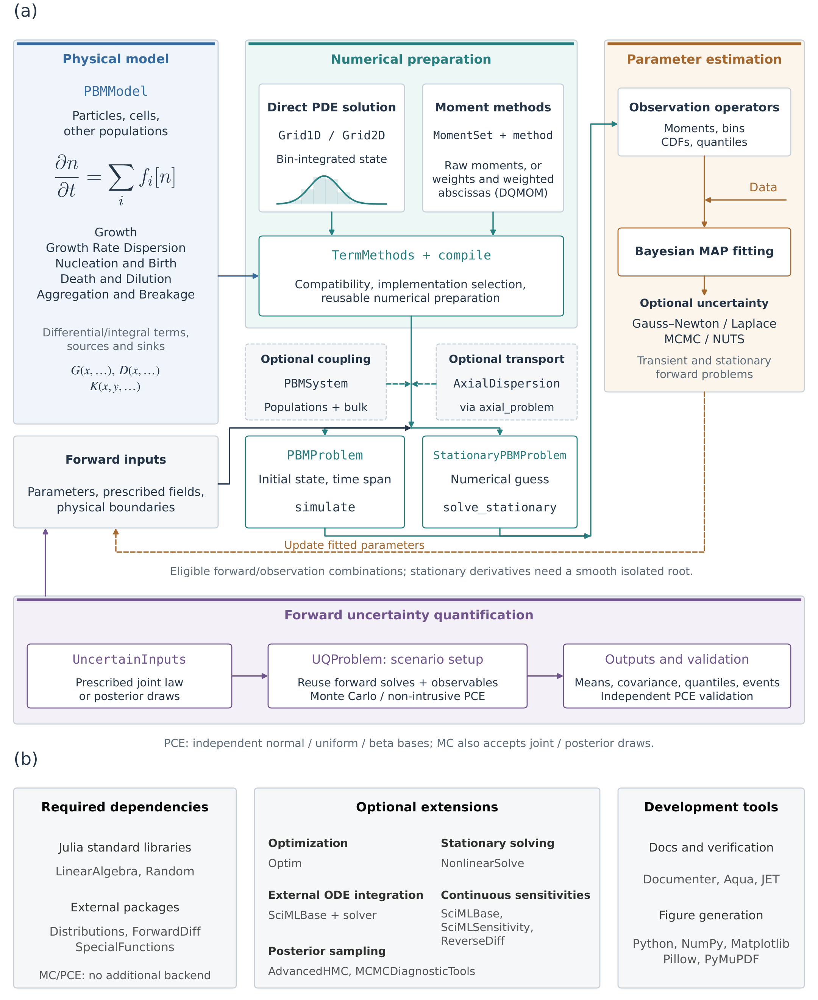

# Contributing, internals, and extensions

## Source organization



Physical terms and numerical preparation are shared by transient and stationary
forward problems. Their inputs differ: a transient problem needs an initial
state and time span; a stationary problem needs a numerical guess. The inference
connection applies to eligible **transient and stationary** models. Both use
observation operators, likelihoods, priors and the shared MAP/uncertainty/sampling
interfaces. `StationarySolver` uses checked equilibria and implicit derivatives
at smooth isolated roots; singular roots, branch/rank changes and incompatible
residual AD require explicit restrictions or a verified finite-difference path.
Transient ODE sensitivities do not supply stationary or event jump rules.
The diagram does not promise every combination of terms and methods.
Its solid forward path also applies to a standalone population. Dashed side
inputs show optional population/bulk coupling (`PBMSystem`) and prescribed axial
reactor transport (`AxialDispersion`) at equal visual priority. A single population
can select an axial domain during compilation; `axial_problem` lifts an eligible
coupled local problem. These additions compose subject to their own restrictions.
DQMOM evolves weights and weighted abscissas;
the other displayed moment route need not have the same state layout.

The [forward-UQ workflow](uncertainty_quantification.md) wraps the same problems,
solvers and observables with `UncertainInputs` and `UQProblem`. Monte Carlo can
propagate prescribed joint inputs or posterior draws without a fitting step;
non-intrusive PCE uses eligible independent normal/uniform/beta reference
coordinates and a declared map to physical inputs. Regression and quadrature
share the public `pce_basis` recurrence contract; `refine_pce` checks validation
and mean/variance stability before selecting a surrogate. These checks are
separate from propagated uncertainty. Both methods use the core dependencies.

The [figure](assets/architecture/section2_architecture_revised.png) and
[generator](https://github.com/pavaninguva/PopulationBalanceModels.jl/blob/main/paper/architecture/generate_pbm_architecture.py)
use the current dependency declarations. Regenerate without simulations using
`python paper/architecture/generate_pbm_architecture.py` from the repository root
with the paper Python environment and LaTeX installed. The schematic uses
DejaVu Sans lettering with a LaTeX-rendered population-balance equation;
`--usetex` additionally renders the other lettering through LaTeX.
Statistics belongs to the **test** dependencies; it is not part of the
simulation core shown in panel (b).

The module is assembled in `src/PopulationBalanceModels.jl`. `modeling/` holds
physical terms, laws, sources, and boundaries; `representations/` defines grids
and moment bases. `numerics/` contains selectable algorithms, and `compilation/`
validates combinations and creates prepared terms. `coupling/` packs populations
and bulk balances; `time_integration/` advances them; `inference/` maps results
to observations and estimation. `stationary/` assembles stationary problems and
parameter paths from the same residuals; its optional NonlinearSolve adapter
lives alongside other integrations in `ext/`.

This separation lets physical laws survive changes of representation and
numerical method. `core/interfaces.jl` defines public dispatch contracts and
method selection. `BatchDomain` and `AxialDispersion` implement well-mixed and
prescribed axial advection–dispersion domains. The axial compiler wraps local
sectional residuals and adds shared physical face fluxes; it does not treat
position as another intrinsic coordinate. General CFD remains outside the scope.

## Add a numerical algorithm

The public sectional extension contract is:

1. Define a subtype of AbstractTermMethod.
2. Extend prepare_term(term,method,representation;...) to validate applicability
   and construct reusable coefficients, quadrature or deposition caches.
3. Extend add_term!(du,u,term,method,cache,operator,p,t,ctx) to **add** its residual.
   Sectional methods return unresolved birth number/property rates for diagnostics.
4. Test the method's actual conservation, positivity assumptions, boundary
   behavior, accuracy and refinement. Implementing an interface is not validation.

Here is a complete extension skeleton that delegates to the existing algorithm:

```julia
using PopulationBalanceModels
struct MyAggregationMethod <: AbstractTermMethod end

PopulationBalanceModels.prepare_term(term::Aggregation,::MyAggregationMethod,grid::Grid1D;kwargs...) =
    prepare_term(term,FixedPivot(),grid;kwargs...)

PopulationBalanceModels.add_term!(du,u,term::Aggregation,::MyAggregationMethod,cache,op,p,t,ctx) =
    add_term!(du,u,term,FixedPivot(),cache,op,p,t,ctx)
```

Replacing those preparation/residual calculations with the new algorithm
does not require editing a central list of aggregation method names. A new
physical term can likewise subtype AbstractPBMTerm, declare mechanism and
provide compatible preparation/residual methods. Common model validation
does not hard-code a whitelist of user term types.

CustomTerm remains a convenient model-specific escape hatch. A reusable
numerical method should use the explicit policy contract so its identity and
cache are inspectable and selectable. ConservativeExchange and diagnostics
call the **selected** residual, including external methods.

## Extend moment evolution

The type hierarchy exposes AbstractMomentMethod, with AbstractMomentClosure
for raw-moment states and AbstractDirectMomentMethod for methods with other
states. Moment compilation automatically plans individual equations:

```julia
op = compile(model,MomentSet(0:3);moment_method=QMOM())
moment_plan(op)
```

Analytical contributions read tracked moments directly and reconstruct only
missing orders. Generic population integrals use the selected family. A global
reconstruction and missing-moment cache are shared within one residual evaluation.
`examples/moment_closures.jl` demonstrates quadratic growth with only M4 missing;
`examples/quadrature_moment_methods.jl` exercises the extended families.

An analytical term extension supplies `moment_dependencies(term,k)` and
`analytical_moment(term,k,getmoment,p,t,ctx)`. Return `nothing` when no analytical
rule is implemented. Generic integral extensions declare
`supports_moment_integral(term,basis)` and retain the existing
`prepare_term(...,QuadratureMomentRule(),basis)` / `moment_term!` hooks.
Preparation caches reach that evaluator unchanged. Independent source laws
must supply their own moments, never use population quadrature as a source law.
These capabilities concern implemented rules, not symbolic inference from probes.

A new moment family supplies:

| Public hook | Responsibility |
|---|---|
| validate_moment_method | Check the supported physical laws, moment basis and family options |
| moment_state_length | Define the packed state layout; it need not equal the number of tracked moments |
| moment_value | Convert a state into an experimental or coupled-model moment |
| moment_rate | Apply the chain rule from the method's derivative to a moment rate |
| validate_moment_state / check_moment_state | Family-specific initial/stage validity |
| prepare_moment_state | Reconstruct the density/quadrature/closure information needed at the current stage |
| reconstructed_moment | Evaluate a missing moment from that family's reconstruction |
| prepare_term / moment_term! | Prepare each selected weak-form rule and add its contribution in that family's state variables |

The concrete signatures are:

```julia
validate_moment_method(method, model, basis)
moment_state_length(method, basis)
moment_value(method, basis, state, k)
moment_rate(method, basis, state, derivative, k)
validate_moment_state(method, basis, state)
check_moment_state(method, basis, state, tolerance)
prepare_moment_state(method, basis, state, p, t, ctx)
reconstructed_moment(method, basis, state, reconstructed, k)
moment_term!(du, u, term, rule, cache, method, reconstructed, op, p, t, ctx)
```

`moment_term!` adds a contribution rather than resetting the derivative. The
compiled moment residual prepares reconstruction once per evaluation. The
external examples in `test/method_interfaces.jl` show both term dispatch and
a direct-state family with explicit moment chain rules.
Existing third-party direct-state families retain their explicit `moment_term!`
evaluator and report `:family_evaluator` in the plan. No generic inverse mapping
from moment rates to an arbitrary state layout is assumed. The built-in DQMOM
maps the automatically assembled raw rates through its checked source-system
factorization. Family validation can require inversion even when the evolution
plan is fully analytical; that distinction also governs stationary AD eligibility.

Underscored helpers such as `_prepare_checked_moment_state`,
`_gamma_primary_precise` and `_ledger_index` are private. Third-party families
should implement the public hooks above; native accepted states are checked
through `validate_moment_state` as well as the necessary stage checks. Rate and
reconstruction callbacks must be pure: rejected trials must leave no state,
ledger or externally visible cache changes.

The moment_rate hook lets MomentExchange remain correct for nonlinear
weight/node-to-moment maps. Direct-state families must implement their
evolution explicitly; the raw-moment residual is never silently applied to
node variables. The external one-node growth test verifies a state layout
different from the moment basis, shared bulk exchange and both moment
observation adapters. The supplied `DQMOM` implementation uses these same
hooks for a scaled weight/weighted-abscissa source solve; its conditioning and
positive-weight restrictions are described in [Moment methods](moment_methods.md).

MomentSet currently holds contiguous nonnegative integer orders in one
coordinate. AbstractMomentBasis leaves room for sparse, fractional or
multivariate moment sets; those require additional concrete representations
and compilation rules. A conditional algorithm cannot be enabled merely by
renaming a one-coordinate QMOM closure.

Use `moment(ctx,k)` and `moment(ctx.system,:population,k)` in physical laws
when portability across representations matters. Directly indexing ctx.N
couples that law to a specific state layout. Observation and bulk-exchange
adapters use the method's moment mapping.


## Verification and documentation changes

The [verification guide](verification.md) gives core, optional-solver,
tensor and documentation commands.
Statistics and Aqua are test dependencies; JET is isolated from runtime loading.

`docs/src/` is the authoritative manual. A documentation change should preserve
equations, units, restrictions and the data provenance behind each claim.
Use short runnable calculations and links to full drivers; keep reporting code
out of the walkthrough. New figures need numerical inputs and settings, while
plot-only revisions must preserve their original producer records.

Both Distributions and this package export `moment`. Use selective imports
(`using Distributions: Normal, logpdf`, for example), or explicitly qualify
`PopulationBalanceModels.moment` when using both packages. The PBM operation
integrates raw powers of particle size; StatsBase's array operation computes a
sample central moment. Their statistical meanings remain distinct.

Keep walkthroughs and reference material separate. Put constructor, keyword and
callback contracts in source docstrings; link those entries from guides using
Documenter's `@ref`. The [API index](api.md) leads to topic-based reference pages.
`docs/api_reference.jl` owns their navigation and source-file routing. A new file
under an existing subsystem is included automatically; a new subsystem needs an
explicit routing rule and, when appropriate, a short page under `docs/src/api/`.
The longest matching source rule wins, so observation files can have their own
page within the broader inference subsystem. No per-symbol exclusion list is
needed.

Run `julia --project=docs test/docs_reference.jl` to check routing. The build
rejects unassigned/ambiguous sources and empty reference groups before rendering.
Documenter's strict exported-docstring coverage, duplicate and cross-reference
checks remain active. Rendered pages warn at 100 KiB and fail at 200 KiB; split
an overgrown topic rather than raising or bypassing those limits. Add a guide
example for new behavior without embedding a generated API catalogue there.

Build with the commands in the README. The build executes model tutorials and
selected case-study blocks; the local checker validates links and assets. HTML
size/search advisories are distinct from fatal document-check errors. The
[publishing guide](publishing.md) describes deployment.


## Updating this checkout

See [CONTRIBUTING.md](https://github.com/pavaninguva/PopulationBalanceModels.jl/blob/main/CONTRIBUTING.md)
for the review/verification workflow and [Publishing](publishing.md) for releases
and versioned documentation deployment.
