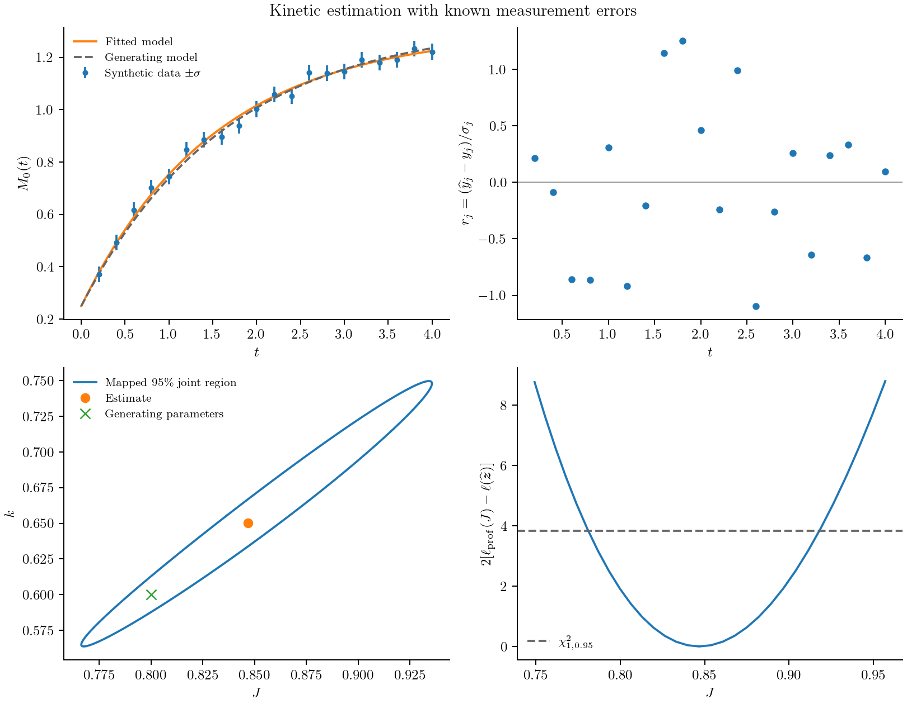

# Observations and parameter estimation

A particle counter, a concentration measurement, and a scattering instrument
observe different features of a population. Before fitting kinetics, specify
how a model state becomes the reported measurement. Otherwise a change in
observation weighting can be mistaken for a change in the physical rate law.

## Fit a removal rate from number measurements

For size-independent removal,

```math
\frac{\partial n(v,t)}{\partial t}=-k n(v,t),\qquad
\frac{dM_0(t)}{dt}=-kM_0(t).
```

We can generate synthetic observations from the analytical solution, independently
of the numerical solver used in fitting:

```@example inference
using PopulationBalanceModels

grid = Grid1D(range(0,8;length=41))
model = PBMModel(loss=Death(rate=(v,p,t,ctx)->p.k))
operator = compile(model,grid)
initial = exp.(-grid.centers).*grid.widths
problem = PBMProblem(operator,initial,(0.0,2.0);p=(k=0.4,))
times = [0.0,0.2,0.6,1.2,2.0]
data = sum(initial).*exp.(-0.4.*times)
observation = Observation(times,data,MomentObservable(0);sigma=0.02)
experiment = Experiment(problem,observation)
nothing # hide
```

MomentObservable(0) maps the computed distribution to total number. `sigma` is
the assumed standard deviation of independent Gaussian measurement errors. Here
the data contain no added noise; they are a check of the fitting workflow.

To keep the fitted hazard positive, optimize its logarithm:

```@example inference
calibration = CalibrationProblem((experiment,);
    parameters=(z,experiment)->(k=exp(z[1]),),dt=0.01)
residuals(calibration,[log(0.4)])
```

CalibrationProblem solves the experiment at the requested observation times and
forms standardized residuals,

```math
r_j=\frac{\widehat M_0(t_j)-y_j}{\sigma_j}.
```

`objective(calibration,z)` is the independent Gaussian negative log likelihood,
including its known-variance normalization. The small residual at the true
parameter is numerical time-integration error, not a discrepancy in the
analytical data.

Load Optim in a working environment to enable fitting:

```julia
using Optim
result = fit(calibration,[log(0.15)];maxiters=100)
estimated_rate = exp(result.minimizer[1])
result.converged
```

`examples/estimate_kinetic_parameters.jl` runs this calculation jointly for two
initial population levels. Each experiment can have its own initial conditions
and operating history while sharing the fitted parameters. FitResult retains
the convergence flag, objective, raw optimizer result, and numerical failures.

## Observe other quantities

| Measurement | Declaration |
|:--|:--|
| A moment of a standalone population | `MomentObservable(k)` |
| A moment of a named coupled population | `PopulationMoment(:particles,k)` |
| A dissolved concentration | `BulkObservable(:c)` |
| Counts in specified size intervals | `HistogramObservable(edges)` |
| A weighted histogram of a coupled population | `PopulationHistogram(:particles,edges;weight=x->1,normalize=false)` |
| A custom standalone or system output | `FunctionObservable((N,op,p,t)->...)` or `SystemObservable((views,op,p,t)->...)` |

Histogram observations integrate the model's piecewise-constant density over
measurement intervals, which must lie inside the model domain. Experimental and
numerical bin edges need not coincide. Normalization is over the measured
window; normalizing an empty window raises a numerical failure.

A two-coordinate moment uses `MomentObservable((kx,ky))`; custom functions can
extract marginals or two-dimensional bins. A moment-state model needs an explicit
distribution reconstruction before predicting a histogram: a finite set of
moments does not uniquely determine a distribution.

The [nanoparticle calculation](case_studies/nanoparticles.md) weights number
density by ``L^6`` and reports ``M_7/M_6``. Its observation definition is part of
the model comparison, separate from the growth or collision discretization.

## Describe errors and assess sensitivity

Observation data use rows for outputs and columns for times. A scalar observable
also accepts a data vector, as above. Times must increase within the problem
interval; standard deviations must be finite and positive. Select missing
measurements before constructing an Observation. For correlated Gaussian measurements, supply a fixed covariance block instead:

```julia
observation = Observation(times,data,observable;covariance=Sigma)
```

`Sigma` is the covariance of `vec(data)`: outputs within each time, followed by
times. Cholesky whitening retains its off-diagonal correlations, including those
across times. Each Observation is an independent block; put dependent outputs
in the same vector observable and block. Do not supply `sigma` as well.
The covariance must be positive definite. A normalized histogram has a linear
dependence between bins and needs independent contrasts or a compositional
likelihood; deleting correlations or adding an arbitrary diagonal is not a remedy.

A local sensitivity report is available without an optimizer:

```@example inference
report = sensitivity_report(calibration,[log(0.4)])
(rank=report.rank,singular_values=report.singular_values)
```

The report finite-differences standardized residuals in **optimization
coordinates**. It returns a residual Jacobian, singular values, numerical rank,
condition number, and a covariance approximation only at full column rank.
For this example its covariance is in ``\log k``, not ``k``. This local Gaussian
covariance alone does not specify a confidence level or establish structural
identifiability. The joint-region calculation below adds a statistical cutoff
and numerical checks. Profile likelihoods and resampling assess other limitations.

By default solver failures propagate. `objective(...;on_failure=:infinity)` can
map NumericalFailure to infinity; programming and invalid-model errors still
propagate. The reference fitting backend uses finite differences. Automatic
differentiation and adjoints need a separately verified integration.


## Construct a joint confidence region

Let ``\boldsymbol z`` denote the optimization coordinates and ``\boldsymbol r``
the whitened residual vector. The Gaussian objective is

```math
\ell(\boldsymbol z)=\frac12\boldsymbol r(\boldsymbol z)^\mathsf T
\boldsymbol r(\boldsymbol z)+\frac12\log\det\boldsymbol\Sigma
+\frac{n}{2}\log(2\pi).
```

The supplied observation covariance is fixed, independent of the fitted
parameters. Parameter-dependent noise requires a different likelihood, including
its changing determinant. Repeated measurements or an independently justified
instrument model are needed to establish the covariance; choosing weights to
balance the numerical size of two outputs does not establish measurement errors.

Near an interior optimum, linearize the residuals with Jacobian
``\boldsymbol J=\partial\boldsymbol r/\partial\boldsymbol z``. With known
absolute errors the local Gauss–Newton covariance is

```math
\boldsymbol C_z=(\boldsymbol J^\mathsf T\boldsymbol J)^{-1}.
```

The package computes it from an SVD, without forming the normal equations.
A rank-deficient Jacobian has no bounded joint ellipsoid and is rejected.
For ``p`` fitted coordinates the local joint region is

```math
(\boldsymbol z-\widehat{\boldsymbol z})^\mathsf T
\boldsymbol C_z^{-1}(\boldsymbol z-\widehat{\boldsymbol z})
\le\chi^2_{p,1-\alpha}.
```

If `sigma` specifies only relative weights with **one unknown common variance**,
request `variance=:estimated`. Then ``\widehat s^2=\mathrm{RSS}/(n-p)`` scales
the covariance, and the cutoff is ``p F_{p,n-p,1-\alpha}``. Positive residual
degrees of freedom and RSS are required. This is exact for the corresponding
linear Gaussian model and a local approximation for nonlinear kinetics. It
cannot estimate a separate unexplained variance for every observation block.
Known absolute errors are the default and are not rescaled from residuals.

For the two-rate creation/removal calibration constructed in
`examples/kinetic_parameter_uncertainty.jl`, the fitted coordinates are
``\log J`` and ``\log k``. Its confidence calculation is:

```julia
starts = ([log(0.4),log(0.3)], [log(1.2),log(1.0)])
result = fit_multistart(calibration,starts).best

refined = CalibrationProblem(calibration.experiments;
    parameters=calibration.parameters,dt=calibration.dt/2)
region = confidence_ellipsoid(calibration,result;level=0.95,refined)
report = region.diagnostics
boundary = ellipse_points(region)   # rows: the two optimization coordinates
physical_boundary = exp.(boundary) # when both coordinates are logarithms
```

The last transformation usually gives a curved region in physical parameters,
not an ellipse. `ellipse_points(region;pair=(1,2))` projects a higher-dimensional
joint region and retains its full-dimensional cutoff; it does not recompute a
pairwise confidence level. `z in region` tests the local quadratic region.

## Check that the region is numerically meaningful

`confidence_ellipsoid` checks optimizer convergence when given a FitResult,
local stationarity, full numerical rank, positive-definite covariance, and
agreement of central differences at steps ``h`` and ``h/2``. Its `refined`
argument additionally checks prediction changes in measurement-standard-deviation
units and changes in the residual Jacobian. The two calculations must describe
the same physical problem and observations; a finer grid requires its own
consistent initial-bin integrals. The default refinement thresholds are 0.01
for maximum whitened prediction change and 0.01 for relative Jacobian change.
These thresholds are numerical checks, not coverage guarantees.

`fit_diagnostics(calibration,result)` also returns residuals, correlations,
condition number, gradient, and residual degrees of freedom. With known errors,
a stationary full-rank fit has an approximate chi-square goodness-of-fit
p-value using ``n-p`` degrees of freedom. Do not interpret a large p-value as
proof of model correctness. Inspect residuals against time and operating
conditions, test independent experiments, and repeat the fit from different starts.

For asymmetric likelihoods, examine a nuisance-reoptimized profile:

```julia
values = range(result.minimizer[1]-0.3,result.minimizer[1]+0.3;length=31)
profile = profile_likelihood(calibration,result,1,values)
```

This fixes the first optimization coordinate and refits the others at each value.
The output includes conditional minimizers and convergence flags, not just
likelihood evaluations with other parameters frozen. For known errors, a
one-coordinate asymptotic likelihood-ratio comparison uses
``2[\ell_{\mathrm{prof}}-\ell(\widehat{\boldsymbol z})]\le\chi^2_{1,1-\alpha}``.
A profile finding a better reference optimum raises an error. Failed conditional
fits are exposed and must not be used to claim a confidence interval.

Wald ellipsoids and likelihood-ratio thresholds still depend on regularity,
adequate data, the error model, and a suitable local approximation. Active
constraints, weak identifiability, small samples, and model mismatch can invalidate
nominal coverage. A parametric bootstrap and simulation-based coverage study
remain separate work; the package does not certify coverage automatically.

## A reproducible two-rate example

`examples/kinetic_parameter_uncertainty.jl` creates a seeded synthetic realization
from the independent analytical balance

```math
\frac{dM_0(t)}{dt}=J-kM_0(t),\qquad
M_0(t)=M_0(0)e^{-kt}+\frac{J}{k}(1-e^{-kt}).
```

It estimates ``J`` and ``k`` jointly, checks three starting points and a halved
time step, then exports the fitted trajectory, whitened residuals, mapped joint
region, and a profile. All four panels below come from that run, not experimental
data. The error bars are one measurement standard deviation. The joint region
uses a two-coordinate cutoff; the profile panel uses a one-coordinate cutoff.



```sh
julia --project=/path/to/working_environment examples/kinetic_parameter_uncertainty.jl
python docs/benchmarks/plot_case_studies.py estimation --usetex
```

The working environment needs Optim. The statistical calculations and geometry
live in PopulationBalanceModels; Optim supplies the numerical minimizer.
An adaptive forward calculation can instead be supplied through
`CalibrationProblem(...;solver=(problem,times)->solution)`. That callback must
check its solver's success code and return exactly the requested times.

The likelihood and residual-variance distinctions follow the
[NIST regression handbook](https://www.itl.nist.gov/div898/handbook/pmd/section4/pmd431.htm).
The package tests compare whitening, likelihood normalization, covariance, and
confidence-region geometry against an independently evaluated weighted linear
problem. These are implementation checks rather than empirical physical validation.
