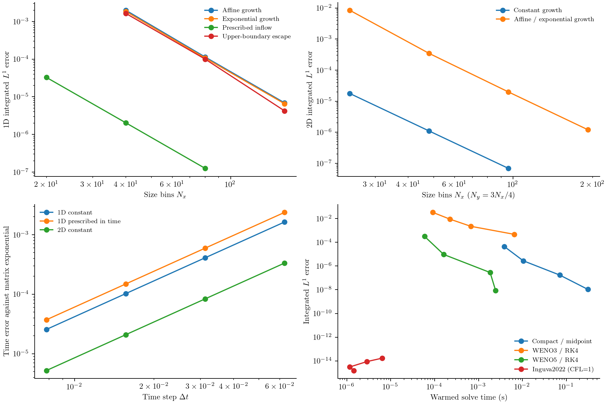
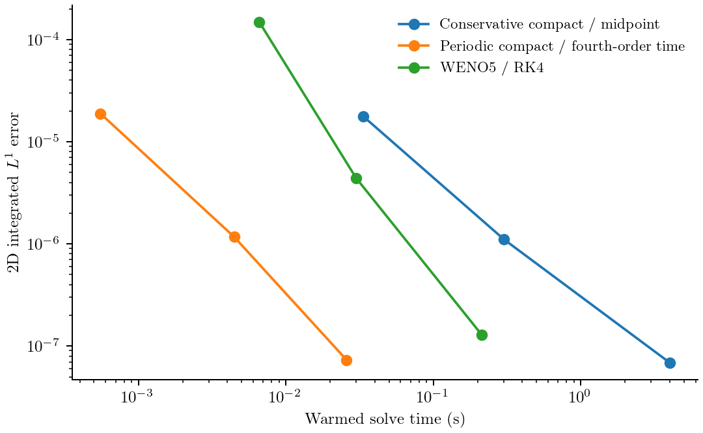
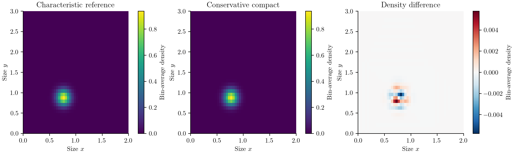
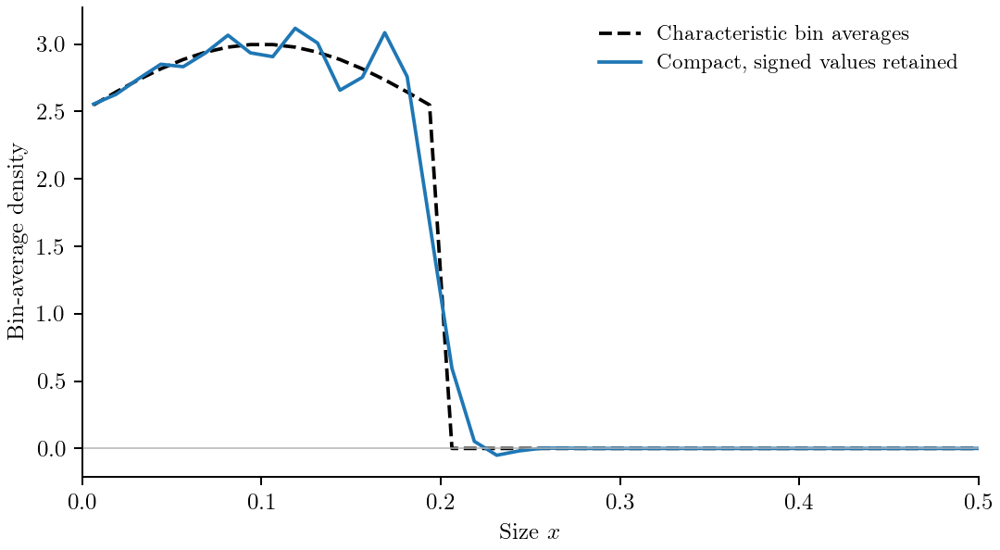
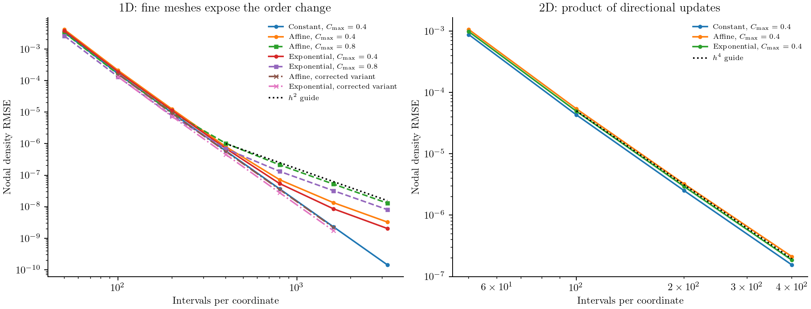

# Compact-method verification

A compact stencil obtains a derivative or a new time level by solving a banded
linear system. This can give high accuracy with few neighboring points, but it
does not by itself guarantee stable boundaries, positivity, or the advertised
order for variable coefficients. We check those properties separately.

## Conservative compact growth

The new `HOCFiniteVolume()` policy advances **bin-integrated populations** in
one or two size coordinates. It is a conservative adaptation, with fourth-order
interior spatial reconstruction and second-order time integration. It supports
declared positive size-dependent or prescribed time-dependent growth and
physical inflow/outflow. The older `HOCADI` policy below remains available for
periodic constant growth, including its verified fourth-order time composition.

### Start with a complete calculation

```julia
using PopulationBalanceModels
grid = Grid1D(range(0, 2; length=81); coordinate=:length)
growth = AffineGrowth(0.4, 0.15)
model = PBMModel(growth=Growth(growth))
bc = SizeBC(InflowFlux(1.0), OpenBoundary())
operator = compile(model, grid; evolution=HOCFiniteVolume(), bc)
# Integral of the positive stationary background 1/G(x).
initial = diff(log.(0.4 .+ 0.15 .* grid.edges)) ./ 0.15
problem = PBMProblem(operator, initial, (0.0, 0.4))
solution = simulate(problem; dt=0.0002)
diagnostics(solution).number_accounting[end]
```

For two coordinates, use
`Growth2D(SeparableGrowth2D(AffineGrowth(0.4,0.1), ExponentialGrowth(0.3,0.12)))`
and `SizeBC2D(x=bc_x,y=bc_y)`. Axis lengths, bin counts and spacings may differ.
[Runnable examples](../assets/source/examples/compact_growth.jl) include smooth
translations, incoming particles, variable growth and boundary nucleation.
The [benchmark driver](../assets/source/examples/benchmark_compact_growth.jl)
keeps reporting and timing outside those short model definitions.
Save both Julia files in the same directory if downloading them separately.

### Equation, states and compact faces

The supported physical equation is

```math
\frac{\partial f(x,t)}{\partial t}
+\frac{\partial [G(x,t)f(x,t)]}{\partial x}=S(x,t),
```

or its separable two-coordinate counterpart,

```math
\frac{\partial f(x,y,t)}{\partial t}
+\frac{\partial [G_1(x,t)f(x,y,t)]}{\partial x}
+\frac{\partial [G_2(y,t)f(x,y,t)]}{\partial y}=S(x,y,t).
```

States remain ``N_i=\int_{x_{i-1/2}}^{x_{i+1/2}} f\,dx`` and
``N_{ij}=\int\!\int_{C_{ij}} f\,dx\,dy`` per process volume. Thus
``U_i=N_i/h`` is a cell average. The independently derived face relation is

```math
\frac14\widehat f_{j-1}+\widehat f_j+\frac14\widehat f_{j+1}
=\frac34(U_j+U_{j+1}).
```

Here face ``j`` lies between cells ``j`` and ``j+1``. Expanding the **cell
integrals** about that face gives the same terms through ``h^2`` on both
sides; their difference is ``h^4 f^{(4)}/120+O(h^6)``. Consequently the smooth
face error is ``-h^4 f^{(4)}/180+O(h^6)`` and its interior flux difference is
fourth order. This is not an assumption that cell averages are nodal values.
For constant periodic growth, eliminating these faces gives
``M\dot{\mathbf N}=-gD\mathbf N``, with diagonal/off-diagonal mass weights
``1,1/4`` and ``D=3(E_+-E_-)/(4h)``. This is exactly the normalized
``\Delta t\to0`` spatial limit of Zhang2025 Eq. 15. Uniform bin integration
commutes with that constant-coefficient stencil. The new midpoint update does
not retain the paper's ``(g\Delta t/h)^2`` corrections or claim its fourth-order
time formula.
For variable growth, multiply the reconstructed density by the **face** rate:
``F_j=G(x_{j+1/2},t)\widehat f_j``. Applying a nodal stencil to ``G_iU_i``
would define a different discretization.

Periodic faces wrap. A physical left boundary prescribes number flux directly:
`OpenBoundary` and `NoFlux` give zero incoming flux; `InflowFlux` gives the
specified flux. Positive growth requires right `OpenBoundary`. Its trace is
the degree-four polynomial reconstruction from the last five cell averages:

```math
\widehat f_n=\frac{137}{60}U_n-\frac{163}{60}U_{n-1}
+\frac{137}{60}U_{n-2}-\frac{21}{20}U_{n-3}+\frac15U_{n-4}.
```

This outflow trace has fifth-order truncation error. Smooth whole-solve
physical-boundary convergence is measured separately below; periodic Fourier
stability alone is not a proof for this boundary closure.
In 2D each line contains populations integrated over its transverse bin.
Incoming `InflowFlux` values are uniform face-flux densities per transverse
size, multiplied by that bin's width. Nonuniform face profiles are not supported.

### Complete time update and number balance

At each directional step, freeze prescribed coefficients at the full step's
midpoint. Solve for a midpoint number flux using

```math
N_i^{\mathrm{new}}=N_i^{\mathrm{old}}+\Delta t(F_{i-1}-F_i),\qquad
\mathbf N^{\mathrm{mid}}=\mathbf N^{\mathrm{old}}
-\frac{\Delta t}{2}D\mathbf F^{\mathrm{mid}}.
```

Writing the compact relation as ``P\widehat{\mathbf f}=Q\mathbf N/h`` gives

```math
\left[P\,\operatorname{diag}(1/G^{\mathrm{mid}})
+\frac{\Delta t}{2h}QD\right]\mathbf F^{\mathrm{mid}}
=Q\mathbf N^{\mathrm{old}}/h,
```

with known inflow terms moved to the right. ``D\mathbf F`` means right minus
left flux. The interior system is tridiagonal. Periodic corners and the
one-sided outflow row use bounded-rank corrections to a tridiagonal LU:
setup, storage and each line solve cost ``O(n)``. Factors are reused only when
the directional step and **all** face rates are unchanged. Caches are local
to a simulation; `remake` rechecks parameters and builds fresh factors.

In 2D the composition is half x, full y, half x. Homogeneous separable
directional operators commute; the symmetric composition also handles the
supported inhomogeneous boundary data to second order. Interior point sources
use source/transport/source splitting, with midpoint quadrature at the quarter
and three-quarter times. The **complete method is second order in time**,
including prescribed time dependence and this source splitting. No negative
substep is used. No transformation ``u=Gf`` is used, so time dependence does
not lose a ``G_t`` contribution.
The order statement requires smooth solutions and sufficiently smooth
coefficient, source and incoming-flux histories. A discontinuity or singular
birth front does not satisfy the smooth spatial-error assumptions.

`Nucleation(J,lower_edge)` on a physical 1D domain supplies one incoming flux
``J(t)`` at the step midpoint. Interior point births contribute their cell
integral. A `Nucleation2D` corner contributes **once** to the containing cell,
not independently through two faces. That singular-source deposition preserves
injected number; it does not have smooth-density fourth-order accuracy or an
exact subcell size moment. Positive-growth outflow-face births are rejected.
Use `PrescribedRate((p,t,ctx)->...)` for prescribed source/inflow callbacks.
Do not specify the same boundary birth again as `InflowFlux`.

Every actual substep accumulates incoming number, births and the computed
signed outflow. At saved times, `diagnostics(solution).number_accounting` holds
`inflow` and `outflow` tuples by axis, `births`, `inventory`, and

```math
\mathrm{defect}=\sum N(t)-\sum N(0)
-\mathrm{inflow}-\mathrm{births}+\mathrm{outflow}.
```

These are integrated during the solves, not reconstructed from output samples.
They are historical number accounting, not an escaped-particle reservoir with
ongoing growth. Sectional state lengths are unchanged. Material moments
generally **change** under growth. Existing `moment` observations retain their
center-weighted bin convention; their quadrature error is separate from the
transport order. No population–bulk exchange is implemented for this policy.

### Compilation contracts and supported combinations

| Feature | `HOCFiniteVolume` | Older `HOCADI` |
|:--|:--|:--|
| Representation | Bin integrals, 1D/2D; uniform rectangular axes, at least six cells each | Bin integrals, 2D periodic uniform axes, at least five cells |
| Growth | Strictly positive `AffineGrowth`, `ExponentialGrowth`, `TimeScaledGrowth`; declared `HOCGrowthLaw` | Constant finite velocity tuple, including signed/zero components |
| Time dependence | Prescribed, evaluated at the midpoint; order 2 | Autonomous only |
| Boundaries | Paired periodic, or left zero/prescribed inflow and right open outflow | Periodic only |
| Source | Prescribed point nucleation as described above; order 2 in time | None |
| Temporal order | 2 | 2 or 4; fourth order only in this reversible scope |
| Bulk/axial/collisions/removal | Rejected; use residual methods | Rejected |
| Positivity | Not guaranteed; default checks reject negative bin populations | Not guaranteed |
| External ODE/AD sensitivities | Not supported | Fully discrete update, no ODE residual |

Compilation checks the **assembled model**, not just the growth term. Ordinary
unclassified callbacks are rejected, even if diagnostic samples match an affine
law. Existing callbacks continue to work for residual methods. For a general
law, explicitly declare its assumptions:

```julia
law = HOCGrowthLaw((x,p,t,ctx) -> 0.4 + 0.1sin(2pi*x);
    lower_bound=0.3, dependencies=(:coordinate,), periodic=true)
```

This declares a positive C⁶ law on the entire compiled axis and, here, a smooth
periodic extension. It is a user contract, not a mathematical proof obtained
from probes. Allowed dependencies are the own `:coordinate`, `:time`,
`:parameters`, and prescribed `:fields`. `:bulk`, population feedback and the
other direction's coordinate are rejected. The lower-bound callback has
signature `(p,t,ctx)` and must bound the full spatial domain. All numerical
face values and the bound are checked when constructing/remaking a problem,
at coefficient evaluations and at accepted endpoints. The contract must also
hold between sampled times; arbitrary callbacks cannot be certified there.
Simulation entry repeats the numerical checks, including requests that save
only the initial time, so changed parameter containers or fields cannot reuse
an earlier problem-construction check.
Nonconstant affine/exponential laws require physical boundaries. Unknown
periodic laws need `periodic=true`, including matching derivatives.
For this policy, `TimeScaledGrowth` uses an affine or exponential autonomous
spatial law; other prescribed smooth laws use `HOCGrowthLaw` directly.

For physical boundaries or spatially variable laws, the verified envelope
requires ``\max(G^{\mathrm{mid}})\Delta t/h\le1`` on each axis, using the numerical
face rates. The solver rejects violations
and suggests a smaller step. This restriction is **not** a positivity theorem.
Spatially constant periodic growth has unit-modulus midpoint factors for any
Courant number, but accuracy still requires time refinement. Resolve narrow
source pulses independently of this transport restriction. Dispersive negative
lobes remain possible; `check_nonnegative=false` explicitly retains them for
diagnostics without clipping. Even a positive cell state can have a signed
reconstructed outflow trace, so outflow accounting uses the actual signed flux.

### Relation to the three papers

All three local full papers and the available two-page Li supplement were
reviewed. No other supporting information for these papers was present locally.

| Primary source | Published construction and implementation consequence |
|:--|:--|
| [Zhang et al. (2025)](https://doi.org/10.1021/acs.iecr.4c02816), Eqs. 15, 20, 30–32 | Nodal density, or autonomous transformed nodal ``u=Gf``; two-level three-point HOCD. Eq. 32 is a Godunov point-source addition and does not establish high-order source integration. Its variable-growth coefficients also appear in Li SI S11. |
| [Li et al. (2026)](https://doi.org/10.1016/j.partic.2026.01.024), Eqs. 6–16, 18–22; SI S1–S11 | Nodal 2D ADI with intermediate states and a multilevel recovery, ``f^{k+1}=2\bar f^k-f^{k-1}``. Autonomous separable transformation ``u=G_1G_2f``; point source added once. This is not a product of the SI one-step updates. |
| [Fu et al. (2025)](https://doi.org/10.1016/j.camwa.2025.08.004), Eqs. 5, 19–35, 60–84 | Cell-average characteristic finite volume, conservative parabolic remapping and a compact **diffusion** solve; second-order time, fourth-order spatial claims. In the linear pure-growth, zero-diffusion limit, the residual characteristic flux vanishes and Eq. 35 reduces to ``hU_i^{n+1}=\int_{\bar C_i}f^n dx``. Its compact diffusion operator cancels; it is not an implicit compact growth operator. |

The new face interpolation, physical outflow closure and midpoint flux solve
above are **independently derived**, informed by compact reconstruction and
Fu's integral conservation requirement. They do not reproduce the Zhang/Li
fully discrete coefficients or claim Fu's characteristic remapping algorithm.
No artificial diffusion is added to the pure-growth equation.

The full Li formulation does not remove the SI audit's one-step finding: those
are different algorithms. In particular, the main Eq. 8 writes an implicit
intermediate update from ``f^k``, while Eq. 16 recovers from ``f^{k-1}``;
the correspondence of these stages to SI S11, the startup values and explicit
one-sided boundary coefficients are not fully specified. Eqs. 6, 8–15 also
print a common ``g_1g_2`` multiplier where the physical directions have distinct
velocities. We therefore cannot infer an unequal-velocity production scheme
by treating those lines as independent S11 steps. The literal and independently
corrected **nodal one-step** audits below remain intact. Their order loss is
not presented as a numerical result for the complete published multilevel ADI.

There is also a temporal-stage consistency issue under the literal reading
of Eqs. 8 and 16. For an exact advection mode ``f^k=e^{-\mathrm i\omega t_k}``,
Eq. 16 requires ``\bar f^k=\cos(\omega\tau)f^k``. Inserting that value into
Eq. 8's apparent intermediate equation
``(\bar f^k-f^k)/\tau+K\bar f^k=0``, even with exact ``K=\mathrm i\omega``,
leaves a residual tending to ``\mathrm i\omega f^k`` rather than zero.
[main_stage_check.csv](../assets/li_supplement/main_stage_check.csv) records
this check; its normalized residual approaches one. This identifies which
interpretation needs clarification; it is not a claim that a reconstructed
full-paper implementation has been tested and disproved. `main_stage_check()`
in the existing supplement audit reproduces it separately.

### Executed refinement and work–precision evidence



The spatial panels use analytic **bin integrals**, with a fixed small time step
across meshes. The temporal panel holds the mesh fixed and compares with an
independent dense matrix exponential of the semidiscrete compact operator;
this removes spatial error from the time-order measurement. It includes
prescribed ``G(t)=0.4(1+t^2)`` and a rectangular 2D case. The work–precision
panel measures one warmed solve and compares total integrated absolute error,
``\sum_i|N_i-N_i^{\mathrm{ref}}|``, at the same physical final time. WENO3/5
use RK4; Inguva2022 uses its separate CFL=1 restriction. This comparison does
not assert an efficiency ranking from equal grid sizes.

The extra `temporal_affine_inflow` rows use the continuum solution
``f(x,t)=\exp(-0.15t)`` with ``G(x)=0.4+0.15x`` and its exact incoming flux.
The spatial reconstruction is exact for this constant density and affine
flux, so its time refinement has no spatial-error floor. Boundary, interior
and corner source time tests instead use independent augmented matrix
exponentials for the same unmodified semidiscrete equations.



The 2D comparison also includes the older periodic fourth-order time
composition. It is eligible here because there are no sources or physical
boundaries. The new midpoint method often needs more steps to reach small
errors: a fourth-order spatial stencil does not remove second-order time
error. These are single measured solves after a separate full warm-up, not
statistical timing estimates. Very short timings and their ordering are
sensitive to runtime noise. Inguva's eligible whole-cell shifts reach the
roundoff floor; their small nonzero slopes have no accuracy interpretation.
WENO3's finite-range slopes are measured, not assumed to be its nominal order.



This field has ``G_1=0.4+0.1x`` and ``G_2=0.3\exp(0.12y)`` on
``[0,2]\times[0,3]``, at ``t=0.25``. The plotted values are bin-average
densities on a 48 by 36 mesh, with a characteristic **bin-integral** reference.
The error panel exposes the small dispersive redistribution around the peak;
the source-free number remains conserved up to the explicitly recorded
boundary flux and roundoff. Negative values are retained in the exports.



For ``G=0.4`` and ``J(t)=1+0.2\sin(2\pi t)``, the oldest newborn particles
reach ``x=0.2`` at ``t=0.5``. The front and its oscillations are expected for
this unlimited compact scheme, not evidence of smooth fourth-order accuracy.
At 160 bins, the minimum density is about -0.0503 and the negative population
is about ``8.57\times10^{-4}``. The numerical number balance is near roundoff,
while midpoint integration of the true source count has an error of about
``4.19\times10^{-9}``: conservation and quadrature accuracy are different
checks. The example also supplies a populated-start run that keeps the normal
nonnegativity check enabled. [rejections.csv](../assets/compact_fv/rejections.csv)
retains the default front rejection and unsupported model/configuration checks.

Exact measured values, allocation counts, step counts, bin-moment errors,
number-balance defects and signed minima are in [results.csv](../assets/compact_fv/results.csv).
`M0_error` compares reference and computed inventories; it is not the flux-balance
defect. `M1x_error` and `M1y_error` are respectively
``|\sum x_i(N_i-N_i^{\mathrm{ref}})|`` and its y analogue, using bin centers.
`negative_number` is ``-\sum\min(N_i,0)``; `minimum_density` divides each bin
number by its width/area before taking the minimum. `RMSE` is the spatially
weighted root-mean-square difference of bin-average densities.
[orders.csv](../assets/compact_fv/orders.csv) reports measured slopes rather
than nominal labels. [environment.txt](../assets/compact_fv/environment.txt)
records CPU, Julia and thread settings. Sharp-front rows retain undershoots;
they do not support smooth convergence-rate claims. Standard tests also cover
zero-start boundary births, one-time 2D corner deposition, coefficient changes,
invalid contracts, dense directional solves and singular systems.

All 80 timed configurations explicitly retain signed values with
`check_nonnegative=false`; completion is not a claim of nonnegative density.
The source matrix-exponential tests can converge in time to a signed
semidiscrete state. That checks the time update, not the physical accuracy of
an unresolved singular distribution. The ordinary example runs retain the
default checks, except for the clearly labelled front/field diagnostics.

| Independent refinement | Finest measured order |
|:--|--:|
| 1D affine growth | 4.043 |
| 1D exponential growth | 4.038 |
| Smooth physical incoming flux | 4.023 |
| Rectangular constant-growth translation | 4.002 |
| Rectangular affine/exponential growth, 192 by 144 finest mesh | 4.036 |
| Constant, prescribed-time, and rectangular time refinement | 2.000 |
| Affine growth with exact continuum incoming-flux solution | 2.000 |
| Boundary, cell and corner source time refinement | 2.000 |

The absolute number-balance defect across these runs stays below
``3.2\times10^{-13}`` per unit process volume. The outgoing-Gaussian rows
`upper_escape` compare a finite-support initial population leaving the upper
boundary against characteristic bin integrals; escaped number comes from the
same flux used in the state update. Verification sizes and physical times use
consistent arbitrary units; wall times below are seconds.

For orientation, these are the single measured 48 by 36 periodic solves on
the recorded i9-13900H, Julia 1.10.3, one Julia/BLAS thread:

| Complete method | Steps | Integrated error | Solve time (s) | Allocated (MB) |
|:--|--:|--:|--:|--:|
| Conservative compact / midpoint | 2,017 | 1.10e-6 | 0.302 | 50.6 |
| Periodic compact / fourth-order time | 12 | 1.17e-6 | 0.00445 | 0.868 |
| WENO5 / RK4 | 48 | 4.40e-6 | 0.0300 | 12.0 |

These controls differ deliberately: midpoint uses ``\Delta t=0.2/(0.7N_x^2)``
to balance spatial and time error; the periodic fourth-order composition and
WENO5 use Courant bounds 0.4 and 0.1 respectively. All use the same physical
problem, initial bin integrals and final time. Spatial-order studies instead
hold ``\Delta t=2\times10^{-5}`` fixed. The allocation cleanup was checked to
leave all previously exported numerical quantities bit-for-bit unchanged.
The [unit-rescaling check](../assets/compact_fv/unit_rescaling.csv) changes
coordinate and time units independently: bin populations and cumulative
number accounting agree within ``4.8\times10^{-16}`` per process volume.

```sh
julia --project=. examples/compact_growth.jl
julia --project=. examples/benchmark_compact_growth.jl
python docs/benchmarks/plot_compact_growth.py --usetex
julia --project=. -e 'using Test, PopulationBalanceModels; include("test/compact_finite_volume.jl")'
```

## Earlier periodic compact policy and nodal audits

The public `HOCADI` method is the periodic constant-velocity compact/Cayley
variant specified on the [time-integration page](time.md). Its Fourier factors
have unit modulus. The existing dense-matrix comparisons and long-period tests
check that implementation. Negative lobes near a sharp front remain possible.
It does not implement the size-dependent algorithm in
[Li et al. (2026)](https://doi.org/10.1016/j.partic.2026.01.024).

## Check the supplement independently

`examples/audit_li2026_supplement.jl` transcribes the five coefficients of the
supplement's Eq. S11. For one size coordinate the physical equation is

```math
\frac{\partial f(a,t)}{\partial t}
+\frac{\partial [G(a)f(a,t)]}{\partial a}=0.
```

For positive, autonomous growth, defining ``u(a,t)=G(a)f(a,t)`` gives

```math
\frac{\partial u(a,t)}{\partial t}
+G(a)\frac{\partial u(a,t)}{\partial a}=0.
```

The printed S11 step is

```math
p_{1,i}u_i^{n+1}+p_{2,i}u_{i+1}^{n+1}+p_{3,i}u_{i-1}^{n+1}
=p_{1,i}u_i^n+p_{4,i}u_{i+1}^n+p_{5,i}u_{i-1}^n.
```

The audit treats ``\tau`` as the time step and ``\lambda=\tau/h``. It uses
**nodal densities** on a uniform mesh. Package `Grid1D` and `Grid2D` states are
bin integrals, so applying these coefficients directly to those states would
introduce a separate representation error. The audit is deliberately separate
from `compile` and `simulate`.

We test three laws on ``0\le a\le2``:
``G=0.1``, ``G=0.1+0.05a``, and ``G=0.1\exp(0.2a)``. The last law exercises
both first and second growth derivatives in the printed coefficients. The
initial density is ``\exp[-((a-0.6)/0.08)^2]``. The exact comparison follows
characteristics:

```math
\frac{da(t)}{dt}=G(a(t)),\qquad
f(a,t)=\frac{G(a_0)}{G(a)}f(a_0,0).
```

The one-dimensional run supplies exact time-dependent Dirichlet endpoints.
For two dimensions, separable rates allow ``u=G_xG_yf`` and a product of the two
S11 directional updates. A second Gaussian factor is centered at 0.7 with width
0.1. Its exact solution is negligible at all four faces over ``0\le t\le1``;
that diagnostic uses zero Dirichlet faces. This directional product is not a
transcription of the main paper's multilevel ADI equations or its physical
boundary closure.

## Results and unresolved issues



At a maximum Courant number of 0.4, the 50–400-interval results initially look
fourth order for all three laws. Extending the one-dimensional test to 3200
intervals changes the conclusion: the variable-growth errors eventually
approach second order. For ``G=0.1+0.05a`` at a maximum Courant number of 0.8,
the last two refinement slopes are approximately 2.03 and 2.00. The exponential
law gives approximately 2.04 and 1.99. The constant-growth test continues to
show fourth-order behavior before roundoff dominates.

The maximum Courant number is a requested bound; the actual time step is
shortened uniformly to reach the final time. The CSV records the actual step.
At a requested bound of 2, this Dirichlet implementation can become singular
or amplify errors enormously. For example, with constant growth and an actual
Courant number of 2, S11 has ``p_1=0`` and ``p_3=0``. The interior tridiagonal
matrix with both endpoint values prescribed is singular. This is a concrete
boundary/step limitation of this transcription, not evidence that every
compact or periodic implementation is unstable.

The main paper's multilevel equations, the relationship to S11, and its
high-order physical boundary closure therefore still need reconciliation.
We do not attribute altered coefficients to the paper or claim a reproduction
of its fourth-order space–time method for variable growth. The conservative
adaptation above has its own derivation and evidence. The script retains singular failures, nonfinite
errors, negative minima, and coarse-grid oscillations in
[errors.csv](../assets/li_supplement/errors.csv).

```sh
julia --project=. examples/audit_li2026_supplement.jl
python docs/benchmarks/plot_compact_audit.py --usetex
```

## A separately specified accuracy correction

The audit also contains an independently derived coefficient variant. It keeps
the literal S11 result available for comparison. Under the one-step
interpretation above, substituting a smooth exact solution into S11 leaves the
following leading time-error contribution after division by the time step:

```math
\frac{\tau^2}{24}\left[
\big(G^2G''-G(G')^2\big)\frac{\partial u}{\partial a}
-G^2G'\frac{\partial^2u}{\partial a^2}\right].
```

This term vanishes for constant growth and generally remains for variable
growth. It explains why a constant-growth test did not expose the order loss.
Writing ``\lambda=\tau/h``, the independent variant changes the printed
coefficients by

```math
\widetilde p_1=p_1+\frac{G\tau^2G''}{24},\qquad
\delta=\frac{G\tau\lambda G'}{48},
```

```math
\widetilde p_2=p_2-\delta,\quad
\widetilde p_3=p_3+\delta,\quad
\widetilde p_4=p_4-\delta,\quad
\widetilde p_5=p_5+\delta.
```

These changes cancel that residual; they are not printed coefficients attributed
to Li et al. Select `variant=:consistent` in the audit's `run1d` or `run2d`.
For affine and exponential growth, the fine one-dimensional slopes return to
approximately 4.00, and the two-dimensional product tests also approach fourth
order. The values are retained in
[consistent_variant.csv](../assets/li_supplement/consistent_variant.csv).

This is evidence for a specified smooth nodal variant over the tested regime.
It does not resolve the main paper's multilevel interpretation, the singular
large-step Dirichlet case, positivity, or a general physical boundary closure.
Neither audit variant is exposed as a production `compile` method. The public
periodic `HOCADI` behavior remains unchanged.

## What the other supplied papers add

The literature review also identifies schemes with distinct implementation
requirements:

| Source | Consequence for this package |
|:--|:--|
| [Zhang et al., CADET Part I (2024)](https://doi.org/10.1016/j.compchemeng.2024.108612) | Two-stencil third-order WENO and van Leer limiting motivate the new `WENO3` and `VanLeer` growth choices. Local cell geometry is used on nonuniform 1D meshes. These are not a CADET backend. |
| [Ketcheson et al., PyClaw (2012)](https://doi.org/10.1137/110856976) and the supplied Clawpack paper | Wave-propagation methods are a separate solver family. The package's conservative face-flux methods do not implement Clawpack's Riemann-solver machinery. |
| Kumar et al., Powder Technology 189 (2009), 218–229 | Cell-average and conservative finite-volume collision algorithms differ from the implemented fixed-pivot event deposition. They need their own number/volume and overflow tests before being exposed. |
| Zhang et al., CADET Part II (2025), CCE 192, 108860 | Weighted finite-volume and moment-conserving collision methods are further candidates. A shared collision interface does not mean these algorithms are already implemented. |
| Inguva et al., Biotechnology Advances 84 (2025), 108643 | Additional nanoparticle physics motivates explicit material closures. CFD and phase-field coupling remain outside the active package scope. |

New growth choices are available through `TermMethods(growth=...)` and tested
for signed velocities and number conservation. Their formal orders and boundary
fallbacks are described on the [growth page](growth.md); whole-solve convergence
is measured in the [constant-growth comparison](../case_studies/constant_growth.md).
