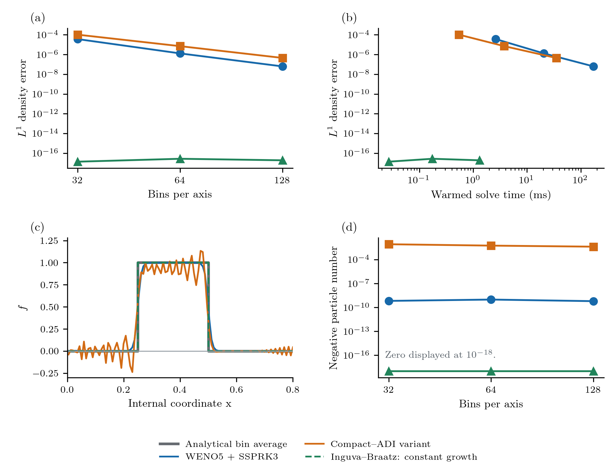

# Time integration

## Advancing the assembled equations

After spatial/internal-coordinate discretization the state satisfies

```math
\frac{d\mathbf u(t)}{dt}=\mathbf R(\mathbf u(t),t;\mathbf p).
```

``\mathbf u`` contains all bin numbers or moment states and any bulk ODE states.
Each term method contributes to ``\mathbf R``. Time integration is selected by
`simulate(problem; method=...,dt=...)`; it is not a property of Growth or Nucleation.

`SSPRK33()` uses the following three-stage update:

```math
\begin{aligned}
\mathbf u^{(1)}&=\mathbf u^m+\Delta t\,\mathbf R(\mathbf u^m,t_m),\\
\mathbf u^{(2)}&=\frac34\mathbf u^m+\frac14\left[
\mathbf u^{(1)}+\Delta t\,\mathbf R(\mathbf u^{(1)},t_m+\Delta t)\right],\\
\mathbf u^{m+1}&=\frac13\mathbf u^m+\frac23\left[
\mathbf u^{(2)}+\Delta t\,\mathbf R(\mathbf u^{(2)},t_m+\Delta t/2)\right].
\end{aligned}
```

All mechanisms, shared concentrations, and prescribed fields use the current
stage state/time. Freezing the concentration while advancing the PSD would be
a different method. SSP describes inheritance of a forward-Euler stability
property under a compatible step restriction; it does not guarantee positivity
for an arbitrary spatial reconstruction.

`dt` is a maximum fixed step, shortened to land on output times. Default state
checks reject nonfinite values and concentrations below `-negative_tolerance`
(default ``10^{-12}``), at SSPRK stages. Values are not clipped.
`suggest_dt` estimates an explicit transport/source bound, including outgoing
face velocities and removal/collision hazards. It is not a proven positivity
bound for WENO or custom residuals. For 2D unsplit transport the sum of both
coordinate Courant numbers matters.

Load SciMLBase to use `odeproblem(problem)` with an external ODE solver. This
exports the same residual, including bulk equations. An adaptive or stiff solver
still needs a suitable error scale and treatment of nonnegative states. It does
not export direct compact or exact-shift updates.

## Compact/ADI variant

`HOCADI(time_order=2)` or `HOCADI(time_order=4)` advances homogeneous constant
growth on uniform periodic 2D grids. It rejects sources, bulk coupling, and
physical nonperiodic compact boundaries. Its spatial derivative is defined by

```math
\frac14d_{i-1}+d_i+\frac14d_{i+1}
=\frac{3}{4h}(f_{i+1}-f_{i-1}),\qquad M\mathbf d=D\mathbf f.
```

Each coordinate uses a Cayley solve,

```math
\left(M+\frac{g\Delta t}{2}D\right)\mathbf f^{\mathrm{new}}
=\left(M-\frac{g\Delta t}{2}D\right)\mathbf f^{\mathrm{old}}.
```

One x solve and one y solve define ``S_2``. The fourth-order time composition is

```math
S_4(\Delta t)=S_2(\gamma\Delta t)S_2((1-2\gamma)\Delta t)S_2(\gamma\Delta t),
\qquad \gamma=(2-2^{1/3})^{-1}.
```

The negative middle step is restricted here to reversible autonomous transport.
It must not be applied to irreversible nucleation, collision, or bulk processes.
Cyclic tridiagonal factorization uses a rank-two correction; each directional
sweep costs linear work in the number of tensor cells.

This is a specified variant, not a verified transcription of Li et al.,
[doi:10.1016/j.partic.2026.01.024](https://doi.org/10.1016/j.partic.2026.01.024).
The paper's supplementary coefficients and printed-update ambiguities have not
been resolved. Its name does not establish reproduction of that paper.

## Stability is different from positivity

For a periodic Fourier mode with wave angle ``\theta``, the compact matrices
have symbols ``m=1+\frac12\cos\theta`` and
``d=\frac{3\mathrm i}{2h}\sin\theta``. A directional Cayley step has amplification

```math
A(\theta)=\frac{m-\mathrm i z}{m+\mathrm i z},\qquad
z=\frac{3g\Delta t}{4h}\sin\theta,\qquad |A(\theta)|=1.
```

The fourth-order composition is also unit modulus, including its negative step.
Thus this periodic constant-growth discretization has no growing Fourier mode
in exact arithmetic. It is dispersive and does not preserve positivity.
Narrow Gaussians and fronts can develop substantial negative undershoots even
while the discrete L2 norm remains constant.

`examples/audit_compact_adi.jl` checks every resolved Fourier mode over signed
Courant numbers 0.1–10 and evolves smooth/rectangular profiles for ten periods.
The recorded norm changes are below ``5\times10^{-14}``; negative densities
remain. Independent dense-matrix tests verify the cyclic solves for both time
orders. These results support stability of the implemented periodic variant,
not a positivity claim or physical-boundary/paper-fidelity claim.
The figure below retains the smooth-profile and sharp-front evidence for this
periodic constant-growth diagnostic. In particular, the front cut shows the
negative lobes despite bounded norm. The
[two-coordinate growth case](../case_studies/transport.md) is a separate,
coordinate-dependent physical problem.



## Exact integer shifts

`ExactShift()` implements the eligible constant-growth class of Inguva and Braatz
(2023). Each direction must travel an integer number of cells at every step and
output time. Periodic or paired open zero-inflow boundaries are supported.
Fractional remapping is rejected. An integer shift moves bin numbers exactly;
no interpolation or flux reconstruction is required.

This property does not extend automatically to transformed variable-growth
meshes, noncommuting velocities, or source terms. The [travel-time adapter](../case_studies/transport.md) explicitly transforms
the separable affine growth laws to constant velocities before using
ExactShift. This does not make the core method a general variable-growth solver.
