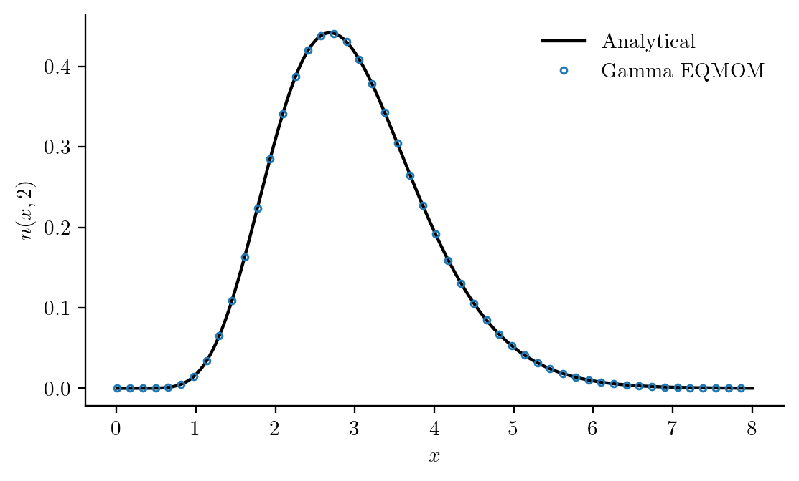

# Moment methods

Sometimes the quantities of interest are total number, mean size, or total
particle material rather than every bin of a distribution. A moment model
advances integrals directly:

```math
\mu_k(t)=\int_0^\infty x^kn(x,t)\,dx.
```

This differs from calling `moment(grid,N,k)` on a sectional solution. In a
moment model the moments are the dynamical variables. We need equations for
their rates, and often an assumption to express those rates using finitely many
tracked moments.

## Integrate the balance against a particle property

For vanishing unmodelled boundary flux, the growth, source, removal, and collision
contributions are

```math
\frac{d\mu_k(t)}{dt}
=k\int_0^\infty x^{k-1}G(x,t)n(x,t)\,dx+J(t)x_c^k+S_k(t)
-\int_0^\infty x^kd(x,t)n(x,t)\,dx+\mathcal A_k(t)+\mathcal F_k(t),
```

with additive-coordinate aggregation

```math
\mathcal A_k(t)=\frac12\int_0^\infty\int_0^\infty
[(x+y)^k-x^k-y^k]K(x,y,t)n(x,t)n(y,t)\,dx\,dy
```

and breakage

```math
\mathcal F_k(t)=\int_0^\infty a(x,t)n(x,t)
\left[\sum_j\nu_j(x,t)x_j(x,t)^k-x^k\right]dx.
```

For a nonadditive coordinate, the aggregate size is obtained through the declared
AdditiveCoordinate map. Boundary losses at zero or infinity are not inferred.
The residual rules do not infer an extinction trace. Native
[MeasureEuler with explicit absorption](methods/realizable_evolution.md) instead
uses positive atomic characteristics and node removal, with rank refinement
needed for a continuous population.

## Use an exact closure when the equations close

Affine growth and constant-kernel aggregation in an additive coordinate produce
a closed hierarchy through any chosen integer order. Declare the polynomial
structure so the compiler can find its moment dependencies:

```@example moments
using PopulationBalanceModels
basis = MomentSet(0:3;coordinate=:volume)
model = PBMModel(
    growth=Growth(rate=PolynomialRate(((p,t,ctx)->p.g,0.1))),
    primary=Nucleation(rate=(p,t,ctx)->p.J,size=0.0),
    aggregation=Aggregation(ConstantKernel((p,t,ctx)->p.K)),
)
operator = compile(model,basis;closure=ExactClosure())
problem = PBMProblem(operator,[1.0,1.0,2.0,6.0],(0.0,1.0);
    p=(g=0.2,J=0.1,K=0.3))
solution = simulate(problem;dt=0.001)
vec(solution.u[end])
```

ExactClosure also supports polynomial removal, self-similar polynomial-rate
breakage, point creation, and MomentSource. Removal and breakage polynomial
coefficients must be nonnegative; growth coefficients may be signed. Compilation
rejects equations that need untracked moments. A distributed source must provide
its raw moments through `MomentSource(J,(k,p,t,ctx)->E_xk)`.

The [cooling-crystallization model](case_studies/crystallization.md) has an exact
four-moment closure because its growth is affine in length. Its
`build_moments` routine uses the same kinetic parameters and nucleation callback
as the sectional builder, and couples the third moment to dissolved concentration.
This supplies a useful check independent of the sectional discretization.

## Approximate an unclosed hierarchy

General size-dependent rates can require integrals that the tracked moments do
not determine. The implemented approximation families make different assumptions:

- `QMOM(n)` (also `QuadratureClosure(n)`) reconstructs positive quadrature nodes
  and weights from moments 0:2n−1. The rate callbacks are evaluated through their
  weak forms at those nodes. Scaled Hankel inversion is checked by reconstructing
  the input moments. Empty states are supported; rank-deficient nonempty states
  fail rather than silently changing node count or repairing moments.
- `LogNormalClosure(quadrature_order=16)` fits a lognormal density to moments
  0:2 and integrates its weak forms with cached normal quadrature. Empty and
  point-mass limits are supported. A three-moment assumed density cannot recover
  multimodality, even if its weak-form quadrature is accurate.

`realizability` reports necessary Hankel positivity checks. These do not prove
realizability at singular truncated-moment boundaries. A closure needs its own
accuracy and convergence assessment; selecting QMOM does not establish agreement
with a full size distribution for nonlinear nanoparticle kinetics.

The [aggregation and nucleation case study](case_studies/moment_crystallization.md)
compares fixed and rank-adaptive QMOM, Gamma EQMOM, DQMOM and the lognormal
closure. It separates analytical and sectional references, checks time and
reconstruction quadrature separately, and retains failed trajectories in the
comparison. Tracked material moments and material inferred from an assumed
shape are identified separately.
Continuous daughter laws may supply `daughter_moment(law,parent,k,p,t,ctx)`;
`UniformVolumeDaughters` gives its exact inner integral. Outer population
integrals still use the chosen moment reconstruction.

## Select weak-form rules and couple populations

The reconstruction family and each term's integration rule can be chosen
separately. For example:

```julia
operator = compile(model,basis;method=QMOM(2),
    methods=TermMethods(growth=ExactMomentRule(),
                        aggregation=QuadratureMomentRule()))
```

Here polynomial growth is integrated analytically while aggregation uses the
reconstructed quadrature. `closure=` remains available for raw-moment families.
The reconstruction is shared within a residual evaluation; `term_methods(operator)`
records the rules used. `examples/moment_closures.jl` exercises the original
families; the comparison below adds the adaptive, extended and direct families.

Native Runge–Kutta methods check the selected closure at accepted states as well
as before rate evaluations. A realizable vector can still fail a chosen closure
or its integration quadrature; reducing the timestep alone need not resolve
that failure. Finite-support initial moments must satisfy the necessary
inequalities ``a\mu_k\leq\mu_{k+1}\leq b\mu_k``. These inequalities and Hankel
checks are not a complete certificate for singular truncated moment problems.
The stronger positive-measure reconstruction belongs to the explicitly selected
[MeasureEuler policy](methods/realizable_evolution.md).

Lognormal integration checks each tracked moment in its own units, using
``\mu_0(\mu_1/\mu_0)^k`` as its absolute scale. Changing from metres to
micrometres therefore does not change reconstruction eligibility. The
standard-normal Gauss rule obtains weights from orthonormal Hermite polynomials
using the [Christoffel identity](https://dlmf.nist.gov/3.5), preserving tiny
positive weights that a generic eigenvector calculation can lose. Increasing
`quadrature_order` improves integration of an assumed shape; it does not make
that shape more representative of the physical population.

Moment populations can share a PBMSystem with 1D sectional populations.
`MomentExchange(:particles,:c,k;factor=...)` derives bulk exchange from the actual
moment rate. Its invariant ``c+\mathrm{factor}\,\mu_k`` assumes a fixed conversion
factor; a changing density or composition needs its additional balance.
PopulationTransfer and CrossAggregation currently require sectional populations;
moment interactions can be written explicitly through CustomCoupling.

Use MomentObservable, PopulationMoment, or a custom observation to measure the
result. Histogram predictions require a declared reconstruction or measurement
model. Optim and SciML adapters can use moment problems, subject to the same
closure and boundary restrictions.

## Adapt the quadrature rank

`RankAdaptiveQMOM(max_nodes)` keeps moments 0:2max_nodes−1 as the ODE state.
During each residual evaluation it tries quadratures with increasing rank and
accepts the smallest one that reproduces **every tracked moment**, including
moments not used in that smaller inversion. This allows an empty or point-mass
population without pretending its Hankel matrix has full rank. `rtol` controls
the scaled reconstruction residual; it does not change the number of ODE states.
No moment vector is clipped or projected to make inversion succeed.
Empty-state inversion does not by itself solve nucleation/growth startup: an
explicit Runge–Kutta predictor can leave the realizable-moment cone. There is
no special startup regularization; use a suitable realizability-preserving
integration/initialization or a sectional population for that stage.

```@example adaptive_moments
using PopulationBalanceModels
basis = MomentSet(0:5)
nodes, weights = [1.0,3.0], [0.4,0.6]
mu = [sum(weights .* nodes.^k) for k in 0:5]
q = quadrature(basis,mu,RankAdaptiveQMOM(3))
(q.rank, q.nodes, q.moment_error)
```

A tolerance-based rank decision is discontinuous. Inference through these
eigenvalue inversions is not supported by ForwardDiff; select explicit finite
differences and check the stability of the rank under perturbation.

A lognormal quadrature must resolve both the evolved moments and the rate
integrands. For example a size-sixth-power breakage law in a three-moment model
uses inferred M6, M7 and M8. Passing the M0–M2 reconstruction check says nothing
about their integration error; refine `quadrature_order` and the timestep
independently. A rapidly growing inferred tail can also make the closure's own
equations singular. Neither effect is a particle/material conservation law.

## Reconstruct a density with Gamma EQMOM

A quadrature rule represents integrals. It does not by itself define a smooth
PSD. Gamma EQMOM makes an additional kernel assumption:

```math
n(x,t) \approx \sum_{i=1}^{N} w_i(t)
\frac{x^{\alpha_i(t)-1}\exp[-x/\sigma(t)]}
{\Gamma[\alpha_i(t)]\sigma(t)^{\alpha_i(t)}},
\qquad \alpha_i(t)=\frac{\xi_i(t)}{\sigma(t)}.
```

Each kernel has mean ``\xi_i``, variance ``\xi_i\sigma`` and the same positive
scale ``\sigma``. `EQMOM(N)` uses moments 0:2N, one more than ordinary QMOM.
Triangular deconvolution removes the Gamma-kernel contributions from the raw
moments. A bracketed search finds the realizability boundary of the deconvolved
Hankel matrices. The primary quadrature is accepted only if the original
mixture reproduces all input moments. A failed Float64 primary inversion is
retried with a 256-bit width search and factorization of the same moment vector;
`q.inversion_precision` reports 53 or 256 bits. The small final Jacobi eigenproblem
and returned nodes/weights remain Float64. This arithmetic refinement does not
change the kernel family, the requested reconstruction tolerance or the evolved
moments. It cannot remove genuine family infeasibility or uncertain input moments.
Some nonnegative moment vectors cannot be represented by this family; those
inputs fail explicitly. The [audit diagnosis](audit.md)
gives independent examples of ill-conditioning and failure of three-kernel
Gamma feasibility.

The rates are integrated with a secondary Gauss–Laguerre rule within each
kernel. `secondary_nodes` controls that integration accuracy independently of
`N`, the number of mixture components. Refine `rtol` and the timestep separately:
a small reconstruction error can still produce a large error in an untracked
high-order rate integral. Increasing `secondary_nodes` does not repair a failed
primary inversion. At zero width the reconstruction becomes
atomic and no ordinary density exists. Empty populations are allowed; growth
through zero still requires a separate extinction model.

```@example extended_moments
using PopulationBalanceModels
basis = MomentSet(0:2)
mu = [1.0,2.0,4.4] # Gamma mean 2, variance 0.4
method = EQMOM(1;secondary_nodes=16)
operator = compile(PBMModel(growth=Growth((x,p,t,ctx)->sqrt(x))),basis;method)
q = quadrature(basis,mu,method)
(q.primary_nodes,q.width,reconstructed_bins(basis,mu,method,[0.,1.,2.,4.,Inf]))
```

`reconstructed_density` evaluates this declared mixture; `reconstructed_bins`
uses exact Gamma-CDF bin integrals. `weight_order=3` gives length-cubed weighting
and `normalize=true` conditions on the specified measurement window. A
`FunctionObservable` can call these functions explicitly for inference.
This is a kernel observation model, not a uniquely recovered PSD. Only the
Gamma kernel is supplied; lognormal EQMOM, CQMOM and multivariate moment
closures remain unimplemented. The eigenvalue/root inversion requires explicit
finite-difference inference. The construction follows the Gamma extended
quadrature framework reviewed by [Dürr and Bück](https://doi.org/10.3390/pr8040414).

## Evolve nodes and weights with DQMOM

`DQMOM(N)` advances ``2N`` variables: positive weights ``w_i`` followed by
weighted abscissas ``q_i=w_i\xi_i``. Pass these variables, rather than raw
moments, to `PBMProblem`:

```@example direct_moments
using PopulationBalanceModels
method = DQMOM(2)
basis = MomentSet(0:3)
u0 = quadrature_state(method,[1.,3.],[0.4,0.6])
operator = compile(PBMModel(growth=Growth((x,p,t,ctx)->0.2x)),basis;method)
solution = simulate(PBMProblem(operator,u0,(0.,1.));dt=0.005)
quadrature(basis,last(solution.u),method)
```

For a required raw-moment rate ``S_k``, the direct source equations are

```math
\sum_{i=1}^{N}\left[(1-k)\xi_i^k\frac{dw_i}{dt}
+k\xi_i^{k-1}\frac{dq_i}{dt}\right]=S_k,
\qquad k=0,\ldots,2N-1.
```

The same growth, nucleation, removal and collision weak forms supply ``S_k``.
The implementation scales sizes by their current weighted mean and solves the
confluent system with LU. It checks conditioning on that dimensionless matrix.
Coincident nodes, vanishing weights and an empty initial population are rejected;
no arbitrary seed weight or regularization is inserted. Adaptive QMOM and EQMOM can invert empty moment vectors, with the startup
integration restriction stated above. DQMOM currently describes local batch
or coupled balances, not spatial transport of its nonlinear node variables.
See [Marchisio and Fox](https://doi.org/10.1016/j.jaerosci.2004.07.009) for the
direct quadrature formulation. `MomentExchange` uses the full chain rule above,
so bulk exchange remains consistent with these solver states.

## Check a known evolution

For ``G(x)=0.2x``, every tracked moment satisfies
``d\mu_k/dt=0.2k\mu_k``. The initial Gamma density stays Gamma as sizes grow.
The runnable comparison checks the raw moments for QMOM, adaptive QMOM, EQMOM
and DQMOM and plots the explicit EQMOM density against its analytical value.
This scaling test verifies implementation; it does not establish closure
accuracy for arbitrary nonlinear kinetics.



```sh
julia --project=. examples/quadrature_moment_methods.jl
python docs/benchmarks/plot_population_studies.py moments --usetex
```

The [extension interface](development.md) supplies separate hooks for state
length, raw-moment values, moment chain rules, reconstruction and stage checks.
New families must implement those contracts rather than treating their solver
states as raw moments.

## Evolve an admissible state and handle disappearance

`simulate(problem;dt,method=MeasureEuler())` constructs positive measures for
supported raw-moment families instead of relying only on Hankel checks of an
explicit predictor. It supports exactly empty nucleation/growth startup,
rank-adaptive atomic extinction, and consistent shared-solute exchange.
[The compatibility matrix and numerical contract](methods/realizable_evolution.md)
state the supported terms, first-order composition, CFL restrictions and
closure limitations. EQMOM, lognormal and direct DQMOM are explicitly excluded
from this policy; their existing residual interfaces are retained.
